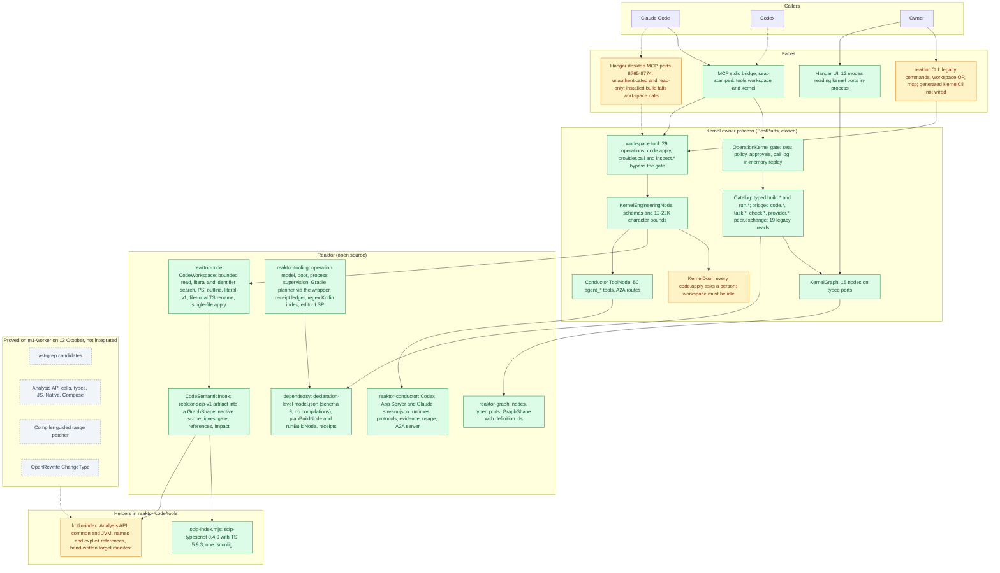
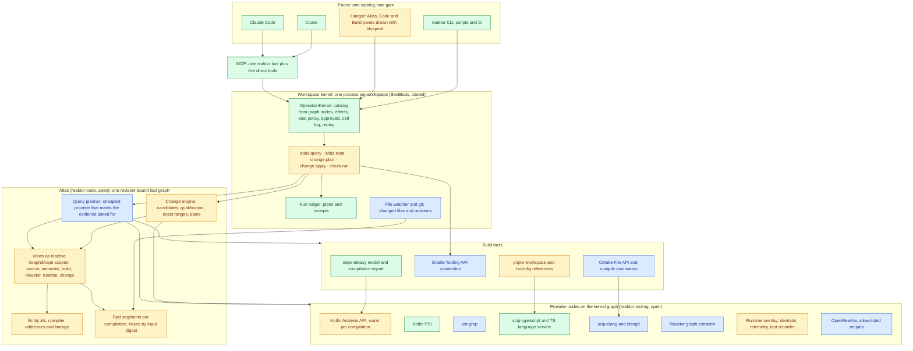
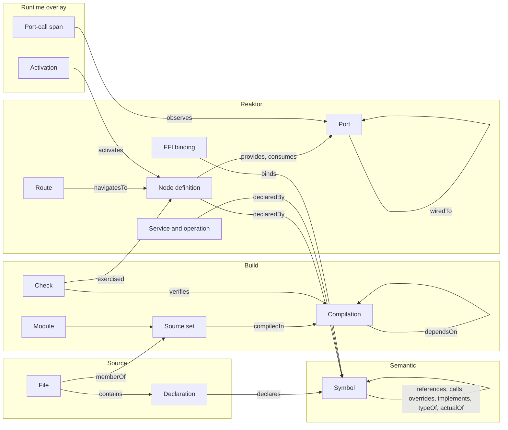
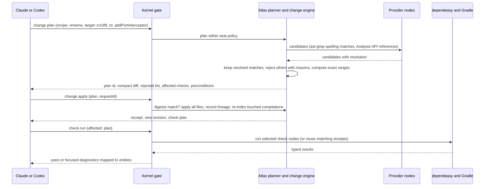

# Reaktor Atlas: one graph interface for coding agents

Written 16 October 2026 by Claude. Not published. Inputs: the Codex tool-experiment handoff ([code-tooling-experiment-handoff.md](code-tooling-experiment-handoff.md)) and its [evidence file](audits/kotlin-tools-20261013-evidence.json), the external review the owner pasted on 16 October, the existing [code/agent HLD](code-agent-hld.md), [kernel plan](reaktor-kernel-plan.md), [kernel handoff](kernel-handoff.md) and [token ROI analysis](token-roi.md), and a source scan of reaktor-code, reaktor-tooling, reaktor-conductor, reaktor-mcp, the graph modules, dependeasy, the BestBuds kernel, the CLI and Hangar. Nothing was built or run for this document, and no model was called.

## 0. Summary

**Proposal.** Build one revision-bound fact graph of the whole workspace, called the Atlas, inside the existing workspace kernel. Every engine we use (Kotlin Analysis API, Kotlin PSI, ast-grep, scip-typescript and the TypeScript language service, clangd and scip-clang, dependeasy, the Gradle Tooling API, the CMake File API, OpenRewrite) becomes a provider node on the kernel's reaktor-graph. Their facts are stored in the graph's own `GraphShape` form, so code, build, app-graph and runtime facts share one shape and one set of identities. Claude, Codex, the CLI and Hangar reach it through five operations in the existing catalog and gate: `atlas.query`, `atlas.read`, `change.plan`, `change.apply` and `check.run`.

**Where we are.** The skeleton is right and the core is narrow. The kernel already derives its operation catalog from graph nodes and serves it to MCP, the CLI and Hangar through one gate. reaktor-code (under 1,000 lines of production code) already projects code facts into `GraphShape`. But Kotlin semantics stop at names and explicit references for common and JVM code, fed by hand-written manifests; the build model exports no compilations; changes are single-file and every one waits for a person; nothing selects affected checks; and code and app graphs are not linked.

**What the experiments decided.** The Kotlin Analysis API resolved 4,841 of 4,841 calls across seven KMP scopes and answers warm queries in 0.096 ms, provided it receives exact compilation inputs. ast-grep is fast but only finds candidates. A compiler-qualified, exact-range rename compiled first time where OpenRewrite's method rename broke the build. scip-java's Kotlin plugin (the maintained successor of the archived scip-kotlin), Kotlin LSP servers and Graphify are not fit for agents today. Most important: tooling that only adds context made a native Codex task 76% more expensive, so the interface must take reads, edits and repair loops away from the agent.

**What reaktor-graph adds.** Every Reaktor+ app is a reaktor-graph declared in regular Kotlin, so the Atlas can see nodes, ports, wiring, routes and services exactly. That turns architecture questions into single queries, stops impact analysis at port contracts, lets tests record the nodes they exercised for exact test selection, enables recipes at architecture level, and joins source definitions to live telemetry through the graph's definition ids.

**Expected improvement.** For a normal week of Kotlin Multiplatform work, the target is 25-45% fewer input tokens and 20-35% fewer requests per accepted task, with 60-90% savings on structural questions and on refactors that have a qualified recipe. These are targets for the matched-task measurement in §5.4, and they depend on agents using the Atlas in place of whole-file reads.

**First steps.** Export compilations from dependeasy; extend the Kotlin producer to calls, types and compiler addresses with warm sessions in the kernel; ship `atlas.query`, `atlas.read` and a compiler-guided Kotlin `rename` through `change.plan` and `change.apply`; let agent seats apply deterministic in-scope plans without a person. The first gate is a real cross-module Kotlin rename done from both Claude and Codex with no whole-file reads and passing affected checks.

## 1. Where things stand

The layer has a sound skeleton and a narrow core.

The skeleton is the BestBuds kernel. It is one reaktor-graph, `KernelGraph`, with fifteen nodes wired through typed ports, hosting an `OperationKernel` whose catalog is derived from the operation and tool nodes attached to that graph. One gate applies the effect policy, single-use approvals, a call log and request replay. Agents reach it through two MCP tools, `workspace` and `kernel`, on a stdio bridge that stamps the harness's seat. The CLI and Hangar reach the same graph in-process.

The core is reaktor-code: under 1,000 lines of production code that give bounded reads, literal and identifier search, PSI outlines, and a semantic index loaded from a SCIP-shaped artifact. Two helpers produce that artifact: scip-typescript for one tsconfig, and the Kotlin Analysis API for declared common and JVM modules, covering names and explicit references only. The kernel can investigate a symbol within 12,000 characters and apply a single-file literal edit or a file-local TypeScript rename, each after a person approves. Everything the 13 October experiments proved beyond that (resolved calls and types, JS and Native compilations, compiler-guided multi-file rename, ast-grep, OpenRewrite) is not integrated.

### 1.1 Current architecture



Green works today for its stated scope. Amber exists but is unwired, narrow or blocks agents. Grey was proved in the experiment and is not integrated. Dashed arrows are connections that are configured but fail or are missing: the installed Hangar build lists `workspace` and answers "Unknown tool" when this session called it on 16 October (the 16 October Hangar scan traced this to a launchd owner running a classpath copied on 7 October), and BestBuds has no `.codex/config.toml` although AGENTS.md names one.

### 1.2 Component map

| Component | Where | What it does today | State on 16 October |
|---|---|---|---|
| Kernel graph and gate | BestBuds `KernelGraph`, `ReaktorKernel`; reaktor-tooling `OperationKernel` | Fifteen nodes on typed ports. The catalog is rebuilt from attached `OperationNode`s and `ToolNode`s on every call. Seat policy (default: allow up to `LiveRead`, ask up to `Destructive`), single-use approvals that expire after 15 minutes, a call log, replay of the last 256 effectful request ids in memory | Working; kernel K0 committed on 15 October |
| Operation catalog | `KernelOperations.kt` | Typed `build.list/show/tree/plan/run/receipts` and `run.list/show/logs/wait/cancel`; bridged `code.read/query/investigate/plan/receipt`, `context.query`, `task.*`, `check.*`, `provider.*`, `peer.exchange`; 19 legacy read tools | Working. `code.apply`, `provider.call` and `inspect.*` stay outside the catalog and its gate |
| `workspace` tool | `KernelEngineering.kt` | 29 operations with schemas and character budgets (12,000 for investigation and candidates, about 22,000 for queries, outlines and context packets) | Working |
| MCP faces | `KernelAgentMcpHost` (stdio), `ReaktorDesktopMcp` (HTTP), owner `/mcp` | Stdio serves `workspace` and `kernel` and stamps the launch seat. The desktop server is loopback-only, unauthenticated and refuses effects. The owner has a bearer token in `connection.json` | Stdio works. The installed desktop build lists `workspace` and fails the call. Seats are labels, not identities |
| CLI | `targets/reaktorCli` | Legacy `build`, `run`, `inspect`, `tools` commands, `workspace OPERATION --args`, `mcp`. A generated `reaktor <domain> <verb>` face with exit codes 0 to 3 | `KernelCli` is not wired into `Main.kt` |
| Hangar | `targets/reaktorDesktop`, `modules/engine` workbench | Twelve modes reading kernel ports in-process. Build panes read `model.json` directly. The Source pane uses the Kotlin language server through `CodeIntelligence` | No pane shows `code.*` results; the editor path and the agent path are separate |
| reaktor-code | `CodeWorkspace`, `CodeSemanticIndex`, `KotlinSyntax`, `CodeWorkspaceNode` | Bounded reads, literal and identifier search, PSI outline, a SCIP-shaped artifact index projected into a `GraphShape`, investigation, `literal-v1`, `scip-local-rename-v1`, single-file digest-checked apply | Working for one indexed target at a time. The index re-hashes every source and binary input, including the JDK image, on each request |
| Kotlin helper | `reaktor-code/tools/kotlin-analysis` | Analysis API 2.5.0-Beta2-59 over a hand-written `reaktor-kotlin-target-v1` manifest: common and JVM modules, named declarations and explicit name references, offset-based symbol ids | Narrow. Rejects any semantic error, plugin or other platform |
| TypeScript helper | `reaktor-code/tools/scip-index.mjs` | scip-typescript 0.4.0 with TypeScript 5.9.3 over one tsconfig without project references | Working for one target |
| reaktor-tooling | `operation`, `mcp/door`, `SupervisedProcessExecutor`, Gradle planner and ledger, `KotlinSourceIndex`, `PackageWorkspaces`, `lsp` | Operation vocabulary and gate, MCP door and approvals, process supervision, Gradle plan and run through the wrapper with request files, receipt ledger, a regex index of top-level Kotlin types, a pnpm workspace reader, the editor's Kotlin LSP session | Working. No Tooling API connection, no CMake reader, no compile-commands reader |
| reaktor-conductor | `appserver`, `cli`, `workspace` | Codex App Server and Claude stream-json runtimes (qualified against Codex 0.154.0 and Claude Code 2.1.270), protocols, evidence and acceptance, usage accounting, an A2A 1.0 server, 50 `agent_*` tools in one `ToolNode`, 214 tests | Working. It does not import reaktor-code and uses no graph ports |
| dependeasy | `model`, `gradle` | Schema-3 `model.json` of declared build nodes (584 nodes, 107 edges, 44 projects in the current Reaktor export), declaration sites, Gradle plans through `planBuildNode` (its `GradleInvocationTask` already uses the Tooling API for a dry-run), receipts from a `BuildEventsListenerRegistry` service (445 on disk) | Working for declarations, plans and receipts. It exports no compilations, source sets, classpaths, generated roots or project dependencies, and nothing evaluates its file inputs. The current export is stale because `local.properties` is a declared input |
| Native and web build facts | dependeasy `native`, `web` | CMake runs with `CMAKE_EXPORT_COMPILE_COMMANDS` on and a CMake File API codemodel query used only for static-library closure. A web contract and generated tsconfig per component; `tsc --build` checks | `compile_commands.json` files exist and nothing reads them. No lockfile parsing |
| reaktor-graph | `graph-runtime` `GraphShape`, `GraphDefinition`; `graph-port` | Live shapes with definition ids for scopes, nodes, ports and wires and a definition digest; ids flow into telemetry spans and service calls. Typed ports with interceptors, attachments and visitors | Working. Type names are simple names, nothing records a source site, the authored `GraphDefinition` IR has no producer, and no static view of graphs exists |
| reaktor-compiler | `FlexCoderProcessor` | A KSP processor that generates FlexBuffer coders for `@Struct` | Emits no graph facts; `ReaktorProcessor` is an empty slot |
| reaktor-ffi | `Runtime.h`, `interop {}` DSL | A `(module, operation, JSON)` bridge between Kotlin, C++ and TypeScript, with installers generated from the dependeasy DSL | No per-symbol binding manifest |

### 1.3 What is missing, most important first

1. **The build does not describe compilations.** The model has no Kotlin compilations, source sets, generated roots, classpaths, klibs, compiler plugins or project dependencies. The Kotlin helper therefore needs hand-written manifests, cannot see Compose or serialization plugins, and cannot cover JS, Native or Android. This is the root cause of the narrow semantic coverage, and the experiment showed that supplying exact inputs is what makes the Analysis API correct.
2. **Kotlin semantics stop at names.** The integrated producer records named declarations and explicit references for common and JVM modules. Calls, inferred types, overloads at call sites, overrides and expect/actual links are missing, and symbol ids are file offsets that change with every edit above them.
3. **There is no multi-file semantic change.** Plans are a literal replacement or a file-local TypeScript rename, applied to one file. Every apply waits for a person and for an idle workspace, so agents edit with their native tools.
4. **Nothing selects affected checks.** There is no affected-target logic anywhere, no map from source sets to build nodes, and dependeasy's file inputs are written but never evaluated. Agents rebuild modules and read raw output.
5. **Code and graphs are not joined.** reaktor-code knows symbols, the graph knows live definitions, and nothing links them: no static view of graphs, no source sites, simple class names in shapes. Architecture questions still mean reading constructors across modules.
6. **The agent surface is fragmented.** There are three MCP servers with different authentication, operations outside the gate, an unwired CLI face, 50 conductor tools behind one tool node, and installed binaries that lag the source. AGENTS.md still describes the older door, and BestBuds has no Codex MCP configuration.
7. **Agents use the tools on top of their old workflow.** The 12 October comparison cost 76% more fresh input with tooling because agents also read the whole files. Nothing yet replaces the read, the edit or the build loop.

## 2. What the experiments tell us

The 13 October experiments ran on m1-worker over a frozen corpus of 3,059 authored Kotlin files (19.7 MB) from Reaktor, BestBuds and Manna. They made no production edits and called no models. The 11 and 12 October runs measured real native Codex sessions. All 31 positive assertions in the evidence file replayed on 16 October. Six conclusions follow, most important first.

**1. The Kotlin Analysis API is accurate across our KMP code once it has the exact compilation inputs, and it is fast once warm.** It resolved 4,841 of 4,841 call expressions in seven scoped contexts: common/JVM, common/JS, iOS Native with Foundation and cinterop, the graph ports, a BestBuds model, Manna's date library and a 61-file BestBuds Compose scope. It told apart overloads, import aliases, extension functions, suspend calls and inferred return types. A cold scope took 2 to 11 seconds and 350 to 800 MiB. A warm repeated call resolution took 0.096 ms. The Compose scope reported 168 missing-resource errors until the four generated Kotlin resource files were added. Semantic accuracy is therefore a build-layer question: whoever supplies the source sets, generated sources, dependsOn edges, klibs, jars and compiler plugins decides whether the answer is right.

**2. Tooling that adds context without removing work costs more.** In the 12 October matched Codex runs (rename `Sealed.nonce` to `iv` across two Crypto files, two pairs, all four attempts correct), the tooling arm used 76% more fresh input and 29% more time. The agents read the complete files anyway and then also read the graph context. In the 11 October bounded-question run, one investigation replaced four reads and known operations ran without discovery calls: structured output fell from 8,172 to 2,008 bytes, MCP calls from three to one, generations from five to three and fresh input from 18,898 to 11,475 tokens. Both samples are small. Together they show that the interface must take reads, edits and repair loops away from the agent. A better answer that sits beside the old workflow raises the cost.

**3. Syntax tools find candidates, and the compiler decides identity.** ast-grep scanned all 3,059 files in 2.1 seconds with 58 MiB of memory. It also reported 516 grammar ERROR nodes in 154 files, about 5% of the corpus and mostly Compose syntax. In the rename experiment it produced eight identifier candidates for `addInterceptor`. The Analysis API kept the four real references and rejected four unrelated ones: an unrelated member, a local function-valued variable and their calls. A small patcher converted UTF-16 offsets to UTF-8 byte ranges and applied the four edits. The code compiled and behaved the same, and a second pass had nothing left to do. sed was not run; the fixture shows that a global substitution would have changed the unrelated names.

**4. OpenRewrite is a good engine for some typed JVM recipes and a poor default.** It parsed and printed 3,057 of 3,059 files in 44.5 seconds with 5.4 GiB of memory, and type-attributed 156,928 of 236,054 method invocations with one shared JVM classpath (all 489 of 489 in the graph scope with its real classpath). Its `ChangeType` recipe migrated `PortInvocation` to `PortCall` across four files, compiled and behaved the same. Its `ChangeMethodName` recipe failed on the same Kotlin extension function that the compiler-guided path renamed correctly: it changed one call, left the declaration and imports, and the result did not compile. Its second pass still reported zero changes, so idempotence says nothing about correctness. OpenRewrite's JavaScript and TypeScript module is published under Moderne's source-available licence, and Swift is not supported.

**5. External Kotlin indexers lag the compiler.** The experiment ran the right project: scip-java, which absorbed the Kotlin plugin when sourcegraph/scip-kotlin was archived in July 2026. Its published 0.13.1 Kotlin plugin failed at once on Kotlin 2.4.21 with an `AbstractMethodError` in its compiler-plugin registrar. The official Kotlin LSP listed KMP as future work, and the reviewed community KMP server used word search for references. Producing Kotlin facts ourselves on the Analysis API, and keeping SCIP as the storage and exchange shape, removes this dependency.

**6. Flow analysers answer questions graph traversal cannot, at a real cost.** CodeQL found 7 of 8 synthetic flows and Joern 8 of 8, but Joern crashed on the real common/JVM Crypto code and found 6 of 9 JCA lineage cases. First queries took 4 to 42 seconds. They belong behind a specific security or data-flow question and should run on demand.

| Tool (version run) | What happened | Decision |
|---|---|---|
| Kotlin Analysis API standalone (2.5.0-Beta2-71) | 4,841/4,841 calls resolved in 7 KMP scopes; 0.096 ms warm; 2-11 s and 350-800 MiB cold | Default Kotlin semantic engine, run warm inside the kernel |
| ast-grep (0.50.0) | 3,059 files in 2.1 s; ERROR nodes in 5% of files; 8 candidates, 4 qualified edits | Polyglot candidate finder and structural rewriter; never the identity source |
| Exact range patcher | 4 edits, compiled, behaviour unchanged, idempotent | Default edit engine for every recipe |
| OpenRewrite (8.90.4) | ChangeType passed; extension ChangeMethodName broke compilation; 5.4 GiB full parse | Optional engine for named, qualified recipes |
| scip-java Kotlin plugin (0.13.1) | Failed on Kotlin 2.4.21 | Not used yet; keep the SCIP shape and scip-java's symbol scheme for our own Kotlin facts, and qualify the first scip-java release built on Kotlin 2.4 |
| Kotlin LSP, community KMP LSP | Reviewed only; no KMP semantics | Editor use only |
| Graphify | Reviewed only; no gain over PSI and the Analysis API | Not used |
| CodeQL (2.27.2), Joern (4.0.654) | Partial results; crashes on real code | On demand for named security questions |

## 3. Which tools help most

The right tools depend on what we actually write. Counting authored files only (vendored Hermes and FlatBuffers excluded): Kotlin has 3,059 files. TypeScript has about 1,100, most of them Manna's web app (632) and API (287), plus BestBuds' companyOS, reaktorWeb and iOS driver scripts, Reaktor's graph-port and performance TypeScript and dependeasy's JavaScript. C and C++ live in reaktor-security's MLS libraries (core, C API, JSI and wasm bindings), reaktor-ffi's runtime kernel and reaktor-flexbuffer. Swift is a handful of app-shell files. Kotlin work therefore carries most of the value, TypeScript is second because of Manna, and C++ matters mainly at the FFI and security boundary.

The table ranks the tools by the value they add to this portfolio. The maintenance evidence was read from GitHub on 16 October 2026.

| Rank | Tool | Role in the Atlas | Why it ranks here | Maintenance |
|---|---|---|---|---|
| 1 | Kotlin Analysis API (standalone) | Symbols, references, calls, types, overrides, expect/actual for every Kotlin compilation | Most of our code; proven accurate on KMP; warm queries cost almost nothing | JetBrains development artifacts, latest 2.5.0-Beta2-71 at the 13 October capture; standalone mode is less stable than the IDE integration, so it stays isolated and pinned |
| 2 | dependeasy model plus a compilation export | The exact inputs per Kotlin compilation, the build graph, checks and receipts | Without it the semantic engine guesses or fails, as the Compose scope showed | Ours |
| 3 | Reaktor graph extractor | Nodes, ports, wiring, routes, services and operations as first-class entities | Every Reaktor+ app is a graph, so architecture questions get exact answers | Ours |
| 4 | Exact range edit engine with compiler-guided recipes | Rename and other symbol-level changes that compile the first time | Removes the read-edit-build-repair loop, which is where the 12 October run lost | Ours (proven in the experiment) |
| 5 | Affected-check selection | Which checks a change needs, with reasons | Shorter verification loops and smaller results | Ours (kernel K3 `build.affected` plus Atlas edges) |
| 6 | Gradle Tooling API | Long-lived build connection with typed progress, test events, cancellation and custom models | Faster, structured build feedback for the kernel | Part of Gradle |
| 7 | ast-grep | Fast structural search and rewrite in Kotlin, TypeScript, C++, Swift and more | Cheap candidate generation and bulk syntactic recipes | 0.51.0 released 15 October 2026; active |
| 8 | scip-typescript plus the TypeScript language service | TypeScript facts and rename for Manna and the web targets | Second-largest language | scip-typescript 0.4.0 released 2 October 2025 with commits through 15 October 2026; Manna uses TypeScript 6.0.3 while the helper pins 5.9.3, and the native TypeScript 7 compiler has shipped (7.0.2 is current), so the language service is the fallback |
| 9 | CMake File API, clangd and scip-clang | C++ targets, compile commands, references and rename at the FFI and MLS boundary | Small code share, high risk per change | CMake and clangd ship with their toolchains; scip-clang 0.4.0 released February 2026, commits through 11 October 2026 |
| 10 | OpenRewrite (Apache-licensed core) | Named Java/Kotlin migrations once a recipe is qualified | Useful for some type migrations; heavy and wrong on extensions | 8.93.8 released 15 October 2026; very active |
| 11 | SourceKit-LSP and swift-syntax | Swift navigation and rewriting | Almost no Swift today | Swift 6.4 / swift-syntax 604.0.0, September 2026 |
| 12 | Joern, CodeQL | On-demand flow and security questions | Narrow, expensive | Joern 4.0.657 (16 October 2026), CodeQL 2.27.2 (7 October 2026) |

Three tools stay out for now. scip-java's Kotlin plugin 0.13.1 fails on our compiler; its main branch moved to Kotlin 2.4.21 on 8 October, but no release has followed, and its Gradle trigger only covers JVM compilations. Kotlin LSP servers do not give KMP semantics to agents, although the editor keeps using one. Graphify adds nothing over PSI and the Analysis API for code.

## 4. Proposed HLD

### 4.1 The idea

Two pieces that already exist fit together. The workspace kernel builds its operation catalog by walking its own graph: `OperationKernel` collects every `OperationNode` attached to the kernel graph, and the CLI, MCP and Hangar all read that one catalog. reaktor-code already stores source facts in the graph's own inspection shapes: `CodeSemanticIndex` turns files and symbols into `NodeShape`s inside an inactive `ScopeShape`, and definitions and references into `WireShape`s.

The proposal joins them. Every engine (Kotlin Analysis API, Kotlin PSI, ast-grep, scip-typescript and the TypeScript language service, clangd and scip-clang, the dependeasy model, the Gradle Tooling API, the CMake File API, OpenRewrite) becomes a provider node on the kernel graph. Their facts go into one revision-bound fact graph, the **Atlas**, which uses the same shapes as the live app graphs. Agents, the CLI and Hangar reach the Atlas through five operations: `atlas.query` to find and traverse, `atlas.read` to read exactly the code they need, `change.plan` and `change.apply` to change code through compiler-checked recipes, and `check.run` to verify only what the change affects. These five sit in the existing catalog beside `build.*`, `run.*` and `task.*`, behind the existing gate.

The design has one aim: an agent should finish a task with fewer requests and less code in its context than it would need with grep, whole-file reads and native edits. Every element below is judged by that.

### 4.2 Proposed architecture



Green exists today, amber exists and must be extended, blue is new. Read the diagram from the top. A face sends one operation to the kernel. The gate checks the effect against the caller's seat and asks a person only when the policy says so. The five Atlas operations go to the planner (reads) or the change engine (writes). Both work on views of the fact graph, which are built from fact segments. A segment is produced by a provider node for one compilation and one set of input digests, so it is reused until those inputs change. The build facts tell every provider what a compilation contains.

### 4.3 The Atlas

**Entities.** The Atlas holds a small set of entity kinds, grouped into views:

| View | Entities | Produced by |
|---|---|---|
| Source | repository, file, declaration | file system, git, Kotlin PSI, ast-grep |
| Semantic | symbol (class, interface, object, function, property, type alias, parameter, local), type | Kotlin Analysis API, scip-typescript, scip-clang, clangd |
| Build | build, module, source set, compilation, external artifact, build node, check, artifact | dependeasy, Gradle Tooling API, CMake File API, pnpm and tsconfig |
| Reaktor | graph, node definition, port, wire, route, service, operation, FFI binding | Reaktor graph extractor, kernel catalog, reaktor-ffi declarations |
| Runtime overlay | activation, port-call span, test activation | devtools and rgp, reaktor-telemetry, the test recorder |
| Change overlay | plan, receipt, check result, finding | kernel ledger, conductor evidence |

**Relations and evidence.** Every relation carries a kind, an evidence strength, the producer and its version, and the digest of the inputs it was computed from. The strengths are: `declared` (written in a build script or graph DSL), `syntactic` (PSI, ast-grep), `resolved` (a compiler or type checker), `observed` (runtime or a test run) and `inferred` (a heuristic join, for example wiring matched by port type). A query states the minimum strength it needs. The planner never answers a `resolved` question from `syntactic` facts; it reports the gap instead.



**Identity.** Each entity gets a stable `EntityId` minted by the Atlas, plus the addresses its producers use. Addresses follow the SCIP symbol syntax so one string format covers Kotlin, TypeScript and C++; Kotlin and Java use scip-java's scheme (`semanticdb maven <group> <artifact> <version> <descriptor>`), so a future scip-java index and our own producer name the same symbol the same way. The current Kotlin producer identifies a symbol by its file path and character offset (`kotlin <module>/<path>#<offset>`). That address changes whenever text above the declaration changes, so a fact store keyed on it would be invalidated by almost every edit. Kotlin addresses should come from the compiler instead: the class id, or the callable id with its receiver and erased parameter types, plus the source set. Locals keep a file-scoped address. When `change.apply` renames or moves a symbol, it records the old and new address against the same `EntityId`. When an edit happens outside the Atlas, re-indexing links a vanished address to a new declaration with the same signature in the same file and marks that link `inferred`. Agents receive handles made of the `EntityId` and the revision, so a stale handle is detected and either re-resolved or rejected.

**Revisions and freshness.** A revision is the set of file digests across the workspace's repositories, including uncommitted changes. The kernel's file watcher reports changed files. The Atlas then invalidates only the facts whose input digests include those files: syntax facts per file, semantic facts per compilation segment, build facts per build-script digest. Every response names the revision it answers for and lists any stale or partial parts.

**Storage.** Three tiers, as the existing HLD already prescribes:

- A small durable core: entity ids, addresses, lineage, build and Reaktor declarations.
- Immutable fact segments, one per compilation and input digest, produced by a provider. Because they are content-addressed, another worktree or m1-worker can reuse a segment with the same inputs. The first segment format is today's `reaktor-scip-v1` JSON. It is bounded at 16 MiB, 4,096 documents and 200,000 occurrences. When a real compilation exceeds that, segments move to a binary encoding; reaktor-flexbuffer is the obvious candidate because it is ours and can be read without parsing.
- Views computed on request: impact cones, call paths and wiring maps, returned as `GraphShape` subgraphs, as `CodeSemanticIndex.sourceGraph` does now.

**The shape is the graph's own.** Each Atlas view is an inactive scope of the same `GraphShape` family that describes live app graphs. This is what makes the Atlas part of reaktor-graph: it is one more set of scopes in the graph's own shape. Hangar's blueprint renderer, the devtools wire and rgp/1 can carry Atlas results unchanged, and one traversal library serves both static and live graphs.

### 4.4 Providers are graph nodes

Each engine is a node on the kernel graph that provides one or more typed capabilities:

| Capability | What it answers | Providers |
|---|---|---|
| `SyntaxFacts` | outlines, declarations, structural matches | Kotlin PSI, ast-grep |
| `SemanticFacts` | resolve, references, calls, types, hierarchy, expect/actual | Kotlin Analysis API, scip-typescript, TypeScript language service, scip-clang, clangd |
| `BuildFacts` | modules, compilations and their inputs, checks, receipts | dependeasy, Gradle Tooling API, CMake File API, pnpm and tsconfig |
| `ReaktorFacts` | graphs, nodes, ports, wiring, routes, services, operations, FFI bindings | Reaktor graph extractor, kernel catalog |
| `RuntimeFacts` | activations, port-call spans, test activations | devtools and rgp, reaktor-telemetry, test recorder |
| `Rewriter` | candidate edits for a recipe | Analysis API, ast-grep, TypeScript language service, clangd, OpenRewrite |
| `CheckRunner` | run checks and return typed results | dependeasy nodes through Gradle |

Each provider node publishes a capability profile: languages, platforms, operations, evidence strength, cold and warm cost, memory, whether it can be cancelled, and its version. The Atlas finds providers by walking its graph, exactly as `OperationKernel` finds `OperationNode`s. Attaching a node registers the capability and detaching it removes it. A query that needs a missing capability returns `PROVIDER_UNAVAILABLE` and names the provider; it does not fall back to a weaker answer.

Graph scopes give providers their lifetimes. A warm Analysis API session lives in a child scope for its compilation group, and closing the scope frees its 350 to 800 MiB. The kernel keeps a small least-recently-used set of warm scopes under a memory budget. Everything else is indexed in the background at low priority, or on m1-worker when the Mac is loaded, and comes back as segments. Port interceptors, which the graph already has, enforce per-call time and byte budgets, emit a reaktor-telemetry span per provider call, and charge the cost to the task that asked.

The dependency direction stays as it is. reaktor-code defines the Atlas and the capability contracts and keeps its boundary (no tooling, LSP4J, UI or product dependency). reaktor-tooling, which already depends on reaktor-code, hosts the provider nodes that launch processes and speak to engines. The graph connects them through typed ports, so the Atlas never imports an engine.

### 4.5 The agent interface

Five operations carry almost all agent work. They share one request style and one response envelope.

| Operation | Purpose | Replaces |
|---|---|---|
| `atlas.query` | Find entities and follow relations; presets for common questions | grep, find, Explore subagents, chains of whole-file reads |
| `atlas.read` | Exact source for an entity: declaration, body, signature or file outline, with the resolved signatures it uses | whole-file reads |
| `change.plan` | A typed recipe against a target; returns a plan, a compact diff, rejected candidates with reasons, affected checks and preconditions | reading every affected file, native edits, sed |
| `change.apply` | Apply one plan by id with a request id; atomic, digest-checked, receipted, re-indexed | native edits and their repair loop |
| `check.run` | Run the checks a plan or revision affects; compact results mapped to entities; receipt reuse | full builds and raw build logs |

Long runs use the existing `run.show`, `run.wait` and `run.cancel`. Continuity uses conductor's `task.context` and `task.checkpoint`, which store Atlas handles so a new session can re-read exactly what it needs. Everything else stays reachable through `operation.catalog` and `operation.describe`.

**Selectors** name a starting point the same way in every operation:

| Selector | Example |
|---|---|
| handle | `{"id": "e:k3f9"}` |
| name | `{"name": "ConsumerPort.invoke", "kind": "function"}` |
| position | `{"path": "reaktor-graph/.../Port.kt", "line": 41, "column": 8}` (zero-based, UTF-16, as today) |
| file | `{"path": "manna/targets/api/src/routes.ts"}` |
| pattern | `{"pattern": "$G.addInterceptor($$$)", "language": "kotlin"}` |
| build entity | `{"module": ":reaktor-graph", "sourceSet": "commonMain"}` |
| Reaktor entity | `{"port": "AuthApi"}`, `{"route": "Settings"}`, `{"operation": "build.run"}` |
| change set | `{"changed": "worktree"}` or `{"changed": "origin/main"}` |

**Traversal** is a list of steps, each a relation kind with a direction and a depth of one to four: `contains`, `declares`, `references`, `calls`, `overrides`, `implements`, `typeOf`, `actualOf`, `memberOf`, `compiledIn`, `dependsOn`, `verifies`, `provides`, `consumes`, `wiredTo`, `navigatesTo`, `binds`, `observed`. A request also names the fields to show, the minimum evidence it needs and a byte budget.

**Presets** are stored queries with no special engine support: `map` (the workspace in about 2 KB: builds, modules with one-line purposes, graphs and entry points, recent changes, the open task), `investigate` (today's `code.investigate`), `explain` (what a module, node, port, service or operation is, what wires to it and what checks it), `impact` (dependents across compilations plus the checks that cover them, each with a reason), `wiring` (providers and consumers of a port type across graphs) and `affected-checks`.

A request and its response:

```json
{"op": "atlas.query", "args": {
  "from": {"name": "addInterceptor", "kind": "function"},
  "follow": [{"rel": "references", "dir": "in"}],
  "show": ["location", "snippet"], "need": "resolved", "budget": 6000}}
```

```json
{
  "revision": "rev:9c41",
  "items": [
    {"id": "e:k3f9", "kind": "function", "name": "addInterceptor",
     "signature": "fun Graph.addInterceptor(interceptor: PortInterceptor)", "at": "reaktor-graph-port/src/commonMain/kotlin/.../Interceptors.kt:41:5"},
    {"id": "e:p2a1", "kind": "reference", "from": "e:k3f9", "at": "reaktor-core/src/commonMain/kotlin/.../Setup.kt:88:9",
     "snippet": "graph.addInterceptor(TelemetryInterceptor(spans))"}
  ],
  "counts": {"total": 4, "shown": 4},
  "evidence": {"strength": "resolved", "producers": ["kotlin-analysis-api/2.5.0-Beta2-71"], "stale": []},
  "omissions": ["Generated sources of :reaktor-core jsMain are not indexed"],
  "next": [{"op": "change.plan", "args": {"recipe": "rename", "target": {"id": "e:k3f9"}, "to": "?"}}]
}
```

The `next` field carries ready-made follow-up calls built from the returned handles. The agent can send the next step without composing it from scratch and without an `operation.describe` round trip. Counts are always complete even when the byte budget cuts items, and the budget is enforced before serialization, so the JSON is never truncated.

**Projections.** MCP exposes one `reaktor` tool for every operation, with progressive disclosure through the catalog, plus five direct tools for the five operations above with their schemas inline (the kernel handoff's K9 step 3 and decision D5). The CLI exposes the same operations as `reaktor atlas query --json` and so on, with identical JSON. Hangar draws query results and views with blueprint in Atlas, Code and Build panes. All of them go through `OperationKernel.invoke`, so requests, approvals, call logs and receipts are shared.

### 4.6 Query planning

For each request the planner resolves the scope and revision, works out what evidence the question needs, reuses current segments when their input digests match, and otherwise runs the cheapest available provider whose profile meets that evidence. Results come back with their evidence and their omissions. A timeout, a missing classpath or an unsupported target becomes an explicit omission or an `UNSUPPORTED_SCOPE` error.

| Question | First choice | Next choice | Evidence |
|---|---|---|---|
| Declarations by name | durable core index | PSI outline of candidate files | syntactic |
| References or callers of a Kotlin symbol | semantic segment | warm Analysis API session | resolved (no text fallback unless the caller asks for `syntactic`) |
| Code matching a pattern | ast-grep | Kotlin PSI for files where the grammar reports ERROR nodes | syntactic |
| Type of an expression, overload at a call | warm Analysis API session | none | resolved |
| TypeScript references | scip-typescript segment | TypeScript language service | resolved |
| C++ references | scip-clang segment | clangd | resolved |
| Providers and consumers of a port | Reaktor facts | runtime overlay | declared, resolved, observed |
| Checks affected by a change | build view joined with semantic and Reaktor impact | full module checks, reported as conservative | declared and resolved |
| Data flow or taint | Joern or CodeQL, scoped, on request only | none | inferred |

### 4.7 Changes and verification



A plan is computed in five steps. The target resolves to exactly one entity; an ambiguous target returns the choices and never edits the first match. The recipe engine collects candidates from the semantic provider and, for coverage, from ast-grep spelling matches. Each candidate is qualified by resolution: kept if it resolves to the target, rejected with a reason otherwise, and reported if it cannot be resolved. Exact ranges are computed with UTF-16 to UTF-8 conversion, CRLF preserved, and imports and aliases handled. The plan is stored with the digest of every file it touches, the compact diff, the affected checks and the approval the seat policy requires.

Applying a plan checks every digest, writes all files through temporary files and renames, and records a receipt. If a write fails part-way, the receipt is marked uncertain and the retained originals are restored before anything else runs. Renames and moves record lineage. Touched compilations are re-indexed before the new revision is returned. Retrying with the same request id returns the same receipt.

The recipes form a closed set, and each one ships with its own qualification fixtures (aliases, overloads, local shadows, comments and strings, Unicode, CRLF, idempotence):

- `rename`: Kotlin first (class, function, property, extension function, type alias, with overloads, aliases, overrides and expect/actual handled as the recipe declares). This is the experiment's path made into a product. TypeScript renames move to the language service, and C++ renames use clangd.
- `edit`: a replacement the agent writes, anchored to an entity ("replace the body of `e:k3f9` with ..."), with the digest precondition. This lets an agent change logic it saw through `atlas.read` without a native whole-file read and edit.
- `structural`: an ast-grep rule, optionally filtered by resolution, for example only calls whose resolved callee is a given symbol.
- `change-type`: move uses from one type to another, through the Analysis API; OpenRewrite's `ChangeType` is the proven alternative engine.
- `move` and `change-signature`: after `rename` and `edit` are measured.
- `literal`: today's `literal-v1`.
- `openrewrite`: a named recipe from an allow-list of qualified recipes, run on m1-worker when memory requires.

**Authority.** Today every source edit through the tool path waits for a person. `code.apply` bypasses the operation gate, and `KernelDoor.admitCodeEdit` files an approval under the `engineering` seat for every edit, whoever the caller is; the workspace must also be idle. Meanwhile agents edit files freely with their native tools under their own permission mode. A prompt on the tool path therefore pushes them back to native edits and loses every benefit above. The proposal is a seat-policy setting, with no new mechanism: `change.apply` goes through `OperationKernel` like every other operation, and an agent seat may apply deterministic plans inside its own checkout and the task's declared scope without a person. Anything wider, non-deterministic or above `SourceWrite` still asks. The agent channel still never approves anything, and seats become authenticated principals with kernel K10.

**Concurrency.** Plans carry digests, and conflicting applications serialize through the workspace owner's existing admission lock. Parallel agents work in separate worktrees. Segments are keyed by input digest, so a new worktree reuses every unchanged compilation's facts.

### 4.8 The build layer

The Atlas needs five things from the build:

- for every Kotlin compilation: the module, source set and platform, the source files including generated ones, dependsOn edges, module dependencies, the resolved jars and metadata klibs, language and API version, compiler plugins and options, and the JDK;
- for every module: its checks (verify nodes, test tasks, Maestro flows) and the source sets each covers;
- for every TypeScript project: its tsconfig, project references, compiler version and dependencies;
- for every C and C++ target: sources, include directories, defines, flags, toolchain and outputs;
- receipts: which checks ran on which inputs with which results.

**dependeasy** is the source for Gradle builds, and this is the largest piece of new build work. The schema-3 model is declaration-level: it has build nodes, declaration sites, plans and receipts, but no compilations, source sets, generated roots, classpaths, klibs, compiler plugins or project dependencies. dependeasy already holds `CompilationRef`, `SourceSetRef` and `ConfigurationRef` handles in its DSL and visits every Kotlin compilation to publish outputs; it never serializes them. The model should gain a compilations section produced inside Gradle from the Kotlin plugin's own compilation objects, which know every input listed above. That section replaces the hand-written `reaktor-kotlin-target-v1` manifests the Kotlin helper needs today. Generated sources arrive as declared generated roots, which also satisfies reaktor-code's rule against reading arbitrary `build/` paths: the producer reads only roots the build declared. The same section maps source sets to the verification nodes that compile and test them, which is the missing link for affected checks.

Build facts must also survive ordinary staleness. `BuildModelReader.read` throws whenever any declared input changed, and `local.properties` is a declared input, so the current export is stale most of the time and about a quarter of the 445 receipts on disk were produced against a stale model. The Atlas serves the last good build facts with a stale flag, and the export should stop treating machine-local files as declarations.

**The Gradle Tooling API** is used today only inside dependeasy's `GradleInvocationTask`, which runs a dry-run with an init script to compute one node's task plan. No code fetches a Tooling API model, and no `ToolingModelBuilder` exists in any of the three repositories. The proposal gives the kernel a long-lived connection per build root. Through it the kernel asks for typed models (dependeasy registers a `ToolingModelBuilder` for its model and the compilations section, so nothing is parsed from files), runs builds with typed task and test progress events in place of the `@dependeasy-task` console lines, and cancels them with a token. Today `GradleBuildPlanner` starts the wrapper twice per node and writes request files. One constraint matters: `./gradlew` hands every build to `remote-dev`, which places it on m1-worker when the Mac is loaded, and a Tooling API connection bypasses that script. Placement therefore stays with remote-dev: a local connection when the Mac has room, and a worker-side runner that streams the same typed events when it does not.

**C and C++.** CMake already runs with `CMAKE_EXPORT_COMPILE_COMMANDS` on, so every native variant has a `compile_commands.json` under its `build/dependeasy/native` directory, and nothing reads them. dependeasy also already writes a CMake File API `codemodel-v2` query, used only to compute static-library closure. Reading the compile commands is enough to start clangd and scip-clang; extending the File API reader to targets, sources and compile groups gives the build view its C and C++ targets. This covers reaktor-security's MLS libraries, reaktor-ffi's runtime kernel and reaktor-flexbuffer.

**pnpm and TypeScript.** Workspace membership is read in three places today (dependeasy's `WorkspacePatterns`, its JavaScript `packages.ts` and reaktor-tooling's `PackageWorkspaces`), and nothing parses the lockfile. One reader for membership, the lockfile's package graph and each tsconfig's project references turns every TypeScript project into a compilation for scip-typescript and the language service. dependeasy's web contracts and generated tsconfigs already describe the Kotlin/JS components. Manna's web app and API are the first real use.

**Affected checks** follow from the joined views: changed files lead to source sets and compilations, then to dependent compilations; entities whose resolved references reach the changed declarations are added; Reaktor facts narrow the set at port boundaries (§4.9); the checks covering the result are selected, each with a reason. A retained receipt is reused only when its input manifest matches exactly. This is the kernel handoff's K3 `build.affected`, extended from build-input digests to semantic and Reaktor edges.

### 4.9 Using reaktor-graph everywhere in Reaktor+

Every Reaktor+ product is built on reaktor-graph: one global graph, a child graph per session, nodes with typed ports, routes and services. The architecture is therefore written in the code in a regular form that a compiler-backed extractor can read exactly. A generic tool sees classes and calls; the Atlas can see nodes, ports, wiring, routes and services. That gives seven capabilities no generic tool offers.

1. **Architecture questions become single queries.** Who provides `AuthApi`, which nodes consume it, which screens navigate to Settings, which services a client calls, which operations can write source: each is one `atlas.query` with the `wiring` or `explain` preset.
2. **Impact stops at port contracts.** A change inside a node that leaves its port types alone reaches other nodes only through behaviour, so the affected checks are the node's own checks plus the checks that exercise its ports. A change to a port type reaches exactly the wired consumers. File-level dependency closure cannot draw that line.
3. **Tests can report what they touched.** A test that builds a graph can record which node and port definitions it activated, through a recorder installed as a port interceptor in the test harness. That gives each check an `exercised` edge to the nodes it ran, which makes affected-check selection exact at node level without bytecode coverage.
4. **Recipes can work at architecture altitude:** rename a port, move a node to another module, add an operation to an `OperationNode`, wire a new consumer, split a service.
5. **Static and live graphs join.** Definitions carry `definitionId`s, live activations carry the same ids, and telemetry spans are recorded per port call. "Is this port called in production, how often and how slowly" becomes part of the answer about the code.
6. **Tools are nodes.** The kernel catalog is already derived from its graph. Atlas providers, recipes and checks are nodes too, so adding a provider means attaching a node, and every face gets it.
7. **Hangar draws the Atlas** with the same blueprint renderer it uses for live graphs, because the shapes are the same.

**How the extractor reads the graph.** Graphs are declared in ordinary Kotlin inside graph constructors, for example `class XGraph(parent): Graph(parentGraph = parent, label = "x") { val r = Route("/x") { Binding() }; Node(::Ctor); autoWire() }` in BestBuds' `BestBudsApp.kt`. Labels and route patterns are string literals, node types are constructor references, and port keys default to the delegate property names of `provides` and `consumes`. Service operations carry `OperationDescriptor`s whose request and response `SchemaRef` names default to the `@Serializable` class's qualified name. All of this is visible to the Analysis API with resolution. It is invisible to a KSP processor, which sees declarations but not constructor bodies, so the extractor belongs in the Kotlin semantic provider. `reaktor-compiler` is a KSP processor today (FlexBuffer coders for `@Struct`, with an empty `ReaktorProcessor`), and it can later emit the declaration-level facts (node classes, port properties, contracts) if the extractor needs a cheaper path.

**How static and live join.** Live graphs already have stable identities: `GraphShape.withDefinitionIdentity()` derives `graph:`, `node:`, `port:` and `edge:` ids from scope label paths, node labels, class names, routes and port keys, and reaktor-telemetry and service calls carry those ids. The extractor reproduces the same digests from source, so a definition found in code and a span observed in production carry the same id. Three of the changes in §4.9.1 make the join exact: qualified types (item 1), source sites (item 2) and definition ids in devtools (item 8).

#### 4.9.1 Where to use reaktor-graph more

The owner asked where reaktor-graph use can grow. These changes are ordered by how much they help the Atlas.

1. **Qualified types in shapes.** `Port.Type.type` and `NodeShape.type` hold the class simple name, so package and generics are lost, and two classes with one simple name collide. Adding the qualified class name as an attribute (and an attributes map on `PortShape` and `WireShape`, which have none) makes every live node and port resolve to exactly one source symbol. The digest can keep the simple name, so existing definition ids stay valid.
2. **A source site on graph entities.** No graph entity records where it was declared. The graph's typed attachments can carry a `SourceSite` (the same shape dependeasy's `BuildModel` already uses), filled by the extractor's table or, in debug builds, at construction. Hangar can then jump from any live node to its declaration, and agents can go from a span to code in one query.
3. **One definition form.** Three forms exist today and are not linked: the runtime port graph with random ids, the authored `GraphDefinition` IR used only by tests and docs, and `GraphShape` with derived ids. The static extractor can be the first real producer of `GraphDefinition`, with `GraphShape`'s ids, which gives the authored IR a purpose and gives rgp/1 its `DefinitionId` type.
4. **A test recorder.** A port interceptor installed by test harnesses records the node and port definitions each test activated (§4.9 item 3).
5. **Maestro flows record routes.** The same recorder in app builds used by Maestro links each flow to the routes and screens it visits.
6. **An FFI binding manifest.** Today the Kotlin, C++ and TypeScript sides of reaktor-ffi are linked only by `(module, operation)` strings declared in dependeasy's `interop {}` block, from which `NativeExportsTask` generates the C++ installer and the TypeScript registrations. Emitting those pairs, with the Kotlin export, C++ installer and TypeScript symbol for each, into the build model gives the Atlas exact `binds` edges across languages.
7. **The build model as a graph scope.** dependeasy's nodes become a `GraphShape` scope (nodes for build nodes; wires for consumes, produces and includes), so the Atlas build view, Hangar's Build view and rgp share one shape. Hangar's Build panes read `model.json` directly today.
8. **Devtools identity.** The devtools handshake sends `AgentRevision.Unknown.graphDigest` in BestBuds and `GraphTap` reports ports by runtime ids. Sending `definitionDigest` and definition ids lets runtime facts land in the Atlas without translation.
9. **The kernel and conductor as graph citizens.** Conductor attaches its 50 `agent_*` tools as one `ToolNode` and uses no ports. Exporting the kernel graph's own shape into the Atlas lets an agent ask which operation can change a given thing, and splitting conductor's tools into typed operations on `OperationNode`s puts them under the same gate and schemas as everything else.

### 4.10 Ownership and boundaries

| Owner | Responsibility |
|---|---|
| reaktor-code (open) | The Atlas: entities, identity and lineage, segments, views, planner, change engine and recipes; capability contracts; the Kotlin helper and SCIP helper executables; the range patcher. Boundary unchanged: no tooling, LSP4J, UI or product dependency. |
| reaktor-tooling (open) | Provider nodes that launch and talk to engines (Analysis API helper, ast-grep, scip-typescript, TypeScript language service, scip-clang, clangd, OpenRewrite); the Gradle Tooling API connection; the CMake File API reader; the pnpm reader; the operation vocabulary and gate it already owns. |
| dependeasy (open) | The compilations section of the model, the `ToolingModelBuilder`, CMake File API query files, check-to-source-set mapping. |
| reaktor-graph modules (open) | Shapes and scopes the Atlas reuses; the test recorder interceptor. |
| reaktor-conductor (open) | Task packets and continuity that store Atlas handles; usage measurement. |
| BestBuds kernel (closed) | Which provider nodes attach, seat policies, the operation catalog composition, the CLI, the MCP face and Hangar panes. |

### 4.11 Steering the agents

The 12 October result shows that a capability the agents ignore, or use on top of their usual workflow, costs more than no capability. Adoption is part of the design:

- a short section in AGENTS.md and CLAUDE.md saying which operation answers which kind of question, and that Atlas results are complete for their stated scope, so a confirming grep is unnecessary;
- the `map` preset loaded at session start (a Claude Code SessionStart hook; a first-step instruction for Codex), about 2 KB in the stable prefix in place of the usual opening exploration;
- direct MCP tools with plain descriptions and `next` hints, so the agent never pays a discovery round trip for the common path;
- structural questions answered in the parent session with `atlas.query`, where the agent would otherwise start an Explore subagent;
- the seat policy in §4.7, so the tool path is never slower to use than a native edit.

## 5. Expected improvements

### 5.1 Where agent tokens go

The 7 October transcript analysis in [token-roi.md](token-roi.md) gives the baseline. Claude averaged about 433K input tokens per response and Codex about 142K. Between 31% and 63% of responses were exploration. 56% of Codex file reads repeated a read from earlier in the same session, and 34% of reads after compaction revisited files already read. In the Claude sample, subagents consumed 21.9B input tokens against 16.2B for their parents. The 15 October usage audit adds that subagents now make 75-90% of Opus 5.5 calls, that average context is about 420K tokens, and that cache reads are 61% of cost.

Within one context window, input is roughly the number of requests times the stable prefix, plus each piece of new context times the number of later requests that still carry it. Context added early is paid again on every later request. The levers therefore act in this order: remove requests, keep large reads out of the context (especially early ones), then shrink each result.

### 5.2 Expected change by kind of work

These are targets to test, derived from the mechanisms and the small samples above. None is a measured result yet.

| Kind of work | Typical flow today | With the Atlas | Expected change | Basis |
|---|---|---|---|---|
| Structural question: where or how X is used, what implements Y | 4-12 requests: greps, 3-10 whole-file reads of 5-30 KB, sometimes an Explore subagent of 20-80K tokens | 1-2 requests returning 2-8 KB | 60-85% fewer input tokens and 70-90% fewer requests for that step | 11 October sample: 3 MCP calls to 1, 8,172 to 2,008 bytes, fresh input down 39% with an unoptimised flow |
| Architecture question in a Reaktor+ app: who provides or consumes a port, which screens reach a route | reads across several modules, or a subagent | one `wiring` or `explain` query | 80-95% fewer tokens for that step | mechanism only; measure |
| Symbol-level refactor across files (rename, change a type) | read every affected file (Claude's Edit requires a prior Read), edit each, build, read errors, fix misses | `change.plan`, `change.apply`, `check.run`: 3-4 requests and no file reads | 70-90% fewer input tokens when a qualified recipe exists; unchanged otherwise | experiment rename correct first time; 12 October shows +76% when the tool only adds context |
| Feature work (new logic) | whole files read to understand surrounding code, repeated reads | `atlas.read` of the relevant declarations and the signatures they use, `edit` recipe | 20-40% fewer input tokens | 56% repeated reads; 31-63% exploration responses |
| Verification loop | whole-module builds, raw Gradle output in context, reruns | affected checks, focused diagnostics mapped to entities, receipt reuse | 30-60% fewer tokens in verification turns and fewer build minutes | mechanism; measure |
| Session start and Claude-Codex handoff | renewed exploration after a new session or compaction | `map` preset plus a task packet holding handles | most of the opening exploration removed | 34% of post-compaction reads revisit files |
| Subagent fan-out for mapping | Explore subagents re-read what the parent then reads again | mapping answered in the parent | large cut in child tokens for mapping work | children 21.9B against parents 16.2B |

Across a normal week of Kotlin Multiplatform work, the combined target is **25-45% fewer input tokens and 20-35% fewer requests per accepted task, with no loss of correctness**. Wall-clock time should also fall for refactors and verification, because fewer builds fail and fewer checks run. Latency per query is small once warm: a warm semantic lookup measured 0.096 ms before transport, a full structural scan of all three repositories 2.1 seconds, and a cold compilation index 2 to 11 seconds in the background.

### 5.3 What would erase the gain

- Agents keep reading whole files and use the Atlas on top; this is exactly the 12 October result.
- Answers are stale or silently partial, so agents learn to confirm them with grep.
- Deterministic in-scope edits still wait for a person, so agents return to native edits.
- Discovery and schema round trips sit in front of every operation.
- Warm semantic sessions push an already loaded Mac into swapping; the memory budget and worker indexing exist to prevent this.
- Results ignore their byte budgets.

### 5.4 How to measure

Use the handoff's protocol: matched accepted tasks on both Claude and Codex, with the ordinary workflow as the control. Record fresh, cached and total input, output, requests, tool calls, repeated reads, elapsed time, setup cost, correctness, review and rework, for the parent and all children together, through conductor's existing usage records. Start with five task types: a cross-module Kotlin rename, a port-type change, a new operation on an `OperationNode`, a Manna TypeScript change and a failing-test fix. Keep an optimization only when it improves accepted work per token.

## 6. Delivery plan

Domains are ordered by leverage. Each lists what is done and what comes next.

**1. Kotlin semantic facts**
- Done: the isolated Analysis API producer for common and JVM compilations (named declarations and explicit references), bound to source and binary digests; `code.investigate` within 12,000 characters.
- Next: compiler addresses in place of offsets; resolved calls, inferred types, receivers, overload identity, overrides and expect/actual; JS and Native compilations (qualified in the experiment), Android after its own qualification; generated sources.
- Next: warm sessions hosted as kernel graph nodes under a memory budget, with background and worker indexing into segments.

**2. Build facts**
- Done: the dependeasy schema-3 model of declared nodes, plan and run through `planBuildNode`/`runBuildNode`, Gradle receipts, the Hangar Build view and the `build.*` operations.
- Next: the compilations section in the model, with source-set-to-check mapping (retiring hand-written target manifests); stale-tolerant reads; `build.affected` (kernel K3) extended with Atlas edges; the Gradle Tooling API connection with placement kept in remote-dev.
- Later: reading the existing compile commands and extending the CMake File API reader; one reader for pnpm membership, the lockfile graph and tsconfig references.

**3. Agent interface**
- Done: the `workspace` and `kernel` MCP tools, `code.investigate`, `code.query`, `code.plan`/`code.apply`, `operation.catalog`/`operation.describe`, and the generated CLI face (not yet wired into `Main.kt`).
- Next: `atlas.query` with selectors and presets (absorbing `code.investigate` and `code.query`), `atlas.read`, the shared response envelope with `next`, five direct MCP tools, and the seat policy for in-scope source writes.

**4. Change engine**
- Done: `literal-v1`, `scip-local-rename-v1` for file-local TypeScript symbols, sealed proposals and receipts.
- Next: multi-file atomic apply with lineage; Kotlin `rename` along the experiment's path; `edit`; `structural` with a resolution filter; `change-type`.
- Later: TypeScript rename through the language service, C++ rename through clangd, the OpenRewrite allow-list.

**5. Reaktor facts**
- Next: the extractor for nodes, ports, wiring, routes, services and operations; the `explain` and `wiring` presets; port-bounded impact.
- Later: the test recorder, the runtime overlay and FFI `binds` edges.

**6. Other languages**
- Done: scip-typescript for one tsconfig target.
- Next: TypeScript multi-project indexing for Manna, qualified on its TypeScript 6.0.3.
- Later: scip-clang and clangd for the MLS, FFI and FlexBuffer code; Swift only if Swift code grows.

**7. Adoption and measurement**
- Next: the AGENTS.md and CLAUDE.md map, the session-start `map`, and the matched task comparisons in §5.4.

**First completion gate.** One real Kotlin change, renaming an extension function or a port type across at least two modules, done from both Claude and Codex through `atlas.query`, `change.plan`, `change.apply` and `check.run`, with no whole-file reads of the edited files, compilation and affected checks passing, and a measured comparison against the ordinary workflow. This is the Codex handoff's gate made concrete.

**Fit with existing plans.** Kernel K1 (CLI), K3 (`build.affected`), K4 (one kernel process), K9 (direct MCP tools) and K10 (identity) carry the kernel side. dependeasy WP16 (model completion) is the natural home for the compilations section. The handoff's four next-slice steps are domains 1, 2, 4 and 3 here, in that order.

## 7. Decisions for the owner

1. Agent seats may apply deterministic plans inside their own checkout and the task's declared scope without a person. Recommended: yes. Without it, agents will keep using native edits.
2. Kotlin identities move from file offsets to compiler addresses, and existing Kotlin artifacts are regenerated. Recommended: yes.
3. At most two warm semantic sessions on the Mac; heavier indexing on m1-worker; segments shared by input digest. Recommended.
4. MCP shape: one `reaktor` tool plus five direct tools. Recommended.
5. OpenRewrite: only the Apache-licensed modules, an allow-list of qualified recipes, run on the worker. Recommended.
6. The Atlas lives in reaktor-code (open), provider nodes in reaktor-tooling (open), composition in the closed kernel. Recommended.
7. A graph recorder in test harnesses for node-level test selection. Recommended; it is small and makes affected checks exact.
8. Names: `atlas.query`, `atlas.read`, `change.plan`, `change.apply`, `check.run`, with today's `code.*` names kept as aliases until every face has moved.

## 8. Where this differs from the external review and the Codex handoff

**The external review** is right about the main shape: Reaktor owns identities, the graph joins views without copying compiler trees, a planner picks the engine, changes are checked against revisions, each kind of fact has one owner, Swift needs SourceKit-LSP and swift-syntax, and OpenRewrite's JavaScript support has licence limits. Our evidence changes six of its recommendations.

- It lists SCIP as a Kotlin source "where supported". scip-java's Kotlin plugin 0.13.1 fails on Kotlin 2.4.21, so Kotlin facts come from our Analysis API producer, stored in SCIP shape with scip-java's symbol scheme so a later scip-java release can feed the same entities.
- It names OpenRewrite as a main Kotlin refactoring engine. On our code its method rename broke compilation on an extension function and a full parse needed 5.4 GiB, so the compiler-guided range path is the default and OpenRewrite handles allow-listed recipes.
- Its first phase is ast-grep plus graph entities. ast-grep reports ERROR nodes in 5% of our Kotlin files and cannot establish identity, so the first phase here is Kotlin semantics with exact compilations.
- Its agent surface has three operations: query, plan change, apply change. It leaves out bounded reads, which are what remove whole-file reads, and verification, which closes the loop. This design has five.
- It generates every patch in an isolated worktree. In Kotlin Multiplatform each new worktree pays Gradle configuration and indexing again. Digest-checked application in the agent's own checkout is enough for one agent; parallel agents get worktrees and share segments by input digest.
- It does not use what reaktor-graph gives us (§4.9): port-bounded impact, test activation records, architecture recipes and the static-to-live join.

**The Codex handoff** sets the right next slice, and this design keeps all four of its steps and its gate. It adds what the owner's wider scope needs: the dependeasy compilations section as the source of target manifests, compiler addresses for identity, `atlas.read` and the `edit` recipe to remove whole-file reads, the seat policy, the Reaktor extractor and test recorder, the Gradle Tooling API with remote-dev placement, the CMake File API for C++, and one interface across languages.

## Appendix: anchors

Code that the design extends:

- [CodeWorkspace](../reaktor-code/src/jvmMain/kotlin/dev/shibasis/reaktor/code/CodeWorkspace.kt): bounded reads, literal and identifier queries, PSI outline, SCIP artifact index, `literal-v1` and `scip-local-rename-v1` plans, digest-checked single-file apply.
- [CodeSemanticIndex](../reaktor-code/src/jvmMain/kotlin/dev/shibasis/reaktor/code/CodeSemanticIndex.kt): the `reaktor-scip-v1` reader that builds a `GraphShape` of `CodeDocument` and `CodeSymbol` nodes with `code.definition`, `code.reference` and `code.symbol-reference` wires; `query`, `investigate`, `symbols`, `sourceGraph`.
- [CodeWorkspaceNode](../reaktor-code/src/jvmMain/kotlin/dev/shibasis/reaktor/code/CodeWorkspaceNode.kt): the graph node that provides `CodeWorkspace` through a typed port.
- [Kotlin Analysis helper](../reaktor-code/tools/kotlin-analysis/Main.kt) and [SCIP TypeScript helper](../reaktor-code/tools/scip-index.mjs).
- [Operation vocabulary](../reaktor-tooling/src/commonMain/kotlin/dev/shibasis/reaktor/tooling/operation/Operation.kt) and [OperationKernel](../reaktor-tooling/src/jvmMain/kotlin/dev/shibasis/reaktor/tooling/operation/OperationKernel.kt): catalog derived from `OperationNode`s and legacy `ToolNode`s on the graph; one gate for effects, approvals, call log and replay.
- [GradleBuildPlanner](../reaktor-tooling/src/jvmMain/kotlin/dev/shibasis/reaktor/tooling/GradleBuildPlanner.kt), [GradleReceiptRunLedger](../reaktor-tooling/src/jvmMain/kotlin/dev/shibasis/reaktor/tooling/GradleReceiptRunLedger.kt), [GradleSourceRoots](../reaktor-tooling/src/jvmMain/kotlin/dev/shibasis/reaktor/tooling/GradleSourceRoots.kt), [PackageWorkspaces](../reaktor-tooling/src/jvmMain/kotlin/dev/shibasis/reaktor/tooling/PackageWorkspaces.kt) and [KotlinSourceIndex](../reaktor-tooling/src/jvmMain/kotlin/dev/shibasis/reaktor/tooling/KotlinSourceIndex.kt).
- [Kotlin language server owner](../reaktor-tooling/src/jvmMain/kotlin/dev/shibasis/reaktor/tooling/lsp/KotlinLanguageServer.kt) and [LSP session](../reaktor-tooling/src/jvmMain/kotlin/dev/shibasis/reaktor/tooling/lsp/LanguageServerSession.kt): editor intelligence, kept for the editor.
- Root `gradlew`: hands builds to `~/dev/tools/remote-dev`, which decides local or m1-worker placement.

Evidence:

- [Experiment handoff](code-tooling-experiment-handoff.md) and [evidence JSON](audits/kotlin-tools-20261013-evidence.json) (13 October tools; 12 October native comparison).
- [Code/agent HLD](code-agent-hld.md) (11 October bounded-question sample) and [token ROI](token-roi.md) (7 October transcript analysis).
- Maintenance dates read from the GitHub API on 16 October 2026: ast-grep 0.51.0 (15 October 2026); scip-typescript 0.4.0 (2 October 2025, commits to 15 October 2026); scip-clang 0.4.0 (23 February 2026, commits to 11 October 2026); scip 0.10.0 (3 September 2026); scip-java 0.13.1 (2 July 2026); OpenRewrite 8.93.8 (15 October 2026), whose `rewrite-javascript` module uses the Moderne source-available licence while the core is Apache-2.0, and whose old standalone `rewrite-javascript` repository was archived in May 2025; kotlin-lsp 263.6379.0 (3 October 2026); sourcekit-lsp swift-6.4.0 and swift-syntax 604.0.0 (15 September 2026); Joern 4.0.657 (16 October 2026); CodeQL CLI 2.27.2 (7 October 2026); TypeScript 7.0.2 (20 August 2026), with Manna on TypeScript 6.0.3.

## 9. Build plan and status

Started 16 October 2026 at the owner's request ("start building"). Codex keeps dependeasy WP13–WP18 and the CLI (K1); this build takes the MCP face (K9), the MCP deletions of K8, the gate parts of K7 it needs, and the Atlas. It edits Kotlin sources only, no build scripts, so it stays out of WP13's files.

| # | Slice | State |
|---|---|---|
| 1 | One server: the `reaktor` door serves the kernel catalog (`kernel` plus direct tools); `code.apply` and `provider.call` join the gate; Hangar's reads join the owner's catalog; the `workspace` meta-tool and the separate `reaktor-desktop` registration go | Code done 16 Oct: `KernelAgentMcpHost` lists `kernel` and the direct tools; `code.apply` (SourceWrite, its effect checked against the plan before anyone is asked) and `provider.call` (the effect of the provider tool named in the call) run only through `OperationKernel.invoke`; Hangar's reads are `hangar.*` operations, in process (`attachHangar`) and in the owner (`HangarLoopbackNode`). Live on the owner's Mac 16 Oct: new dist installed, BestBuds owner upgraded, `.mcp.json` and both Codex configs register only `reaktor`, Hangar reinstalled; the live `access.map` lists 135 operations, 21 of them `hangar.*` |
| 2 | Access map: `access.map` shows each face (Hangar, terminal, Claude Code, Codex, Antigravity), the servers it is configured with, and every operation's decision for its seat | Code done 16 Oct: `KernelAccess` (faces from `.mcp.json`, `~/.claude.json`, `.codex/config.toml`, `~/.gemini/config/mcp_config.json`, the spawned-task config; seats `*`, `cli`, `claude-code`, `codex`, `gemini`, `spawned`; findings for retired servers, wrong seats, missing launchers and folders, Codex trust). Hangar asks the running owner and falls back to the files when none answers |
| 3 | Atlas v0: `atlas.query` and `atlas.read` over today's facts (PSI outline, identifiers, the semantic index, the build model) with the shared envelope and `next` hints | Code done 16 Oct in the BestBuds kernel (`KernelAtlas.kt`); covers the BestBuds root only, because `CodeWorkspace` refuses paths outside it |
| 4 | Hangar: an Access view in Agent → MCP, then an Atlas view | Done 16 Oct. Access view (`AgentAccess.kt`, the first view of Agent → MCP; it replaced the machine-evidence drawer). Atlas view (`AgentAtlas.kt`, the second): a question box that takes a name, a file or position, `node:`, `op:` or a handle, with Find, Uses, Contents or Build tree; the answer is drawn with blueprint as a map and listed in a table with its evidence, omissions and next questions; the inspector reads a result's exact source through `atlas.read`. Hangar asks the running owner as seat `hangar` through `KernelAgents.ask` (`KernelOwner.kt`), the same gate the agents use, and says in plain words when no owner runs or the owner predates the `kernel` tool. `KernelAtlasTest`, `AgentPaneRenderTest` (a real owner on a temporary workspace) and flows F-AGENT-20 and F-AGENT-28 pass. Installed in Hangar 16 Oct |
| 5 | Build facts: compilations through a Gradle Tooling API model fetch; Kotlin compiler addresses; JS and Native compilations | Later |
| 6 | Change engine: multi-file atomic apply, Kotlin `rename`, `edit`, seat policy for deterministic plans (decision 1) | Later |

**Open on the owner's Mac (16 Oct).**
- Cut-over done 16 Oct. It surfaced a startup bug: an engineering descriptor (`kernel-connection.json`) left by a dead process made the new owner's `publish` throw, the owner then lost its lock and new sessions failed for about 15 minutes. `publish` and the server's `connect` now replace a descriptor whose endpoint is gone or answers as someone else, and the owner exits for launchd to restart it when startup fails after it opened the workspace. Still open: 20 `agent.*` operations declare no effect, so every call to them asks a person; remote-dev's appended `:exportBuildModel` currently fails on `kotlinAnalysisCompiler` resolution in dependeasy.
- `~/Library/LaunchAgents` holds 45 `build.reaktor.agents.*` services, all kept alive and started at login. 30 are for folders that no longer exist, mostly test temp roots. Of the 15 that run, 10 are the old conductor `workspace serve` service, and one of those serves `/`. Three fixes belong together: refuse `/`, the home folder and the temp folder as a workspace, and find the enclosing workspace when `--dir` is absent, as `AgentBundle` already claims; add a command that lists and prunes these services; stop tests installing them into the real home.

**Acceptance for slices 1 and 2.**
- `workspace mcp` lists only callable tools: `kernel` and the direct tools whose operations are in the catalog. No `workspace` meta-tool.
- `operation.catalog` includes `code.apply` (SourceWrite) and `provider.call` (the effect of the provider tool named in the call), each approved once by the gate, and Hangar's reads while Hangar runs.
- `access.map` returns faces, servers, per-seat decisions and findings, and Hangar shows it.
- `.mcp.json` in BestBuds and `~/dev` registers one `reaktor` server.
- Existing `OperationKernelTest`, kernel and engine suites stay green; new tests cover access decisions, per-call effects, the gate's approval reaching `code.apply`, and the server's tool list.

**Budget for slices 1 and 2.** reaktor-tooling: an `Access` enum, an `OperationAccess` row, `OperationKernel.access`, a per-call effect on `Operation`, and the spent approval on `OperationCall`. BestBuds kernel: `access.map` and its rows, two gate operations, one loopback operation node for Hangar's reads. No new module, dependency, flag or stored file.
