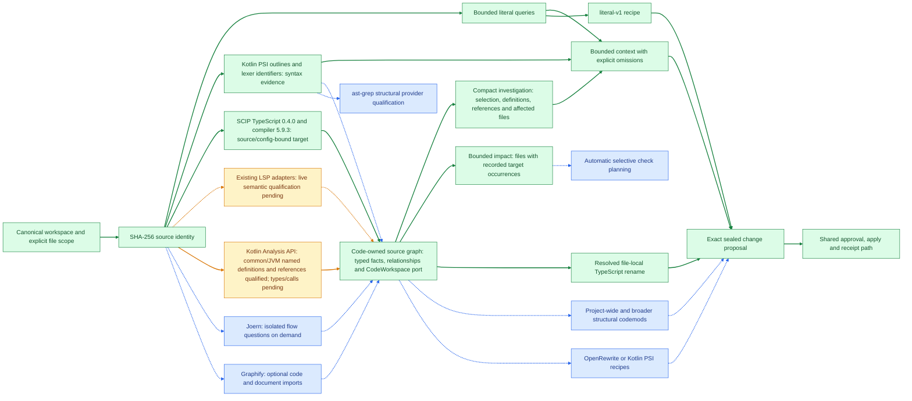
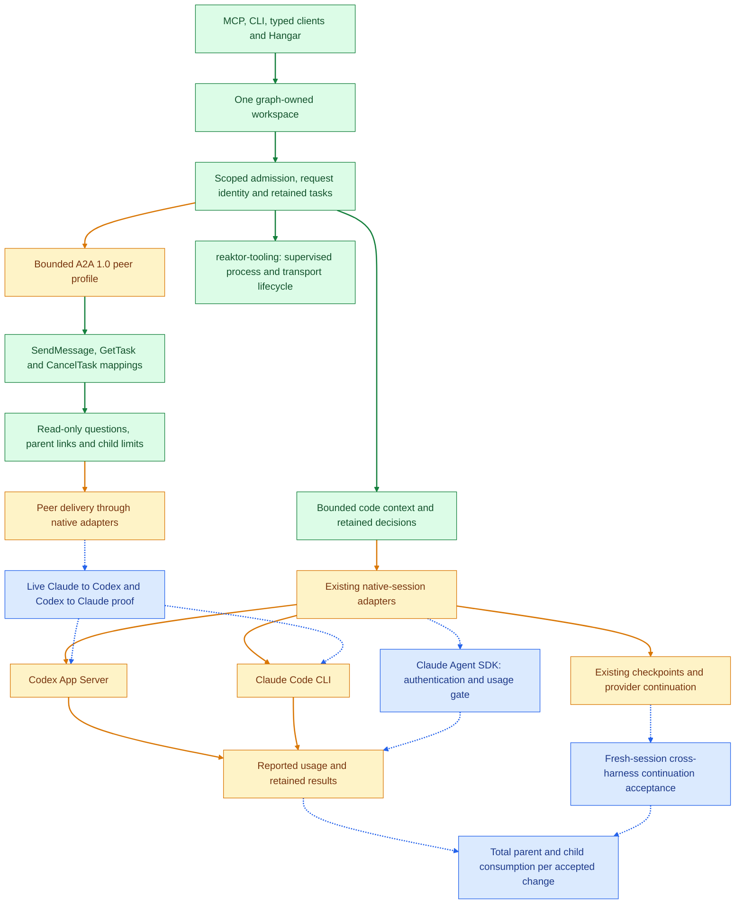
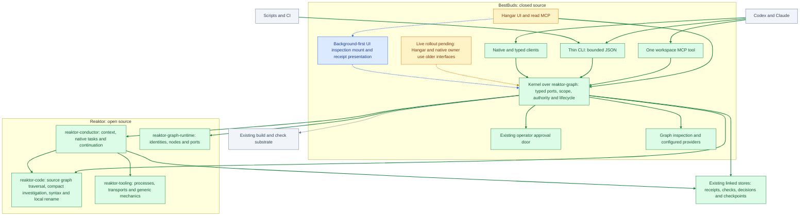
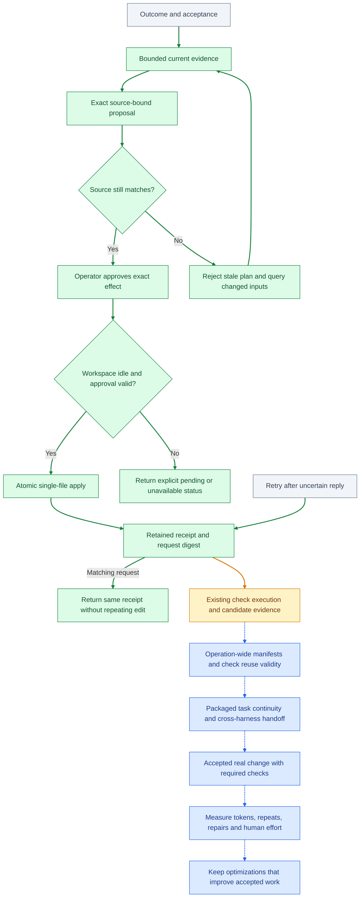

# Reaktor engineering HLD: implementation and qualification flows

The four views below follow the implementation priority: code intelligence, native cooperation, system ownership and acceptance economics. They describe logical capability and evidence flows, not process deployment or module imports.

**Legend:** green = implemented and qualified for the labelled scope; amber = existing implementation or adapter with live/complete acceptance still open; blue dashed = planned integration or qualification gate; grey = caller or established substrate. Green source edits qualify literal single-file edits and resolved file-local TypeScript rename. Broader rewrites, live model handoffs and measured subscription ROI remain open.

**Kotlin update, 12 October 2026:** an isolated Code-owned Analysis API helper now resolves named definitions and explicit source references for declared common/JVM compilations into the same revision-bound source graph. Real Reaktor Crypto qualification retains 307 occurrences and identical packaged CLI/MCP investigations, with source, common metadata, JVM libraries and JDK hashes checked on cached reuse. Thirty-four focused cases pass. The Kotlin node remains amber because types/calls, broader platform/plugin parity and transformations are still pending. The [qualification receipt](/Users/ovd/dev/tmp/kotlin-semantics-20261012/qualification.json) records the limited scope; daily owners/registrations remain unchanged.

**Live observation, 11 October 2026:** this Codex session connected over MCP to the workspace kernel on port 8766, discovered one tool and 28 operations, queried the current file with a matching SHA-256, retrieved bounded context and confirmed scope/effect rejection. The installed Hangar on port 8765 and the authenticated native owner on port 62150 remain older deployments; the native owner exposes 50 tools without `workspace`. The [live receipt](/Users/ovd/dev/tmp/engineering-kernel-20261011/live-connection.json) preserves these distinctions. The current source cannot be called a fully deployed single-owner system until those running instances are upgraded and reconciled.

Background-first workspace routing, owner identity, exact operator approval files, receipt replay, read-only rejection and lease preservation pass deterministic two-kernel tests. Mounting live Hangar inspection into that remote owner's graph and presenting its receipts in the UI remain open. No active service or harness registration was changed during the live audit.

The current Code path includes Kotlin PSI outlines/identifier tokens and qualified TypeScript SCIP navigation, graph-owned traversal, compact investigation, indexed-target impact and resolved local rename. The kernel consumes CodeWorkspace through the real headless graph provider/consumer port. Current focused acceptance covers thirteen Code, seventeen kernel and eight CLI cases. Earlier thirty-four end-to-end checks passed through copied normal CLI/agent distributions without class overlays or model calls, including existing operator approval, apply/replay, real TypeScript compilation, behavior and re-indexing. The [semantic receipt](/Users/ovd/dev/tmp/code-semantics-20261011/qualification.json) preserves that earlier evidence; the [investigation receipt](/Users/ovd/dev/tmp/code-investigation-20261011/qualification.json) records the additional graph and native acceptance. Active installations have not been upgraded.

The real SCIP helper indexed Reaktor's TypeScript performance target: thirteen source files and seventeen bound local inputs. For the same question, compact investigation replaces four separate reads: 8,172 → 2,008 structured bytes and 23.846 → 5.841 ms warm median over twenty alternating trials per path. The [standard performance report](/Users/ovd/dev/tmp/code-investigation-20261011/performance.json) links the JVM profile; the original measurement retains full precision and a 997.878 ms cold investigation. Two fresh native Codex sessions answered the same bounded question. Shared MCP descriptor guidance reduced discovery overhead from three to one MCP calls and reported fresh input from 18,898 to 11,475 tokens. The [native report](/Users/ovd/dev/tmp/code-investigation-20261011/native-performance.json) retains total and cached usage, generations and elapsed time. One run per variant is directional evidence, not general subscription ROI or Claude acceptance. Executable helper assets remain in the open-source Code checkout rather than the JVM distributions. The newly packaged workspace surface has twenty-nine operations; the live audit above describes older running versions.

### 1. Code intelligence and deterministic transformations

### 2. Native agent sessions and A2A cooperation

### 3. System ownership and agent access

### 4. Change verification, continuity and ROI

