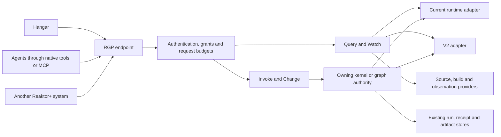
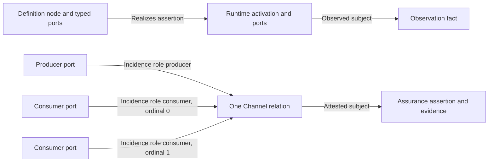
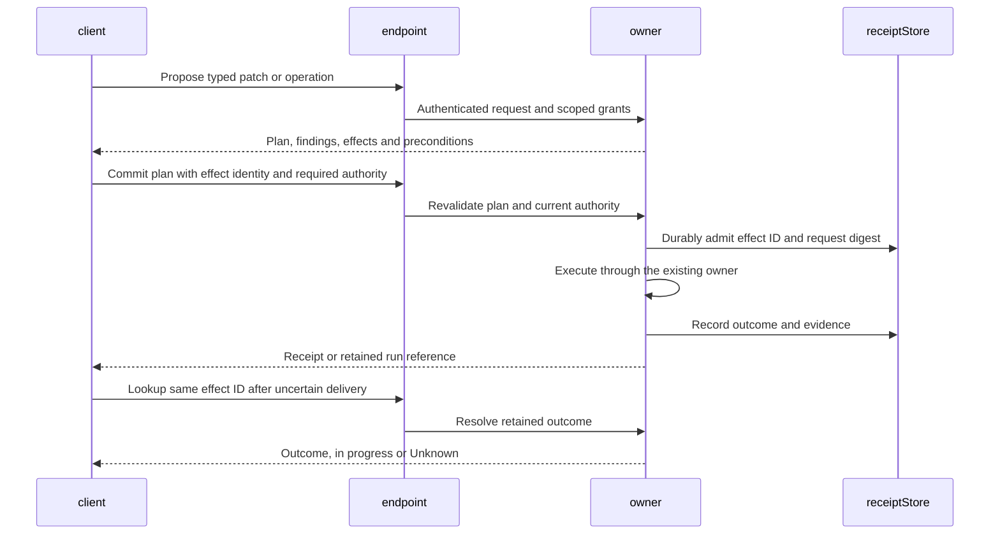

# Reaktor Graph Protocol HLD

Draft proposal, 16 October 2026. Audience: Reaktor runtime, kernel, agent, service and Hangar owners.

Adopt the v2 graph model at the protocol boundary now, and expose the current runtime through an adapter. RGP should provide one set of graph references, contracts, queries, watches, operation calls and change receipts for Reaktor+ systems, agents and Hangar. Moving a host from the current runtime to v2 should replace its adapter and add capabilities; it should not replace client APIs or wire identities.

The protocol must stay independent of runtime version. This proposal uses the drafts' wire name `rgp/1`; it does not claim an implemented or frozen standard. V2 remains a draft, so compatibility depends on agreeing the semantic core below before freezing schemas.

## Architecture

Each owner exposes an RGP endpoint. An endpoint can serve several graph targets and delegate requests to their explicit owners. It can be embedded in an app, a headless workspace kernel, a service or a host process. The roles below are logical components and can share a process.



The read and write paths share identity, authorization and ownership. A query provider can publish facts without gaining permission to execute operations or commit definitions. The owner executes the operation; the endpoint does not introduce a second executor. The workspace kernel's existing `OperationNode` and `OperationKernel` are the initial invocation path.

A connection may attach to several authorized targets. An attachment is an ephemeral subscription and resource context; persistent references never depend on its handle. A directory or relay is optional. It does not own the graphs it routes to, infer production routes or confer authority on a caller.

## Scope of the common protocol

RGP carries graph interaction and explicitly exported typed operations. This covers inspecting an app, querying build dependencies, asking an agent to perform an admitted task, requesting a service action, proposing a source change and observing the resulting run.

The v2 paper deliberately excludes application-session transport from RGP. **This proposal adds an optional `Invoke` profile for exported graph operations.** It is a deliberate extension to the paper, motivated by the shared Reaktor+ operation surface. It reuses the protocol's contracts, grants and effect identities. It must be agreed as part of the design, rather than being presented as already specified by v2.

A normal service call can use this profile when it fits its contract. Media, bulk datasets, high-rate telemetry and application-specific streaming can use other declared realizations. Their graph identities, contracts, bindings and receipts remain inspectable through RGP. One graph protocol therefore does not require all application bytes to pass through a graph gateway.

For example, a build request is an exported operation that returns a run reference. Its logs and artifacts remain in their existing stores. An application RPC is a typed Session with an admitted realization. A database query stays an operation of its store; graph traversal does not become unrestricted row access.

## Current implementation and the required adapters

| Existing surface | What it supplies now | RGP treatment |
|---|---|---|
| Runtime `GraphShape` | Scopes, live nodes, nested ports, binary wires, routes and operation descriptions | Adapter into generic graph records, with runtime observation provenance |
| `withDefinitionIdentity` | IDs derived from scope paths, labels, types and routes; a normalized structural digest | Retain as derived identity evidence; do not promise rename stability or full artifact identity |
| Portgraph `GraphDefinition` | Structural regions, nodes, ports and role/ordinal incidences ending at ports | Reuse structural concepts; extend the protocol representation to arbitrary element incidences, layers and ownership |
| `OperationKernel` | Typed operation catalog and invocation with policy, approvals and call logging | Reuse execution and progressively add the stronger remote identity and outcome contract |
| Devtools agent | Capabilities, facts, graph snapshots, commands and bounded streams | Adapt observations and controls; preserve declared capability limits |
| Kernel `graph_describe` and `graph_query` | Bounded declared-system queries with coverage and freshness | Keep named queries as an initial Query provider and map MCP onto the same semantics |

The current `Graph.shapes()` watches back-stack and container changes. It does not establish a complete, replayable log of all structural changes. A compatibility adapter must initially advertise snapshot refresh, not lossless structural watch.

The current kernel replay cache is a bounded in-memory cache keyed by caller seat and request ID, populated after execution. It does not establish durable effect deduplication, request-digest checking or exclusion of concurrent duplicate executions. Those properties must be qualified before advertising the durable invocation profile.

## Graph records and identity

The wire model is a typed port hypergraph. It must not serialize the current `NodeKind`, `WireShape` or a loaded Kotlin object graph as the universal schema.

| Record | Essential meaning |
|---|---|
| Graph | Authority, graph identity, supported semantic profiles and declared consistency domains |
| Scope | Containment parent, layer, edit owner and applicable policy references |
| Node | Stable element reference, scope, qualified kind and typed facets |
| Port | Owning node, profile, contract reference, polarity and typed facets |
| Relation | Scope, qualified family or kind, contract or protocol reference and typed facets |
| Incidence | Relation reference, target element reference, role and ordinal |
| Contract | Versioned typed schema or protocol descriptor and full fingerprint |
| Fact | Subject reference, typed claim, provenance, freshness, assurance and coverage |

An incidence can target a node, port or relation. Executable connection incidences target ports. Assertions can refer to other relations, which allows a receipt or attestation to describe a particular binding. Hyperedges remain single relations with multiple incidences; clients must not expand them into an implicit clique of binary edges.

Containment is an acyclic forest. Ownership and dependency are distinct. The semantic vocabulary includes v2's connection families `Bind`, `Session`, `Channel` and `Transition`, plus assertions such as `References`, `Realizes`, `Observes` and `Attests`. Kinds and facets use qualified names with schema references. Unsupported required semantics cause refusal; optional unknown records can be retained and displayed opaquely.

The six v2 layers are source, definition, deployment, runtime, observation and assurance. Connections remain within a layer; explicit assertions relate layers. A definition node, its live activation and an observation of that activation are separate records.



Arrows in this diagram show references, not executable data direction.

Use these distinct identities:

| Identity | Purpose |
|---|---|
| `ElementRef(authorityId, graphId, elementId)` | Durable reference in the owner's namespace; labels and paths are display and lookup fields |
| Definition revision | Content identity of a committed definition within one consistency domain |
| Contract fingerprint | Identity of the typed interaction contract; says nothing about implementation equality |
| Artifact digest | Identity of the executable implementation or bundle |
| Configuration digest | Identity of the admitted configuration |
| Activation reference | Definition reference when known, host/place, instance key and host-issued epoch |
| View digest and cursor | Identity and progress of one authorized projection; never a substitute for definition revision |

Element IDs are authored or minted and persisted by their owner. Rename and move operations preserve them when the semantic element is preserved. Deletion does not allow reuse for an unrelated element. Foreign references always retain their authority namespace.

During transition, each reference declares identity quality: persistent, derived candidate or activation-local. A v1 runtime ID can be addressed within its host epoch. A derived definition ID can support a suggested match, but cannot silently become a persistent identity. Persisted source mappings or an explicit alias/migration record establish continuity across a rename or migration to v2. Ambiguous matches remain unresolved.

If a current target cannot supply a committed definition revision or artifact digest, that field is unknown. Its structural snapshot digest is reported as a view digest with its derivation, even if the legacy field was named `definitionDigest`.

The initial adapter must translate only semantics it can establish:

| Current observation | Protocol representation |
|---|---|
| Loaded scope, node and port | Runtime-layer records with their containment and activation-local or derived references |
| Actual same-process provider/consumer connection | One `Bind` relation with typed endpoint incidences, where its contract is known |
| DI can resolve a dependency, but no connection is observed | Resolution fact or candidate reference; not an invented active binding |
| Route or navigation target | A legacy route fact; a `Transition` only when its actual transition semantics are supplied |
| Service operation descriptor | Exported operation/Session contract to the extent described; a Kotlin type-name string alone is not a portable contract |
| Legacy relationship with incomplete semantics | Qualified legacy relation plus explicit missing semantics; no claim of v2 execution conformance |

The service and tooling operation descriptors currently come from different APIs. Their adapters must produce the common contract descriptor without pretending they already have identical schemas. An operation reference includes its owning graph/node or port and local operation ID; a dotted operation name is not globally unique.

## Protocol domains

Every endpoint supports Connect and bounded Query. All other domains and their individual capabilities are negotiated. A small app can offer snapshot inspection; a workspace owner can additionally offer invocation and changes. Neither is required to implement release orchestration to be inspectable.

| Domain | Main operations | Purpose |
|---|---|---|
| Connect | `hello`, `targets`, `attach`, `detach` | Authenticate; negotiate versions, profiles, limits and target grants |
| Query | `describe`, `resolve`, `select`, `traverse` | Read bounded graph slices, contracts, operation catalogs and facts |
| Watch | `open`, `credit`, `resume`, `close`, `reconcile` | Maintain a selected view with explicit continuity or reset |
| Invoke | `call`, `lookup`, `status`, `cancel` | Call an exported typed operation and follow its retained result or run |
| Change | `propose`, `check`, `approve`, `commit`, `lookup` | Prepare and authorize typed changes at their edit owner |
| Observe | `describe`, `subscribe`, `read` | Runtime facts, receipts and separately granted payload samples |
| Release | `offer`, `admit`, `activate`, `retire`, `lookup` | Optional host admission and activation under epochs |
| Assure | `status`, `attest` | Claims, evidence and verifier attestations |
| Federate | `export`, `watch`, `reconcile`, `revoke` | Authorized views exchanged between graph authorities |

Operation discovery is a Query projection over exported operation descriptors. The descriptor names its subject, owner, input/output contract, interaction shape, effects, availability and invocation capability. A port existing in the graph does not by itself make it remotely callable.

The earlier protocol draft's Mesh becomes Connect, Graph becomes Query and Watch, Revision becomes revision and activation queries, Edit becomes Change, and Wire/Value become separately authorized Observe capabilities. Lifecycle callback names are adapter inputs; clients consume generic records and view deltas.

## Messages and compatibility

Separate four version axes: RGP wire major, message schema, graph semantic profile and operation contract. A current runtime and a v2 runtime can both speak `rgp/1`. An endpoint's advertised capabilities state which semantics it can actually execute or validate.

The common frame carries a message kind, message schema reference, conversation/request ID, attachment and target reference, deadline, trace correlation and typed body. Streams add a stream ID and cursor range. Effectful requests add an effect ID and semantic request digest. The authenticated connection supplies the principal and verified delegation; a caller-provided principal string is not proof of identity.

An illustrative semantic request is:

```text
Invoke.call
  target: authority + graph + scope + environment
  operation: exported operation reference
  contract: schema identity + fingerprint
  input: typed arguments or an admitted artifact reference
  expected: definition revision and/or activation epoch where relevant
  plan: optional prepared plan reference, required by applicable policy
  effect: effect ID + request digest
  deadline: execution admission deadline
```

This is a logical shape, not the final field encoding. Routing context cannot silently override a request's environment or activation expectation.

Use the existing FlexBuffers direction for a binary carrier, with keyed control messages first. Positional decoding is allowed only for an exact negotiated fingerprint. Compatible keyed decoding follows explicit schema rules. Unknown optional fields survive proxying; unknown required fields or methods return a typed unsupported result. A server never silently ignores a requested action.

Contract compatibility is directional and includes interaction shape and required semantics, not just matching field names. An older client may display an unfamiliar relation opaquely while being unable to modify or invoke it. Adding a v2 capability does not authorize a lossy adapter or automatic downgrade of an effectful request.

Errors use stable typed codes such as Unsupported, InvalidRequest, Forbidden, Conflict, BudgetExceeded, CursorExpired, TargetUnavailable and OutcomeUnknown, with bounded structured details. Retry advice does not authorize retrying an uncertain effect with a new identity. Discovery and error details obey the same visibility rules as ordinary queries.

Define canonical semantic bytes before signing or hashing patches, plans, releases and views. Sorted map keys alone are insufficient. Canonicalization must specify field presence and defaults, integer and floating representations, string bytes, map ordering, sequence ordering, unknown fields and hash-domain separation. Fingerprints carry an algorithm identifier and full digest; truncated display hashes are not authority keys. A signature binds its object type, authority, target and expiry where applicable.

Column chunks can optimize large slices after the semantic schemas are stable. Network framing must still bound frame and decoded sizes, validate offsets and declare buffer ownership. A binary layout does not itself guarantee zero-copy operation across runtimes.

## Reading and maintaining a view

Query executes at the provider that owns the data. Start with named bounded queries such as subject, dependencies, dependents and impact, then add a typed traversal expression profile. Arbitrary uploaded code is not a query language. Every request has limits for depth, returned records, bytes and work; the owner enforces the tighter of the request and grant budgets.

A slice contains summaries and the records needed to keep its references meaningful: ancestor scopes, requested ports and relations, incidences, and declared boundary references. Detail is lazy. Large dataset rows and log bodies remain outside the structural slice.

Every answer states its revision or observation cut, producer epoch, origin, capture time, consistency guarantee, searched scope and coverage. Coverage distinguishes complete within the authorized view, truncated, unavailable, stale and opaque boundaries. Completeness never implies visibility of the entire system. Where existence itself is sensitive, filtering must not reveal an opaque stub or hidden count.

Absence can be concluded only within a declared complete scope. An unloaded target, denied scope or expired observation is not evidence that a dependency does not exist. Assurance, freshness, provenance, coverage and conflict remain separate fields, rather than one confidence score.

A provider may support `snapshotOnly`, `refreshableSnapshot` or `replayableView`. Only the last promises list-then-watch continuity:

1. Open a selected view and obtain a snapshot pinned to a cut, plus a cursor at that cut. Pagination stays pinned to the same cut and has an expiry.
2. Subscribe from that cursor. Deltas carry `from` and `to` cursors and one atomic batch of typed upserts, removals or declared aggregate differences.
3. Apply a batch only when `from` matches the applied cursor. Recognize exact duplicate delivery. Gaps, expired history and producer epoch changes require an explicit reset.
4. Resume after reconnect within advertised retention. Otherwise obtain a new snapshot. A progress bookmark does not promise indefinite replay retention.

Cursors are opaque and bound to the selected query, producer, epoch, visibility context and schema. Snapshot/watch handoff requires a producer barrier or an equivalent proven mechanism. Client-side diffing of occasional `GraphShape` snapshots cannot manufacture that guarantee.

Streams use byte and item credits, bounded queues, fair scheduling and bounded frames. A subscriber cannot stall graph execution. State deltas may be combined only when the combination preserves the resulting view; if the bounded buffer cannot preserve continuity, send Reset. Sample streams can drop with explicit gap counts. Dropping a structural removal and continuing as if the view were complete is invalid.

Merkle reconciliation is optional for stable containment-based projections, using digests of the authorized view. Arbitrary traversal aggregates may require a new snapshot. Unfiltered graph digests must not leak hidden changes.

For multiple authorities, an answer carries a revision vector and declared consistency. A negative or non-monotone cross-authority conclusion needs an established consistent cut or an unknown result. There is no fabricated global revision counter.

## Invocation and modification

All clients use the same operation owner. Hangar translates a gesture into an operation or patch proposal. An agent submits typed arguments. A peer system calls the same exported contract under its own grants. MCP and CLI translate these requests and outcomes; neither gets a separate policy or executor.

Read-only operations can execute directly under their grants and budgets. Effectful operations pass through the owner's preparation and policy path. Policy determines whether a particular plan needs human approval; the protocol does not introduce an unconditional approval prompt for every write.



The plan binds the target environment, exact inputs, base revisions/read set, affected owners, effect footprint, required evidence, expiry and policy requirements. Approval, when needed, binds the plan fingerprint and the approver's verified authority. At execution the owner rechecks grants, policy, revision preconditions and applicable activation fences. Relevant drift returns Conflict or requires a new plan.

Effect classes alone are insufficient. Preserve current local/source/device distinctions and include the affected resources, environment, read/write scope and reversibility in the typed effect footprint. Do not collapse the current `SafetyClass` taxonomy into an incomplete numeric ranking of v2 effects.

Remote execution needs an outcome contract that distinguishes admission from completion:

| Outcome | Client interpretation |
|---|---|
| ApprovalRequired or Conflict | Execution has not been admitted; resolve the stated prerequisite |
| Accepted with run reference | Owner admitted the work; watch or query the retained run |
| Completed with receipt | Operation reached its stated completion condition; inspect its result and evidence |
| Refused with no-effect receipt | Owner establishes that this effect identity cannot execute |
| Failed with receipt | Execution failed; receipt explicitly states completed effects and unresolved work |
| Unknown with lookup reference | Outcome cannot yet be established; reconcile before issuing a replacement effect |

A transport timeout is Unknown, not a no-effect failure. A reported application error does not imply rollback. Cancellation is an explicit request to the owner; acknowledgement does not establish termination or compensation.

The owner atomically claims an effect ID against the semantic request digest before execution. Concurrent identical requests join the same work. Reusing an ID with another target, operation or input is refused. The digest binds the operation contract, target, arguments, principal/delegation scope and applicable plan/preconditions, while excluding delivery-only fields such as trace IDs.

Effect records and their lookup retention are part of the advertised contract. An absent lookup record alone cannot establish that nothing happened. A no-effect conclusion requires the owner to fence or tombstone the identity so a delayed request cannot execute. Expired identities are rejected rather than accidentally treated as new work. External effects require downstream idempotency or reconciliation support; RGP does not create end-to-end exactly-once behavior by itself.

### Edit ownership

A scope declares its edit owner, and a prepared plan explicitly reports its write target. Requests may name an expected owner or target to catch mistakes; the owner validates it.

| Target | Authorized behavior |
|---|---|
| Source-owned structure | Typed source change through its adapter, pinned source revision, validation and elaboration into a new definition |
| Graph-owned definition | Typed patch committed by that graph authority with revision/read-set checks |
| Runtime activation | Explicit runtime operation, or a Release plan where replacement is intended; runtime edits do not silently rewrite source |
| Presentation | Layout or annotation edit in its own document and concurrency model |
| Store-owned data | Store operation under its own transaction contract; graph receives references and receipts |

Patch operations are typed and versioned, with explicit preconditions. There is no universal untyped `setProperty` escape hatch. Unknown required patch semantics are refused. A source-derived scope cannot be edited durably by changing its currently loaded shape.

Definition commit, host activation, data transaction and external effect are separate completion conditions. A cross-owner change is a plan with per-owner receipts and explicit compensation or forward recovery where supported. It is not a distributed ACID transaction. Hosts can admit or refuse releases independently; writes require fences enforced at the resource that accepts them.

## Reaktor+ communication and federation

A Reaktor+ system can act as both endpoint and client. It discovers an explicitly exported operation or application Session, checks its contract and admitted realization, obtains scoped authority and calls the owning endpoint. Peer messages are typed operations or declared Session messages with correlation and effect identity where appropriate. Receiving graph facts does not authorize peer execution.

Federation exports a selected view with its authority, revision, provenance, labels and expiry. Import retains foreign references and distinguishes imported facts from local declarations. A shared contract fingerprint establishes a potential compatibility match; an explicit binding and admission establish an actual communication route.

Environment and tenant boundaries apply to discovery, reads, watches, operations and federation. Cross-environment comparison is an explicitly granted read; it does not create a write route. A relay preserves authenticated delegation and cannot widen grants. Revocation ends the affected stream, invalidates its visibility-bound cursors and requires the client to discard or revalidate affected cached views. Withdrawing future access cannot erase bytes already delivered to another party.

Metadata and payload samples have separate permissions. Filtering happens before encoding, including names, counts and digests. Labels travel with facts and exported views; any declassification must be performed by a specifically authorized component. There is no ambient trust because an endpoint is on localhost or because the client is Hangar.

## Transport and module placement

The protocol is carrier-independent. Start with in-process/loopback transport and one authenticated remote carrier already appropriate to the owner. WebSocket can carry the logical streams; FFI/JSI and QUIC remain optional realizations. Do not require a new Switchboard or global broker to complete the first path.

Multiplexed WebSocket streams need fair queuing, small bounded frames and reserved control capacity. They still share a transport connection and its head-of-line behavior; logical stream credits do not provide network-level stream independence. Remote and local implementations must preserve the same authorization and outcome semantics.

| Boundary | Responsibility |
|---|---|
| Common protocol contracts | Frames, references, graph records, schemas, capabilities, queries, patches and outcomes; no Compose, workbench or product dependency |
| Graph semantics owner | Validation of signatures, relation laws, ownership and definition changes |
| Runtime adapters | Snapshot/event extraction, activation identity and translation into supported semantic profiles |
| Kernel and operation owners | Policy, plan validation, execution, durable effect admission and receipts |
| Service and IO carriers | Authentication binding, connection lifetime, framing and bounded delivery |
| Agent, CLI and MCP adapters | Bounded presentation and faithful translation of typed requests/results |
| Hangar and blueprint | Projection, layout and interaction; no direct mutation bypass |

Decide the precise common module placement after checking dependency direction. The wire model should not be added to the UI-bearing graph module simply because `GraphShape` lives near existing consumers. Existing stores keep their specialist ownership; the protocol references them instead of creating a universal graph database or scheduler.

## Adoption sequence

1. **Freeze the semantic boundary.** Agree references and identity quality, generic records and incidences, layer vocabulary, coverage, edit ownership, effect outcomes and capability negotiation. Publish schemas for both reads and writes before implementing only the read half.
2. **Deliver one complete inspection path.** Current application graph to its owner endpoint to Hangar, plus one bounded agent query using the same endpoint. Include contracts, provenance and explicit snapshot limitations. Start with one carrier and one target.
3. **Deliver one operation path.** Invoke an existing exported typed operation through the current kernel and return its receipt or retained run. Exercise authorization and uncertain delivery with the actual operation owner. Advertise only the supported durability profile.
4. **Deliver one modification path.** Prepare and execute one source-owned or graph-owned change, show its concrete plan and conflict result in Hangar and agent tooling, and query the resulting revision. Keep runtime replacement separate.
5. **Qualify continuous views and peer use.** Instrument a complete producer log where required, test snapshot/watch handoff, credits and reset, then connect a second Reaktor+ system with explicit contracts and grants.
6. **Add v2 behind the same endpoint.** Supply authored identities, hyperedge semantics, stronger validation, definition transactions and host admission through the v2 adapter. Add Release, Assure and Federate capabilities as their owners become ready.

This follows the current delivery priority: prove application-to-service-to-Hangar behavior before broad recovery or generalized reliability work, while keeping authority and correctness checks on that path.

## Conformance and decisions to settle

The common contract needs executable transcripts for these invariants:

- A client can inspect a current host and a v2 host using the same Query and slice schema; unsupported semantics remain explicit.
- Identical contracts with different implementations have equal contract fingerprints and distinct artifact identities. Renaming preserves an authored element identity.
- A paginated snapshot and resumed watch yield the same view as a fresh snapshot at the final cursor, or explicitly reset. Slow subscribers cannot block application execution.
- Different authorized views do not expose hidden identifiers, counts or raw graph digests. Revocation invalidates affected streams and cursors.
- Concurrent retries of one admitted effect do not start duplicate owner work. Digest mismatch is refused. A delayed request cannot run after a no-effect refusal has been recorded.
- Source edits cannot bypass source ownership, stale plans cannot commit, and local, MCP, Hangar and peer entry points apply the same owner policy.
- Multi-authority reads expose their revision vector; multi-owner execution exposes partial outcomes and per-owner receipts.

Four decisions should be resolved before calling the first version stable: the exact canonical encoding and schema-evolution rules; persistent identity allocation and rename/migration mappings; the scope of `Invoke` as a deliberate addition to the paper; and the minimum profiles with their retention and outcome guarantees. Transport optimization, a global broker and full v2 activation are not prerequisites to settle those contracts.

## Source references

The proposal above is distinct from implemented behavior. These sources anchor the current-state statements and the v2 compatibility choices:

- [Original v2 design PDF](/Users/ovd/dev/bestbuds/papers/reaktor-graph-v2/main.pdf) and [original protocol section](/Users/ovd/dev/bestbuds/papers/reaktor-graph-v2/sections/09a-protocol.tex). The original sources preserve semantics that were damaged in the docs conversion.
- [Earlier graph protocol draft](/Users/ovd/dev/bestbuds/targets/reaktorWeb/docusaurus/docs/reaktor-graph-protocol.md), including the specification-only status and Mesh, Graph, Wire, Revision, Edit and Value domains.
- [Runtime shape](/Users/ovd/dev/reaktor/reaktor-graph-runtime/src/commonMain/kotlin/dev/shibasis/reaktor/graph/core/GraphShape.kt:18), [shape observation triggers](/Users/ovd/dev/reaktor/reaktor-graph-runtime/src/commonMain/kotlin/dev/shibasis/reaktor/graph/core/GraphShape.kt:165) and [derived identity implementation](/Users/ovd/dev/reaktor/reaktor-graph-runtime/src/commonMain/kotlin/dev/shibasis/reaktor/graph/core/GraphDefinition.kt:6).
- [Structural portgraph definition](/Users/ovd/dev/reaktor/reaktor-graph-port/src/commonMain/kotlin/dev/shibasis/reaktor/portgraph/definition/GraphDefinition.kt:7), including the current port-only incidence endpoint.
- [Operation kernel](/Users/ovd/dev/reaktor/reaktor-tooling/src/jvmMain/kotlin/dev/shibasis/reaktor/tooling/operation/OperationKernel.kt:32) and [invocation replay behavior](/Users/ovd/dev/reaktor/reaktor-tooling/src/jvmMain/kotlin/dev/shibasis/reaktor/tooling/operation/OperationKernel.kt:55).
- [Devtools protocol](/Users/ovd/dev/reaktor/reaktor-devtools/src/commonMain/kotlin/dev/shibasis/reaktor/devtools/DevToolsProtocol.kt) and [bounded kernel graph queries](/Users/ovd/dev/bestbuds/modules/kernel/src/main/kotlin/ai/bestbuds/reaktor/kernel/mcp/KernelGraphQuery.kt:21).
- [Current kernel direction](/Users/ovd/dev/reaktor/plans/reaktor-kernel-plan.md) and [CLI and Hangar owner boundaries](/Users/ovd/dev/reaktor/plans/cli-kernel-hld.md).
