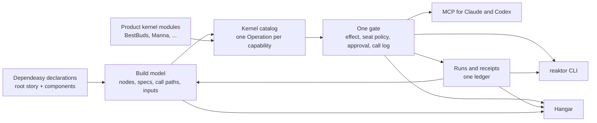

# Kernel, CLI, MCP and Hangar: handoff to Codex

Written on 15 October 2026 for Codex. Not published.

**Start condition.** Start after dependeasy WP11–WP18 in `dependeasy-handoff.md` are committed and its status table says so. There are two exceptions:
- **§3 applies to WP12 and WP13 now.** It raises the target for the root build scripts. `dependeasy-api.md` §4.4 points here. Read §3 before starting WP12.
- **K0 can start as soon as WP11 is committed**, if the owner agrees (decision D2). It lands work that is uncommitted and at risk today.

**Documents.**
- This file holds the work packages, their status and the log.
- `reaktor-kernel-plan.md` holds the design, written on 14 Oct. Where the two differ, this file wins.
- `dependeasy-api.md` defines the build DSL.
- `delivery-handoff.md` WP19–WP26 defines the deploy layer. This plan consumes its kernels and receipts and owns their CLI, MCP and Hangar faces.

## 0. Summary for the owner

Dependeasy, the kernel, the CLI, MCP and Hangar are one system. Dependeasy declares what exists. The kernel turns every declaration into an operation with an effect, a gate and a receipt. The CLI, MCP and Hangar are three faces on that one kernel. The result is that anything added in one place appears everywhere:
- a new build node is runnable from the terminal, by an agent and from Hangar;
- a new deploy kernel is planned, approved and receipted the same way on every surface;
- every run lands in one history that all three faces read.

The root build script will read like the product's story. In about twenty lines it says three things: what BestBuds is made of, how we know it works, and how it ships. Every name in it is a Kotlin value you can Cmd+click down to the kernel. `reaktor build explain` and Hangar show exactly what each line expands to. Nothing is discovered by convention, string or file scan.

Today's root is 259 lines. It holds 61 quoted paths, 35 string node names, 15 `packageAlias` calls, 15 `if`s, 6 loops, 14 file reads, 10 hand-built host requirements, and five near-identical device-flow blocks. Each of those moves to the component that owns it, to product data, or to a typed option the CLI already understands.

## 1. How the pieces compound



### 1.1 Add once, get everywhere

| You add, in one place | You get, with no more code |
|---|---|
| `val phones by verify(...)` in a build script | `reaktor build run phones`, MCP `build.run {node: "phones"}`, a node with a Run button in Hangar's Build view, a CI step, a receipt in the ledger, membership in `build.affected`, a line on the story page |
| A dependeasy `DeployKernel` (WP21) | `ship.plan`, `ship.apply`, `ship.verify` and `ship.rollback` on every face, with the gate's approvals and a deploy receipt |
| A typed `BuildOption` or `@Option` (WP12, WP15) | A CLI flag, an MCP argument and a Hangar form field, all validated the same way and recorded on the receipt |
| An `Operation` in a product kernel module | A CLI command with help, an MCP entry with schema and effect, a Hangar palette entry, a call-log line and a telemetry span |
| A change to the seat policy or approval rules | The same behaviour for the terminal, agents and Hangar |
| A receipt from any surface or from CI | Hangar's runs drawer, `reaktor run show`, MCP `run.show`, reuse and affected decisions, the story page status |
| A Hangar selection (environment, subject) | Request scope for operations started from Hangar; `reaktor open <ref>` lands in the same context |

### 1.2 One vocabulary

The words in the root script are the words on every face:
- `product`, `verify`, `artifacts`, `release`, `deploy`, `migrate`, environments and lanes;
- the kernel domains `build`, `ship` and `run`;
- the CLI commands and the MCP operation ids;
- the titles of the Hangar views.

A reader who learns the root script has learned the CLI.

### 1.3 Each face lends the others something

- **Dependeasy gives the kernel truth about the build:** what exists, where it is declared, what it consumes and produces, which kernel does it, and which host it needs. The kernel never guesses a script or task name.
- **The kernel gives dependeasy a runtime:** one place to plan, gate, run and receipt any node, from any surface, including Gradle-free kernels (WP16).
- **The CLI gives everyone the shortest loop and the scripting surface.** It replaces package aliases and ad-hoc scripts.
- **MCP gives agents the same operations with honest effects.** Agents run verification freely and wait for a person on anything above their seat.
- **Hangar gives the system a face for humans.** It shows the story tree, live runs, approvals, receipts and source navigation, and it answers approvals for the other faces.
- **Receipts close the loop.** What ran, on which inputs, with which result, feeds the next plan (reuse, affected) and every view.

## 2. What exists today

**Dependeasy:**
- WP0–WP10 are committed.
- WP11 is qualifying.
- Schema-2 model and reader with staleness.
- Gradle plans and receipts through `planBuildNode` and `runBuildNode`.
- `GradleReceiptRunLedger`.
- The Hangar Build view and the CLI and MCP drill-down from WP10.

**Kernel slice, built 14 Oct.** It is uncommitted. `reaktor-kernel-plan.md` lists the files.

| Piece | Where |
|---|---|
| Operation model: `Operation<I,O>`, `rawOperation`, `OperationDescriptor`, `CatalogEntry`, `Invocation`, `Outcome`, schema from serializer with `@Describe`/`@Subject` | `reaktor-tooling/src/commonMain/.../tooling/operation/` |
| The gate: `OperationKernel` (door seat policy, single-use `DoorApprovals`, `CallLog`, request-id replay, cheap `catalog()`, lazy `describe()`, legacy `ToolNode` adapter), `OperationNode` | `reaktor-tooling/src/jvmMain/.../tooling/operation/OperationKernel.kt` |
| BestBuds operations: `build.list/show/tree/plan/run/receipts`, `run.list/show/logs/wait/cancel`, 22 bridged engineering operations with explicit effects | `bestbuds/modules/kernel/.../kernel/KernelOperations.kt` |
| `ReaktorKernel.invoke`, `operationCatalog`, `describeOperation`; the owner's `kernel` tool | `ReaktorKernel.kt`, `KernelOperations.kt` |
| MCP stdio serves `kernel` with the harness's seat | `KernelAgentMcpHost.kt`, `AgentWorkspaceCli.kt` |
| Generated CLI face: `reaktor <domain> <verb>`, schema-driven arguments, `--json`, `--args -`, `--detach`, run following, terminal approval, exit codes 0/1/2/3 | `bestbuds/targets/reaktorCli/.../cli/KernelCli.kt` (not yet wired into `Main.kt`) |
| Tests | tooling `OperationKernelTest` (6), CLI `KernelCliTest` (5, one over the real owner wire), kernel and CLI suites 300 green |

**Known gaps:**
- Hangar still embeds its own control plane.
- `code.apply` and `provider.call` keep their own approval paths, so they are left out of the gate.
- The seat is attribution, not identity.
- The old CLI commands are still live.
- The 14 Oct slice depends on the uncommitted engineering-tools work in bestbuds: `KernelEngineering.kt`, `KernelAgentMcpHost.kt`, `KernelEngineeringConnection.kt`, `CodeEditAdmission.kt`, `modules/kernel/src/main/kotlin/dev/shibasis/reaktor/conductor/cli/`, their tests, and the matching deletions in reaktor `reaktor-conductor/.../cli/` and `reaktor-cli/`.
- Backup: `~/.reaktor/backups/kernel-cli-wip-20261014-2143.tgz`.

## 3. Orchestration altitude: the root reads like the product

### 3.1 What a reader must see in the root

Like a Compose screen, where `Scaffold(topBar, content)` says what the screen is before any drawing code, the root answers four questions in order:
1. **What is the product made of?** Its parts, grouped by role: the shared app, clients, services, sites, tools.
2. **How do we know it works?** The verifications, named by intent: `pr`, `phones`, `web`.
3. **How does it ship?** Migrations, deploys and store releases, in order, after which proof.
4. **Where does it run?** Environments and hosts, as values and modifiers.

Everything else is detail and lives below.

### 3.2 Why the planned root is still too low

The §10.5 target in `dependeasy-handoff.md` and the §4.4 target in `dependeasy-api.md` remove the plumbing. But they still read as a list of build-system nouns:
- `verify("appChecks") { tests(Suite.Jvm, projects.app, projects.design, projects.engine) }`
- `includes(Reaktor.build, Workspace.Verify)`
- `artifacts("buildAll", role = Workspace.Build) { includes(...six projects...) }`

To understand them, a reader has to know dependeasy's node kinds, roles and suites. The product's parts are never named as a group. Each check enumerates test suites per project instead of saying what it proves. And shipping is a set of unrelated statements, not a visible flow.

### 3.3 Four altitudes, one home each

| Altitude | Says | Home | Vocabulary |
|---|---|---|---|
| Story | what the product is, how it is proven, how it ships | root `build.gradle.kts`, `workspace {}` only | `product`, `verify`, `artifacts`, `delivery`, `release`, `deploy`, `migrate`, `include`, environments, lanes, `Run` modifiers |
| Components | what one part is, what it consumes, what it publishes, how it is tested | each part's own Gradle project | typed component DSLs (`library`, `androidApp`, `appleApp`, `webApp`, `workers`, `deviceTests`, `loadTests`, `docs`, ...) |
| Product conventions | product data and small composites | product `buildSrc` (`buildlogic`) | data objects (`BestBudsFlows`, `BestBudsWeb.Budgets`, `BestBudsDevices`), composites (`storeRelease`) |
| Kernels | how the work is done | dependeasy, five layers per capability (`dependeasy-api.md` §5) | Gradle API, files, processes, tools |

This is §10.5 with one altitude added on top. The story altitude composes facts that the components own. It never enumerates suites, files, flows or environment files.

### 3.4 Target: the BestBuds root

Names are illustrative; the shape is the point.

```kotlin
plugins { id("dev.shibasis.dependeasy.workspace") }

workspace(delivery = BestBudsDelivery) {
    val framework = include(Reaktor.build)
    includeIf(BestBudsOptions.IncludeManna, BestBudsBuilds.Manna)

    val bestbuds = product(shared = projects.app) {
        clients(projects.appAndroid, projects.appDarwin, projects.appWeb, projects.appBrowser, projects.reaktorDesktop)
        services(projects.workers, projects.reaktorServer)
        sites(projects.reaktorWeb, projects.companyOs)
        tools(projects.reaktorCli)
    }

    val pr by verify(bestbuds) {
        include(framework.verify)
        contracts(projects.workers)
        check(BestBudsChecks.CredentialContainment)
    }
    val phones by verify(projects.deviceTests, BestBudsFlows.Everything, run = Run.onPhones())
    val web by verify(projects.appWeb)
    val everything by artifacts(bestbuds)

    delivery(after = pr) {
        val schema by migrate(BestBudsDatabases.Main)
        val backend by deploy(bestbuds.services) { after(schema) }
        val sites by deploy(bestbuds.sites)
        val testflight by storeRelease(projects.appDarwin, Lane.TestflightInternal)
        val play by storeRelease(projects.appAndroid, Lane.PlayInternal)
    }
}
```

How it reads, line by line:
- **`include(Reaktor.build)`** brings in the framework build and returns a handle whose `verify` and `artifacts` are that build's own roles.
- **`product(...)`** names the parts. It returns a typed `Product` value whose `clients`, `services`, `sites`, `verify` and `artifacts` are plain properties built from those lists. Cmd+click shows them.
- **`verify(bestbuds)`** includes each part's own declared verification. The parts declare it in their components: unit suites, window tests, Hangar flows, contracts. `pr` adds what is not owned by one part.
- **`verify(projects.deviceTests, BestBudsFlows.Everything, run = Run.onPhones())`** names one suite. The data object is shared by the root and the `deviceTests` component. The modifier says where it runs.
- **`delivery(after = pr)`** is the shipping flow. Every child waits for `pr`, and the `after` edges inside give the order. `storeRelease` is a three-line product composite in `buildlogic`.

**The Reaktor root:**

```kotlin
plugins { id("dev.shibasis.dependeasy.workspace") }

workspace {
    val reaktor = product(modules = Reaktor.modules) {
        packages(Reaktor.Web, Reaktor.Mcp, Reaktor.GraphPort)
        native(Reaktor.Ffi, Reaktor.Flexbuffer)
        tools(Dependeasy.build)
    }
    val pr by verify(reaktor)
    val everything by artifacts(reaktor)
    delivery(after = pr) { val packages by publish(reaktor, Registry.GithubPackages) }
}
```

**A component that absorbs five root blocks and 15 aliases.** This is `targets/deviceTests/build.gradle.kts`:

```kotlin
plugins { id("dev.shibasis.dependeasy.device-tests") }

deviceTests(apps = BestBudsApps.Debug, defaults = BestBudsDevices) {
    val connect by suite(BestBudsFlows.Connect)
    val everything by suite(BestBudsFlows.Everything, environment = BestBudsEnvironments.Dev)
    val login by suite(BestBudsFlows.Login, environment = BestBudsEnvironments.Dev)
    val push by suite(BestBudsFlows.Push, environment = BestBudsEnvironments.Dev)
    val production by suite(BestBudsFlows.Production, environment = BestBudsEnvironments.Prod)
}
```

How the old pieces map:
- `BestBudsDevices` holds the team, the WDA bundle id, hooks and environment files, once.
- `BestBudsFlows.Everything` names a directory and its exclusions. The kernel lists the directory when it runs; the script reads no files.
- Platform, single flow and screenshots are typed options of the device-suite kernel. So `pnpm maestro:ios:login:screenshots` becomes `reaktor build run login --platform ios --flow login-screen --screenshots`, with the same flags in MCP and Hangar.

### 3.5 Where today's root goes

| Today, in the root | Goes to |
|---|---|
| `javascript("companyWeb")`, `javascript("bestbudsWeb")`, `javascript("reaktorDocs"/"reaktorWeb")`, `browserBundle`, `appleHost {...}` | each target's own component project (WP13) |
| `ArtifactSizeReport` registration, `SizeMetric`/`SizeBudget` lists, the budget script | `targets/appWeb` component `budgets(BestBudsWeb.Budgets)`; a dependeasy size-budget kernel; data in `buildlogic` |
| `credentialContainmentSmoke` command node | `BestBudsChecks.CredentialContainment`, a check kernel invocation in `buildlogic`; the root says `check(...)` |
| `dagger { option(DevTools, false) }` | the delivery declaration: CI runs `pr` and the delivery flow; the Dagger pipeline is generated from the story (WP22) |
| `reaktorVerify`, `appChecks`, `jsChecks`, `architectureChecks`, `pr` | `val pr by verify(bestbuds) {...}`; the suites are declared by each part |
| `portableChecks`, `desktopChecks`, `distributedChecks`, every `HostRequirement(...)` | host is declared once by the node that needs it (window tests need a desktop session); the planner groups by host; `Run` modifiers where the story chooses |
| `workerBundle`, `desktopPackage`, `androidArtifacts`, `webArtifacts`, `iosFrameworks`, `buildAll` | each component publishes its artifacts; the root says `artifacts(bestbuds)` |
| `browserCheck` web checks and Lighthouse | `targets/appWeb` component; the root says `verify(projects.appWeb)` |
| `external("iosRelease"/"androidRelease")` fastlane | `storeRelease(...)` in `delivery` |
| `workers { ... }` fleet | `targets/workers` component (`dependeasy-api.md` §4.5); the root says `deploy(bestbuds.services)` |
| five `deviceFlows` blocks, `mobileApplication`, `iosDebug` | `targets/deviceTests` component, as above |
| every `packageAlias` loop | deleted; typed options on the CLI (K1, K3); package scripts are no longer generated |
| `karateSuite`/`k6Suite` loops | `targets/contractTests` and `targets/loadTests` components with typed `mode` and `environment` options |
| `file(...).isFile`, `listFiles()`, `providers.environmentVariable` | kernels at execution time, or typed options with declared sources (WP15) |

### 3.6 No magic: three tests for every line

Higher abstraction must not hide anything. Every element of the story and component altitudes passes three tests:

1. **Read test.** Someone who knows the product but not Gradle can say what the line does. The owner reviews the bestbuds, reaktor and manna roots against this.
2. **Click test.** Every identifier resolves by Cmd+click to a Kotlin declaration. From any root element to its kernel class takes no more than story function → spec `emit` → kernel. A product composite such as `storeRelease` adds one hop and is recorded in the call path.
3. **Explain test.** `reaktor build explain <node>`, MCP `build.explain` and Hangar's Build view show the full expansion:
   - the call path;
   - every spec field, with defaults marked and where each default is defined;
   - the resolved child nodes and the effective host and run modifiers.

   Nothing runs that is not in the model.

**Allowed:** composition, explicit data flow and recorded expansion.
- Composition: functions that call other functions, like composables.
- Explicit data flow: a function sees only what is passed to it. `verify(bestbuds)` reads `bestbuds`; it scans nothing.
- Recorded expansion: the model stores what each call produced.

**Not allowed in the story or component altitudes:**
- discovery by file scan, naming convention, reflection, service loader or registry;
- strings that refer to build elements;
- ambient reads of files, environment or properties;
- task registration;
- third-party DSL types;
- loops or conditionals that generate nodes. These are allowed inside product composites, where the model records them.

### 3.7 Acceptance facts for §3

All of these come from model, runtime and API-dump facts, never from tests that scan source text:
- Every node declared by a root has a kernel with source, a spec, a declaration site and a call path.
- No two nodes declared by a root share a declaration site, so nothing was generated by a loop in the root.
- The workspace plugin's public API dump offers only `workspace {}` and the story vocabulary. It has no string parameter that names a build element and no third-party DSL type.
- No unowned tasks and no ambient reads from authored scripts, per the model and Gradle's configuration-cache report.
- `reaktor build tree` and Hangar print the same tree for bestbuds, reaktor and manna. Its top level is the product's parts, the verifications and the delivery flow.
- Every former `packageAlias` command has a `reaktor` equivalent, listed in the K1 mapping table.
- Report the root line counts before and after, and the number of distinct story functions used. These are reported facts, not limits.
- The owner reads the bestbuds root and says what it does without help.

### 3.8 What this changes in WP12 and WP13

- **WP12** adds the story vocabulary to the workspace plugin: `product`, `verify(parts)`, `artifacts(parts)`, `delivery`, `include` returning a handle with roles. The lower primitives stay available for the rare case. This is the Pareto rule in AGENTS.md §2.
- **WP13** converts the roots to §3.4 and moves everything in §3.5 to its owner. A `packageAlias` loop is deleted only after its `reaktor` replacement exists. Until K1 lands, WP13 keeps generated package scripts.
- **WP15's typed options** are what make the device, contract and load suites one node each with flags, instead of one node per combination.

## 4. Work packages

Each package lists its goal, steps, acceptance evidence, change budget and what not to do. Follow §7 after each package.

### K0 — Land the uncommitted work (after WP11, owner decision D2)

Goal: the engineering-tools work and the 14 Oct kernel slice are committed together and qualified, so nothing more is at risk.

Steps:
1. Inventory the uncommitted hunks in the paths listed in §2. Separate the engineering-tools work and the kernel slice from anything another agent owns. Ask before touching anything unclear.
2. Run the module checks:
   - reaktor `:reaktor-tooling:jvmTest` (operation and door tests), `:reaktor-conductor:jvmTest`, `:reaktor-mcp:allTests`;
   - bestbuds `:kernel:test :kernel:verifyKernelBoundary :reaktorCli:test`.
3. Commit by path in logical commits:
   - reaktor: the operation model and `CallLog` caller;
   - reaktor: the removal of the conductor CLI and `reaktor-cli` sources, which now live in bestbuds;
   - bestbuds: the engineering surface;
   - bestbuds: the kernel operations, MCP host and CLI face.
4. Push per decision D1.

Acceptance:
- Every listed suite passes, with counts recorded in the Log.
- `KernelCliTest.theCliAndMcpReachTheKernelThroughTheWorkspaceOwner` passes.
- `git status` is clean for the listed paths.
- The reaktor build has no references to deleted `reaktor-cli` sources.

Budget: no behaviour change.

Don't:
- commit another agent's hunks;
- change any behaviour to make a test pass without recording why.

### K1 — The CLI is the kernel's face

Goal: `reaktor` is generated from the catalog, the legacy commands are gone, and it starts instantly.

Steps:
1. **Wire `KernelCli` into `Main.kt`:**
   - pre-scan `--dir`, keeping `--workspace` as a compatibility spelling of the same option;
   - root help lists the domains from the cached catalog (`~/.reaktor/agents/<digest>/kernel-catalog.json`) without starting an owner;
   - an unknown domain or verb refreshes the catalog once.
2. **Delete the legacy commands** `snapshot`, `tasks`, `connections`, `plan`, `run <task>`, `inspect`, `tools`, the `workspace OPERATION --args` form, and the old `build` group. Print one replacement line for each old spelling:

   | Old | New |
   |---|---|
   | `plan <node>` | `build plan <node>` |
   | `run <node>` | `build run <node>` |
   | `workspace code.query --args …` | `code query --paths … --literal …` |
   | `inspect <tool>` | `<domain> <verb>` |
   | `tools` | `operation catalog` |
   | `snapshot` / `tasks` | `run list` and `build list` |
   | `connections` | `connection status`, until K8 types it |

3. **`reaktor mcp --stdio --seat <harness>`** serves the same server as `KernelAgentMcpHost.serve(root, seat = ...)`.
4. **Human output:**
   - tables for lists, with id, status and summary;
   - trees for `build.tree`;
   - one-screen summaries for runs and plans;
   - pretty JSON only for objects with no renderer.

   `--json` is unchanged.
5. **Completion.** `reaktor completion zsh|bash|fish` comes from the cached catalog. Subjects (build nodes, runs, tasks, environments) complete from a new kernel operation `operation.complete {operation, field, prefix}`. Each `OperationNode` can answer it for its own subjects.
6. **Install** through `targets/reaktorCli/tools/install --build`, and record the startup facts:
   - warm and cold `reaktor --help` outside a repository;
   - no workspace files touched;
   - no owner started.

Acceptance:
- On bestbuds:
  - `reaktor build tree` prints the story tree;
  - `reaktor build run <a verify node>` follows to a receipt and exits with its status;
  - `reaktor run list --json` is one JSON value;
  - an effect above the CLI seat in a non-TTY returns exit 3 and the approval id.
- Every former `packageAlias` command has a listed `reaktor` equivalent once WP13 has removed it.

Budget:
- one new kernel operation (`operation.complete`);
- no new flags beyond `--dir`, `--json`, `--args`, `--detach`, `--seat` and the completion command.

Don't:
- keep two spellings of one command;
- generate top-level commands from scripts or folders;
- start an owner for help, version or completion of static parts.

### K2 — Orchestration altitude (verify, or finish what WP12/WP13 did not)

Goal: §3 holds in bestbuds, reaktor and manna.

Steps:
1. Check each §3.7 fact.
2. Finish anything WP12 or WP13 left: the story vocabulary, the component projects for device, contract and load suites, the `buildlogic` data objects, and alias deletion.
3. The owner read review.

Acceptance: §3.7.

Budget: the story vocabulary listed in §3.8. Nothing else public.

Don't:
- add a story function used once;
- hide a product fact inside dependeasy (WP14).

### K3 — The build domain at full power

Goal: everything the model knows is an operation, and the kernel adds what only a runtime can.

Steps:
1. **`build.explain <node>`:** the spec field by field, defaults marked with where each is defined, the call path, resolved children and the effective host. This uses WP16's tree fields.
2. **`build.kernels`:** each kernel with its spec fields and tools.
3. **`build.tree`** reads the model's parent and child fields once WP16 adds them, instead of following `Includes` edges.
4. **`build.affected`:** `{since: <git ref>}` returns the nodes whose declared inputs changed, by digest.
5. **`build.run`** takes `--affected` for verification nodes. Reuse a retained successful receipt only when its input identity is strong and identical, and say so in the result.
6. **Typed options become operation arguments.** A node's `BuildOption` and `@Option` parameters appear in its `build.run` schema. CLI flags, MCP arguments and Hangar form fields follow from that schema. The receipt records the values used.
7. **Environment is request scope,** validated against the delivery declaration (WP20). Nothing changes Hangar's selected environment as a side effect.

Acceptance, on bestbuds:
- `build explain pr` lists the expansion of `verify(bestbuds)`.
- `build affected --since HEAD~1` after a one-file change in `modules/app` lists only the nodes that consume it.
- `build run login --platform ios --flow login-screen` validates its options before any process starts.

Budget: three operations (`build.explain`, `build.kernels`, `build.affected`) and one option on `build.run`.

Don't:
- compute a task closure in the kernel; Gradle plans it;
- reuse a receipt on weak identity.

### K4 — One kernel process per workspace

Goal: one owner, one store, one discovery file, and Hangar as a client.

Steps:
1. **`~/.reaktor/agents/<digest>/owner.json`** holds pid, port, token, incarnation, version, catalog digest and host kind (service or Hangar). It replaces `connection.json`, `kernel-connection.json` and `graph-connection.json`. Delete the four owner-discovery copies (`KernelAgents`, `KernelAgentMcpHost`, CLI, `WorkspaceDoor`) for one function.
2. **Only the owner writes the operational store.** Delete the per-surface sessions (`desktop`, `cli`, `mcp`, `agent-service`) after migrating their runs once.
3. **A snapshot and event stream on the owner wire** (`kernel.watch {after: revision}`). It uses bounded long-poll rounds within the transport budget, and gives revisions and run events.
4. **Hangar becomes a client.**
   - The `KernelGraph` nodes that panes use become owner-backed: `requestRun`, `previewPlan`, `cancel` and `retry` go through `invoke`, and snapshots come from `kernel.watch`.
   - If no owner exists when Hangar starts, Hangar hosts the owner in-process.
   - Closing Hangar hands ownership to the background service without stopping runs (decision D3).
5. **Delete** the kernel loopback default on 8765 and the desktop port scan for the door's own mounts. The desktop read server, if kept, serves from the owner's catalog.

Acceptance:
- A run started with `reaktor build run` appears in Hangar's runs drawer, and the reverse.
- Exactly one operational store file exists per workspace.
- Quitting Hangar keeps a running build alive and its receipt lands.
- No second embedded control plane starts while an owner exists. Prove it by counting processes and stores.

Budget: one discovery file format and one operation (`kernel.watch`).

Don't:
- point two processes at one store;
- fall back silently to a fresh embedded kernel.

### K5 — Hangar is a face

Goal: Hangar shows and drives the same catalog.

Steps:
1. **The Build view draws the story tree through Blueprint.** It groups by product parts, verifications and delivery, with the last receipt per node. Run goes through `build.run`. Explain goes through `build.explain`. Source navigation follows the call path to the declaration and the kernel.
2. **The command palette is the operation catalog:** search, describe, and run with a form generated from the schema and effect.
3. **The approvals pane covers every kernel operation,** including second approval by a different person.
4. **The runs drawer reads the one ledger:** kernel runs, agent runs, Gradle receipts and deploy receipts.
5. **A story page:** the same tree, rendered read-only, on Hangar's home and as a generated private docs page (`reaktor build story --markdown`). This is the "top level" view of the build for people who are not in an editor.

Acceptance: headless Hangar flows (`HangarFlowsTest`) for:
- running a verification node from the Build view;
- approving a kernel operation;
- seeing a CLI-started run;
- opening a node's declaration;
- the palette running `operation.describe`.

Budget: no new pane. The Build view, palette, approvals and runs drawer are reused through Surface (AGENTS memory: everything in Surface).

Don't:
- render a value the kernel did not supply;
- give a pane its own control plane.

### K6 — The shipping domain (after delivery WP20–WP21)

Goal: releases, deploys and migrations are kernel operations on dependeasy's `DeployKernel`.

Steps:
1. **`ship.plan <node> --env <e>`** returns the deploy kernel's plan (what changes) with a fingerprint.
2. **`ship.apply`** goes through the gate. Production effects require approval through an operator face. It writes a deploy receipt (WP21) into the ledger.
3. **`ship.verify` and `ship.rollback`.**
4. **`ship.run <delivery>`** runs a whole delivery flow: one plan of all steps in order, one approval for the reviewed plan, staged execution with a receipt per step, and a stop at the first failure.
5. **MCP deploy reads** (WP26) and the Hangar Deploy pane (WP26) use these operations. Coordinate with WP26 so it builds the kernel side and this package builds the faces, or merge them (decision D4).

Acceptance:
- A dev worker deploy through `reaktor ship apply` with approval, receipt and Hangar visibility.
- A rollback of that deploy.
- An agent's `ship.apply` returns approval-required.

Budget: the four `ship.*` operations.

Don't:
- auto-retry an ambiguous write; report the outcome as unknown;
- deploy from a stale model.

### K7 — One plan, approval and ledger path

Goal: one approval per effect, on any face.

Steps:
1. **Plans are kept by id with one fingerprint function.** That function is the length-framed one in `AdHocProcessPlan`; process, native, code-edit and door plans all use it. Remove the control plane's single `pendingPlan` slot.
2. **`code.apply` and `provider.call` join the gate.** Remove `KernelDoor.admitCodeEdit`'s inner approval. Stop the door's own approval for calls arriving through the kernel. Record both on the receipt.
3. **The confirmation phrase and second approver become gate policy** for high-impact effects. Two different principals are required (K10).
4. **An appendable `RunLedger` implementation** combines control-plane runs, Conductor runs, `CallLog` (as a sink) and Gradle and deploy receipts, with typed references between them.

Acceptance:
- Each effect asks once, whether it came from the CLI, MCP or Hangar.
- `run.list` shows kernel, agent and Gradle runs together.
- Five of the six fingerprint implementations are deleted.

Budget: none public beyond the ledger implementation.

Don't: keep a second approval store.

### K8 — Finish the catalog and delete the duplicates

Goal: one descriptor shape and one dispatch path.

Steps:
1. **Move everything that remains:**
   - cloud APIs, with per-call effects from `ApiEffect`;
   - devices (`DeviceTools`);
   - database queries (`DoorAuthority.readsOnly` decides read or write);
   - telemetry (`telemetry_refresh` becomes a run-starting operation, not a read);
   - the desktop reads;
   - the remaining agent tools.
2. **Give `SafetyClass` an explicit rank.** Fold in `TaskEffect`, `ApiEffect`, `WorkerEffect`, `DeviceAction.writes` and `CloudOperation.destructive`.
3. **Delete** `McpTool`, `McpReadTool`, `ReaktorMcpReadServer`, the engineering string lists, the `workspace` meta-tool (after K9 moves the harnesses) and finally the legacy `ToolNode` adapter.

Acceptance:
- The descriptor shapes counted in `reaktor-kernel-plan.md` go from 13 to 1.
- Dispatch paths go from about 12 to 1.
- Every operation's effect is stated, not inferred from hints.

Don't: map an unknown effect to a read.

### K9 — MCP is a face

Goal: agents see exactly what they can call, with honest effects.

Steps:
1. **The stdio bridge serves `kernel`** as its primary tool, with progressive disclosure through `operation.catalog` and `operation.describe`.
2. **`tools/list` equals the callable set** on every server.
3. **Direct tools for the most used operations** (decision D5), derived from the catalog.
4. **The protocol era is handled at the edge,** per `project_reaktor_mcp_gateway`. Collapse the door's own-surface mounts (workspace, kernel, desktop) into the kernel; third-party providers stay behind the door.
5. **`reaktor mcp install`** writes `.mcp.json` and `.codex/config.toml` with the seat.

Acceptance: in bestbuds, Claude Code and Codex each:
- list the operations;
- describe `build.run`;
- run a verification node;
- hit approval-required on a source write, with a person approving in Hangar and the identical retry succeeding.

Don't:
- let a reply in the conversation count as approval;
- hide callable tools.

### K10 — Identity and authority

Goal: who called is known, not claimed.

Steps:
1. **The owner issues a token per seat** when a face connects. The seat comes from the token, never from arguments. Use `PrincipalKind.AGENT` and `AuthContext` from `reaktor-auth-core`.
2. **Operator faces authenticate as the person:** the TTY CLI and Hangar. The agent channel never approves.
3. **Second approval needs two distinct principals.**
4. **Approve or deny from the phone** through `reaktor-notification`, for approvals waiting on the person.

Acceptance:
- A seat cannot be spoofed by arguments.
- An agent token cannot decide an approval.
- A phone approval is spent by the identical retry.

### K11 — Every Reaktor+ workspace

Goal: one CLI, MCP and Hangar across Reaktor, BestBuds, Manna and later Nexergy and CompanyOS.

Steps:
1. **Workspaces are addressed by `--dir` or by name** from the dependeasy builds a workspace includes.
2. **Each product contributes its catalog** as `OperationNode`s from its own kernel module. Manna's worker deploys and data operations are the second real use.
3. **Move the generic owner host into reaktor only when Manna needs it.** That is the regularisation rule; until then it stays closed source in bestbuds.

Acceptance: the same installed `reaktor` runs `build tree`, `build run` and `ship plan` in reaktor, bestbuds and manna.

### K12 — Observability and docs

Goal: every invocation is visible and the story is documented from the model.

Steps:
1. **A `reaktor-telemetry` span per invocation,** carrying operation id, seat, effect, outcome, duration and run id. Hangar Telemetry shows CLI, MCP and agent calls next to app spans.
2. **`reaktor build story --markdown`** renders the story tree with the last receipt states. A generated private docs page and Hangar home use it (K5 step 5).

Acceptance:
- A span for a `build.run` appears in Hangar Telemetry.
- The bestbuds story page renders and matches `reaktor build tree`.

## 5. Order and dependencies

| Package | Needs | Can run |
|---|---|---|
| §3 (spec) | — | now, inside WP12 and WP13 |
| K0 | WP11 committed | right after WP11 (decision D2) |
| K1 | K0 | after WP18 |
| K2 | WP12, WP13, K1 for alias deletion | after WP18 |
| K3 | WP12, WP15, WP16, WP20 for environments | after WP18 |
| K4 | K0 | after WP18 |
| K5 | K4, K3 | after K4 |
| K6 | WP20, WP21; K4 | after delivery WP21 |
| K7 | K4 | after K4 |
| K8 | K7 | after K7 |
| K9 | K8 for the deletions; steps 1–2 earlier | after K1 |
| K10 | K4 | after K4 |
| K11 | K4, K8 | last |
| K12 | K4 | any time after K4 |

Highest leverage first: K0 → K1 → K3 → K4 → K5 → K7 → K6 → K9 → K8 → K10 → K12 → K11. K2 runs wherever WP12 and WP13 left gaps.

## 6. Owner decisions (defaults Codex follows unless the owner says otherwise)

| # | Decision | Default |
|---|---|---|
| D1 | Push | Same branches and PR flow as dependeasy §10.7 decision 1, after each package's gate |
| D2 | When K0 runs | Right after WP11 commits, before WP12, because the work is uncommitted and at risk |
| D3 | Who owns the kernel when Hangar quits | The background service takes over; Hangar hosts only when it starts first |
| D4 | WP26 versus K5/K6 | WP26 builds deploy reads in the kernel; K5/K6 build the faces; no duplicate pane |
| D5 | MCP direct tools | `kernel` plus up to eight direct tools for the most used operations, derived from the catalog |
| D6 | Package scripts | Deleted once each has a `reaktor` replacement; shell completion replaces discoverability |
| D7 | The story vocabulary | `product`, `verify`, `artifacts`, `delivery`, `release`, `deploy`, `migrate`, `publish`, `include`, `includeIf` |

## 7. Rules for every package

Process:
- **Before the first edit,** write the acceptance evidence and the change budget in the Log, per AGENTS.md §2.3.
- **After each package:**
  - update the status table;
  - add a dated Log line with the evidence;
  - update `reaktor-kernel-plan.md`'s status table;
  - stage only your own hunks.
- **Commit each package separately,** scoped to its paths. Push per D1.
- **Acceptance comes from model, runtime and API-dump facts and from the modules' existing checks.** Hangar behaviour is proven with headless Hangar flows. Never use tests that scan source text.

Code:
- **No comments in code.** Versions live in dependeasy's Kotlin only, never TOML. Maintained libraries only.
- **Everything in Hangar goes through Surface.** Identifiers are shown in full; secrets show only a `secret` marker.

Machine:
- **Run builds through the `./gradlew` wrappers.** Run `~/dev/tools/dev-storage cleanup` before large builds and before finishing.
- **No emulators or simulators.** Phone checks use the Samsung `RZCW21KMTTM` and the iPhone 14 Pro when they are free.
- **Never print fixture, token or secret contents.** Never untrack `bestbuds/config`.
- **No destructive git:** no `reset --hard`, `clean`, `checkout` to undo work, or stash drops. Delete only with the guarded `deleteTreeSafely(within = ...)`.

Stop and write the reason in the Log, instead of guessing, when:
- an acceptance needs a new owner decision;
- another agent's edits overlap yours;
- a step would delete data;
- a step would untrack `bestbuds/config`;
- a step would make an agent able to approve its own effect.

## 8. Status

| Package | Status |
|---|---|
| §3 | Written 15 Oct; `dependeasy-api.md` §4.4 points here |
| K0 | Complete 15 Oct; four scoped commits pushed to Reaktor #18 and BestBuds #8, 746 reported cases / 27 existing skips / zero failures |
| K1 | Outstanding; CLI face built 14 Oct, not wired |
| K2 | Outstanding (verify after WP12/WP13) |
| K3 | Outstanding; `build.list/show/tree/plan/run/receipts` exist |
| K4 | Outstanding |
| K5 | Outstanding; kernel approvals already show in the door pane |
| K6 | Outstanding (waits for WP21) |
| K7 | Outstanding |
| K8 | Outstanding |
| K9 | Outstanding; stdio serves `kernel` with the seat |
| K10 | Outstanding |
| K11 | Outstanding |
| K12 | Outstanding |

## 9. Kickoff message for Codex

The owner pastes this when the dependeasy packages are done:

> New round: the Reaktor kernel and its faces. Read `/Users/ovd/dev/reaktor/plans/kernel-handoff.md` in full, then `reaktor-kernel-plan.md` for the design. Do K0 first if it has not run, then the packages in the order of §5, following §7 after each. The owner approved the defaults in §6. Dependeasy, the kernel, the CLI, MCP and Hangar are one system: every package must leave a capability reachable from all three faces through the one gate, with a receipt. Stop and log the reason when §7 says to.

## Log

- **15 Oct 2026.** Handoff written. Measured the bestbuds root: 259 lines, 61 quoted paths, 35 string node names, 15 `packageAlias` calls, 15 `if`s, 6 loops, 14 file reads, 10 `HostRequirement`s, 5 near-identical device-flow blocks. `dependeasy-api.md` §4.4 now points to §3 so WP12 and WP13 build to the story altitude directly.

- **15 Oct, Codex preflight.** Read the new handoff and aligned the WP12/WP13 entry points in dependeasy-handoff.md with §3 and D2/D6. WP11's exact candidate remains qualified but uncommitted pending inclusion authorization for its existing two listener files, which are outside K0's kernel/engineering slice. Read-only K0 inventory: 138 dirty paths in the initial scopes; 66 product paths byte-match the pre-kernel backup and five differ (ReaktorKernel, KernelAgentMcpHost, KernelEngineering, AgentWorkspaceCli and KernelEngineeringTest). This comparison identifies review inputs, not hunk ownership. Exact paths/hashes are retained in build/dependeasy/receipts/qualification/k0/source-inventory.json. K0 execution and module qualification have not started; no source staged, committed or pushed.

- 15 Oct 2026 — K0 budget and acceptance before source edits: land the existing operation/CallLog slice, engineering Code/Conductor/Tooling/MCP surface, relocated product CLI and kernel operation face in logical path-scoped commits. Include only source proven by the 11–14 October engineering plan and the kernel handoff; preserve unrelated telemetry, graph, cloud, app and build changes. No behavior, new API, test, dependency or module beyond that existing slice. Reuse the existing isolated qualification workspace and run the five listed module suites plus kernel boundary, with exact test counts and the CLI/MCP workspace-owner case. Record source manifests, remaining exclusions and proof that the open framework does not reference the removed CLI. Push onto the existing authorized PRs after qualification.

- 15 Oct 2026 — K0 first isolated compile failed: the existing CodeSemanticIndex uses five optional graph identity fields absent from committed GraphShape. The working-tree GraphShape also includes unrelated traversal/ownership changes. Isolated a five-line metadata-only prerequisite in qualification/k0/graph-identity-fields.patch, excluding those other changes. Primary graph source remains untouched. Qualify this proposed prerequisite before seeking explicit hunk inclusion under K0/§7; K0 publication waits for that inclusion decision. No test weakening or behavior workaround.

- 15 Oct 2026 — K0 second candidate compiles with the isolated graph metadata prerequisite. Existing Conductor AgentEvidenceTest.anIncludedBuildEditChangesTheRootCandidate fails at its initial complete-candidate assertion: it still supplies only settings text, whereas WP10 deliberately made GradleSourceRoots consume the evaluated BuildModel instead of parsing settings. Correction budget before edits: import existing model values and write the two-build fixture model before the fixture commits; retain every included-source edit/root/diff assertion, add no test or production behavior. Rerun the existing suite and preserve the failed attempt.

- 15 Oct 2026 — Owner authorized including what K0 needs, including the five optional GraphShape identity fields. Framework qualification passes (448 reported cases, 16 existing opt-in skips, zero failures/errors). Product qualification first stopped at compilation because the broad pre-kernel backup also contains unrelated telemetry filters requiring an excluded service-span change. Scope correction budget: exclude those telemetry files and island-catalog hunk, remove only their refresh wiring from K0's partial candidate, preserve every primary working-tree byte, and rerun the original product checks. No new runtime behavior or acceptance change.

- 15 Oct 2026 — Product attempt 2 compiles after foreign-slice exclusion. Three existing CLI tests fail because their commands omit --workspace and therefore read this checkout's stale build model instead of the temporary fixture. Correction budget: pass the existing fixture root to all five legacy plan/run command invocations, including the two rejection cases so they exercise approval checks. Keep every assertion and production freshness/approval rule unchanged; rerun the same product gate.

- 15 Oct 2026 — Product attempt 3 was not a Gradle test run: automatic load routing selected m1-worker, whose source synchronization rejected the pre-existing shallow qualification checkout (shallow update not allowed). Recovery budget: complete only the isolated checkout Git histories from the primary local repositories, reusing their existing object alternates, then retry the unchanged routed gate. No router policy, worker configuration or product source change.

- 15 Oct 2026 — K0 publication check recognizes CRLF as the intentional line endings in the existing SCIP semantic fixture. Keep fixture bytes exactly as qualified; run Git whitespace validation with its CR-at-EOL setting alongside the default whitespace checks. No source or test change. The second commit was not created on the first attempt, and no later commit proceeded.

- 15 Oct 2026 — K0 whitespace check also caught one extra EOF blank line in the existing relocated DoorVerify.kt. Budget before normalization: remove that final newline only, preserve all Kotlin tokens and qualified behavior, rerun the whitespace check. No test rerun for this formatting-only change; source hashes and the post-qualification delta are recorded explicitly.

- 15 Oct 2026 — K0 complete. Reaktor d761f9c9 (typed operations/CallLog) and 7d083796 (Code/Conductor/MCP engineering surface and CLI relocation); BestBuds ee9615b8 (engineering surface/relocated CLI) and 7e7576b6 (kernel operations/MCP owner/CLI face) are pushed to existing PRs #18/#8. Framework gate: 448 reported, 16 existing opt-in skips, zero failures/errors, 171.364s. Product gate: 282 kernel + 16 CLI reported, 11 existing opt-in skips, zero failures/errors; workspace-owner CLI/MCP case passes. Routed worker build 126.417s, copy-back 246.350s, wrapper 487.571s. Five approved optional graph identity fields included. Owned committed contents match the qualified candidate except the separately logged EOF formatting normalization; 372 foreign source paths and the staged PDF are byte-preserved. Overlapping files retain only excluded foreign hunks. Framework build reference inventory has no removed-CLI references. Proof: qualification/k0/qualified-candidate.json and commit-verification.json. Main CLI wiring, caller identity and Hangar background-kernel cutover remain K1/K10/K4–K5. WP12 proceeds next.
