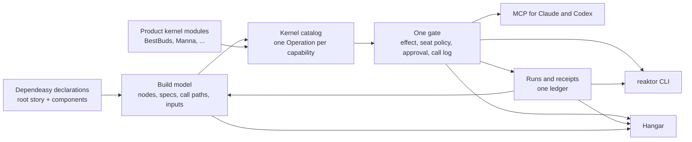

# Kernel, CLI, MCP and Hangar: handoff to Codex

## Current qualification — 29 October2026,15:10IST

Checked telemetry adapter installed in both CLIs; standard graceful owner upgradePID35565, kerneld103c6eee6b5 unchanged. ClickHouse aggregate-alias rejection fixed;250toolingPASS1declaredskip/57freshsuites. Actual owner backendreceipt run-1793264144189-1 verifies a retained BestBudswebCLIENTsessionRefresh→directSERVERsessionRefresh journey asImported with exact application/install/session/build/graph identities. Configured user-initiated Claude/Codexsuperadmin works; no sign-in prompt/authority change. VisualHangar pane/devicepush/producerack/crashdelivery remain separate. Execution56.59s/publicationqueue930.37s separated.

Latest sealed image run-1793262055227-301 Failed: currentkernelpasses; wheelratio1.236>1.1,PageDown1.119>1.1,engineoriginal600s after333reportedcases. Zero completedfreshengineXML; priorXMLexcluded. Noimage/digest/providerwrites. Shippingfixture513PASS11skip/boundary. Tooltip5focused+16freshJVMcases pass; earlier691enginepasses are historical. Schemas30.6%lessfunctiontime/75.6%lessallocation,110JVM/JS; wholewebpublication112byte-exactfiles/13,792B budget qualifies. Read-only preview is qualified:131plugin+26modelPASS, original2105-taskgraph retained; actual installed CLI plan and definition seal succeed458.652s wall,129.529s combined wrapper execution and162.296s recordedadmission. Preview executes no engine/kernel/PR checks; actualexecute still runs checks and rejects provider writes after failedverification. Earlier ignored-directory timeout retained; no gate/timeout relaxation. See readonly-preview-prod-retry-live-proof.json in the report. Foreign auth/unification work preserved; Pencil/.pen excluded.

[Full HLD and benchmark evidence](/Users/ovd/dev/reaktor/reports/dependeasy-build-plane-hld-2026-10-28/report.md) · [Detailed diagram](/Users/ovd/dev/reaktor/reports/dependeasy-build-plane-hld-2026-10-28/hld.mmd).

## 0. Summary for the owner

Dependeasy, the kernel, the CLI, MCP and Hangar are one system. Dependeasy declares what exists. The kernel turns every declaration into an operation with an effect, a gate and a receipt. The CLI, MCP and Hangar are three faces on that one kernel. The result is that anything added in one place appears everywhere:
- a new build node is runnable from the terminal, by an agent and from Hangar;
- a new deploy kernel is planned, approved and receipted the same way on every surface;
- every run lands in one history that all three faces read.

The root build script will read like the product's story. In about twenty lines it says three things: what BestBuds is made of, how we know it works, and how it ships. Every name in it is a Kotlin value you can Cmd+click down to the kernel. `reaktor build explain` and Hangar show exactly what each line expands to. Nothing is discovered by convention, string or file scan.

Today's root is 259 lines. It holds 61 quoted paths, 35 string node names, 15 `packageAlias` calls, 15 `if`s, 6 loops, 14 file reads, 10 hand-built host requirements, and five near-identical device-flow blocks. Each of those moves to the component that owns it, to product data, or to a typed option the CLI already understands.

## 1. How the pieces compound



### 1.1 Add once, get everywhere

| You add, in one place | You get, with no more code |
|---|---|
| `val phones by verify(...)` in a build script | `reaktor build run phones`, MCP `build.run {node: "phones"}`, a node with a Run button in Hangar's Build view, a CI step, a receipt in the ledger, membership in `build.affected`, a line on the story page |
| A dependeasy `DeployKernel` (WP21) | `ship.plan`, `ship.apply`, `ship.verify` and `ship.rollback` on every face, with the gate's approvals and a deploy receipt |
| A typed `BuildOption` or `@Option` (WP12, WP15) | A CLI flag, an MCP argument and a Hangar form field, all validated the same way and recorded on the receipt |
| An `Operation` in a product kernel module | A CLI command with help, an MCP entry with schema and effect, a Hangar palette entry, a call-log line and a telemetry span |
| A change to the seat policy or approval rules | The same behaviour for the terminal, agents and Hangar |
| A receipt from any surface or from CI | Hangar's runs drawer, `reaktor run show`, MCP `run.show`, reuse and affected decisions, the story page status |
| A Hangar selection (environment, subject) | Request scope for operations started from Hangar; `reaktor open <ref>` lands in the same context |

### 1.2 One vocabulary

The words in the root script are the words on every face:
- `product`, `verify`, `artifacts`, `release`, `deploy`, `migrate`, environments and lanes;
- the kernel domains `build`, `ship` and `run`;
- the CLI commands and the MCP operation ids;
- the titles of the Hangar views.

A reader who learns the root script has learned the CLI.

### 1.3 Each face lends the others something

- **Dependeasy gives the kernel truth about the build:** what exists, where it is declared, what it consumes and produces, which kernel does it, and which host it needs. The kernel never guesses a script or task name.
- **The kernel gives dependeasy a runtime:** one place to plan, gate, run and receipt any node, from any surface, including Gradle-free kernels (WP16).
- **The CLI gives everyone the shortest loop and the scripting surface.** It replaces package aliases and ad-hoc scripts.
- **MCP gives agents the same operations with honest effects.** Agents run verification freely and wait for a person on anything above their seat.
- **Hangar gives the system a face for humans.** It shows the story tree, live runs, approvals, receipts and source navigation, and it answers approvals for the other faces.
- **Receipts close the loop.** What ran, on which inputs, with which result, feeds the next plan (reuse, affected) and every view.

## 2. What exists today

**Dependeasy:**
- WP0–WP10 are committed.
- WP11 is qualifying.
- Schema-2 model and reader with staleness.
- Gradle plans and receipts through `planBuildNode` and `runBuildNode`.
- `GradleReceiptRunLedger`.
- The Hangar Build view and the CLI and MCP drill-down from WP10.

**Kernel slice, built 14 Oct.** It is uncommitted. `reaktor-kernel-plan.md` lists the files.

| Piece | Where |
|---|---|
| Operation model: `Operation<I,O>`, `rawOperation`, `OperationDescriptor`, `CatalogEntry`, `Invocation`, `Outcome`, schema from serializer with `@Describe`/`@Subject` | `reaktor-tooling/src/commonMain/.../tooling/operation/` |
| The gate: `OperationKernel` (door seat policy, single-use `DoorApprovals`, `CallLog`, request-id replay, cheap `catalog()`, lazy `describe()`, legacy `ToolNode` adapter), `OperationNode` | `reaktor-tooling/src/jvmMain/.../tooling/operation/OperationKernel.kt` |
| BestBuds operations: `build.list/show/tree/plan/run/receipts`, `run.list/show/logs/wait/cancel`, 22 bridged engineering operations with explicit effects | `bestbuds/modules/kernel/.../kernel/KernelOperations.kt` |
| `ReaktorKernel.invoke`, `operationCatalog`, `describeOperation`; the owner's `kernel` tool | `ReaktorKernel.kt`, `KernelOperations.kt` |
| MCP stdio serves `kernel` with the harness's seat | `KernelAgentMcpHost.kt`, `AgentWorkspaceCli.kt` |
| Generated CLI face: `reaktor <domain> <verb>`, schema-driven arguments, `--json`, `--args -`, `--detach`, run following, terminal approval, exit codes 0/1/2/3 | `bestbuds/targets/reaktorCli/.../cli/KernelCli.kt` (not yet wired into `Main.kt`) |
| Tests | tooling `OperationKernelTest` (6), CLI `KernelCliTest` (5, one over the real owner wire), kernel and CLI suites 300 green |

**Known gaps:**
- Hangar still embeds its own control plane.
- `code.apply` and `provider.call` keep their own approval paths, so they are left out of the gate.
- The seat is attribution, not identity.
- The old CLI commands are still live.
- The 14 Oct slice depends on the uncommitted engineering-tools work in bestbuds: `KernelEngineering.kt`, `KernelAgentMcpHost.kt`, `KernelEngineeringConnection.kt`, `CodeEditAdmission.kt`, `modules/kernel/src/main/kotlin/dev/shibasis/reaktor/conductor/cli/`, their tests, and the matching deletions in reaktor `reaktor-conductor/.../cli/` and `reaktor-cli/`.
- Backup: `~/.reaktor/backups/kernel-cli-wip-20261014-2143.tgz`.

## 3. Orchestration altitude: the root reads like the product

### 3.1 What a reader must see in the root

Like a Compose screen, where `Scaffold(topBar, content)` says what the screen is before any drawing code, the root answers four questions in order:
1. **What is the product made of?** Its parts, grouped by role: the shared app, clients, services, sites, tools.
2. **How do we know it works?** The verifications, named by intent: `pr`, `phones`, `web`.
3. **How does it ship?** Migrations, deploys and store releases, in order, after which proof.
4. **Where does it run?** Environments and hosts, as values and modifiers.

Everything else is detail and lives below.

### 3.2 Why the planned root is still too low

The §10.5 target in `dependeasy-handoff.md` and the §4.4 target in `dependeasy-api.md` remove the plumbing. But they still read as a list of build-system nouns:
- `verify("appChecks") { tests(Suite.Jvm, projects.app, projects.design, projects.engine) }`
- `includes(Reaktor.build, Workspace.Verify)`
- `artifacts("buildAll", role = Workspace.Build) { includes(...six projects...) }`

To understand them, a reader has to know dependeasy's node kinds, roles and suites. The product's parts are never named as a group. Each check enumerates test suites per project instead of saying what it proves. And shipping is a set of unrelated statements, not a visible flow.

### 3.3 Four altitudes, one home each

| Altitude | Says | Home | Vocabulary |
|---|---|---|---|
| Story | what the product is, how it is proven, how it ships | root `build.gradle.kts`, `workspace {}` only | `product`, `verify`, `artifacts`, `delivery`, `release`, `deploy`, `migrate`, `include`, environments, lanes, `Run` modifiers |
| Components | what one part is, what it consumes, what it publishes, how it is tested | each part's own Gradle project | typed component DSLs (`library`, `androidApp`, `appleApp`, `webApp`, `workers`, `deviceTests`, `loadTests`, `docs`, ...) |
| Product conventions | product data and small composites | product `buildSrc` (`buildlogic`) | data objects (`BestBudsFlows`, `BestBudsWeb.Budgets`, `BestBudsDevices`), composites (`storeRelease`) |
| Kernels | how the work is done | dependeasy, five layers per capability (`dependeasy-api.md` §5) | Gradle API, files, processes, tools |

This is §10.5 with one altitude added on top. The story altitude composes facts that the components own. It never enumerates suites, files, flows or environment files.

### 3.4 Target: the BestBuds root

Names are illustrative; the shape is the point.

```kotlin
plugins { id("dev.shibasis.dependeasy.workspace") }

workspace(delivery = BestBudsDelivery) {
    val framework = include(Reaktor.build)
    includeIf(BestBudsOptions.IncludeManna, BestBudsBuilds.Manna)

    val bestbuds = product(shared = projects.app) {
        clients(projects.appAndroid, projects.appDarwin, projects.appWeb, projects.appBrowser, projects.reaktorDesktop)
        services(projects.workers, projects.reaktorServer)
        sites(projects.reaktorWeb, projects.companyOs)
        tools(projects.reaktorCli)
    }

    val pr by verify(bestbuds) {
        include(framework.verify)
        contracts(projects.workers)
        check(BestBudsChecks.CredentialContainment)
    }
    val phones by verify(projects.deviceTests, BestBudsFlows.Everything, run = Run.onPhones())
    val web by verify(projects.appWeb)
    val everything by artifacts(bestbuds)

    delivery(after = pr) {
        val schema by migrate(BestBudsDatabases.Main)
        val backend by deploy(bestbuds.services) { after(schema) }
        val sites by deploy(bestbuds.sites)
        val testflight by storeRelease(projects.appDarwin, Lane.TestflightInternal)
        val play by storeRelease(projects.appAndroid, Lane.PlayInternal)
    }
}
```

How it reads, line by line:
- **`include(Reaktor.build)`** brings in the framework build and returns a handle whose `verify` and `artifacts` are that build's own roles.
- **`product(...)`** names the parts. It returns a typed `Product` value whose `clients`, `services`, `sites`, `verify` and `artifacts` are plain properties built from those lists. Cmd+click shows them.
- **`verify(bestbuds)`** includes each part's own declared verification. The parts declare it in their components: unit suites, window tests, Hangar flows, contracts. `pr` adds what is not owned by one part.
- **`verify(projects.deviceTests, BestBudsFlows.Everything, run = Run.onPhones())`** names one suite. The data object is shared by the root and the `deviceTests` component. The modifier says where it runs.
- **`delivery(after = pr)`** is the shipping flow. Every child waits for `pr`, and the `after` edges inside give the order. `storeRelease` is a three-line product composite in `buildlogic`.

**The Reaktor root:**

```kotlin
plugins { id("dev.shibasis.dependeasy.workspace") }

workspace {
    val reaktor = product(modules = Reaktor.modules) {
        packages(Reaktor.Web, Reaktor.Mcp, Reaktor.GraphPort)
        native(Reaktor.Ffi, Reaktor.Flexbuffer)
        tools(Dependeasy.build)
    }
    val pr by verify(reaktor)
    val everything by artifacts(reaktor)
    delivery(after = pr) { val packages by publish(reaktor, Registry.GithubPackages) }
}
```

**A component that absorbs five root blocks and 15 aliases.** This is `targets/deviceTests/build.gradle.kts`:

```kotlin
plugins { id("dev.shibasis.dependeasy.device-tests") }

deviceTests(apps = BestBudsApps.Debug, defaults = BestBudsDevices) {
    val connect by suite(BestBudsFlows.Connect)
    val everything by suite(BestBudsFlows.Everything, environment = BestBudsEnvironments.Dev)
    val login by suite(BestBudsFlows.Login, environment = BestBudsEnvironments.Dev)
    val push by suite(BestBudsFlows.Push, environment = BestBudsEnvironments.Dev)
    val production by suite(BestBudsFlows.Production, environment = BestBudsEnvironments.Prod)
}
```

How the old pieces map:
- `BestBudsDevices` holds the team, the WDA bundle id, hooks and environment files, once.
- `BestBudsFlows.Everything` names a directory and its exclusions. The kernel lists the directory when it runs; the script reads no files.
- Platform, single flow and screenshots are typed options of the device-suite kernel. So `pnpm maestro:ios:login:screenshots` becomes `reaktor build run login --platform ios --flow login-screen --screenshots`, with the same flags in MCP and Hangar.

### 3.5 Where today's root goes

| Today, in the root | Goes to |
|---|---|
| `javascript("companyWeb")`, `javascript("bestbudsWeb")`, `javascript("reaktorDocs"/"reaktorWeb")`, `browserBundle`, `appleHost {...}` | each target's own component project (WP13) |
| `ArtifactSizeReport` registration, `SizeMetric`/`SizeBudget` lists, the budget script | `targets/appWeb` component `budgets(BestBudsWeb.Budgets)`; a dependeasy size-budget kernel; data in `buildlogic` |
| `credentialContainmentSmoke` command node | `BestBudsChecks.CredentialContainment`, a check kernel invocation in `buildlogic`; the root says `check(...)` |
| `dagger { option(DevTools, false) }` | the delivery declaration: CI runs `pr` and the delivery flow; the Dagger pipeline is generated from the story (WP22) |
| `reaktorVerify`, `appChecks`, `jsChecks`, `architectureChecks`, `pr` | `val pr by verify(bestbuds) {...}`; the suites are declared by each part |
| `portableChecks`, `desktopChecks`, `distributedChecks`, every `HostRequirement(...)` | host is declared once by the node that needs it (window tests need a desktop session); the planner groups by host; `Run` modifiers where the story chooses |
| `workerBundle`, `desktopPackage`, `androidArtifacts`, `webArtifacts`, `iosFrameworks`, `buildAll` | each component publishes its artifacts; the root says `artifacts(bestbuds)` |
| `browserCheck` web checks and Lighthouse | `targets/appWeb` component; the root says `verify(projects.appWeb)` |
| `external("iosRelease"/"androidRelease")` fastlane | `storeRelease(...)` in `delivery` |
| `workers { ... }` fleet | `targets/workers` component (`dependeasy-api.md` §4.5); the root says `deploy(bestbuds.services)` |
| five `deviceFlows` blocks, `mobileApplication`, `iosDebug` | `targets/deviceTests` component, as above |
| every `packageAlias` loop | deleted; typed options on the CLI (K1, K3); package scripts are no longer generated |
| `karateSuite`/`k6Suite` loops | `targets/contractTests` and `targets/loadTests` components with typed `mode` and `environment` options |
| `file(...).isFile`, `listFiles()`, `providers.environmentVariable` | kernels at execution time, or typed options with declared sources (WP15) |

### 3.6 No magic: three tests for every line

Higher abstraction must not hide anything. Every element of the story and component altitudes passes three tests:

1. **Read test.** Someone who knows the product but not Gradle can say what the line does. The owner reviews the bestbuds, reaktor and manna roots against this.
2. **Click test.** Every identifier resolves by Cmd+click to a Kotlin declaration. From any root element to its kernel class takes no more than story function → spec `emit` → kernel. A product composite such as `storeRelease` adds one hop and is recorded in the call path.
3. **Explain test.** `reaktor build explain <node>`, MCP `build.explain` and Hangar's Build view show the full expansion:
   - the call path;
   - every spec field, with defaults marked and where each default is defined;
   - the resolved child nodes and the effective host and run modifiers.

   Nothing runs that is not in the model.

**Allowed:** composition, explicit data flow and recorded expansion.
- Composition: functions that call other functions, like composables.
- Explicit data flow: a function sees only what is passed to it. `verify(bestbuds)` reads `bestbuds`; it scans nothing.
- Recorded expansion: the model stores what each call produced.

**Not allowed in the story or component altitudes:**
- discovery by file scan, naming convention, reflection, service loader or registry;
- strings that refer to build elements;
- ambient reads of files, environment or properties;
- task registration;
- third-party DSL types;
- loops or conditionals that generate nodes. These are allowed inside product composites, where the model records them.

### 3.7 Acceptance facts for §3

All of these come from model, runtime and API-dump facts, never from tests that scan source text:
- Every node declared by a root has a kernel with source, a spec, a declaration site and a call path.
- No two nodes declared by a root share a declaration site, so nothing was generated by a loop in the root.
- The workspace plugin's public API dump offers only `workspace {}` and the story vocabulary. It has no string parameter that names a build element and no third-party DSL type.
- No unowned tasks and no ambient reads from authored scripts, per the model and Gradle's configuration-cache report.
- `reaktor build tree` and Hangar print the same tree for bestbuds, reaktor and manna. Its top level is the product's parts, the verifications and the delivery flow.
- Every former `packageAlias` command has a `reaktor` equivalent, listed in the K1 mapping table.
- Report the root line counts before and after, and the number of distinct story functions used. These are reported facts, not limits.
- The owner reads the bestbuds root and says what it does without help.

### 3.8 What this changes in WP12 and WP13

- **WP12** adds the story vocabulary to the workspace plugin: `product`, `verify(parts)`, `artifacts(parts)`, `delivery`, `include` returning a handle with roles. The lower primitives stay available for the rare case. This is the Pareto rule in AGENTS.md §2.
- **WP13** converts the roots to §3.4 and moves everything in §3.5 to its owner. A `packageAlias` loop is deleted only after its `reaktor` replacement exists. Until K1 lands, WP13 keeps generated package scripts.
- **WP15's typed options** are what make the device, contract and load suites one node each with flags, instead of one node per combination.

## 4. Work packages

Each package lists its goal, steps, acceptance evidence, change budget and what not to do. Follow §7 after each package.

### K0 — Land the uncommitted work (after WP11, owner decision D2)

Goal: the engineering-tools work and the 14 Oct kernel slice are committed together and qualified, so nothing more is at risk.

Steps:
1. Inventory the uncommitted hunks in the paths listed in §2. Separate the engineering-tools work and the kernel slice from anything another agent owns. Ask before touching anything unclear.
2. Run the module checks:
   - reaktor `:reaktor-tooling:jvmTest` (operation and door tests), `:reaktor-conductor:jvmTest`, `:reaktor-mcp:allTests`;
   - bestbuds `:kernel:test :kernel:verifyKernelBoundary :reaktorCli:test`.
3. Commit by path in logical commits:
   - reaktor: the operation model and `CallLog` caller;
   - reaktor: the removal of the conductor CLI and `reaktor-cli` sources, which now live in bestbuds;
   - bestbuds: the engineering surface;
   - bestbuds: the kernel operations, MCP host and CLI face.
4. Push per decision D1.

Acceptance:
- Every listed suite passes, with counts recorded in the Log.
- `KernelCliTest.theCliAndMcpReachTheKernelThroughTheWorkspaceOwner` passes.
- `git status` is clean for the listed paths.
- The reaktor build has no references to deleted `reaktor-cli` sources.

Budget: no behaviour change.

Don't:
- commit another agent's hunks;
- change any behaviour to make a test pass without recording why.

### K1 — The CLI is the kernel's face

Goal: one understandable and expressive command surface generated from the graph-owned catalog, with full typed access and qualified legacy removal. Implement the [CLI/TUI HLD](cli-kernel-hld.md); K1 covers shell commands, while K1-TUI below is a separate required delivery milestone.

Steps:
1. **Wire the generated face into the primary entry point.** Use `reaktor <domain> <verb> [subject] [typed options]`, with one command per canonical operation. Reuse `KernelCli` and current owner transport. Parse help/version/`--dir` before heavy initialization; `--workspace` maps to the same root field during migration. Root/domain/operation help provides progressive discovery from validated cached descriptors. Extend the existing disposable catalog cache with schema/help metadata bound to workspace, wire version and catalog digest; missing live detail offers an explicit describe/refresh remedy. An explicit invocation may refresh an unknown command once; help/static completion never starts an owner.
2. **Qualify and delete legacy command paths:** `snapshot`, `tasks`, `connections`, root `plan`, `run <task>`, `inspect`, `tools`, `workspace OPERATION --args`, and the old build parser/discovery. Inventory every existing caller first. Old spellings may print one replacement error, but must not remain executable aliases. The explicit workspace-root option mapping is the documented exception.

   | Old | New |
   |---|---|
   | `plan <node>` | `build plan <node>` |
   | `run <node>` or old `build <target>` proposal | `build run <node>` |
   | `workspace code.query --args …` | `code query --paths … --literal …`, or the same operation's `--args` |
   | `inspect <tool>` | The admitted owning `<domain> <verb>` |
   | `tools` | `operation catalog` |
   | `snapshot` / `tasks` | `run list` and `build list`, preserving the caller's intended subject |
   | `connections` | `connection status`, through its owning schema |

3. **Generate usable arguments and help.** Reuse serializer/descriptor metadata for subject position, named options, enums, arrays, variants, defaults, sensitivity, examples and effects. Support repeated collection fields and bounded `--args JSON` / `--args -`. Reject duplicate scalar/conflicting JSON fields, unknown options and invalid variants before effects. Common client options work before or after a command with identical semantics. Detect collisions with reserved client option names.
4. **Implement the HLD output contract.** Human tables/trees and plan/run summaries include scope, evidence state and next actions. `--json` emits exactly one bounded typed outcome, progress goes to stderr, and exit codes distinguish failed work, rejected requests, approval-required, bounded-wait expiry and interruption. No picker or approval read occurs with redirected input/output. Mask sensitive fields in every renderer and diagnostic.
5. **Complete from the catalog.** `reaktor completion zsh|bash|fish` provides static schema completion. Bounded `operation.complete {operation, field, prefix}` provides dynamic subject completion from an existing owner, without starting a service/build/provider on Tab.
6. **Follow durable work correctly.** Normal execution follows its run to a receipt; `--detach` returns the accepted handle. Expose admitted `run list/show/wait/logs/cancel` operations through the same parser. Preserve request/run references on timeout, disconnect and Ctrl-C. `--request-id` maps to the existing invocation identity for explicit replay; K7 qualifies exact deduplication and approval semantics. Never retry an uncertain effect with a new ID automatically.
7. **Keep MCP a projection.** `reaktor mcp --stdio --seat <harness>` uses the shared host/catalog. Seat remains attribution, not authority. Do not introduce another CLI-specific dispatcher or MCP schema.
8. **Install and qualify real use.** Use `targets/reaktorCli/tools/install --build`. Capture help/version outside a repository, cold/warm latency and classpath against the existing fast startup path, workspace-write/owner-start observations, and installed shell results. Update the CLI README and migrate every script/package-alias caller before removing its implementation.

Acceptance:
- With shipped help, an owner can discover a build, explain it, preview/run verification and inspect the receipt without reading Kotlin source.
- BestBuds, Reaktor and Manna have exact canonical discovery/schema parity. Every former package alias has a documented, qualified `reaktor` equivalent before deletion.
- Installed `build tree`, `build run <verify-node>`, `run list --json`, `run show` and log following use typed operations. A real failed verification returns exit 1; explicit detach returns an accepted run rather than a false passing check.
- Captured stdout parses as one JSON value for success, failure, rejection, approval and detach. Conflicting inputs fail before process/provider effects. Common options, shell quoting, `--` and stdin behave as specified.
- Noninteractive and agent-PTY calls cannot self-approve; approval-required returns exit 3 and the approval reference. Static help/completion performs no source scan, owner/model/provider/Gradle start or workspace write.
- Removed parsers/discovery/executors have no remaining callers. Use existing CLI/kernel checks plus real installed shell scenarios; no source-scan tests or new kernel unit-test suite.

Budget:
- Extend the existing CLI host, serializers/descriptors, existing catalog-cache metadata, argument parser, renderers and installer; no new module, independent catalog, operation executor, approval store, config language or scheduler.
- One new operation: `operation.complete`. Common invocation options remain `--dir`, `--json`, `--args`, `--detach`, existing `--seat`, plus `--request-id` for the existing request identity. `--help`/`--version` and the root-mapping compatibility spelling retain their ordinary roles.
- Typed domain options come from their owning schemas. They are not hand-maintained CLI flags. Completion and the future `tui` launcher are explicit client entry points.
- No dependency/library replacement selected by this design; measure the existing stack before changing it.

### K1-TUI — The interactive terminal face

Goal: a proper keyboard-first terminal application over the same operations, with inspectable plans and live receipts. This is required to complete the CLI/TUI design, but does not block shipping the K1 shell improvements. Execution waits for K1, K3, K4, K7 and K10's authenticated human authority; it does not bypass the existing WP18 start condition.

Steps:
1. Add explicit `reaktor tui` to the existing CLI distribution. Reject non-TTY use with CLI alternatives. Keep bare `reaktor` as help.
2. Implement the [HLD screen and interaction contract](cli-kernel-hld.md#tui-experience): persistent context bar; Overview, Builds, Runs and Operations; content/details panes and bounded live events. Reuse graph identities and schema-derived forms, including typed defaults, variants, validation, sensitivity and availability.
3. Support keyboard navigation, focused search, operation palette, inspect, explicit plan/run/cancel forms, contextual help and equivalent shell commands. Selecting a row or fuzzy match never executes an effect. Secret values do not enter history, copy or diagnostics.
4. Follow owner snapshots/events and existing artifact pages. Preserve revision/completeness and selection on resize; show disconnect/stale states honestly. Reconnect reads without replaying effects. Exit restores the terminal and detaches durable work.
5. Review exact scope/host/options/plan before effects. Reuse K7's approval path/ledger and K10's authenticated identity; the terminal cannot invent authority. Plans retain their original environment when the client changes context.

Acceptance:
- Installed PTY walkthrough on an actual declared node: browse → inspect → invalid form → valid plan/review → run → live events/logs → final receipt. The same run and receipt are visible in Hangar and the CLI.
- Search, keyboard-only focus, command palette, safe shell equivalent, narrow resize, plain/no-color presentation, disconnect/reconnect and Ctrl-C terminal restoration work.
- Exiting the terminal leaves work alive. A repeated request does not execute twice. An agent TTY cannot approve its own effect.
- Canonical subjects, fields, defaults, effect and evidence match CLI/MCP/Hangar. There is no TUI-side policy, graph, operational store or task scheduler.

Budget:
- One launcher and terminal presentation inside the existing CLI target. Four views and schema-derived operation forms; ephemeral UI state only.
- Reuse owner/catalog/invoke/watch/run/artifact capabilities. No new domain operation or persisted state just to support a screen.
- Reuse the current terminal stack where it meets the requirement. A rendering dependency, if needed, must be named, justified against this interaction acceptance and pinned through the existing Kotlin version owner before implementation; this document adds none.

### K2 — Orchestration altitude (verify, or finish what WP12/WP13 did not)

Goal: §3 holds in bestbuds, reaktor and manna.

Steps:
1. Check each §3.7 fact.
2. Finish anything WP12 or WP13 left: the story vocabulary, the component projects for device, contract and load suites, the `buildlogic` data objects, and alias deletion.
3. The owner read review.

Acceptance: §3.7.

Budget: the story vocabulary listed in §3.8. Nothing else public.

Don't:
- add a story function used once;
- hide a product fact inside dependeasy (WP14).

### K3 — The build domain at full power

Goal: make the full canonical build model understandable, selectable and runnable through graph-owned operations. Preserve already-qualified WP16/WP17 list/show/tree/explain/kernels parity; qualify the remaining expressive selection, option and execution behavior against the [CLI HLD](cli-kernel-hld.md).

Steps:
1. **`build.explain <node>`:** resolved spec fields, defaults and their origins, call path, children, inputs/outputs and effective host. Distinguish declared facts from retained plans and observed runs.
2. **`build.kernels`:** kernels, source locations, spec fields and tools, using the current model without a second reflection/registry mechanism.
3. **`build.tree`:** declared parent/child hierarchy, with explicit expansion of qualified retained Gradle task-plan facts. A normal inspection never starts Gradle. Stale model inspection lists changed inputs and cannot authorize a run.
4. **`build.affected --since <git-ref>`:** use declared input digests and relationships, include each selection reason and report omitted/unresolved scope. Reuse the domain's bounded selection/pagination capabilities; no CLI-side workspace scan or new query language.
5. **`build.run --affected`:** verification nodes only, with exact selected scope and options recorded. Reuse a successful receipt only with strong identical input identity and explicit reuse evidence. No affected selection silently deploys work or treats incomplete input coverage as a complete green check.
6. **Typed options become operation arguments.** `BuildOption` and `@Option` fields generate the build-run schema, CLI options, MCP arguments and TUI/Hangar forms. Validate names, variants, allowed environments and target scope before effects. The receipt records effective values and source/default origins, with sensitive values protected.
7. **Plans and results round-trip.** Return canonical node, plan, run and artifact references; resolve qualified subjects through their graph owner. A reviewed plan is passed through the owning operation schema and rejected if stale; Gradle alone computes exact task closure.
8. **Environment is request scope,** validated against delivery declarations when WP20 lands. It never changes Hangar's selected environment. Existing K1 output and K4/K7 lifecycle/approval contracts apply unchanged.

Acceptance on the supported three roots, with real BestBuds execution:
- `build explain pr` explains the verification expansion, effective defaults and kernel source; `build tree` and Hangar show the same hierarchy.
- `build affected --since HEAD~1` for a controlled one-file change selects its actual declared consumers with reasons and honest coverage.
- `build run login --platform ios --flow login-screen` validates supported options before any process starts; unsupported or ambiguous targets return actionable errors.
- CLI, MCP and forms agree on canonical subjects/options; returned plan/run references round-trip to the exact retained evidence. Changed inputs invalidate execution/reuse.

Budget: extend existing build operations/model readers and typed option projection. Retain the planned `build.affected` operation and `--affected` build-run field; reuse existing `build.explain`/`build.kernels` rather than adding replacements. No second graph, task scheduler, parser-specific policy or kernel unit-test suite.

### K4 — One kernel process per workspace

Goal: one owner, one store, one discovery file, and Hangar as a client.

Qualification, 24 October 2026: typed owner snapshot graph ports are committed and pushed in BestBuds `ec2b84c4`. Shell and pane read projections borrow the kernel snapshot provider; connection generation travels in that snapshot. Kernel 443 pass / 11 skip, CLI 17 pass, focused engine 50 pass and desktop drawer 2 pass; desktop compilation passes. The CLI distribution is installed into all three owners and fresh MCP/CLI context, collection paging and bounded waits pass (`build/dependeasy/receipts/qualification/wp13/k4-snapshot-port-20261024-v13-publication.json`). Ordinary Build plan/run/cancel/retry already use the invocation port. Full Hangar owner-client startup, background handoff and history-preserving single-store migration remain open; this does not close K4. Radar uses the same graph snapshot/invocation providers in BestBuds `213764ad`: native `radar.start` returns an exact run id, custom port reaches the sealed argv, and task-wide cancellation is removed.39 existing focused checks and desktop compilation pass; kernel441 pass/11 existing skips,CLI17 and boundary pass. The matching283-jar package is installed on all3 owners; fresh native descriptor/help/watch/provider checks pass (`k4-radar-20261024-v27-publication.json`). No live tunnel/provider execution was requested. Pane state projections also borrow the exact shared snapshot provider in BestBuds `dae8a61c` (seven pure reads,38 existing focused checks and desktop compilation pass; `k4-pane-snapshot-20261024-v10-publication.json`). Its active analytics session remains explicit until migrated. GraphPane native refreshes are qualified and pushed in BestBuds `d6ba8a80`: the concrete executing-plane port is removed, existing KernelLink handles typed LiveRead telemetry/island requests, and owner context/host/credential/read bounds remain.47 focused checks/desktop compilation pass; full kernel441 pass/11 existing skips,CLI17 and boundary pass. All3 owners have the matching283-jar package, and fresh CLI/MCP descriptor/help/provider/watch checks pass (`k4-native-refresh-20261024-v21-publication.json`). No live provider executions were requested. Broader K8 catalog migration remains open. The affected-run correction is committed in BestBuds `2c936443`: kernel 443 pass / 11 skip, CLI 17 pass and one unchanged focused repeat pass. All three owners are upgraded; fresh MCP/CLI/provider reads pass. Manna correctly reports stale/conservative affected metadata and forbids reuse. The original intermittent timing is unproven. Duplicate self-provider mounts and the obsolete `graph-mcp` bridge are retired in BestBuds `ae535833` and Reaktor `29ab2e86`, pushed and installed into all three owners. Fresh kernel 441 pass / 11 skip, CLI 17 pass and conductor 243 pass / 15 skip. The packaged bridge class is absent; fresh three-root MCP, provider and conservative affected reads pass, and retired commands reject. One earlier workflow resume checkpoint failed; unchanged focused/full repeats pass and its cause remains unproven. External providers remain. The production alternate owner-directory flag and typed build input are retired in BestBuds `54d3acc0`, pushed and installed into all three owners. Kernel 441 pass / 11 skip, CLI 17 pass, boundary and unchanged model identities/edges pass; warm export reuses configuration cache in 8 seconds on the worker (101.910 seconds through the router). Fresh three-root CLI/MCP/provider reads pass, and packaged `--data-dir` rejection leaves the discovery file unchanged. Native Kotlin alternate-directory parameters are retired in BestBuds `600e58b2`, with catalog watches armed before publication in `4c475f38`; both are pushed and installed on all three owners. Full original kernel 441 pass / 11 skip, CLI 17 pass, boundary, engine/desktop compilation and unchanged 1741 node / 1900 edge model qualify (`k4-catalog-publication-20261024-v8-green-proof.json`). Fresh three-root CLI/MCP/provider reads pass (`k4-canonical-directory-20261024-v19-live-proof.json`); Manna affected evidence remains stale/conservative. The earlier watcher timeout is retained and its timing cause remains unproven; the passing synchronous experiment was removed byte-exact. Full Hangar client/store/handoff remains open; system-links snapshot-port wiring is qualified and pushed in BestBuds `817636ee` with 56 focused graph/operational/system-link/database relationship checks and desktop compilation passing. Unrelated test deletions remain unstaged. Auxiliary engineering discovery still has active Hangar/native callers and remains until client cutover. Cloud and live-log reads use typed kernel providers and the unused Auth control-plane edge is removed in pushed BestBuds `cb7cb50d`: focused kernel 4, engine 61 and CLI 17 pass, with desktop compilation and matching CLI distribution (`k4-read-ports-20261024-v20-proof.json`). The existing Cloud renderer now yields Swing and awaits populated state; original failed attempts remain. All three owners are installed and fresh native MCP/CLI/provider reads qualify. Installed14 static/offline cases,17 read/reject cases and6 stdin/redaction cases pass. The CLI diagnostic fix is pushed as `12be662b` with17 graph-owned CLI tests; installed invalid-option output shrinks45KB to926/928bytes. A real reviewed verification correctly rejected a worker-slot change (plan slot1, run slot0). A fresh reviewed run succeeded with exact follow,980 lines across16 log pages, artifacts and a SHA256-correlated Gradle receipt. Explicit replay with the identical request ID started a second run; both runs succeeded. The confirmed cause is the SourceRead task lowering build.run to ReadOnly, which skips the existing gate replay cache despite run/artifact writes. The correction floors build.run at LocalArtifactWrite while preserving stronger effects and approvals, qualified and pushed in B b9c036c3.441 kernel pass/11 existing skips,17 CLI pass; matching archive installed on all three owners. Fresh real run Succeeded, replay before/after terminal returns identical outcome, SIGINT retains the reference,980 log lines/16 pages and SHA256-correlated receipt pass. Evidence: cli-replay-20261024-v23-proof.json and cli-replay-20261024-v19-publication.json. Original failed replay and harness attempts remain recorded. No full K4, TUI, shared-approval or performance completion claim.

Qualification, 24 October 2026: BestBuds `eac8050b` removes the concrete execution ports from workspace prerequisite and Git identity readers. Both borrow the canonical typed snapshot provider; native graph edges qualify on all three installed owners. Kernel441 pass/11 existing skips,CLI17 pass,boundary and desktop compilation pass. Evidence: `k4-prerequisite-snapshot-20261024-v11-publication.json`. Full K4 client/store/handoff remains open.

Qualification, 24 October 2026: BestBuds `af40591a` routes explicit shell environment, target, run and trace context changes through the canonical typed graph invocation port. Direct desktop graph construction owns one real ReaktorKernel over the existing plane and supplied agent seams. Exact retained worker artifact: kernel441 pass/11 existing skips,CLI17,boundary/package pass;34 existing focused graph checks and desktop compilation pass. The prior real environment/target Maestro flow passes. Installed shell17 read/reject,6 stdin/redaction and14 offline startup cases pass. Reaktor/Manna native context checks pass; BestBuds drain/stop completed, but running old Hangar PID10925 took owner.lock and published the old discovery format; its packaged jars differ from the new CLI. Owner explicitly chose to keep Hangar open; canonical restart and dependent BestBuds native/device/source-gated qualification are recorded blocked. No further close request is pending. Evidence: `build/dependeasy/receipts/qualification/wp13/k4-context-actions-20261024-v130-core-publication.json`. Six separate desktop repairs stay uncommitted; latest selected retry executed no tests because concurrent BoardCanvas refactor changed source and removed required methods. Full desktop68/78 baseline and full K4 owner-client/store/handoff remain open.

Steps:
1. **`~/.reaktor/agents/<digest>/owner.json`** holds pid, port, token, incarnation, version, catalog digest and host kind (service or Hangar). It replaces `connection.json`, `kernel-connection.json` and `graph-connection.json`. Delete the four owner-discovery copies (`KernelAgents`, `KernelAgentMcpHost`, CLI, `WorkspaceDoor`) for one function.
2. **Only the owner writes the operational store.** Delete the per-surface sessions (`desktop`, `cli`, `mcp`, `agent-service`) after migrating their runs once.
3. **A snapshot and event stream on the owner wire** (`kernel.watch {after: revision}`). It uses bounded long-poll rounds within the transport budget, and gives revisions and run events.
4. **Hangar becomes a client.**
   - The `KernelGraph` nodes that panes use become owner-backed: `requestRun`, `previewPlan`, `cancel` and `retry` go through `invoke`, and snapshots come from `kernel.watch`.
   - If no owner exists when Hangar starts, Hangar hosts the owner in-process.
   - Closing Hangar hands ownership to the background service without stopping runs (decision D3).
5. **Delete** the kernel loopback default on 8765 and the desktop port scan for the door's own mounts. The desktop read server, if kept, serves from the owner's catalog.

Acceptance:
- A run started with `reaktor build run` appears in Hangar's runs drawer, and the reverse.
- Exactly one operational store file exists per workspace.
- Quitting Hangar keeps a running build alive and its receipt lands.
- No second embedded control plane starts while an owner exists. Prove it by counting processes and stores.

Budget: one discovery file format and one operation (`kernel.watch`).

Don't:
- point two processes at one store;
- fall back silently to a fresh embedded kernel.

### K5 — Hangar is a face

Goal: Hangar shows and drives the same catalog.

Steps:
1. **The Build view draws the story tree through Blueprint.** It groups by product parts, verifications and delivery, with the last receipt per node. Run goes through `build.run`. Explain goes through `build.explain`. Source navigation follows the call path to the declaration and the kernel.
2. **The command palette is the operation catalog:** search, describe, and run with a form generated from the schema and effect.
3. **The approvals pane covers every kernel operation,** including second approval by a different person.
4. **The runs drawer reads the one ledger:** kernel runs, agent runs, Gradle receipts and deploy receipts.
5. **A story page:** the same tree, rendered read-only, on Hangar's home and as a generated private docs page (`reaktor build story --markdown`). This is the "top level" view of the build for people who are not in an editor.

Acceptance: headless Hangar flows (`HangarFlowsTest`) for:
- running a verification node from the Build view;
- approving a kernel operation;
- seeing a CLI-started run;
- opening a node's declaration;
- the palette running `operation.describe`.

Budget: no new pane. The Build view, palette, approvals and runs drawer are reused through Surface (AGENTS memory: everything in Surface).

Don't:
- render a value the kernel did not supply;
- give a pane its own control plane.

### K6 — The shipping domain (after delivery WP20–WP21)

Goal: releases, deploys and migrations are kernel operations on dependeasy's `DeployKernel`.

Steps:
1. **`ship.plan <node> --env <e>`** returns the deploy kernel's plan (what changes) with a fingerprint.
2. **`ship.apply`** goes through the gate. Production effects require approval through an operator face. It writes a deploy receipt (WP21) into the ledger.
3. **`ship.verify` and `ship.rollback`.**
4. **`ship.run <delivery>`** runs a whole delivery flow: one plan of all steps in order, one approval for the reviewed plan, staged execution with a receipt per step, and a stop at the first failure.
5. **MCP deploy reads** (WP26) and the Hangar Deploy pane (WP26) use these operations. Coordinate with WP26 so it builds the kernel side and this package builds the faces, or merge them (decision D4).

Acceptance:
- A dev worker deploy through `reaktor ship apply` with approval, receipt and Hangar visibility.
- A rollback of that deploy.
- An agent's `ship.apply` returns approval-required.

Budget: the four `ship.*` operations.

Don't:
- auto-retry an ambiguous write; report the outcome as unknown;
- deploy from a stale model.

### K7 — One plan, approval and ledger path

Goal: one approval per effect, on any face.

Steps:
1. **Plans are kept by id with one fingerprint function.** That function is the length-framed one in `AdHocProcessPlan`; process, native, code-edit and door plans all use it. Remove the control plane's single `pendingPlan` slot.
2. **`code.apply` and `provider.call` join the gate.** Remove `KernelDoor.admitCodeEdit`'s inner approval. Stop the door's own approval for calls arriving through the kernel. Record both on the receipt.
3. **The confirmation phrase and second approver become gate policy** for high-impact effects. Two different principals are required (K10).
4. **An appendable `RunLedger` implementation** combines control-plane runs, Conductor runs, `CallLog` (as a sink) and Gradle and deploy receipts, with typed references between them.

Acceptance:
- Each effect asks once, whether it came from the CLI, MCP or Hangar.
- `run.list` shows kernel, agent and Gradle runs together.
- Five of the six fingerprint implementations are deleted.

Budget: none public beyond the ledger implementation.

Don't: keep a second approval store.

### K8 — Finish the catalog and delete the duplicates

Goal: one descriptor shape and one dispatch path.

Steps:
1. **Move everything that remains:**
   - cloud APIs, with per-call effects from `ApiEffect`;
   - devices (`DeviceTools`);
   - database queries (`DoorAuthority.readsOnly` decides read or write);
   - telemetry (`telemetry_refresh` becomes a run-starting operation, not a read);
   - the desktop reads;
   - the remaining agent tools.
2. **Give `SafetyClass` an explicit rank.** Fold in `TaskEffect`, `ApiEffect`, `WorkerEffect`, `DeviceAction.writes` and `CloudOperation.destructive`.
3. **Delete** `McpTool`, `McpReadTool`, `ReaktorMcpReadServer`, the engineering string lists, the `workspace` meta-tool (after K9 moves the harnesses) and finally the legacy `ToolNode` adapter.

Acceptance:
- The descriptor shapes counted in `reaktor-kernel-plan.md` go from 13 to 1.
- Dispatch paths go from about 12 to 1.
- Every operation's effect is stated, not inferred from hints.

Don't: map an unknown effect to a read.

### K9 — MCP is a face

Goal: agents see exactly what they can call, with honest effects.

Steps:
1. **The stdio bridge serves `kernel`** as its primary tool, with progressive disclosure through `operation.catalog` and `operation.describe`.
2. **`tools/list` equals the callable set** on every server.
3. **Direct tools for the most used operations** (decision D5), derived from the catalog.
4. **The protocol era is handled at the edge,** per `project_reaktor_mcp_gateway`. Collapse the door's own-surface mounts (workspace, kernel, desktop) into the kernel; third-party providers stay behind the door.
5. **`reaktor mcp install`** writes `.mcp.json` and `.codex/config.toml` with the seat.

Acceptance: in bestbuds, Claude Code and Codex each:
- list the operations;
- describe `build.run`;
- run a verification node;
- hit approval-required on a source write, with a person approving in Hangar and the identical retry succeeding.

Don't:
- let a reply in the conversation count as approval;
- hide callable tools.

### K10 — Identity and authority

Goal: who called is known, not claimed.

Steps:
1. **The owner issues a token per seat** when a face connects. The seat comes from the token, never from arguments. Use `PrincipalKind.AGENT` and `AuthContext` from `reaktor-auth-core`.
2. **Operator faces authenticate as the person:** the TTY CLI and Hangar. The agent channel never approves.
3. **Second approval needs two distinct principals.**
4. **Approve or deny from the phone** through `reaktor-notification`, for approvals waiting on the person.

Acceptance:
- A seat cannot be spoofed by arguments.
- An agent token cannot decide an approval.
- A phone approval is spent by the identical retry.

### K11 — Every Reaktor+ workspace

Goal: one CLI, MCP and Hangar across Reaktor, BestBuds, Manna and later Nexergy and CompanyOS.

Steps:
1. **Workspaces are addressed by `--dir` or by name** from the dependeasy builds a workspace includes.
2. **Each product contributes its catalog** as `OperationNode`s from its own kernel module. Manna's worker deploys and data operations are the second real use.
3. **Move the generic owner host into reaktor only when Manna needs it.** That is the regularisation rule; until then it stays closed source in bestbuds.

Acceptance: the same installed `reaktor` runs `build tree`, `build run` and `ship plan` in reaktor, bestbuds and manna.

### K12 — Observability and docs

Goal: every invocation is visible and the story is documented from the model.

Steps:
1. **A `reaktor-telemetry` span per invocation,** carrying operation id, seat, effect, outcome, duration and run id. Hangar Telemetry shows CLI, MCP and agent calls next to app spans.
2. **`reaktor build story --markdown`** renders the story tree with the last receipt states. A generated private docs page and Hangar home use it (K5 step 5).
3. **Reconcile user documentation at each CLI cutover.** `cli-kernel-hld.md` is the CLI/TUI target contract; the CLI README describes shipped behavior only. Generate operation examples/help from the same descriptors, retain explicit planned/unavailable labels, and record old-to-new command/package-alias mappings and their completed removals. K1-TUI records its installed terminal walkthrough; do not report CLI/TUI completion from inspection parity alone.

Acceptance:
- A span for a `build.run` appears in Hangar Telemetry.
- The bestbuds story page renders and matches `reaktor build tree`.

## 5. Order and dependencies

| Package | Needs | Can run |
|---|---|---|
| §3 (spec) | — | now, inside WP12 and WP13 |
| K0 | WP11 committed | right after WP11 (decision D2) |
| K1 | K0 | after WP18 |
| K1-TUI | K1, K3, K4, K7, K10 | after K10; shell K1 ships independently |
| K2 | WP12, WP13, K1 for alias deletion | after WP18 |
| K3 | WP12, WP15, WP16, WP20 for environments | after WP18 |
| K4 | K0 | after WP18 |
| K5 | K4, K3 | after K4 |
| K6 | WP20, WP21; K4 | after delivery WP21 |
| K7 | K4 | after K4 |
| K8 | K7 | after K7 |
| K9 | K8 for the deletions; steps 1–2 earlier | after K1 |
| K10 | K4 | after K4 |
| K11 | K4, K8 | last |
| K12 | K4 | any time after K4 |

Highest leverage first: K0 → K1 → K3 → K4 → K5 → K7 → K6 → K9 → K8 → K10 → K1-TUI → K12 → K11. K2 runs wherever WP12 and WP13 left gaps.

## 6. Owner decisions (defaults Codex follows unless the owner says otherwise)

| # | Decision | Default |
|---|---|---|
| D1 | Push | Same branches and PR flow as dependeasy §10.7 decision 1, after each package's gate |
| D2 | When K0 runs | Right after WP11 commits, before WP12, because the work is uncommitted and at risk |
| D3 | Who owns the kernel when Hangar quits | The background service takes over; Hangar hosts only when it starts first |
| D4 | WP26 versus K5/K6 | WP26 builds deploy reads in the kernel; K5/K6 build the faces; no duplicate pane |
| D5 | MCP direct tools | `kernel` plus up to eight direct tools for the most used operations, derived from the catalog |
| D6 | Package scripts | Deleted once each has a `reaktor` replacement; shell completion replaces discoverability |
| D7 | The story vocabulary | `product`, `verify`, `artifacts`, `delivery`, `release`, `deploy`, `migrate`, `publish`, `include`, `includeIf` |

## 7. Rules for every package

Process:
- **Before the first edit,** write the acceptance evidence and the change budget in the Log, per AGENTS.md §2.3.
- **After each package:**
  - update the status table;
  - add a dated Log line with the evidence;
  - update `reaktor-kernel-plan.md`'s status table;
  - stage only your own hunks.
- **Commit each package separately,** scoped to its paths. Push per D1.
- **Acceptance comes from model, runtime and API-dump facts and from the modules' existing checks.** Hangar behaviour is proven with headless Hangar flows. Never use tests that scan source text.

Code:
- **No comments in code.** Versions live in dependeasy's Kotlin only, never TOML. Maintained libraries only.
- **Everything in Hangar goes through Surface.** Identifiers are shown in full; secrets show only a `secret` marker.

Machine:
- **Run builds through the `./gradlew` wrappers.** Run `~/dev/tools/dev-storage cleanup` before large builds and before finishing.
- **No emulators or simulators.** Phone checks use the Samsung `RZCW21KMTTM` and the iPhone 14 Pro when they are free.
- **Never print fixture, token or secret contents.** Never untrack `bestbuds/config`.
- **No destructive git:** no `reset --hard`, `clean`, `checkout` to undo work, or stash drops. Delete only with the guarded `deleteTreeSafely(within = ...)`.

Stop and write the reason in the Log, instead of guessing, when:
- an acceptance needs a new owner decision;
- another agent's edits overlap yours;
- a step would delete data;
- a step would untrack `bestbuds/config`;
- a step would make an agent able to approve its own effect.

## 8. Status

Current cross-domain status and color HLD: `build/dependeasy/receipts/qualification/wp13/full-status.json` and `full-status-hld.mmd`; legacy removals: `legacy-removal-register-current.json`. These receipts distinguish historical acceptance from current package gaps. Updated 25 Oct: 29 domains,10 finished/16 working/3 pending;19 open implementation checkpoints, plus final equivalent-host timings and pinned-main review.

| Package | Status |
|---|---|
| §3 | Written 15 Oct; `dependeasy-api.md` §4.4 points here |
| K0 | Complete 15 Oct; four scoped commits pushed to Reaktor #18 and BestBuds #8, 746 reported cases / 27 existing skips / zero failures |
| K1 | In progress; installed primary catalog face, typed arguments, human/JSON output, shell completion, durable following and legacy parser/archive removal qualify. Current three-root CLI/MCP discovery parity and selected execution pass. Full BuildOption/caller migration and remaining K1 acceptance stay open. CLI/TUI design refined 21 Oct; no new runtime qualification |
| K1-TUI | Outstanding; screen/interaction/lifecycle acceptance specified 21 Oct in `cli-kernel-hld.md`; implementation follows K1/K3/K4/K7/K10 |
| K2 | Outstanding (verify after WP12/WP13) |
| K3 | In progress 24 Oct: three-root build inspection, conservative affected selection/execution, scoped typed options, reviewed-plan run/follow/receipt and identical request replay qualify. The fresh iOS selection is exactly five tasks with no pr dependency; its actual physical run is blocked by iPhone UI automation enablement, with failure receipt/replay retained. CLI multi-check continuation and terminal exits qualify in both installed frontends (B19e9b747). Shared forms, caller migration and approval/identity-dependent acceptance remain open; full CLI qualification is not claimed. |
| K4 | In progress 24 Oct: owner lease and lazy construction pushed R1560c62b/B5832ef16; versioned native owner.json/common lookup pushed R0532eb6a/B0af310d8. Installed typed CLI, Atlas, fresh MCP and competing foreground/service starts preserve one owner and unchanged checked state files on all three roots. Bounded owner watch and shared graph invocation port are qualified, installed and pushed B d14067b6/440347c1. Hangar Build plan/run Bbac9dc9c and canonical cancellation B3a82e741 are qualified and pushed (35 focused graph/build checks plus1 cancellation Maestro case; desktop compilation passes). Single operational store, full owner-backed Hangar/handoff and auxiliary endpoint/port-scan removal remain open. |
| K5 | Outstanding; kernel approvals already show in the door pane |
| K6 | Outstanding (waits for WP21) |
| K7 | Outstanding |
| K8 | Outstanding |
| K9 | Outstanding; stdio serves `kernel` with the seat |
| K10 | Outstanding |
| K11 | Outstanding |
| K12 | Outstanding |
| U0 | In progress 28 Oct: revised tooling HLD accepted for implementation; O1–O6/O8/O9 defaults apply. Pane-action inventory and measured baseline evidence being collected; no baseline or parity completion claimed. O7 request budgets remain for the website slice. |
| U1 | In progress 28 Oct: five engineering contracts and 22 captured descriptors qualify through the shared graph gate and authenticated owner link. Real owner-wire checks and bounded process-local spans qualify; full native-session and source-wiring inventory acceptance remain open. |
| U2 | In progress 29 Oct: Build evidence, model and inventory reads are qualified and pushed. Testing's owner-backed verification catalog is qualified and pushed as BestBuds c78dfdf5; the focused run passes34 engine cases and desktop compilation. Typed Agent Atlas wiring is qualified and pushed as BestBuds406a5afc; the final44-case engine run and desktop compilation pass. Background client startup, remaining pane actions and history-preserving store migration remain open. O1 requires the background owner only, superseding D3. |
| U3 | Outstanding; service socket streams and listener migration under O4. |
| U4 | Outstanding; headless domain slices in the revised HLD order. |
| U5 | Outstanding; persistent update actor and separately supervised update host. |
| U6 | Outstanding; shared retained admission after the useful owner/update path. |
| U7 | In progress 28 Oct, owner priority: admin browser → fixed local Reaktor+ service. Both website UIs pass real HTTPS/local-service/model qualification, with Docs revision/citations. A normal supervised upgrade without --plus preserves discovery and replays the saved Docs answer with zero model calls. Scoped product context and typed intelligence contracts remain open. |
| U8 | Outstanding; real hosted qualification after U7. |
| U9 | Planned 29 Oct, owner requested: a bound Node sidecar owned once by the elected background JVM, private gRPC behind typed domain ports, immutable runtime bundle and isolated heavy workers. TypeScript indexing first; Radar lifetime moves to the owner, then individual Lighthouse/SDK adapters. Website publication keeps priority. No sidecar implementation or lifecycle qualification is claimed. HLD §3.9 and U9 define acceptance. |

25 Oct current qualification: phone connect is complete (iOS XCTest hierarchy1.814s, Android UI round trip1.511s). The canonical BestBuds owner is reachable with Hangar open; the earlier owner-lock blocker is historical. The newest installed CLI still needs its matching model decoder build. Three additional root-only readers now consume the existing graph snapshot provider; compilation/runtime qualification is queued. Browser67/67 and retained-output boundary38/38, notification4/4 and appBrowser32/32 are scoped commits. Chat PostgreSQL and four Worker coverage gaps remain. The exact19 remaining checkpoint definitions are in `full-status.json` → `remainingCheckpoints`; no full K1/K3/K4 or program completion is claimed.


### 8.1 Pane-action parity ledger — partial, 29 October 2026

This inventory covers Testing, three Agent Atlas workflows, AI, Build-owned controls, bounded UI source-authoring and Graph main-view/authoring workflows, Cloud shell/resources/Work inspection, Analytics shell controls, Auth shell/state, Telemetry shell actions and Data entry-surface controls. It is not the complete thirteen-mode U0 ledger. Definitions were read through Atlas at TestingPane `594f2ea351f7`, TestingCoverage `19153d3c5189`, TestingInspector `0113e288370c`, and TestingState `7b3a6497a2cb`. Agent Atlas wiring is qualified and pushed as BestBuds406a5afc; its three real-owner UI cases pass in the44-case final run. A row is not closed by a catalog entry alone.

The profiles below supply the owner, GUI dependency, contract, effect, principal, scope, freshness, run behavior and provider fields for each action row. Each row supplies its definition and concrete input/output. Equivalent inspector and table controls name the same workflow; distinct operational choices have separate rows.

| Profile | Current backend and GUI dependency | Operation and target contract | Effect, principal and scope | Freshness, run and providers | Evidence / disposition |
|---|---|---|---|---|---|
| C | TestingState.read → BuildDeliveryModel.read through a graph port; production desktop still has an embedded kernel | `build.model`, `KernelApi.invoke`; eventual BuildApi model | ReadOnly; trusted `hangar`; canonical workspace and collection | Bounded nodes/edges, fixed collection metadata, stale/partial declarations explicit; no Gradle; owner contract transport | TestingOwnerModelTest passes with actual owner disconnect/reconnect; BestBuds c78dfdf5. Contract wiring exposed; production startup cutover remains open |
| R | CheckReports, TestHistory and TestingState aggregation run in desktop | No owner operation for the complete report/history projection; ChecksApi extension needed | Local reads plus existing local history write; desktop operator; workspace/check | Report timestamps, parser omissions and retained outcomes; no new run; local result files | Existing Testing suites, first focused run28/29; extraction needed |
| S | HarnessSessions / WorkingTree / ChangeChecks run in desktop | `checks.affected` is related but is not a substitute for the complete pane projection; ChecksApi extension needed | ReadOnly; desktop operator; workspace/build/session | Explicit unreadable Git/session evidence; no run; Git, session files and process reader | TestingState.choose/changesOf; extraction needed |
| E | TestingState.run/rerun calls OperationalControlPlane directly | Future owner check launch carrying exact selected Gradle/test/flow scope; existing ChecksApi.run is not API-equivalent | Route.Local→LocalArtifactWrite, Device→DeviceWrite, Dev→NonProductionWrite, Production→ProductionReversibleWrite; operator authority and existing plan policy | Returns admitted run or pending reviewed plan; configured build router, physical phones for device work | Existing Testing execution fixtures; extraction needed |
| V | Existing operational snapshot and drawer callbacks | `run.list/show/logs/cancel`, RunsApi; retry remains an existing reviewed launch | Reads ReadOnly, cancel LocalEphemeral, retry original effect; operator/run/workspace | Snapshot/report timestamps and explicit active/terminal state; cancel/retry observes resulting run; owner/control-plane and drawer provider | Canonical cancellation previously qualified; Testing inputs/callbacks still require owner migration |
| P | TestingState / pane navigation only | No remote operation required | LocalEphemeral presentation; window operator; current pane/selection | Derived from displayed evidence; no run; Surface/MachineSignal | Desktop-only; existing Testing UI checks |
| D | Desktop seams, source lookup or cross-pane navigation | No remote window/clipboard operation; source resolution can later use AtlasApi.read | Local desktop action; window operator; selected source/artifact | Uses selected path and available file; no operational run; IDE, OS browser/files, clipboard or target pane | Desktop-only; existing UI checks |
| A | Typed AtlasApi consumed by DesktopPaneNode and Agent views; production provider remains embedded until startup cutover | `atlas.query/read/graph`, AtlasApi | ReadOnly; trusted `hangar` plus fresh request UUID; workspace/declaration or graph revision | Existing strength/partial/omission metadata; bounded graph pages and revision restarts; no mutation; code provider | Actual OwnerKernel-backed AgentPaneRenderTest query/source/code-graph cases pass; BestBuds406a5afc. Production startup cutover remains open |

| Action | Definition / visible control | Input → output | Profile |
|---|---|---|---|
| T01 | TestingPane / refresh | Workspace → verification catalog and read error | C |
| T02 | TestingPane / automatic open or finished-run refresh | Workspace and latest finished run → report/status/history projection | R |
| T03 | SourcePicker / Working tree | Workspace → changed files and affected checks | S |
| T04 | SourcePicker / agent session | Session key → session-edited files and affected checks | S |
| T05 | ChangesView / Run edited | Edited check set → admitted run or reviewed plan | E |
| T06 | ChangesView / With users | Edited plus user check set → admitted run or reviewed plan | E |
| T07 | ChangesView / Flows | Flow check set → admitted run or reviewed plan | E |
| T08 | ChangesView / activate or Run this check | One affected CheckSpec → admitted run or reviewed plan | E |
| T09 | ChangesView / Show in Checks | Check id → selected check and Checks view | P |
| T10 | ChangesView / changed-file activation | File path → IDE source | D |
| T11 | ChecksView / query | Search terms → filtered displayed checks | P |
| T12 | FamilyPicker / kind | CheckFamily or all → filtered displayed checks | P |
| T13 | ChecksView / status | CheckStatus or all → filtered displayed checks | P |
| T14 | ChecksView / expand or collapse | Tree path → expanded paths | P |
| T15 | checkActions and CheckInspector / Run | CheckSpec → admitted run or reviewed plan | E |
| T16 | checkActions and CheckInspector / Rerun failing tests | Check and failed cases → exact plain test filters or Hangar flow ids, otherwise whole check | E |
| T17 | checkActions and CheckInspector / Last run | Retained run id → drawer evidence | V |
| T18 | ChecksView and CheckInspector / Show in Coverage | Check domains/aspects → Coverage focus | P |
| T19 | CoverageGrid / aspect | Aspect → focused checks | P |
| T20 | CoverageGrid / domain | Domain → focused checks | P |
| T21 | CoverageGrid.Cell / domain-aspect cell | Domain and aspect → focused checks | P |
| T22 | CoverageView / Show unclassified | Unclassified focus → checks without domain/aspect | P |
| T23 | CoverageView / Every check | Clear focus → all checks | P |
| T24 | CoverageView / Run focus | Runnable focused checks → admitted run or reviewed plan | E |
| T25 | CoverageView / Show in Checks | Check id → selected check and Checks view | P |
| T26 | CoverageView and CheckInspector / Show in build graph | Check id → Build graph selection | D |
| T27 | Coverage Gap / Open DevTools audits | Domain/aspect gap → DevTools audits | D |
| T28 | FailuresView / search | Case/class/check/message terms → displayed failing tests | P |
| T29 | FailuresView and CaseInspector / Open source | TestCase source or symbol → resolved file/line in IDE | D |
| T30 | FailuresView and CaseInspector / Rerun this test | One failed case → exact filter or whole check | E |
| T31 | FailuresView / Rerun failing tests of check | Report failures → exact filters or flow ids | E |
| T32 | FailuresView / Run whole check | CheckSpec → admitted run or reviewed plan | E |
| T33 | FailuresView and CaseInspector / Copy failure | Case key and detail/message → clipboard | D |
| T34 | FailuresView and CaseInspector / Show check | Check id → selected check inspector | P |
| T35 | RunsView and RunInspector / Open drawer | Run id → retained/current run evidence | V |
| T36 | RunsView and RunInspector / Cancel | Active run id → cancellation request and observed outcome | V |
| T37 | RunsView and RunInspector / Run again | Retained run → retry admission or reviewed plan | V |
| T38 | CheckInspector / Open report | HTML report path → OS browser | D |
| T39 | CheckInspector / Show files | Existing result directory → OS file viewer | D |
| T40 | CheckInspector / select failing case | Case key → case inspector | P |
| T41 | CheckInspector / select leaf or parent | Check id → check inspector | P |
| T42 | CheckInspector / Declared at | Declaration file/line → IDE | D |
| T43 | CaseInspector / Open screenshot | Existing attachment file → OS viewer | D |
| T44 | RunInspector / error source | Diagnostic file/line → IDE | D |
| T45 | TestingViews / change view | View id → Changes/Coverage/Checks/Failures/Runs | P |
| T46 | TestingPane and tables / select or clear | Check/case/run subject → inspector selection | P |
| T47 | TestingPane / Show inspector | Inspector visibility → pane layout | P |
| T48 | TestingPane / Show build model | Existing build/dependeasy directory → OS file viewer | D |
| A01 | AgentAtlasView / ask and follow query | AtlasQuery → AtlasAnswer with evidence strength and next actions | A |
| A02 | AgentAtlasView and AtlasItemDetail / open result or next source | AtlasRead → AtlasSource, partial source and next actions | A |
| A03 | AgentCodeGraphView / open or refresh graph | AtlasGraphRequest page/revision → assembled graph, counts and omissions | A |

AI definitions were read through Atlas on29 October: AiPane/AiView `3b45969d29f6`, AiPaneState `5f8520a9c35f`, AiGateway `dd18c62dc870`, AiModels `16b40db349e9`, AiBots `1a349ef31159`, AiInspector `cbee68d43a90`, source-only views `775c91201500`, and OperationalControlPlane.requestCloudflareAi `d47eeb083184`. This inventory does not qualify a headless AI contract. The existing question-only `inference.ask` uses Antigravity and is not a substitute for account administration or a selected Cloudflare model trial.

| Profile | Current backend and GUI dependency | Operation and target contract | Effect, principal and scope | Freshness, run and providers | Evidence / disposition |
|---|---|---|---|---|---|
| AI-I | AiPaneState.readRepository → WorkspaceRepositories/AiInventory and bounded notebook walk in desktop | Owner inventory projection needed; scoped AI source facts through IntelligenceApi, cloud resources through CloudApi | ReadOnly source observation; trusted Hangar operator; canonical workspace/repositories | Source declarations, not deployed/installed evidence; explicit inventory failures; no operational run; repository files | Atlas source inventory only; extraction needed |
| AI-R | AiView.request → embedded OperationalControlPlane.requestCloudflareAi → CloudflareAiCall | No API-equivalent typed contract yet; CloudApi account inventory/log reads | Existing LiveRead; trusted operator; configured workspace/account and optional gateway | Read is a recorded operational run; latest result/error/read time retained; Cloudflare account, credential, network and existing executor | Read/catalog/usage/gateway-traffic and logs are distinct actions; extraction needed |
| AI-M | TryPanel → same embedded requestCloudflareAi complete path | IntelligenceApi model trial needed; question-only inference.ask cannot preserve model/system/gateway inputs | Existing task advertises LiveRead despite a billed call; migration must retain truthful paid-call admission and UUID receipts, never silently replay an unknown result | Run and captured completion/error; selected Workers AI model and optional gateway; Cloudflare credential/network | No headless equivalence qualified; extraction needed |
| AI-G | CreateGateway → same embedded control plane, create-gateway | CloudApi reviewed account mutation needed | ProductionReversibleWrite; trusted operator and existing exact-plan policy; configured account/gateway | Pending plan or admitted run, existing gate/receipt; Cloudflare gateway credential | Existing gateway creation is not inference; extraction needed |
| AI-P | AiPaneState, table/list and BlueprintCanvas controls | No remote operation required | LocalEphemeral presentation; window operator; current pane/selection | Derives only from displayed source/live evidence; no run; Surface/MachineSignal | Desktop-only |
| AI-D | Desktop IDE, clipboard and external browser seams | No remote window operation; source resolution may use AtlasApi | Local desktop action; window operator; selected source/URL | Existing source/config location or external URL; no run; OS/IDE/browser/clipboard | Desktop-only |

| Action | Definition / visible control | Input → output | Profile |
|---|---|---|---|
| AI01 | AiPane / open or repository refresh | Workspace → bots, workers, model/store/table declarations, on-device references and notebooks | AI-I |
| AI02 | AiPane / Refresh | Account → catalog, week of model usage, gateway list and traffic, plus source inventory refresh | AI-R + AI-I |
| AI03 | Logs / Read | Selected gateway → newest request logs and read time/error | AI-R |
| AI04 | CreateGateway / Create | Missing declared gateway → exact pending plan or creation run | AI-G |
| AI05 | TryPanel / Run or prompt submit | Model, optional gateway/system and prompt → billed run/completion/error | AI-M |
| AI06 | AiModelsView / task, used, tools and search filters | Display filters → model rows | AI-P |
| AI07 | AiModelsView and ModelDetail / Try this model | Text-generation model → selected trial model and Models view | AI-P |
| AI08 | TryPanel / model, system, prompt and gateway editing | Text and route selection → local trial inputs | AI-P |
| AI09 | AiHeader / view, bot scope and dismiss error | View/bot/error key → filtered display or dismissed local error | AI-P |
| AI10 | AiBotsView / choose or clear bot | Bot identity → scoped workers/map/findings and inspector | AI-P |
| AI11 | AiFindingList / choose or activate | Finding → selected subject, with Gateway navigation when applicable | AI-P |
| AI12 | BotMap / card, pin, link or background | Graph subject → selection/port/highlight | AI-P |
| AI13 | BlueprintCamera / Fit or Centre | Displayed layout/selection → canvas camera | AI-P |
| AI14 | AiGatewayView and Traffic / select or clear | Gateway/traffic identity → logs target and inspector | AI-P |
| AI15 | Logs / select or clear request | Request identity → local selection | AI-P |
| AI16 | AiWorkersView, AiOnDeviceView and AiDataView / select or clear | Declared worker/model/store → inspector | AI-P |
| AI17 | AiPane / clear, Show inspector and layout | Selection/layout → local pane presentation | AI-P |
| AI18 | AiWorkersView / activate or Open in IDE | Worker config → IDE source | AI-D |
| AI19 | AiOnDeviceView / activate or Open in IDE | Declared model reference → IDE source; no device model installation | AI-D |
| AI20 | WorkerDetail / activate model use or Open in IDE | Source model use → IDE file/line | AI-D |
| AI21 | Bot/finding/worker/model-use row actions / Copy | Selected source/display facts → clipboard | AI-D |
| AI22 | TokenSetup / Open API Tokens | Fixed Cloudflare profile URL → browser; credential entry remains local | AI-D |
| AI23 | AiNotebooksView / empty-state Open Google Colab | Fixed external URL → browser; existing notebook rows have no open action | AI-D |
| AI24 | GatewayDetail / Open the Gateway view | Selected gateway → Gateway view | AI-P |

Workers' live metrics consume a retained Cloud inventory result and do not initiate a new read from the AI pane. Data views show source bindings/table uses, not live database contents; Manna TypeScript SQL is not scanned. On-device references do not prove an installed model or working device runtime. Source inventory, account reads, paid trials and gateway mutations remain separate extraction requirements.

Build-owned controls were read through Atlas at BuildPane `289a9f3c5b1f`, BuildTargets/StoryRow/BuildTargetDetail/BuildTargetDefinition `dd96416eb4fa`, BuildGraphPane `85b2f5fcceb9`, BuildInspection `7e10d2d41004`, LiveDeploys/DeployResourceInspector `00cefae13091` and OperationalSubjectInspector `a6cbafce5dea`. The following39 actions cover those definitions. Shared AppGraphPane controls and the operational Catalog/drawer remain separate incomplete inventory; this is not full Build parity.

| Profile | Current backend and GUI dependency | Operation and target contract | Effect, principal and scope | Freshness, run and providers | Evidence / disposition |
|---|---|---|---|---|---|
| B-M | BuildDeliveryModel through typed KernelApi graph port; production provider remains embedded | build.model; future BuildApi projection | ReadOnly; authenticated hangar; canonical workspace/collection | Complete bounded topology or explicit stale/partial facts; no Gradle | Actual owner paging, disconnect/reconnect and no-file-fallback qualified in06147a2d/3fc44b7d |
| B-R | BuildTargets and BuildInspection use graph-provided legacy KernelLink | build.story/show/receipts and operation.describe; future BuildApi/KernelApi | ReadOnly; hangar caller; selected node/run/collection | Retained plan/receipt observations carry stale truth and timestamps; paged continuation; no configuration | Retained read slice61c2cc63 qualified; typed migration remains open |
| B-E | BuildInspection invokes legacy build.plan/run; reviewed/deploy path uses embedded OperationalControlPlane.requestRun | Future BuildApi preserving exact input schema, sealed plan and admission | Plan LocalArtifactWrite; execution retains declared task effect; operator/workspace/environment/node | Planning may configure Gradle; model must be current and complete; admitted run or pending review; build router/provider | Existing exact-plan UI case qualified; changed-input approval drawer cannot carry arbitrary inputs yet, explicitly disabled |
| B-S | Embedded operational snapshots supply artifacts, run ledger and task availability | Owner snapshot plus RunsApi/BuildApi projection needed | ReadOnly observations; hangar; workspace/environment | Retained results are not current deployment health; existing snapshot refresh lifecycle | Extraction remains open; no claim that model read migrates snapshot/history ownership |
| B-L | LocalSystemLinks and system.readCloud use embedded cloud state/executor | CloudApi inventory needed; cross-pane selection stays local | Existing LiveRead operational run; configured account/cluster/environment | Manual provider read; last-read timestamp/error; source-only resources remain source facts | Extraction remains open; no new read on table selection |
| B-P | BuildTargetsState/AppGraphState/navigation/table controls | No remote operation | LocalEphemeral presentation; window selection | Derives only from displayed evidence; no operational run | Desktop-only |
| B-D | Desktop seams and cross-pane verbs | No remote window operation | Local desktop action; selected path/target/run | Current selected file/line, or retained run reference; IDE/OS/other pane | Desktop-only; source lookup can use AtlasApi |

| Action | Definition / visible control | Input → output | Profile |
|---|---|---|---|
| B01 | BuildTargets / open or Refresh | Workspace → model, bounded story and read status | B-M + B-R |
| B02 | BuildTargets / build or All builds | Build identity → filtered target list | B-P |
| B03 | BuildTargets / target group | Group → filtered targets | B-P |
| B04 | BuildTargets / search | Query → matching targets | B-P |
| B05 | BuildTargets / select, clear or Back | Node id → detail/compact layout | B-P |
| B06 | StoryRow / activate | Top-level node → selected target | B-P |
| B07 | BuildTargetDetail / Definition, Plan & run, Evidence | Section → visible detail | B-P |
| B08 | BuildTargetDetail / Open declaration | SourceSite → IDE file/line | B-D |
| B09 | BuildTargetDetail / Open kernel | Kernel source or class → IDE | B-D |
| B10 | BuildTargetDetail / View graph | Node id → Build graph reveal | B-P |
| B11 | BuildTargetDefinition / dependency | Edge destination → selected target | B-P |
| B12 | BuildInspection / open or refresh schema/evidence | Node/run/offset → declared inputs and retained plans/receipts | B-R |
| B13 | BuildInspection / producer kernel | Provider source/class → IDE | B-D |
| B14 | BuildInspection / Previous or More producers | Offset → ten local provider rows | B-P |
| B15 | BuildInspection / input edit | Typed input text → validated arguments, clears prepared plan | B-P |
| B16 | BuildInspection / Request execution plan | Valid arguments/current model → exact PendingOperationalPlan | B-E |
| B17 | BuildInspection / Run target or Review & run | Prepared plan → admission or shared review drawer | B-E |
| B18 | BuildInspection / plan task link | Task identity → corresponding graph selection | B-P |
| B19 | BuildInspection / Previous or More tasks | Offset → ten sealed-plan tasks | B-P |
| B20 | BuildInspection / Open delivery run | Retained receipt run → run drawer | B-D |
| B21 | BuildInspection / Previous or More delivery receipts | Node/collection/offset → retained delivery page | B-R |
| B22 | BuildInspection / latest operational run | Run id → drawer/plane selection | B-D |
| B23 | BuildInspection / Open receipt | Returned receipt path → IDE | B-D |
| B24 | BuildInspection / Previous or More observations | Node/run/offset → recorded task outcomes | B-R |
| B25 | BuildGraphPane / open or Refresh | Workspace → owner model and graph | B-M |
| B26 | BuildPaneTabs / change view | View id → targets/graph/artifacts/runs/operations/live | B-P |
| B27 | Build artifacts / open | Snapshot → retained resource rows and evidence | B-S |
| B28 | Build artifacts / select or clear | Artifact subject → existing evidence inspector | B-P |
| B29 | Build runs / open | Snapshot → retained run ledger | B-S |
| B30 | Build runs / select | Run id → existing drawer | B-D |
| B31 | Build operations / open | Snapshot/task availability → Catalog | B-S |
| B32 | Build live / Refresh | Account/cluster/environment → admitted cloud inventory run | B-L |
| B33 | LiveDeploys / select or clear Worker/workload | Resource id → deployment inspector | B-P |
| B34 | LiveDeploys / activate or Open in Compute | Resource id → Cloud selection | B-D |
| B35 | DeployResourceInspector / Open in Compute | Inspected resource → Cloud selection | B-D |
| B36 | Build live / Show inspector | Layout → revealed evidence inspector | B-P |
| B37 | Build artifact/live inspectors / layout | Inspector preferences → local layout | B-P |
| B38 | LiveDeploys / sort table | Column key → displayed Worker/workload order | B-P |
| B39 | Build artifacts / search | Search terms → matching retained resources | B-P |

The UI source-authoring slice below was read through Atlas on29 October: UiComponents `7bdaab47a354`, UiWords/WordEditor/WordChanges `faad1674a0bb`, UiSizes and its use/value/token editors `93c6eb65fc7c`, PendingReview `d519737a4fc5`, UiAccessibility `d8cddaef960a`, UiResponsive `9ebd71140ba1` and UiStoryboard `4a7a464e8e4d`. Child canvas, component-detail, navigation, design-system and fallback fixture controls remain unenumerated. The source-editing actions belong to the HLD's StudioApi extraction, even though their current visible mode is UI. No headless contract parity is claimed.

| Profile | Current backend and GUI dependency | Operation and target contract | Effect, principal and scope | Freshness, run and providers | Evidence / disposition |
|---|---|---|---|---|---|
| UI-R | UiComponents/Words/Sizes and PendingReview → desktop StudioCodebase/SourceIndex and word/size/design planners | No equivalent served operation yet; StudioApi authored reads/proposals with ChangesApi application | ReadOnly source read/plan; trusted operator; selected workspace, app runner source set and exact declaration | Source-derived, not deployed evidence; read generation, planner errors and changed drafts matter; local repository/compiler; no operational run | Source inventory only; extraction needed |
| UI-E | Studio word/size/design draft state, validation and undo stacks in engine | Draft/editor state remains local; resulting authored proposals feed StudioApi/ChangesApi | LocalEphemeral draft mutation; window operator; selected app/source and draft revision | Live preview of a pending edit, not a source write or deployment; validation and interpolation/token constraints retained; no run | Desktop-only draft interaction; owner proposal generation still needed |
| UI-W | rememberPlannedWrite / PendingReview → CodeWorkspace.apply(change, fingerprint); undo → retained plan revert | SourceWrite through exact reviewed ChangesApi path; no current pane-equivalent owner call | SourceWrite including Undo write; trusted operator; canonical workspace and exact file content | Must retain fingerprint/source checks, real changed files, error and receipt. Write all plans Studio, design, words, sizes sequentially on the preceding result; partial failure is explicitly reported, not atomic | Current direct desktop source mutation; extraction needed; no gate bypass implied |
| UI-V | Studio mock app runner, replayable component instances and navigation previews inside desktop | No remote render required; semantic source/route inventory may be StudioApi, selection through HangarApi | LocalEphemeral preview activation; window operator; selected app/run generation | Mock/replay previews are not physical-device or production evidence; Compose/window provider; no kernel execution receipt | Desktop-only rendering; semantic read extraction open |
| UI-P | SurfaceLabState, selection, filters, local list/tree expansion and input buffers | No owner operation required | LocalEphemeral presentation; window operator; current pane | Existing source/preview evidence only; no run/provider request | Desktop-only |
| UI-D | Desktop seams and explicit Studio/evidence navigation | HangarApi selection where remote inspection is useful; IDE stays desktop | Local desktop action; window operator; exact source/selection | Existing source path/line or captured evidence; no cloud mutation; IDE/window provider | Desktop-only |
| UI-A | UiAccessibility callback → existing focused device audit capture | DevicesApi audit/read required; opening retained evidence is UI-D | LiveRead for explicit device capture; trusted operator; focused device/application keys | Captured timestamp, metrics and findings retained; absence means no capture. Device transport and configured physical device required | Existing callback is not headless parity; extraction needed |

| Action | Definition / visible control | Input → output | Profile |
|---|---|---|---|
| UI01 | UiComponents / open | App/workspace/source set → source component library and preview runner | UI-R + UI-V |
| UI02 | UiComponents / filter or Enter | Name/folder query → matching components/first selection | UI-P |
| UI03 | UiComponents / view choice | Levels/index choice → local presentation | UI-P |
| UI04 | UiComponents / select component or level | Component/level key → selection, trail and expanded level | UI-P |
| UI05 | UiComponents / preview width | Width key → replay viewport | UI-V |
| UI06 | UiComponents / Edit in Studio | Seen component or route → Studio selection/open mock route | UI-V + UI-D |
| UI07 | UiComponents / Show code | Component file/line → IDE | UI-D |
| UI08 | UiWords / open or Read again | Workspace/app sources → literal words, interpolation constraints and errors | UI-R |
| UI09 | UiWords / find | Words/file query → filtered rows | UI-P |
| UI10 | UiWords / shown choice | Word-kind choice → seen/everything/tidy rows | UI-P |
| UI11 | WordList or WordChanges / select | Word id → editor selection | UI-P |
| UI12 | WordEditor / edit text | Text → validated local buffer | UI-P |
| UI13 | WordEditor / Apply | Valid text + word id → pending word edit | UI-E |
| UI14 | WordEditor / Change all | Same literal/interpolation shape + text → multiple pending edits | UI-E |
| UI15 | WordEditor / Tidy | One suggested fix → pending edit | UI-E |
| UI16 | UiWords / Tidy matching | Current tidy matches → pending edits | UI-E |
| UI17 | UiWords / open or close Replace | Replacement UI state → local editor visibility | UI-P |
| UI18 | UiWords / Replace | Search + replacement → matching pending word edits | UI-E |
| UI19 | WordEditor/WordChanges / Reset or Revert | Word id → remove its pending edit | UI-E |
| UI20 | UiWords / Undo | Draft undo stack → prior word draft | UI-E |
| UI21 | UiWords / Redo | Draft redo stack → later word draft | UI-E |
| UI22 | UiWords / Discard every edit | Word draft → empty draft | UI-E |
| UI23 | UiWords / Write to code | Current ready word plan → exact file writes/result | UI-W |
| UI24 | UiWords / Undo write | Retained last write → source reversion/result | UI-W |
| UI25 | WordEditor / Show in Studio | Word source spot → Studio focus | UI-D |
| UI26 | WordEditor / Open code | Word file/line → IDE | UI-D |
| UI27 | UiSizes / open or Read again | Workspace/app source set → size index, holders and token uses | UI-R |
| UI28 | UiSizes / find | Number/call/file query → filtered sizes/tokens | UI-P |
| UI29 | UiSizes / shown choice | Size-kind/token/tidy/tokenize choice → local rows | UI-P |
| UI30 | SizeScale/TokenScale/SizeChanges / select or expand | Size/token/use key → selection and expansion | UI-P |
| UI31 | SizeField / type or increment/decrement | Numeric buffer → candidate value | UI-P |
| UI32 | UseEditor / Apply | Valid value + one use → pending size edit | UI-E |
| UI33 | UseEditor/ValueEditor / Change all | Valid value + same-size group → pending edits | UI-E |
| UI34 | ValueEditor / Snap | Suggested common value → pending group edits | UI-E |
| UI35 | UiSizes / Tidy matching | Current snap suggestions → pending edits | UI-E |
| UI36 | UiSizes / Use tokens matching | Exact-value token fits → pending token substitutions | UI-E |
| UI37 | UseEditor / Use token | One compatible use + existing token → pending substitution | UI-E |
| UI38 | ValueEditor / Use token in group | Compatible unbound group uses → pending substitutions | UI-E |
| UI39 | MakeToken / open or cancel | Chosen value/holder → local naming form | UI-P |
| UI40 | MakeToken / Make | Valid new name + holder/uses → pending token definition and substitutions | UI-E |
| UI41 | TokenEditor / Change token | Valid value + definition/followers → pending token edit | UI-E |
| UI42 | UseEditor/TokenEditor/SizeChanges / Reset or Revert | Edit or new-token id → remove pending edit | UI-E |
| UI43 | ValueEditor / Reset group | Edited group ids → remove pending group edits | UI-E |
| UI44 | UiSizes / Undo | Size undo stack → prior draft | UI-E |
| UI45 | UiSizes / Redo | Size redo stack → later draft | UI-E |
| UI46 | UiSizes / Discard every edit | Size draft → empty draft | UI-E |
| UI47 | UiSizes / Write to code | Current ready size/token plan → exact file writes/result | UI-W |
| UI48 | UiSizes / Undo write | Retained last write → source reversion/result | UI-W |
| UI49 | Size editors / Show in Studio | Size source spot → Studio focus | UI-D |
| UI50 | Size editors / Open code | Definition/use file/line → IDE | UI-D |
| UI51 | PendingReview / open or draft change | Studio/design/word/size revisions → current plans, rows, source diffs and stale indicator | UI-R |
| UI52 | PendingReview / review views | Review selection → local displayed changes | UI-P |
| UI53 | PendingReview / Write all | Fresh pending plans → sequential exact writes and explicit partial failure | UI-W |
| UI54 | PendingReview / Undo write | Sizes/words/design/Studio last writes → reverse-order source reversions/result | UI-W |
| UI55 | PendingReview / Open Studio | Unplanned or stale Studio edits → Studio focus | UI-D |
| UI56 | UiAccessibility / Read focused devices | Focused device/app keys → timestamped accessibility captures/findings | UI-A |
| UI57 | UiAccessibility / Open captured evidence | Finding evidence selection → device/evidence inspector | UI-D |
| UI58 | UiResponsive / component choice | Current replayable component → fixed-width previews | UI-V |
| UI59 | UiStoryboard / open | App runner/run generation → mock navigation workspace | UI-V |

Graph main view and authoring toolbar — bounded inventory. Sources: `GraphPaneNode` `3eba0ea589f6`, `AppGraphPane`/`MapToolbar` `197434708595`, `EditToolbar` `6fd25a89ee4d`, `AppGraphInspector` `8f945300d8b2`, `GraphSourcePane` `c6a8b1dc6161`, `SubgraphsPane` `88201f0ef56c`, `KernelSubgraphs.put` `46e2eaaaa157` and `GraphRevisionArchive` `67cd8e595f9e`. Child canvas/editor/inspector controls remain unenumerated.

| Profile | Current backend and GUI dependency | Operation and target contract | Effect, principal and scope | Freshness, run and providers | Evidence / disposition |
|---|---|---|---|---|---|
| G-R | GraphPaneNode combines local runtime shapes, device links, owner operational observations and desktop source islands | GraphApi projection plus owner telemetry/island reads; current node consumes KernelLink and embedded KernelGraph | Mixed source/retained reads; trusted desktop operator; workspace/app/environment/trace | Shapes carry definition digests; run keys and environment refresh observations; failures remain explicit | Direct embedded subgraphs and local source reads block owner-only parity |
| G-L | GraphPaneNode requests `telemetry.refresh` and `islands.refresh` through its current invocation port | Existing owner operations; future GraphApi projection retains their authority | LiveRead; hangar; selected environment/trace/hosts | Starts retained operational work; read failures/approvals shown; deployed server, workers and devices | Existing gate remains authoritative; do not recast a refresh as ReadOnly |
| G-H | GraphPaneNode retains device/telemetry topology in `.reaktor/graph-revisions` | Owner graph revision projection and store migration needed | LocalArtifactWrite; workspace/application/digest | Atomic retained artifacts, size/capacity checks, explicit retention failures; telemetry validates advertised digest | Observing the graph currently writes history; extraction must preserve that effect and retained revisions |
| G-P | AppGraphState, layout cache, inspector and canvas | Presentation state; no new owner operation | Local presentation; desktop operator; current graph and selection | Recomputes from selected graph; no operational run | Controls stay in Hangar, underlying capability reads move to ports |
| G-E | GraphEditor in EditToolbar | Local graph draft; ChangesApi for durable changes | Local draft edits until saved; app and base graph | Undo/redo, validity, dirty/locked/applied state | Editor child commands still need enumeration |
| G-W | ChangeSets/templates/recoveries/preferences accessed directly from toolbar | ChangesApi draft persistence/claim/history needed | LocalArtifactWrite; operator; workspace/app/draft id and revision | Saved versions, editing claims, recoveries and applied detection; no source apply in Save | One owner store must replace direct per-surface persistence |
| G-A | Try/Apply/Describe callbacks open the Agent workflow; toolbar does not itself execute the brief | AgentsApi task dispatch after existing user initiation | Dispatch may use quota and source-write authority; actual task admission must classify its requested effect | Brief binds saved draft/base/workspace; completed draft discovered by id; no claim that a callback is a completed run | Do not infer SourceWrite execution from the Apply button alone |
| G-S | GraphSourcePane uses WorkspaceSource and shared KotlinLanguageServer in desktop | AtlasApi exact declaration/source and intelligence projections | Source reads plus existing local language-server lifecycle; workspace/qualified name | Refresh counter, multiple exact declarations, read-only editor, explicit missing source | Typed Agent Atlas migration does not cover this separate direct source consumer |
| G-D | IDE, clipboard and screen/navigation seams | Hangar presentation/device navigation; underlying device interaction needs DevicesApi | Local desktop interaction; selected declaration/node | No owner run for IDE/clipboard; device evidence follows its link | Keep desktop integrations outside the headless owner |
| G-Q | SubgraphsPane calls KernelSubgraphs directly, with a local fallback | GraphApi saved-subgraph operations | LocalArtifactWrite; operator; graph id/document/expected revision | Source validation, compare revision, file lock and atomic replace; equal document replay returns retained value | Owner-only migration removes the fallback and preserves revision conflict behavior |

| ID | Definition / action | Concrete input → output | Profile |
|---|---|---|---|
| G01 | GraphPaneNode / open and follow | Workspace/environment/source/runtime/device evidence → assembled graph reading | G-R + G-H |
| G02 | GraphPaneNode or pane / Read again | Refresh revision → updated source/observations | G-R + G-L |
| G03 | GraphPaneNode / Read spans | Environment/trace/window → retained telemetry request and refusal state | G-L |
| G04 | GraphPaneNode / Read islands | Environment + observed hosts/server → retained island request and refusal state | G-L |
| G05 | GraphPaneNode / Show trace | Trace/call/retained digest → graph source and execution selection | G-P |
| G06 | AppGraphPane / source choice | Available source id → selected graph and compatible detail | G-P + G-R |
| G07 | AppGraphPane / environment choice | Deployed environment → operational environment selection/read | G-P + G-L |
| G08 | AppGraphPane / Map, Findings, Ports or Subgraphs | Tab id → selected view | G-P |
| G09 | MapToolbar / search | Query → matching graph nodes | G-P |
| G10 | MapToolbar / detail | Allowed detail → layout request | G-P |
| G11 | MapToolbar / focus | Focus kind → selected path/ports and execution visibility | G-P |
| G12 | MapToolbar / telemetry lens | Lens → structure/call/access projection; access facts read when needed | G-P + G-R |
| G13 | MapToolbar / Outline | Toggle → outline region visibility | G-P |
| G14 | MapToolbar / Trace or Inspect executions | Toggle → execution region visibility | G-P |
| G15 | AppGraphPane / region resize | Outline width/trace height → local pane preferences | G-P |
| G16 | MapToolbar / Fit | Current layout bounds → camera transform | G-P |
| G17 | MapToolbar / Centre | Selected node/path geometry → camera transform | G-P |
| G18 | AppGraphPane / layout Retry | Retry count → recomputed primary layout | G-P |
| G19 | AppGraphPane / Grid layout | Grid choice → alternate layout | G-P |
| G20 | AppGraphPane / selection and clear | Node id/null → selection, inspector and callback | G-P |
| G21 | AppGraphInspector / Details or Source | Inspector tab → selected details/source projection | G-P + G-S |
| G22 | AppGraphInspector / focus choice | Focus option → map view and focus | G-P |
| G23 | AppGraphInspector / Show screen | Screen node → DevTools navigation callback | G-D |
| G24 | GraphSourcePane / Refresh source | Exact workspace/name + refresh → matching declarations/text | G-S |
| G25 | GraphSourcePane / declaration choice | Candidate index → read-only source editor | G-P + G-S |
| G26 | GraphSourcePane / Open externally | Declaration file/line → IDE | G-D |
| G27 | EditToolbar / Edit | Source shape + settled port layout → graph editor | G-E |
| G28 | EditToolbar / Drafts or ready agent draft | Saved draft id → resumed graph editor | G-W + G-E |
| G29 | EditToolbar / Undo | Draft undo stack → earlier local graph | G-E |
| G30 | EditToolbar / Redo | Draft redo stack → later local graph | G-E |
| G31 | EditToolbar / Show changes | Toggle → draft differences | G-P |
| G32 | EditToolbar / Save | Valid unlocked dirty draft → saved change-set revision or supplied sink | G-W |
| G33 | EditToolbar / Discard | Dirty graph → reverted local draft | G-E |
| G34 | EditToolbar / Try with agent | Saved valid draft + trial file → Agent brief | G-A |
| G35 | EditToolbar / Apply with agent | Saved unapplied draft/base → Agent brief | G-A |
| G36 | EditToolbar / Describe | Ask + selected nodes/base → draft request and Agent brief | G-W + G-A |
| G37 | EditToolbar / Agent drafting check | Awaited ids → newly retained drafts/resume or notice | G-W + G-E |
| G38 | EditToolbar / Done | Clean editor → cleared edit/selection state | G-P |
| G39 | EditToolbar / templates, preferences, claim and recovery lifecycle | Editor callbacks/state → retained template/preferences/claim/recovery/history | G-W |
| G40 | SubgraphsPane / save callback | Valid document + expected revision + source → saved subgraph or conflict | G-Q |

Cloud shell/resources/Work inspection and Analytics shell — bounded inventory. Sources: `CloudPane` `2b9e7b65b686`, `CloudWorkspaceState.follow` `77927c39dd0a`, `CloudResources` `8881994457c8`, `CloudWorkView`/`CloudWorkState` `55b637689dc7`, `WorkInspectionSession.read` `abffe35b6e10`, `OperationalControlPlane.requestCloudInventoryRead` `d47eeb083184`, `AnalyticsPane` `feeaeb695d0a`, `ProductScope` `309a8f41c8af`, and `ProductAnalyticsState`/`runQuery` `dbb1858dc8a6`. This does not cover deployment/formation controls, provider-specific inspectors, Work command controls, charts or SQL editor commands.

| Profile | Current backend and GUI dependency | Operation and target contract | Effect, principal and scope | Freshness, run and providers | Evidence / disposition |
|---|---|---|---|---|---|
| C-R | CloudWorkspaceState.follow reads RepositoryDeclarations, PipelineReader, system topology and deploy-task mappings locally; deployment receipts already use invocation port | CloudApi source/inventory projection; existing owner deployment evidence | Source and retained reads; desktop operator; workspace/app/environment | Scope change clears selections/snapshot; source reads combine with retained inventory, explicit stale/partial/error truth | Build evidence migration does not migrate these independent local reads |
| C-L | CloudPane.refresh directly invokes controlPlane.requestCloudInventoryRead | CloudApi inventory refresh; existing `cloud/session/inventory/read` task | LiveRead; trusted operator; selected environment and declared machine credentials | Bounded180s retained operational task; Cloudflare, Google Cloud, Kubernetes; source declares available providers | Must reach the existing owner gate; no new direct provider credentials in a client |
| C-P | CloudWorkspaceState, canvas, filters, inspector and navigation | Local presentation; no new kernel operation | Local view/selection state; workspace/app/current projection | Does not create a provider run unless paired with C-L/C-W | Child-specific controls remain open |
| C-W | CloudWorkState calls existing WorkInspectionSession endpoint subscription | CloudApi/owner projection of registered Work inspection endpoints | LiveRead/subscription; endpoint-authenticated source scope and activation | Rejects wrong activation; generation rejects late replies; partial/stale/disconnected/unsupported remain distinct; cursor comes from returned page | Environment/tenant/principal filter text selects existing authorized hosts; it does not grant authority |
| A-L | ProductAnalyticsState.read calls supplied DatabaseReadSession factory for each generated ProductQuery | AnalyticsApi read projection using existing DatabaseApi authority | LiveRead; selected target/environment; period/platform/custom funnel steps |200 rows/query,20s query timeout and45s reply wait; generation/scope guards late replies; each table retains its timestamp/failure | Caller-supplied factory ownership and SQL child commands still need wiring inventory; no complete owner parity claimed |
| A-P | ProductAnalyticsState selection, query and local pane layout | Local presentation; underlying query reads use A-L | Local view state; current target/table/row | Changing period/platform clears old results/selections and advances generation | SQL document is explicitly independent of dashboard filters |

| ID | Definition / action | Concrete input → output | Profile |
|---|---|---|---|
| C01 | CloudPane / open and follow | Workspace/source declarations + operational snapshots → inventory, topology, pipeline, deploy mappings/evidence | C-R |
| C02 | CloudPane / Read again outside Work | Current scope → reread declarations and retained provider inventory task | C-R + C-L |
| C03 | CloudPane / tab | Resources/Work/Operations/Deploy/Pipeline/Runs/Cost id → selected body | C-P |
| C04 | CloudPane / clear selection | Current tab subject → cleared matching selection/navigation subject | C-P |
| C05 | CloudPane / Show inspector | Pane layout → visible inspector | C-P |
| C06 | CloudResources / Map, List or Radar | Available view id → resource presentation | C-P |
| C07 | CloudResources / search | Query → matching resource rows/map | C-P |
| C08 | CloudResources / detail | Overview/Resources/Everything → map detail | C-P |
| C09 | CloudResources / focus | Whole map/neighbours/hops/path → map focus | C-P |
| C10 | CloudResources / Problems only | Toggle → findings-filtered resources | C-P |
| C11 | CloudResources / platform filter | Available platform toggle → hidden-platform set | C-P |
| C12 | CloudResources / Fold opened groups | Current expansion → collapsed groups | C-P |
| C13 | CloudResources / initial Read prompt | Unread inventory → same provider read as C02 | C-L |
| C14 | CloudWorkView / Refresh | Selected registered source + view/filter → Work subscription | C-W |
| C15 | CloudWorkView / Next page | Returned next cursor → next bounded Work page | C-W |
| C16 | CloudWorkView / environment filter | Text → visible authorized hosts | C-P |
| C17 | CloudWorkView / application filter | Text → visible authorized hosts | C-P |
| C18 | CloudWorkView / tenant filter | Text → visible authorized hosts | C-P |
| C19 | CloudWorkView / principal filter | Text → visible authorized hosts | C-P |
| C20 | CloudWorkView / host filter | Text → visible authorized hosts | C-P |
| C21 | CloudWorkView / definition filter | Text → subscription definition filter | C-W |
| C22 | CloudWorkView / state filter | WorkState/all → subscription state filter | C-W |
| C23 | CloudWorkView / history Work id | Record id → history subscription filter | C-W |
| C24 | CloudWorkView / registered host | Authorized source/activation → new source, cleared subject and subscription | C-W + C-P |
| C25 | CloudWorkView / Work, Workflows/DAG or History | View id → corresponding inspection subscription | C-W |
| C26 | CloudWorkView / Runs or Definitions | Workflow view → runs/definition subscription and cleared node | C-W |
| C27 | CloudWorkView / record, run, event or definition row | Stable returned id → inspector subject and reveal | C-P |
| C28 | CloudWorkView / stale timer | No recent update for60s → explicit stale status | C-W |
| A01 | AnalyticsPane / open or Read again | Selected target + dashboard scope → query tables with per-table outcomes | A-L |
| A02 | AnalyticsPane / view tab | Catalog view id → chart/table or SQL workspace | A-P |
| A03 | ProductScope / period |7/14/30 days → reset scope/results, then read | A-P + A-L |
| A04 | ProductScope / platform | Allowed platform → reset scope/results, then read | A-P + A-L |
| A05 | ProductScope / clear focused day | Selected day → unfiltered local chart view | A-P |
| A06 | AnalyticsPane / search | Event/screen/platform/version/person query → filtered current results | A-P |
| A07 | AnalyticsPane / clear selection | Dashboard row or SQL inspected result → cleared subject | A-P |
| A08 | AnalyticsPane / Show inspector | Pane layout → visible current inspector | A-P |
| A09 | AnalyticsPane / SQL view | Target + supplied session factory → SQL document/results workspace | A-L + A-P |

Auth shell/state and Telemetry shell — bounded inventory. Sources: `AuthPane`/`AuthConsoleBody` `80619d47ec18`, `AuthConsoleState` `cf450c4ed262` (including `bind`, `refresh`, `scope`, query/filter/detail methods, `simulate`, `inspectToken`, `write`, `saveCatalog`, declarations and keys), `TelemetryPane` `feeaeb695d0a`, and `KernelTelemetry.refresh` `4b109830808a`. These are extraction requirements, not new remotely callable pane callbacks. Child management wizards, access editing, per-provider token operations, telemetry queries and child commands remain open.

| Profile | Current backend and GUI dependency | Operation and target contract | Effect, principal and scope | Freshness, run and providers | Evidence / disposition |
|---|---|---|---|---|---|
| H-R | AuthConsoleState reader calls AuthDirectorySession through DesktopAuthNode; scope picks Postgres target and app/tenant | AuthApi directory/session/audit/simulation reads; no owner parity yet | LiveRead of authorized directory; trusted operator; workspace/target/environment/app/tenant | Read slots keep timestamp/failure; scope generation cancels old jobs and rejects late reads; connection blocker remains explicit | Move database session and query validation into owner before exposing |
| H-K | Local AuthDeclarations/AuthCatalogs/PermissionReferences and JWKS fetch | AuthApi source/catalog/key projection | Source reads plus network LiveRead; kernel catalog and call-log access are separate inputs | Refresh rereads declarations/catalogs/keys; issuer-specific key sets are retained; production AuthReader credentials stay in their current owner | Local source and actual issuer observations must retain separate truth |
| H-W | AuthConsoleState.write invokes AuthWriter; saveCatalog writes FGA source and starter model | Typed AuthApi management or ChangesApi reviewed source mutation | Directory mutations require per-command production classification; catalog writes are SourceWrite; trusted operator scoped to selected app/target | Catalog save compares exact read revision before write, reloads and records source receipt; directory success refreshes and failure is shown | Every management command still needs its own effect/authority inventory; no blanket write endpoint |
| H-P | Auth view, selection, inspector, canvas and draft inputs | Local presentation; no new kernel operation | Local view state; current scope | Opening a view can trigger H-R; selecting Access also reaches its separate state | Access graph children remain open |
| L-R | TelemetryPane reads retained KernelTelemetry, KernelCrashes, local logs/span ledger and instrumentation plan | TelemetryApi retained reads; current direct object consumers require migration | Retained/source/local-live observations kept distinct; workspace/environment and full query scope | Retained environment mismatch is not current data; provenance includes stale/partial/unknown/failure | Application-to-service-to-Hangar proof remains the delivery priority |
| L-L | TelemetryPane calls KernelTelemetry.refresh/refreshAnalytics or supplied database sessions | TelemetryApi refresh and bounded DataApi queries | LiveRead; existing operational gate and configured read credentials; selected environment/query | Span refresh requires matching selected environment and limit1..500; explicit failure/receipt; backend refresh runs on view/query activation | SQL is an independent document, not rewritten by dashboard filters |
| L-P | Telemetry selection, tabs, inspector, filters and context-preserving navigation | Local presentation; selected evidence can trigger L-L or child reads | Local view state; full trace/session/application/build/installation/platform/graph/activation scope | Changing source clears incompatible subject; inspector layout retains pin semantics | Child actions and socket lifecycle remain unqualified |
| L-U | Continuous profiles and eBPF views show NotWiredYet | No supported owner operation claimed | Unsupported producer, not empty healthy data | Profiles need receiver/agent; eBPF needs Linux-side producer | Keep explicit absence until actual producer proof |

| ID | Definition / action | Concrete input → output | Profile |
|---|---|---|---|
| H01 | AuthPane / bind selected environment | Postgres target, blocker, environment and workspace → scoped state and refresh | H-R + H-K |
| H02 | AuthConsoleBody / Read again | Current scope → overview, active view, detail, declarations, catalogs and keys | H-R + H-K |
| H03 | Auth views / open tab | View id → selected body and required lazy read | H-P + H-R |
| H04 | Auth scope / app or tenant | App/tenant id → canceled old jobs, cleared scoped observations and new reads | H-R + H-P |
| H05 | Auth / select subject | Principal/session/finding/access id → inspector and detail lookup | H-P + H-R |
| H06 | Auth / clear selection | Selection/task → cleared inspector subject | H-P |
| H07 | Auth / Show inspector or layout | Existing pane layout → visible/pinned inspector | H-P |
| H08 | People / search and kind | Query/kind → directory people lookup | H-R |
| H09 | Sessions / state, fixture and search filters | State/include-fixtures/query → scoped session lookup | H-R |
| H10 | Sessions / Sessions or Tokens | Tab id → lazy sessions or tokens/people read | H-P + H-R |
| H11 | Audit / filter | AuditFilter → scoped events lookup | H-R |
| H12 | Simulation / principal, app and scope | SimulationInput → effective grants and principal detail | H-R |
| H13 | Token inspection / text | Token text → local decode, issuer-key observation and scoped directory facts when applicable | H-K + H-R |
| H14 | Principal candidate lookup | Search → authorized candidates | H-R |
| H15 | Directory mutation entry | Typed AuthWrite → selected writer outcome, refresh or failure | H-W |
| H16 | Catalog mutation entry | App, expected catalog revision and change → source files/receipt or conflict | H-W |
| H17 | Workspace declarations / refresh | Registered repositories → declarations, catalogs and permission references | H-K |
| H18 | Keys / refresh | Declared JWKS URL → timestamped key set or failure | H-K |
| H19 | Access/roles open or refresh | Current app/catalog → access state reload | H-K + H-P |
| H20 | Auth / notices and write failures | Current outcome → existing pane toast | H-P |
| L01 | Telemetry / activate backend span view or query | Selected environment and TelemetryQuery → retained refresh request | L-L |
| L02 | Telemetry / Read again on backend spans | Query and window → span plus analytics refresh | L-L |
| L03 | Telemetry / Read again on application logs | Current log query/environment → application-log refresh | L-L |
| L04 | Telemetry / primary view tab | Catalog id → corresponding body and scoped lazy reads | L-P |
| L05 | Telemetry / section tab | Logs/crashes, instrumentation/delivery, metrics/alerts → section | L-P |
| L06 | Logs / Application or Workbench | Source → cleared log selection and correct observation plane | L-P + L-R |
| L07 | Spans / Backend or This workbench | Source → cleared span/execution/entry selection | L-P + L-R |
| L08 | Telemetry / clear selection | SQL row or log/span/entry/signal ids → cleared subject | L-P |
| L09 | Telemetry / inspector visibility and pin | Pane layout and selected subject → layout | L-P |
| L10 | Signal inspector / open executions | Signal node/island and trace → scoped Spans view | L-P + L-L |
| L11 | Application log inspector / trace | Log row trace/window → scoped backend Spans view | L-P + L-L |
| L12 | Fleet / open device or trace executions | Returned device/installation/application/trace/window → backend span query | L-P + L-L |
| L13 | Backend span inspector / node observations | Selected span/query → retained node projection | L-R |
| L14 | Telemetry / SQL workspace | Selected read target and session factory → independent SQL document/results | L-L |
| L15 | Telemetry / Grafana scope | Query/selected span → full dashboard context | L-P |
| L16 | Telemetry / dashboard selection | UID → selected Grafana dashboard | L-P |
| L17 | Telemetry / local Sources and Delivery | Instrumentation plan/span ledger → source/export facts | L-R |
| L18 | Telemetry / performance to spans | Current performance observation → Spans view | L-P |
| L19 | Telemetry / Profiles | Missing receiver/agent → explicit unavailable producer | L-U |
| L20 | Telemetry / eBPF | Missing Linux producer → explicit unavailable producer | L-U |

Data shell definitions were read through Atlas on29 October: DatabaseStudioPane `642c05ee894b`, DataRail `7dce0977f0e7`, DataStoreGroup `9c04c107b05b` and DataWorkspaceSections `6a344de2439b`. This is the entry surface, not the inventory of database mutation, migration, export, graph, object-store or messaging child commands.

| Profile | Current backend and GUI dependency | Operation and target contract | Effect, principal and scope | Freshness, run and providers | Evidence / disposition |
|---|---|---|---|---|---|
| DB-S | Desktop target discovery, declared schema and retained session/catalog records | DataApi source and retained projections needed | ReadOnly source/recorded observation; workspace/engine/store/environment | Live schema and declared schema remain separate; environment mismatch, failure and stale evidence stay visible | Direct desktop/provider inputs remain to migrate |
| DB-Q | DatabaseWorkspaceState/DatabaseSession and inspection sessions; connection checks use KernelConnections | DataApi typed query/inspection and existing run cancellation | Preserve the existing statement classifier, engine authority, row limits and exact plan for mutations; never classify arbitrary query text as ReadOnly | Scoped target/environment and configured connection credentials; recorded run/result/failure; Memgraph inspection limit or500 rows | Owner extraction and per-command authority inventory required |
| DB-F | Postgres findings reader, schema/statistics requests and migration refresh entry | DataApi typed inspection projections | Authorized database LiveRead; migration writes remain a separate child workflow | Scoped target and current schema/read time; missing binding/query support stays unavailable | Source declaration is not a live finding |
| DB-P | Tabs, rail, drafts, selection, inspector, layout and browser controls | Local presentation; semantic reads use DB-Q/DB-F | Window operator and active target/document | Selected source auto-expands; changing group normalizes tabs; independent query draft and scope | Desktop-only shell, with explicit effects when a view triggers a read |
| DB-D | Rail copy and existing desktop navigation seams | No remote window callback | Local clipboard/OS action | Displayed subject and existing evidence location | Desktop-only |

| ID | Definition / action | Concrete input → output | Profile |
|---|---|---|---|
| DB01 | Data / open and resolve resource selection | Workspace/environment/search/resource → matching targets, source and retained evidence | DB-S + DB-P |
| DB02 | Source picker or source activation | Target id → selected source, document and resource link | DB-P + DB-S |
| DB03 | Query editor / change draft | Target/document or unbound editor → retained local draft | DB-P |
| DB04 | Data / Test the connection | Declared connection task → admitted check or visible failure | DB-Q |
| DB05 | Data / Run query | Selected target, statement, parameters and row limit → classified run/result | DB-Q |
| DB06 | Data or Schema / initial schema read | Query-capable target → schema request and timestamped result | DB-F |
| DB07 | Schema / statistics read | Supported target and completed schema → statistics request/result | DB-F |
| DB08 | Data / Explain | Statement and parameters → Explain-purpose run and inline operators | DB-Q |
| DB09 | Data / Cancel | Current query or inspection session → cancellation request | DB-Q |
| DB10 | Relationships / Refresh | Eligible non-Memgraph targets → separate schema inspection sessions | DB-F |
| DB11 | Migrations / Refresh | Selected source → existing migration inspection callback | DB-F |
| DB12 | Schema / findings read | Query-capable Postgres source → findings, progress or failure | DB-F |
| DB13 | Data / Refresh | Active tab and query purpose → repeat query, Explain or schema read; optional statistics/findings | DB-Q + DB-F |
| DB14 | Data / select tab | Engine group and view id → valid Data/Schema/History/Migrations/Relationships or engine-specific body | DB-P |
| DB15 | Data rail / search | Name/table/source/engine/environment terms → filtered groups and rows | DB-P |
| DB16 | Data rail / expand group or source | Group/source id → local expansion state and table visibility | DB-P |
| DB17 | Data rail / activate group or table | Remembered/first store or table identity → source/table selection and navigation | DB-P |
| DB18 | Data rail / Open table or Copy | Displayed row → table navigation or clipboard text | DB-P + DB-D |
| DB19 | Data / clear subject | Table, result, plan, history, graph, store and message selections → cleared inspector subject | DB-P |
| DB20 | Data / inspector layout | Visibility/pin/layout → current pane inspector | DB-P |
| DB21 | Data / Auto-refresh toggle | Current query and parameters or PubSub selection → local refresh intent | DB-P + DB-Q |
| DB22 | Query draft / replace or keep | Proposed table query and current draft → explicit local replacement or dismissal | DB-P |
| DB23 | Data / connection settings, export panel or summary visibility | Current pane state → visible existing section; export execution remains a child command | DB-P |

Remaining inventory: Graph child canvas/editor/inspector and subgraph controls; every action in DevTools and Studio; Data query/mutation/migration/export and engine-specific child commands; Auth management/access/token child commands and Telemetry query/log/span/fleet/crash/verification child commands; Cloud deployment/formation/cost/operations/provider-specific inspectors, Work command/DAG controls, Analytics chart/table/SQL commands; remaining UI children/design-system/canvas/workbench/fallback controls; non-Atlas Agent actions; shared controls, Catalog, menus/overflows and their provider-specific actions. No thirteen-mode parity completion is claimed.

## 9. Kickoff message for Codex

The owner pastes this when the dependeasy packages are done:

> New round: the Reaktor kernel and its faces. Read `/Users/ovd/dev/reaktor/plans/kernel-handoff.md` in full, then `reaktor-kernel-plan.md` for the design. Do K0 first if it has not run, then the packages in the order of §5, following §7 after each. The owner approved the defaults in §6. Dependeasy, the kernel, the CLI, MCP and Hangar are one system: every package must leave a capability reachable from all three faces through the one gate, with a receipt. Stop and log the reason when §7 says to.

## Log

28 Oct 2026, Codex — U2 first retained Build reads qualified and committed in BestBuds `61c2cc633d0e5bc504f37bbbb3bb9824e960cf5f`. Routed run `20261028-235635-d61fc4a1-bestbuds` passes all three existing BuildGraphPane/BuildTargetsRender cases and desktop compilation in 36s. Actual kernel calls carry the node and receipt offset, and delivery continuation uses `/deploymentReceipts` with offset 10. Disconnect removes retained delivery evidence while the local receipt file still exists; reconnect restores it. Reads neither configure nor execute Gradle, and the reviewed plan identity, inputs and one successful execution remain correct. The delivery screenshot was inspected. The three committed source blobs match the qualified file SHA256 values. Proof: `build/dependeasy/receipts/qualification/unification/hangar-build-owner-reads-20261028.json`. The Build model reader, remaining pane actions, production background-client startup and single-store history migration remain open; this is not full U2 acceptance.

28 Oct 2026, Codex — U2 first retained-read slice, budget before edits. `BuildInspection` still opens build receipts and delivery evidence from its own filesystem although its plan/run path already uses the graph-provided `KernelLink`. Route those reads through the existing `build.receipts` and `build.show` owner operations, including their continuation arguments and Hangar caller. Reuse the existing result decoder and renderers; retain local IDE navigation and pure decoding. An absent or failed owner must show unavailable evidence, with no direct-file fallback. Budget: one existing production file and the two existing Build graph/targets behavioral test files; no new operation, type, dependency, store, transport or setting. Acceptance: actual kernel calls carry node/run/offset and delivery collection pointers; retained delivery paging and reviewed plan/run identity remain correct; reads start no task or Gradle configuration; losing the graph link removes retained evidence even when local receipts exist. Run the focused Build graph/targets checks and desktop compilation. This does not qualify the full Build pane or startup/store cutover.

28 Oct 2026, Codex — U2 qualification attempts retained. `run-1793210911278-1155` / routed log `20261028-234112-10a6176a-bestbuds` failed inside Kotlin code generation (`Index 6 out of bounds for length 0`) and reported moving source. The focused routed run `20261028-235255-79a1611e-bestbuds` compiles and passes both BuildGraphPane cases; BuildTargetsRender reaches delivery paging and fails its newly added read-only call whitelist because the existing `BuildTargets` also invokes `build.story`. Correction budget: include that existing read-only operation in the assertion and print actual operation ids if it fails; keep all execution/configuration and paging assertions. Rerun these three cases and desktop compilation.

28 Oct 2026, Codex — Qualified website slice committed and pushed: Reaktor `7b11f902` (owner contracts and fixed browser listener), `40244683` (shared browser discovery client); BestBuds `c9a2177c` (owner composition and tracing), `a6a929b9` (Docs automatic connection/replay); Manna `2ed39fa` (question-only local Ask). Existing PRs are Reaktor #18, BestBuds #8 and Manna #2. Foreign staging and source changes remain untouched. Latest package upgrades also pass on BestBuds and Manna; fresh native MCP stdio processes on all three roots expose the same six tools and all 22 captured descriptors with no differences, and report bounded owner spans/island signals. Manna correctly uses its selected `local` environment rather than the other roots' `production`. Only the Reaktor root is selected for the fixed website listener. Proof: `engineering-owner-tracing-workspaces-20261028.json`. These are CLI-distribution MCP probes, not newly spawned Claude/Codex coding sessions. U0, full U1 native/source-wiring acceptance, U2–U6 and broader U7/U8 remain open.

28 Oct 2026, Codex — Routine Reaktor+ upgrade qualified. Retained archive from routed build `20261028-225810-9e586e89-bestbuds` and installed core JARs match by SHA256 (`reaktor-plus-upgrade-artifacts-20261028.json`). A normal `--upgrade /Users/ovd/dev/reaktor` starts a new supervised owner in 10.05s with no `--plus` in its command, honors the private selection marker, and preserves exact-origin discovery. A fresh actual HTTPS Docs UI replays request `2c823f65-a783-4ce8-89e0-8d66452be08d` in 2.235s with the original revision/citations, no model calls and an unchanged retained receipt. Proof: `reaktor-plus-normal-upgrade-20261028.json` and `reaktor-plus-normal-upgrade-replay-20261028.json` under the unification qualification directory. Two earlier replay harness mistakes invoked the model before the interceptor and fixed request id were corrected; the final replay is the measured zero-call proof. This qualifies manual normal upgrades, not U5 automatic updates.

28 Oct 2026, Codex — Owner tracing qualified. Full routed run `20261028-224343-be2b38bd-bestbuds` reports kernel 514 cases / 11 skips with one new fixture assertion failure: it incorrectly required server activation identity on client spans. The other 502 executed kernel cases, conductor 491 / 16 skips and CLI 17 pass. Corrected that assertion to require client node/port/graph and server activation, then `20261028-225221-a58e9c14-bestbuds` passes the focused real owner-wire case and boundary/package checks. The matching tested kernel JAR is installed on the selected Reaktor owner. Fresh installed CLI reads prove `reaktor.check.catalog` and bridge calls in `telemetry.spans` with node/port/activation/graph identities and `reaktor-kernel` in `telemetry.signals`; `engineering-owner-spans-20261028.json` retains bounded evidence. Missing remote client parents are reported honestly. The 1,024-span ring expires on restart; durable export and a live Hangar projection remain open. Removing one newly added explanatory comment after qualification changes no behavior. All three routed results have completed publication with no copy error.

28 Oct 2026, Codex — Owner warm-path baseline recorded in the existing ReaktorPerformance report shape at `build/dependeasy/receipts/qualification/unification/owner-warm-baseline-20261028.json`: three fresh installed CLI samples per operation/root, including JVM startup and authenticated typed transport. Median catalog/describe: Reaktor 847/764 ms, BestBuds 863/791 ms, Manna 981/969 ms under concurrent worker builds. Payload bytes, Mac/architecture, owner incarnation and single RSS snapshots are recorded; these are not cold-start, peak-memory, worker or availability measurements. Remaining U0 measurements stay open. Manna mission reporting is unavailable because its connected tool catalog advertises 5c7290c7cfaf but manna_version reports 906bbe709fb7; no stale mutation was attempted.

28 Oct 2026, Codex — U1 owner tracing budget before edits. Contract nodes already provide stable node/port/activation identities, but the owner graph has no Spans sink. Extend the existing KernelTelemetry with one bounded, in-memory 1,024-span ring and expose it through the existing telemetry read operations alongside retained provider observations, marked Partial/bounded with its local source. Install the existing graph Spans interceptor with the owner island and selected environment; reuse the same query filters for both sources. Add the telemetry read callback to the existing MCP composition and extend the real owner-wire test to verify local/HTTP contract spans, graph identities and the owner island in signals. No new contract, module, dependency, persistent telemetry store or exporter. Existing OTLP invocation export remains separate; this slice does not claim durable owner contract-span export. Acceptance: kernel suite/boundary and actual authenticated owner-wire calls prove node/port/wire identities, filtering and owner signals.

28 Oct 2026, Codex — Reaktor+ owner selection follow-up before edits. A routine upgrade rebuilds the Java command without `--plus`, so the selected machine listener would disappear. Budget: persist one non-secret selection marker inside the existing private browser-inference directory only after the fixed listener binds, and have the existing workspace owner startup honor it. No new option, contract, dependency, supervisor or upgrade policy. Acceptance: existing conductor/kernel checks pass; a normal upgrade without `--plus` preserves exact-origin discovery and replays an already completed browser request without another model invocation. Keep all other workspace owners unselected.

28 Oct 2026, Codex — Docs retry qualification complete. Routed build `20261028-222707-0a75c154-bestbuds` and asset publication pass with no copy error. TypeScript and all six Chromium cases pass (55.0s total), including lost-reply/reconnect/section-change replay and another actual HTTPS Docs UI answer through the installed local service/model (35.3s case). Proof: `build/dependeasy/receipts/qualification/unification/reaktor-plus-docs-retry-live-20261028.json`. No production website deployment is claimed.

28 Oct 2026, Codex — Docs retry acceptance follow-up before edits. A lost inference reply currently re-prepares the prompt before deciding whether to reuse the request id; changing the selected public section can therefore fork the retry. Budget: keep the already-admitted question, prepared public sources and corpus snapshot with the existing in-memory attempt, and add one behavioral browser case covering lost reply, reconnect and unchanged id/prompt after a section change. No persistent state, contract, dependency or listener change. Acceptance: the second request is identical to the first, the retained public revision/citations validate, and the existing browser checks and TypeScript check pass.


28 Oct 2026, Codex — First Reaktor+ website vertical complete. Routed Docs build `20261028-220940-9f487f75-bestbuds` passes 299 tasks (57 executed, 3 from cache), source corpus revision `2e0f6830d39f`; publication completed with no copy error. All five Docs Chromium checks pass in 55.4s, including the actual HTTPS Ask UI calling the unmocked loopback service and Antigravity: 39.2s answer with validated public citations and revision. The earlier five failures served old assets before the router obtained its publication lease; the completed publication rerun passes without source changes. Fresh installed CLI/MCP clients now work against supervised owners on Reaktor, BestBuds and Manna. All 22 captured engineering descriptors match id, effect, summary and input on each root; each MCP projects the same six tools. BestBuds' upgrade command timed out before its slow startup published the endpoint; the same new process subsequently became ready and passed the fresh-client checks, with no second restart. Proof: `build/dependeasy/receipts/qualification/unification/reaktor-plus-docs-live-20261028.json` and `engineering-contracts-workspace-mcp-20261028.json`, alongside the prior Reaktor proof. The first browser path is working and installed; automatic qualified updates, full Hangar parity and typed product context are still outstanding. No website deployment is claimed.


28 Oct 2026, Codex — First Reaktor+ live path qualified. Shared routed build `.remote-dev/logs/20261028-214315-880975b4-bestbuds.json` passes kernel 512 reported/11 skipped, conductor 491/16, tooling 246/1, CLI 17/0 and the kernel boundary; `agentDist` and CLI archive are built. Copied kernel/tooling/conductor JARs and CLI archive match their retained worker artifacts by SHA256. Installed the matching CLI and enabled one supervised Reaktor owner with `workspace plus --dir /Users/ovd/dev/reaktor`; the fixed discovery URL admits the two approved website origins. Real Chromium at `https://reaktor.build` reached the local service and Antigravity, returned 391, and replayed the same request identically. After a supervised owner restart (PID 94709 → 3310), a fresh HTTPS browser replay returned the same reply/elapsed receipt without changing its retained receipt file. Manna's opt-in live HTTPS UI test passes in 42.4s: actual Ask view, real localhost service, real gemini-4-argon-high answer 437, only question/requestId transmitted, no product Ask call or records. Fresh Atlas CLI and canonical plan catalog work against the new Reaktor owner. Evidence is under `build/dependeasy/receipts/qualification/unification/reaktor-plus-{artifacts,browser-live,restart-live}-20261028.json`. Docs' full built UI/citation qualification remains queued behind shared worker work; no production website deployment or full U1/U7 completion is claimed. Broader typed intelligence/context, remaining owner installs and tracing remain open.

28 Oct 2026, Codex — First Reaktor+ client qualification: shared discovery client 4 behavioral tests pass; Manna TypeScript and 3 Chromium cases pass (automatic discovery with question-only payload, absent service leaves product Ask available, reconnect preserves request identity). Reaktor Docs TypeScript passes; its existing grounding/model/citation/browser suite is updated for automatic discovery. Kernel run run-1793203226314-20234 compiled production code and passed 512 kernel cases (11 skipped), 491 conductor cases (16 skipped), and the kernel boundary check. Tooling test compilation found missing required McpTool fixture effect arguments, corrected by p63d1693ae6cd10138e71. The run reports source movement while executing, so retain these as observations and qualify the final distribution separately. Browser local-network permission may still be required; automatic discovery does not bypass it.

28 Oct 2026, Codex — Owner priority change: deliver the Reaktor+ website path before the remaining Hangar migration, updater and generalized retained admission. First vertical reuses the existing graph-owned, question-only browser inference adapter and published-docs retrieval/citations. One explicitly selected supervised owner serves `http://127.0.0.1:9317/reaktor-plus/v1`; approved website origins discover a separate origin-bound inference credential there. No running endpoint means local Reaktor+ is unavailable, never a product authorization decision. Budget before edits: extend the existing bounded loopback carrier with discovery for its browser projection, fixed machine listener owned by AgentBrowserMcp, one `workspace plus` command / owner `--plus` flag, one shared TS discovery client, and the two existing website ask views. Retain request-id/prompt-digest admissions and answers in the existing private browser-inference directory before invoking the model; unknown outcomes never restart that request. No new module, dependency, general engineering access, model router, website backend or private-record retrieval in this first slice. IntelligenceApi and product-authorized Manna context remain explicit subsequent U7 work. Acceptance: exact-origin discovery/CORS, invalid Host and owner bearer refusal, no engineering tools, same-request replay through process restart with one model call, real docs answer with revision/citations while Hangar is closed, and Manna's existing question-only ask connects without pairing. Preserve existing manual pairings for compatibility.

28 Oct 2026, Codex — U1 bridge qualification run run-1793201896220-19521 compiled all sources; service JVM/JS and conductor tests passed. Kernel failures: new wire-test cleanup incorrectly guards private test-home data with the temporary-directory root, the evidence test calls retired raw check_artifact, and graph inspection now correctly exceeds its 22,000-character response budget after contract nodes were added. Test correction budget: guard cleanup under the test home, invoke the canonical check.artifact, and explicitly assert the bounded-inspection branch or graph identity. Keep production inspection limits unchanged. Tooling additionally reports the concurrently edited BuildDeclarationsTest task-definition seal failure; preserve that separate evidence. Receipt: .remote-dev/logs/20261028-211027-0e65327a-bestbuds.json. Earlier checks/plans conductor run run-1793200862491-19235 passed.

28 Oct 2026, Codex — U1 owner transport slice before edits. Add the planned KernelApi hello/catalog/describe/invoke bridge and its closed server; remove migrated domain ids from bridge invocation. Extend the existing authenticated loopback listener to dispatch served contract routes, carrying canonical workspace, caller and request id in authenticated transport metadata, with strict serializer decoding before dispatch. A bounded service prerequisite lets Route.decode reuse the chosen Json decoder and lets HttpLink honor an explicit long operation deadline instead of its fixed 30-second socket idle timeout. The connection owns a client graph with remote contract nodes and typed consuming ports for the five domains and the bridge; CLI OwnerLink and MCP use it. Check Compatibility on hello, preserve the existing MCP/CLI grammar and outputs, and never retry an uncertain mutation. The bridge invoke delegates admission to its target after authenticating the caller, rather than admitting the wrapper twice. Hello reports unavailable release/digest/update facts explicitly until U5 supplies them. Budget: one bridge root, its DTOs/server, existing listener/connection/adapters, one client graph type, the two bounded service corrections and behavioral wire/authority/drift tests. No new dependency, module, persistent state, flag or approval policy. Acceptance: actual HttpLink calls through the bearer-protected owner route, strict unknown-key refusal, wrong workspace/missing authentication refusal, guarded admission once, compatible handshake and incompatible refusal, all five migrated schemas and existing kernel/CLI checks.

28 Oct 2026, Codex — U1 evidence checkpoint. Run run-1793199017789-14050 passed kernel JVM and boundary, CLI JVM, tooling JVM, graph-runtime JVM and JS: kernel 511 reported/11 skipped, CLI 17, tooling 244 reported/1 skipped, graph 39 on each target, no failures. The routed receipt is .remote-dev/logs/20261028-202216-1b7ffd0a-bestbuds.json. The later shared app check run-1793199617462-14828 failed because newly written check contract files preceded their Schema prerequisite and used link, which collides with Service.link. Applied prerequisites and renamed the Kotlin property to linkEvidence with the explicit wire name link; the public operation remains check.link. Combined checks/plans qualification is now run-1793200482875-18598.

28 Oct 2026, Codex — U1 checks/plans slice before edits. Move the closed check DTOs and their reach/evidence enums into `ChecksApi` in tooling; declare `PlansApi` in conductor, where plan types already live. Add the two typed servers and remove their legacy operation declarations. Preserve each captured id, effect, summary and input schema. Bounded prerequisite: one serializer metadata annotation in the existing operation vocabulary and its schema projection, expressing integer limits, optional non-null fields, array item descriptions/open objects and an explicitly empty required list; no registry or schema override per operation. Retire migrated hand-written MCP input schemas by projecting the same request descriptors (internal actor injection remains trusted). Budget: two roots, their request DTOs, two servers, one metadata annotation, existing composition/alias/schema sites and focused behavioral schema tests. No dependency, module, state, policy change or new flag. Acceptance: captured descriptor equality for all eleven check/plan calls, strict unknown-argument rejection before effects, unchanged guarded checks/plan authority and affected kernel/CLI/tooling/conductor checks.

28 Oct 2026, Codex — U1 graph-port correction before edits. The first real consumer-wire check exposed an existing carrier bug: `CallPort` and `PortLink` replace the coroutine's `CallAttributes` when adding the wire id, dropping the authenticated caller. Extend those two existing crossing functions to merge the carried attributes with the wire id. Budget: the owning graph-runtime file, its behavioral port fixture and four test enum imports moved by the run DTO migration; no API, parameter, state or dependency. Acceptance: JVM and JS tests prove caller attributes and wire identity arrive together through both port forms and do not leak to a later call, followed by the guarded kernel/CLI check that found the failure.

28 Oct 2026, Codex — U1 changes slice before edits. The owner explicitly chose to preserve the advertised `SourceWrite` effect and the existing receipt-only `ReadOnly` replay of `change.apply`. Extend the existing gate with a nested server classifier interface for effect and own-plan checks; only this operation may take that receipt-only exception. Other classifiers can still only raise the declared effect. Move the nine change DTOs unchanged into `ChangesApi`, keep host aliases, serve `ChangesServer` and remove the two migrated legacy declarations. Keep `check.run` in its current adapter until the checks slice. No new module, dependency, durable state, approval flow or flag. Acceptance: existing change atomicity, stale-source, scope and approval fixtures; a guarded contract application writes once, a new request id can read its saved receipt without another approval, and discovery continues to advertise `SourceWrite` with the captured schema and summary.

28 Oct 2026, Codex — U1 adapter wiring refinement before edits. The initial projection reaches a served node's local link but has no consumer wire. Extend the existing dispatcher with one explicit `connectContracts` composition step and a private graph node that consumes each declared call through the existing `consumes(Call)` API. Its typed call port replaces direct link invocation; attach and connect at composition, never from catalog reads. No persistent state, transport, dependency, policy or fallback. Extend the current projection fixture with the existing `Spans` interceptor and assert nonempty server node, port, wire and activation plus graph wire visibility. This fulfills the existing U1 graph identity acceptance; owner collector installation remains part of U1.

28 Oct 2026, Codex — U1 run-domain budget before edits. Move the four existing run requests and their status enum into tooling with compatibility aliases, declare `RunsApi`, and move the five existing handlers and private receipt-merging reads into `RunsServer`. Preserve the current JSON results, summaries, status selection, 25-second wait permit and cancellation behavior; declare a 30-second contract deadline for wait. Serve this second domain on the same owner graph and remove its legacy declarations. No new state, dependency, module, flag or policy. Acceptance: existing run, CLI and kernel suites, exact captured descriptor parity and the already-required shared-gate checks. Atlas's nullable-property compiler correction is confined to local bindings in its existing backend.

28 Oct 2026, Codex — U1 Atlas migration budget before edits. Move the existing Atlas request/result vocabulary into tooling's JVM source set, where the current owner, CLI and MCP consumers already see the service/graph foundation. Keep source-compatible aliases in the old host package. Add `AtlasApi` and its closed `AtlasServer`, serve it on the owner graph, and project contract calls into the existing operation catalog and invocation adapter. The adapter strictly decodes input, forwards trusted caller attributes and translates contract failures to existing MCP outcomes; migrated calls enter the gate once. Remove the four migrated legacy declarations. Budget: the first of the five roots/servers, moved DTOs, existing dispatcher projection and tests; no module, dependency, stored state or flag. Acceptance: serializer-derived schema/summary parity, guarded admission and authenticated caller, strict typo rejection, old kernel Atlas fixtures and graph visibility. Full five-domain and transport qualification remains open.

28 Oct 2026, Codex — U1 compilation correction before edits. Tooling and conductor retained explicit JVM 21 bytecode while the existing service/graph/code foundation uses the repository's JVM 25 default. Contract builders and typed rejection helpers are inline, so the new contract consumer cannot compile at the lower target. Remove those two legacy overrides; keep the existing Java toolchain and dependency set. Also map failed executions to `Unavailable`, since `Rejected` accepts only 4xx statuses. Acceptance: tooling contract/gate tests, conductor compilation and existing downstream kernel checks. No new dependency or module.

28 Oct 2026, Codex — U1 gate extraction budget before edits. Move the existing `OperationKernel` decision path, replay map, invocation telemetry and receipt handling into one `OperationGate` server interceptor in the same tooling package. The legacy dispatcher delegates to that same gate during migration. Contract calls derive caller identity from server attributes and retain typed `Outcome` problems; the domain classifier may only raise a contract's declared effect. Budget: one interceptor type, existing dispatcher and existing gate tests; no dependency, module, policy default, approval prompt, persisted state or flag. Acceptance: existing gate cases unchanged plus actual served-contract approval, authenticated caller, receipt, denial and effect-floor behavior. This is an intermediate U1 step, not completion of the five-domain or owner migration. The pre-migration catalog and 22 descriptors are retained in `reports/tooling-unification-before-2026-10-28.json`; isolated U0 baselines and the full pane ledger remain open.

- **28 Oct 2026, Codex — tooling unification implementation preflight.** The owner requested implementation of Claude's revised `tooling-unification-hld.md`. Follow its service-contract/graph-port architecture and defaults O1–O6/O8/O9; FFI remains a separate plan and gRPC is excluded. The thread plan is `codex:01a18203-d9ad-70b3-9045-994e121740a0`, revision 1. U0 budget is documentation and one existing-model performance report, with current catalog/schema evidence preserved before migration; cold-start/replacement measurements must not interrupt unrelated native runs. U1's first bounded budget is the four local service effects and operation summaries through the existing declaration/shape machinery, plus behavioral fingerprint/retry checks in the existing contract suite. No new module, dependency, runtime state, flags, approval prompt or changed local policy. Acceptance is unchanged existing service behavior plus the exact SafetyClass effect order, conservative retry semantics, summaries on declared/answered shapes, and stable fingerprints when only a summary changes. Subsequent U1 contracts/gate slices retain the HLD budget and will be logged before editing. Radar reports no other session editing these service files. U0's broader baseline remains in progress while this independent contract prerequisite is built. Manna reporting is unavailable because its tool-set version differs from the connected schema; no stale-schema writes will be attempted.

- **21 Oct 2026, Codex — K3 scoped build options.** Reaktor dfcf03ee and BestBuds 29233fe4 are pushed. Existing framework fixtures pass 16 cases; kernel 433 (11 existing skips), tooling 232 (one existing skip), CLI 16, zero failures. Three-root exports retain scoped type/default/source-order metadata; installed CLI/MCP schemas agree. Real run `run-1792559592142-3` passes five selected CLI tests: exact test filter and `-Pbestbuds.devTools=false` survive the sealed plan, and its receipt records the effective CommandLine value, declared default and scope. Source attestation remains Partial. Existing CLI fixture now bounds human table cells while preserving full JSON. Public output task options are the next bounded slice; affected execution, approval round-trip, forms and strict aliases remain open. Evidence: `build/dependeasy/receipts/qualification/wp13/k3-build-options-20261021-v6-proof.json`.

- 21 Oct 2026 — K3 installed request-context and immediate-plan follow-up qualified and pushed: Reaktor `ade8deef` / BestBuds `bfd5de2a`. The planner exports under the actual request context before sealing; immediate non-approved execution reuses its prepared plan, while approved execution still re-prepares and checks its reviewed fingerprint. Existing checks pass: 433 kernel cases (11 existing skips), 232 tooling cases (1 existing skip), 16 CLI cases and the kernel boundary. After priming the model with a different shell PATH/options, the installed CLI's first request succeeds without retry: `run-1792556166597-1`, five selected tests, zero failures, exact `--tests` in the sealed plan and correlated receipt. Coverage remains Partial for source identity. Proof: `build/dependeasy/receipts/qualification/wp13/k3-request-context-plan-20261021-v3-proof.json`. Full BuildOption projection, affected execution, parameterized aliases and K7 remain open; no provider write or approval bypass.

- 21 Oct 2026 — CLI/TUI plan refinement complete as documentation: canonical domain/verb grammar; progressive/offline help and completion; typed input and shell composition; bounded JSON, logs and exit codes; exact plan/request/run semantics; four TUI views, keys, forms and lifecycle; K1/K3 removals and K1-TUI dependencies through authenticated K10. Validation passed for all 14 local links/anchors across the three edited documents, balanced code fences, milestone references and `git diff --check`. Runtime status remains outstanding; no code, builds, installation, commit or publication occurred in this side conversation.

- 21 Oct 2026 — CLI design refinement requested by the owner: make the CLI powerful, expressive and easy to understand, and close the HLD/TUI design gap. Documentation-only budget: refine `cli-kernel-hld.md`, align this file's K1/K3 delivery contracts and add an explicit TUI milestone, and correct the precedence pointer in `reaktor-kernel-plan.md`. No implementation, dependencies, runtime state, commits, external writes or changed qualification claims. Design acceptance: one command grammar; graph-owned operation/schema/authority parity; concrete discovery, typed arguments, output, execution and error contracts; a usable TUI interaction spec; package dependencies and legacy-removal gates; all local documentation links and whitespace checked. Runtime acceptance remains outstanding and is specified in the revised HLD and packages.

- **15 Oct 2026.** Handoff written. Measured the bestbuds root: 259 lines, 61 quoted paths, 35 string node names, 15 `packageAlias` calls, 15 `if`s, 6 loops, 14 file reads, 10 `HostRequirement`s, 5 near-identical device-flow blocks. `dependeasy-api.md` §4.4 now points to §3 so WP12 and WP13 build to the story altitude directly.

- **15 Oct, Codex preflight.** Read the new handoff and aligned the WP12/WP13 entry points in dependeasy-handoff.md with §3 and D2/D6. WP11's exact candidate remains qualified but uncommitted pending inclusion authorization for its existing two listener files, which are outside K0's kernel/engineering slice. Read-only K0 inventory: 138 dirty paths in the initial scopes; 66 product paths byte-match the pre-kernel backup and five differ (ReaktorKernel, KernelAgentMcpHost, KernelEngineering, AgentWorkspaceCli and KernelEngineeringTest). This comparison identifies review inputs, not hunk ownership. Exact paths/hashes are retained in build/dependeasy/receipts/qualification/k0/source-inventory.json. K0 execution and module qualification have not started; no source staged, committed or pushed.

- 15 Oct 2026 — K0 budget and acceptance before source edits: land the existing operation/CallLog slice, engineering Code/Conductor/Tooling/MCP surface, relocated product CLI and kernel operation face in logical path-scoped commits. Include only source proven by the 11–14 October engineering plan and the kernel handoff; preserve unrelated telemetry, graph, cloud, app and build changes. No behavior, new API, test, dependency or module beyond that existing slice. Reuse the existing isolated qualification workspace and run the five listed module suites plus kernel boundary, with exact test counts and the CLI/MCP workspace-owner case. Record source manifests, remaining exclusions and proof that the open framework does not reference the removed CLI. Push onto the existing authorized PRs after qualification.

- 15 Oct 2026 — K0 first isolated compile failed: the existing CodeSemanticIndex uses five optional graph identity fields absent from committed GraphShape. The working-tree GraphShape also includes unrelated traversal/ownership changes. Isolated a five-line metadata-only prerequisite in qualification/k0/graph-identity-fields.patch, excluding those other changes. Primary graph source remains untouched. Qualify this proposed prerequisite before seeking explicit hunk inclusion under K0/§7; K0 publication waits for that inclusion decision. No test weakening or behavior workaround.

- 15 Oct 2026 — K0 second candidate compiles with the isolated graph metadata prerequisite. Existing Conductor AgentEvidenceTest.anIncludedBuildEditChangesTheRootCandidate fails at its initial complete-candidate assertion: it still supplies only settings text, whereas WP10 deliberately made GradleSourceRoots consume the evaluated BuildModel instead of parsing settings. Correction budget before edits: import existing model values and write the two-build fixture model before the fixture commits; retain every included-source edit/root/diff assertion, add no test or production behavior. Rerun the existing suite and preserve the failed attempt.

- 15 Oct 2026 — Owner authorized including what K0 needs, including the five optional GraphShape identity fields. Framework qualification passes (448 reported cases, 16 existing opt-in skips, zero failures/errors). Product qualification first stopped at compilation because the broad pre-kernel backup also contains unrelated telemetry filters requiring an excluded service-span change. Scope correction budget: exclude those telemetry files and island-catalog hunk, remove only their refresh wiring from K0's partial candidate, preserve every primary working-tree byte, and rerun the original product checks. No new runtime behavior or acceptance change.

- 15 Oct 2026 — Product attempt 2 compiles after foreign-slice exclusion. Three existing CLI tests fail because their commands omit --workspace and therefore read this checkout's stale build model instead of the temporary fixture. Correction budget: pass the existing fixture root to all five legacy plan/run command invocations, including the two rejection cases so they exercise approval checks. Keep every assertion and production freshness/approval rule unchanged; rerun the same product gate.

- 15 Oct 2026 — Product attempt 3 was not a Gradle test run: automatic load routing selected m1-worker, whose source synchronization rejected the pre-existing shallow qualification checkout (shallow update not allowed). Recovery budget: complete only the isolated checkout Git histories from the primary local repositories, reusing their existing object alternates, then retry the unchanged routed gate. No router policy, worker configuration or product source change.

- 15 Oct 2026 — K0 publication check recognizes CRLF as the intentional line endings in the existing SCIP semantic fixture. Keep fixture bytes exactly as qualified; run Git whitespace validation with its CR-at-EOL setting alongside the default whitespace checks. No source or test change. The second commit was not created on the first attempt, and no later commit proceeded.

- 15 Oct 2026 — K0 whitespace check also caught one extra EOF blank line in the existing relocated DoorVerify.kt. Budget before normalization: remove that final newline only, preserve all Kotlin tokens and qualified behavior, rerun the whitespace check. No test rerun for this formatting-only change; source hashes and the post-qualification delta are recorded explicitly.

- 15 Oct 2026 — K0 complete. Reaktor d761f9c9 (typed operations/CallLog) and 7d083796 (Code/Conductor/MCP engineering surface and CLI relocation); BestBuds ee9615b8 (engineering surface/relocated CLI) and 7e7576b6 (kernel operations/MCP owner/CLI face) are pushed to existing PRs #18/#8. Framework gate: 448 reported, 16 existing opt-in skips, zero failures/errors, 171.364s. Product gate: 282 kernel + 16 CLI reported, 11 existing opt-in skips, zero failures/errors; workspace-owner CLI/MCP case passes. Routed worker build 126.417s, copy-back 246.350s, wrapper 487.571s. Five approved optional graph identity fields included. Owned committed contents match the qualified candidate except the separately logged EOF formatting normalization; 372 foreign source paths and the staged PDF are byte-preserved. Overlapping files retain only excluded foreign hunks. Framework build reference inventory has no removed-CLI references. Proof: qualification/k0/qualified-candidate.json and commit-verification.json. Main CLI wiring, caller identity and Hangar background-kernel cutover remain K1/K10/K4–K5. WP12 proceeds next.

- **24 Oct 2026 — CLI and K4 qualification.** CLI multi-check continuation retains exact members; both typed and Atlas frontends produce correct aggregate terminal exits without new execution (B19e9b747). K4 now acquires the owner lease before constructing a graph/store (R1560c62b/B5832ef16). Native discovery uses validated schema2 owner.json with PID, incarnation, host kind and wire catalog digest; four face lookups share the helper, and foreground serve is lazy (R0532eb6a/B0af310d8). Existing conductor243, kernel66 and CLI17 tests pass,16 skipped; headless boundary passes. Matching archive and283 JARs are installed on all three roots after draining/stopping only the owned services. Typed/Atlas/fresh MCP, competing background and rejected foreground starts preserve owner PID, discovery bytes and all checked state files. Existing long-lived Codex MCP needs reconnect after the record format migration; fresh stdio works on every root. Auxiliary kernel/graph records, own-port scan, per-surface stores and embedded Hangar remain pending. Evidence: `build/dependeasy/receipts/qualification/wp13/k4-owner-discovery-20261024-v6-publication.json`. Bounded watch design is recorded separately and is currently qualifying; no watch acceptance or complete K4 claim.

- 24 Oct 2026 — K4 bounded owner watch shipped in BestBuds d14067b6053a64a392a8fa73f0390fd96842c2c9: full kernel443 pass/11skip,CLI17 and boundary green; same distribution installed in all3 owners. Real MCP/CLI pages respect64items/192KiB and revisions; unchanged25-second poll returned in25.16s. No execution started; owner discovery unchanged. Existing reviewed-run fixture now waits for the exact legitimate approval audit receipt and asserts exact run IDs/owner. Evidence: build/dependeasy/receipts/qualification/wp13/k4-owner-watch-20261024-v14-publication.json. Next bounded budget: move existing KernelLink/OwnerLink to kernel and publish exact owner through KernelOperationsNode.invocations; no new type/file/store/scheduler/transport. Plan p2becefd78a79e23379a1 applied; full checks running. K4 remains open for Hangar and preserved store cutover.

- 2026-10-23T23:54:32.330408+00:00: K4 shared owner invocation port qualified, installed and pushed in BestBuds `440347c1d972be843088075642dde86a3685a32b`. Existing443 kernel cases pass,11 skip;17 CLI pass;engine/desktop compilation and3-root installed live watch/CLI pass with zero execution requests. CLI-owned duplicate type declarations removed without aliases. Hangar consumer/store cutover remains open; next bounded change migrates Build plan/run buttons through this graph port. Evidence: `/Users/ovd/dev/reaktor/build/dependeasy/receipts/qualification/wp13/k4-owner-client-link-20261024-v8-live-proof.json`.


2026-10-24 K4 progress — BestBuds `bac9dc9c412b6633d11bfa8116b63f9192880ec9` pushed: Hangar Build uses the existing graph invocation provider for canonical build.plan and ordinary build.run with the exact reviewed plan and selected environment. 35 focused engine checks pass; desktop compiles. Existing graph fixtures now declare their worker/model inputs and verify current kernel agent/invocation ownership. Guarded delivery/device drawer remains until canonical approval UI; owner-backed snapshots, store/history migration and auxiliary discovery retirement remain open. Evidence: `/Users/ovd/dev/reaktor/build/dependeasy/receipts/qualification/wp13/k4-owner-build-face-20261024-v8-publication.json`.

- **24 Oct 2026 — K4 collection-consistent owner reads qualified.** BestBuds `c9703b6b` is pushed and installed on all three workspace owners. Existing `kernel.watch` continuations carry a SHA256 of the full privacy-filtered list, independent of unrelated global revisions, and reject actual list changes. The existing CLI catalog case pages130 large multibyte tasks across favorite/context revision changes and rejects an old runs-list fingerprint; no new cases/types/store/cache/scheduler. Kernel443 pass/11skip, CLI17 pass and boundary pass; fresh three-root typed CLI/MCP paging and bounded polls pass. Hangar Build migration is already pushed as `bac9dc9c` with35 focused checks and desktop compile passing. K4 remains open for full owner-backed actions/reads, history-preserving single-store migration and background handoff; auxiliary endpoint discovery is retained. Evidence: `build/dependeasy/receipts/qualification/wp13/k4-owner-watch-collections-20261024-v6-publication.json`.

- **24 Oct 2026 — K4 Hangar cancellation qualified.** BestBuds `3a82e741` is pushed. All four cancellation controls use the reaktor-graph-provided invocation link and canonical `run.cancel`. The actual desktop Maestro case records exactly one Hangar call and one executor cancellation, retains Running until executor completion, then observes Cancelled.35 focused graph/build checks and1 desktop Maestro pass, desktop compiles, source guards hold. Six generated lock lines reference already locked React versions; foreign source/lock hunks remain uncommitted. K4 remains open for full owner-backed reads/actions, history-preserving store migration and background handoff. Evidence: `build/dependeasy/receipts/qualification/wp13/k4-owner-cancel-face-20261024-v6-publication.json`.

- **24 Oct 2026 — K4 ordinary-build retries qualified.** BestBuds `5bd5f6cb` is pushed. All three retry controls use the existing graph-provided invocation port and the owner’s `build.show → build.plan → build.run` path, submit the returned plan, and preserve the original run environment. The actual desktop Maestro changes selection to production before retrying a failed dev build, proves one successful retry in dev and unchanged selection, and verifies the canonical Hangar call log. Existing cancellation Maestro and35 graph/build checks pass; desktop compiles. Guarded/device/delivery and non-build retries keep their current domain/gate path. Full owner-backed reads/client, history-preserving single-store migration and background handoff remain open; K4 is not complete. Evidence: `build/dependeasy/receipts/qualification/wp13/k4-owner-retry-face-20261024-v5-publication.json`.

Current CLI qualification, 24 Oct: Bb9c036c3 is committed and pushed. The installed archive passes441 kernel cases (11 existing skips),17 CLI cases,14 outside-workspace startup scenarios and fresh three-root MCP/provider reads. Real verification run `run-1792811368673-1` succeeded; request replay before and after completion returns the same outcome, SIGINT retains its reference,980 log lines paginate in16 pages and its Gradle receipt SHA256/run identity match. Evidence: `cli-replay-20261024-v23-proof.json` and `cli-replay-20261024-v19-publication.json` in the qualification store. The collector's earlier count-based timeout and continuation NameError remain recorded as failed harness evidence; neither created a new run. Full K4 owner-client/store/background handoff and later CLI forms/TUI/authority remain open. Next: GraphPane snapshot reads through the existing typed graph provider.

24 Oct K4: GraphPane snapshot reads now borrow the existing kernel StateFlow through a typed port in BestBuds `c26fa044` (pushed).36 existing graph/operational/telemetry/archive cases and desktop compilation pass; foreign graph and test hunks remain unstaged and byte-preserved. Two active domain actions retain their concrete port until owner-native operations qualify. Evidence: `k4-next-read-ports-20261024-v7-proof.json` and `k4-next-read-ports-20261024-v8-publication.json`. Full owner-backed client/store/handoff remains open.

- **29 Oct 2026 — U7 production deployment and U2 client graph budget, before source edits.** Production evidence: retain the active Manna Worker version and exact integration source, then publish Reaktor Docs through the sealed delivery plan and exercise the published Ask dialog from its actual HTTPS origin against the live local model, without mocked routes or product authentication. Manna's signed-out browser limitation stays explicit. Next U2 slice budget: two engine types (`KernelServices`, `OwnerKernel`), six existing contract provider properties, and additions to the existing desktop graph suite; no new protocol, operation, state, dependency, flag or production startup path. Acceptance: an unused contract creates no client node or call; existing graph consumers reach the real authenticated owner through typed ports, preserve caller/request identity and the shared gate, and remain unavailable after the owner closes. `LocalKernel`, pane migration, the production startup cutover and store/history migration remain subsequent work.

- **29 Oct 2026 — U2 client binding detail.** `ContractNode` installs its identity and interceptor scope on its `Link`, so reusing one mutable link across contract nodes would overwrite their attribution. `OwnerKernel` takes one link factory, used lazily per contract (`connection::contractLink` for the current HTTP carrier). A second carrier parameter is deferred until U3 actually introduces streaming. This keeps each existing contract node independently attributed without adding a wrapper transport or dependency.

- **29 Oct 2026 — U2 typed owner clients qualified.** BestBuds `d3d0f877` is pushed. `KernelServices` and lazy `OwnerKernel` expose the six existing contracts through independently attributed client nodes. The existing graph suite verifies actual authenticated HTTP calls, caller/request identity on Kernel and Checks, missing-caller refusal, dormant unused contracts and failure after disconnect without fallback. Focused engine check plus desktop compile passed in Gradle receipt `eb0a6062-4ec9-4e92-9f31-ff0b543e1a14` (router `20261029-120446-a80e41d6-bestbuds`). Removal pass retains only two graph types and one existing-suite case; no dependency or carrier added. Proof: `build/dependeasy/receipts/qualification/unification/hangar-typed-owner-clients-20261029.json`. Full U2 remains open for LocalKernel, pane consumers, background startup and the single store/history migration. Manna production includes its local-service integration and a real manna.ac-origin model request passed; Docs publication remains pending its declared delivery gate.

- **29 Oct 2026 — next U2 disposable-client budget, before edits.** Add the third planned engine type, `LocalKernel`, in the existing client-graph file, with one case in the existing graph suite. An explicit owner-construction function lets each headless fixture declare its temporary workspace, store and executor; the variant lazily constructs and owns that disposable kernel, binds existing Served contracts through LocalLink and closes its owner. Acceptance: dormant construction opens nothing, caller/request identity and missing-caller refusal pass through the same server gate, close retires the owner and prevents opening an unused contract afterward. This variant is chosen explicitly and is never a production fallback. No new protocol, operation, store implementation, dependency or flag.

- **29 Oct 2026 — Docs delivery gate correction budget, before edits.** The current production plan reaches the declared server gate and fails `GoogleConnectGatewayTest`: `calendar/calendarList.list` is now explicitly supported by the shared Google operations and requires a Calendar List scope, while the server test still calls it unknown. Budget: adjust that one existing test to assert scope-missing alongside Drive, retaining unsupported-route rejection and zero upstream calls without a grant. No production allow-list, auth rule, deployment prerequisite or new test suite changes. Acceptance: the existing gateway class passes, then retry the canonical sealed Docs delivery.

- **29 Oct 2026 — production and disposable-client continuation.** Manna version `933c4ab5-ca21-416a-8cbb-994f5420341a` is live at 100%, deployment receipt `9286e171-e95c-479f-84fd-d0019ac237f3`, source `6a8b86d5` includes integration `2ed39fa`. A fresh actual manna.ac-origin discovery and real model request `cfb432cf-58f8-46c7-b4f5-cb78fe3f4d89` passed; authenticated Ask UI remains unqualified in the signed-out browser. The gateway correction is pushed as BestBuds `42bd3345`; all nine gateway cases pass in router `20261029-142035-1a755814-bestbuds`. Canonical Docs plan `ef2bebf062790a50a8f993b7` contains the retained website bundle, zero pending Docs D1 migrations and five declared ClickHouse prerequisites. Its `ship.apply` returned approval-required `0e40e81dab`; a person was asked to approve the exact plan. No Docs publication is claimed.

- **29 Oct 2026 — disposable-client qualification pending.** LocalKernel and its existing-suite case are implemented. The focused pre-fix run passed the authenticated OwnerKernel case and exposed a real lazy first-call routing bug: connect installs the internal operation node, but KernelAgents.invoke retained its prior null binding and called a hidden tool through public MCP. The fix re-reads that binding after connect, preserving the remote fallback; invokeRunning uses the corrected path. The LocalKernel case also checks executor ownership, idempotent close and temporary owner-state cleanup. Final source has not been qualified or committed. Cleanup cannot evict active remote work, and Mac free space is about 11.8 GB, below the required 15 GB floor; no additional Gradle job is started by this continuation. Exact source hashes and failed pre-fix evidence are in `build/dependeasy/receipts/qualification/unification/local-kernel-pending-20261029.json`. Resume with focused client and kernel-check cases, the kernel boundary and desktop compilation after storage admission, then finish Docs publication and its actual Ask UI probe. Full U2–U8 acceptance remains open.

- **29 Oct 2026 — focused first-call regression budget.** The combined rerun executes all three existing kernel check cases successfully but cannot compile the concurrently edited Auth UI, so it never runs the final LocalKernel case. Add one case to KernelAgentChecksTest to exercise the first lazy internal check invocation directly, without an engine dependency. It must start the temporary owner, reach its newly bound internal tool on the first call, preserve public MCP projection, and close/remove its state. No new suite, fixture abstraction or API. LocalKernel stays unqualified until the engine compiles.

- **29 Oct 2026 — LocalKernel and first-call routing qualified.** BestBuds `6cb33e36` fixes the first internal call after lazy owner startup; four KernelAgentChecksTest cases and the kernel boundary pass in router `20261029-145243-3175617a-bestbuds`. BestBuds `5c39b721` adds LocalKernel; both actual/disposable client cases and desktop compilation pass in router `20261029-150032-f6b921af-bestbuds`. Both commits are pushed. LocalKernel opens only its explicit disposable owner, keeps caller/request attributes and the shared gate, and closes the executor once. Proofs: `qualification/unification/kernel-lazy-tools-20261029.json` and `qualification/unification/hangar-local-kernel-20261029.json`. The prior pending entry is superseded for these exact sources. Docs plan was approved in chat, but the interactive kernel approval remains unrecorded; replacement `54a3c31d95` expires at 2026-10-29T09:42:54Z. No publication claimed.

- **29 Oct 2026 — bounded Build model bridge budget, before edits.** The Build graph still reads model.json in the desktop process; the existing shared modelPage returns summaries without all node details or a revision, so it cannot preserve the current graph inspector or prevent mixed topology. Budget: one request type and one ReadOnly `build.model` bridge operation in KernelOperations, one paged projection on existing BuildModels, and one case in KernelBuildNodeTest. Pages carry at most64 full nodes or edges and192KiB, declared build identities, exact model fingerprint and continuation offset. Every page checks current declarations and rejects a changed model, invalid cursor, unsupported view or oversized single item. No new contract root, module, dependency, store, cache, flag or Gradle execution. Acceptance: complete topology and source/spec fields across pages, byte/count bounds including Unicode, no source/configuration execution, unchanged outcome after non-model context changes, refusal after model/declaration changes. Hangar consumption follows this qualified owner projection through KernelApi.invoke.

29 Oct U2 bounded model projection qualified: BestBuds `2053e9fa95917d32a760e43d24fc3949c9c543d2` is committed and pushed. Routed run `20261029-151149-9783efda-bestbuds` finished with exit 0; both existing KernelBuildNode cases pass and verifyKernelBoundary passes. The full node/edge projection is bounded to 64 items /192 KiB per page and rejects a changed model or declaration. Proof: `build/dependeasy/receipts/qualification/unification/kernel-build-model-pages-20261029.json`. It is not yet installed in the live owner; Hangar consumer/startup/store cutover stays open.

29 Oct production authorization correction: the human explicitly reaffirmed standing superadmin authority for Claude/Codex user-initiated work and instructed no per-call approval prompts. Live `access.map` already reports both machine-policy superadmin seats and ship.apply Allowed. My previous generic cli attribution caused the prompt; no machine policy or approval record was changed. The exact reviewed apply through the actual codex seat passed authority but rejected a stale plan. Preparing a fresh canonical ship.plan; preserve plan/environment/prerequisite checks. This supersedes this log's pending-interactive-approval notes for this user-authorized deployment.

- **29 Oct 2026 — U2 Build consumer budget, before edits.** Replace the Build graph file read with its existing pane consuming KernelApi.invoke through a graph port. Reconstruct source-validated full nodes and edges with the same collection fingerprint across bounded pages; use a fresh request id per page and retain the Hangar caller. The current served contract remains the provider until the separate startup cutover; no second owner, service locator, file fallback or new contract root. Budget: existing BuildGraphSource/Reading/Pane, BuildPane and its graph wiring, and existing UI/graph tests. Prove multiple pages preserve inspector/source paths, missing/disconnected owner removes evidence despite retained files, reconnect restores it, and reads never execute Gradle.

- 29 Oct 2026 — Docs/Build qualification compile repair budget: the focused retry stops in the concurrently edited AccessDecisionsView because its existing mutable delegated state lacks mutableStateOf and setValue imports. Add only those two Compose imports, preserving its behavior and all foreign edits. No new tests or Auth behavior; rerun the same focused Build/graph and desktop compilation evidence, then canonical delivery.

- **29 Oct 2026 — U2 Build graph consumer qualified.** BestBuds `06147a2d403e78448b3fac6531b569a5f4342a8e` routes Build graph declarations through a typed KernelApi graph port and cross-scope wiring. Routed run `20261029-160140-903bd6f7-bestbuds` passes27 engine cases (6 source,2 UI,19 graph) and desktop compilation in33.65s. Actual authenticated owner pages preserve65nodes/64edges, Hangar caller and request identities; disconnect produces an error and removes evidence despite retained files, reconnect restores it. Existing declaration/kernel source links and exact reviewed plan/run assertions remain. Proof: `build/dependeasy/receipts/qualification/unification/hangar-build-model-client-20261029.json`. Remaining Build inventory reads, other panes, background startup and single-store migration stay open. Docs delivery attempt under codex policy reached the full gate but compiled before the cross-scope wiring correction; that failing own run was cancelled. A fresh canonical plan is pending because the previous seal became stale; no Docs publication yet.

- **29 Oct 2026 — next U2 Build inventory budget, before source edits.** Reuse the existing typed KernelApi pane port and bounded build.model projection for BuildDeliveryModel/BuildTargets. The inventory currently keeps stale and partial declarations inspectable while disabling planning; preserve that behavior through owner-supplied truth, unread and changed-declaration metadata included in collection identity. The graph source view stays strict, and execution admission still requires current complete inputs. Move the paged reconstruction into the existing BuildDeliveryModel reader and remove its desktop BuildModels file read. Budget: existing owner projection/description, inventory reader/graph adapter/BuildTargets/BuildPane and existing kernel, model and UI cases; no new contract root, operation, dependency, store, flag or cache. Acceptance includes bounded complete topology, stale/partial visibility without execution, changed-freshness continuation refusal, actual authenticated owner disconnection discarding retained inventory and reconnection. Source edits wait for the prioritized Docs production delivery.

- **29 Oct 2026 — queued production delivery and bounded inventory continuation.** Docs plan request `720399f5-a8e2-4d43-9b72-9f1ac64364ee` is queued behind an unrelated desktop UI suite. The earlier plan failed the generated navigation check; `pnpm run nav` regenerated the derived views and `node scripts/build-nav.mjs --check` passes (80 docs, seven groups, 274 edges). Actual production still serves the previous Ask bundle; no Docs deployment is claimed. Storage recovered above 38 GB, and a cleanup waits for active builds. While the release waits, plan revision 35 authorizes the already-budgeted inventory slice; this supersedes the previous entry's instruction to wait before editing. Exact change plan `pb4e4eb8202f5611fd9fc` applied nine existing files. Focused kernel model/boundary, engine inventory/source/UI/graph and desktop compilation checks are queued, with no passing qualification claimed. Other agents' changes in shared kernel files remain separate.

- **29 Oct 2026 — inventory qualification correction budget.** The kernel model cases pass (two cases, no skips) and verifyKernelBoundary passes in the routed focused retry; the engine initially stopped on active concurrent Auth edits. A later shared engine compile reaches this slice and reveals two missing aliases for the graph Node extension in the inventory fixtures. Budget: add the existing GraphNode import to BuildDeliveryModelTest and BuildTargetsRenderTest only; no behavior, API, state or new tests. Rerun the same focused inventory/source/UI/graph checks and desktop compilation. Docs request 1d2b2872 is being recovered through the restarted supervised owner using the same request ID; no Docs publication yet.

- **29 Oct 2026 — shared fixture overlap observed.** The import-correction check failed with duplicate GraphNode aliases; immediately afterward another active session applied change p604031eb732d8213a56c and both fixture files now contain one alias each. No additional edit is made to those shared fixtures. Qualification will rerun on the resulting source; no completion or commit is inferred from the older failure. Docs recovery 1d2b2872 failed before sealing with ignored-directory discovery TimedOut. The exact Git discovery command now succeeds in0.35s with225 directories, so retry planning with a fresh request; no guard or timeout change.

- **29 Oct 2026 — U2 Build inventory qualification passes.** Routed run `20261029-172709-c6530ae7-bestbuds` exits0:38 engine cases pass (3 delivery model,6 source,1 inventory UI,2 graph UI,19 desktop graph,7 operational reads), and desktop compilation passes. Execution59.12s after536.95s queue. Earlier kernel2cases and verifyKernelBoundary pass. The actual authenticated owner supplies inventory through KernelApi; disconnect clears targets and retained receipt UI despite local files, reconnect restores them, stale/partial declarations remain inspectable without planning, and read/paging/reconnect never configures Gradle. Proof: `build/dependeasy/receipts/qualification/unification/hangar-build-inventory-client-20261029.json`. Full U2 startup/store/domain migration remains open. Docs request `fd50a0a0-4439-4a56-a71b-505c15debcc0` follows the completed focused check and waits for shared Gradle admission under the authorized Codex superadmin seat; no per-call approval prompt or production Docs publication.

- **29 Oct 2026 — live service and partial U0 measurements.** Fresh actual manna.ac-origin request `90fa8058-df62-42ab-aac6-4a3354e483c1` returns100 in23.828s through the restarted fixed listener: discovery and inferenceHTTP200, exactly one question-only inference.ask, no mocked routes and no JavaScript errors. Authenticated Manna UI remains unqualified in a signed-out browser. Both production origins pass discovery. A partial ReaktorPerformanceReport is retained at `build/dependeasy/receipts/qualification/unification/tooling-unification-performance-20261029.json`: five warm MCP samples give operation.catalog median26ms and operation.describe median7ms under shared load, with payload, current RSS and focused build timing metrics. The carrier includes MCP/tool overhead; the RSS snapshot is not peak memory. Cold-start, restart/reconnect, socket, worker and update measurements remain open, and U0 is not complete.

- **29 Oct 2026 — U2 Testing catalog budget before edits.** Reuse the existing KernelApi.invoke graph port, bounded build.model projection and BuildDeliveryModel reader for TestingState, then derive Verifications.of from that owner-supplied model. Remove the desktop Verifications.read call; reports, local history, harness sessions and working-tree analysis remain explicit later migration work. Budget: existing TestingState and DesktopWorkbenchGraph, one existing lifecycle assertion and one focused owner-transport fixture. Add two required typed-call parameters to existing read/open methods, a typed consumer on the existing pane-state node and an internal post-wiring start method; no new operation, contract root, dependency, stored field, module, cache or flag. Acceptance: complete multi-page verification identity, actual authenticated OwnerKernel disconnection clears presented catalog/report evidence despite retained files, reconnect restores it, no model read executes Gradle, and existing Testing/desktop graph cases plus desktop compilation pass. This slice proceeds while the canonical Docs deployment waits for shared Gradle; publication retains priority.

- **29 Oct 2026 — Docs planning recovery and navigation.** The15-minute carrier deadline preceded Gradle admission, so the unknown fd50a0a0 request was not redispatched while active. Its completed failure was recovered with the identical request ID: planBuildNode failed the generated navigation check after1517.22s queue/88.25s execution. Regenerated derived views; the existing navigation check passes80docs/seven groups/274edges. Fresh canonical production plan request14552295-1264-403a-846c-9ba5741a91fc is pending under the actual Codex superadmin seat. No per-call approval or Docs publication is claimed. The completed storage cleanup reports32.30GB remote,15.35GB temporary and53.09GB free, within both40GB budgets. Testing owner-catalog qualification remains queued.

- **29 Oct 2026 — U2 Agent Atlas budget before edits.** Reuse AtlasApi query/read/graph and typed graph consumers for the existing Hangar Atlas and code-graph views. Replace their nullable KernelAgents parameters with required AtlasApi, wire the existing desktop embedded provider until the later startup cutover, and preserve caller/request identity, cancellation, page limits and revision restarts. Budget: one contract consumer on DesktopPaneNode, existing service exposure, required parameters through the existing Agent views, and a private OwnerKernel graph fixture used by both existing UI cases. No new contract, operation, public option, stored field, dependency or module. Acceptance: actual authenticated owner query/source/code graph through typed ports, existing Agent configuration/desktop graph cases and desktop compilation, alongside corrected Testing disconnect/reconnect. First Testing run compiled engine/tests/desktop with28 of29 cases passing; the corrected fixture now uses a separate reader connection and awaits rerun. Production Docs planning14552295 remains active, so it is not redispatched.

- **29 Oct 2026 — focused-check compile unblock budget.** The joint Testing/Agent check reached engine test compilation but stopped at the concurrent AccessGraphTest fixture assigning AccessGraphState.traffic after its setter became private. Adapt only that existing case to its existing AccessTrafficSource and readTraffic API, preserving the saved/draft replay assertions; no production visibility change, new API, dependency or test. Rerun the same focused cases plus that affected Auth case and desktop compilation. Docs plan06832fa3 was refused after a concurrent build-model change; no publication, and a new sealed plan is required.

- **29 Oct 2026 — U2 Testing owner catalog qualified.** BestBuds `c78dfdf5d589be8f7d72fee2a60dee88ae82163a` is committed and pushed. Routed run `20261029-192733-bba123a0-bestbuds` exits0:34 engine cases and desktop compilation pass, including the71-verification authenticated-owner paging/disconnect/reconnect case,3 Agent UI cases and the affected existing Auth fixture. Reads never configure or execute Gradle. Testing reports, history, harness sessions and working-tree analysis remain desktop-owned; full U2 remains open. Removal review found no further Testing changes. The shared graph commit includes only the four Testing hunks; foreign Auth/Cloud and Atlas hunks remain unstaged. Proof: `build/dependeasy/receipts/qualification/unification/hangar-testing-owner-catalog-20261029.json`. The legacy nonexistent KernelServicesTest selector matched no cases and is excluded from these counts. Docs plan51ab473cde8f23eae38cb0b4 was admitted through actual codex superadmin as run-1793282684972-13737; no approval records or machine policy were changed, and no publication is claimed before its terminal receipt.

- **29 Oct 2026 — Docs Auth frame qualification budget.** The admitted production gate found the existing DesktopGraphCoverageTest Auth-frame assertion predates the committed AccessFactsSource wire from Auth into Graph. The production projection correctly places multi-feature providers in a shared feature. Budget: replace only that assertion with explicit shared feature membership and both Auth console and Graph AccessFacts wire assertions; no production API, dependency, policy or gate change. Acceptance is the existing graph coverage case, the focused owner-client cases and desktop compilation, followed by a fresh reviewed canonical production plan and real Docs Ask UI qualification. Keep the failing production run receipt.

- **29 Oct 2026 — U2 Agent Atlas consumer qualified.** BestBuds `406a5afc` is committed and pushed. Routed run `20261029-195132-205e186b-bestbuds` passes44 engine cases and desktop compilation after removal of the unused Atlas import (77.93s execution,17.67s queue). Existing query/source and code-graph UI cases consume AtlasApi through OwnerKernel over authenticated transport; the configuration case, Testing paging/disconnect/reconnect and desktop graph cases also pass. The render artifacts were inspected. The first production Docs run failed on an outdated Auth-only feature assertion (720/721 engine cases pass); `bbd6e6fa` now verifies the shared Auth feature and both consumer wires, with all10 coverage cases passing in the44-case run. The aborted final-no-export attempt did not compile because shared remote storage exceeded40GB; cleanup later reports33.00GB remote/15.36GB temporary/49.94GB free. Proof: `build/dependeasy/receipts/qualification/unification/hangar-agent-atlas-client-20261029.json`. Production background startup, remaining Agent/Testing projections and single-store migration remain open. Fresh Docs production planning request39f7036b is pending under codex superadmin; no publication is claimed.

- **29 Oct 2026 — Docs second release gate and AI inventory.** Production run `run-1793284246660-21842` is admitted under the actual Codex superadmin seat and still executing; it reports the old DatabaseStudioPaneRenderTest navigation assertion after the concurrent DataStoreGroup redesign. The owning session has already updated that assertion in the shared checkout; no overlap edit or skipped check is made here. A fresh canonical release will be needed if this run fails. U0 now records24 AI pane actions and their backend/effect/provider boundaries. AI code and headless contract qualification are unchanged.

- **29 Oct 2026 — Docs Data render qualification budget.** The second production gate also finds DataPaneRenderTest expecting the old relational Query tab and inline Explain table. Atlas confirms the current grouped relational contract exposes Data and a dedicated Query plan map, with operator selection opening the existing PlanInspector. Radar shows no session editing DataPaneRenderTest. Budget: only that existing render fixture, replacing obsolete tab/control expectations while retaining schema, relationship, data, plan-statistics and inspector checks. No production code, API, dependency, timeout or skipped check. Do not edit the active Data feature files or its separately updated navigation fixture. Acceptance: existing DataPaneRenderTest and DatabaseStudioPaneRenderTest pass, followed by the unchanged canonical production gate.

- **29 Oct 2026 — Docs second gate terminal evidence and storage recovery.** Run `run-1793284246660-21842` finished Failed:727 engine cases,725 passed, two old Data UI assertions; Gradle receipt `6740e431-58d0-4fc9-9ffc-de8ecc81b407`. No provider publication occurred. The active Data owner corrected DatabaseStudioPaneRenderTest. Exact plan `pd41ae9b62ee9bfb29765` updates only DataPaneRenderTest for current relational tabs, dedicated Query plan map and operator inspector. The first focused retry was refused before compilation because remote storage exceeded40GB. Completed cleanup reduces it from42.18GB to28.55GB; temporary19.30GB and free51.33GB. The same focused seven-case Data check is now awaiting routed execution. No skipped gate, policy change or per-call approval.


- **29 Oct 2026 — current Data fixture alignment.** The seven-case focused check finished with6 passing and one stale Query-plan header expectation. The concurrent Data navigation now exposes Data/Schema/History/Migrations/Relationships and renders Explain inline in Data. Exact plan `p79e652c1267dda0bbefd` updates only the same existing fixture, retaining its real inline operator statistics and inspector assertions. The replacement focused run is queued. Fresh plan request `f316fd10-de2b-42c2-a839-2db03ca98076` ended unavailable while resolving ignored task directories; replacement `07d88f66-0c33-447b-9370-544f2b2a18ca` is pending. No production publication or gate exemption. The U0 ledger adds59 UI source-authoring/preview actions; remaining controls and modes stay explicitly open.

- 29 October,20:50IST: focused Data release qualification passed the corrected header but found a second obsolete expectation that selected Sources start collapsed. The owning Data session updated group/initial-table visibility; this session retained those edits and added explicit collapse/re-expand checks via plan `pfe4901d3ef81dced6425`. Focused seven-case run is queued. Both preceding production plan requests (`f316fd10`, `07d88f66`) ended unavailable before any apply, on ignored-definition-directory discovery; a direct identical Git query now completes in0.7s. Fresh canonical prod request `e8b7124a-e7db-4c7b-9bd4-8347edf3c0e3` is pending; no Docs publication is claimed. Both exact production origins still discover the fixed local service withHTTP200.
- Added40 bounded Graph main-view/authoring workflows to the partial U0 ledger. Read-only source display, operational refresh, revision-history writes, draft persistence/claims/recovery, saved-subgraph revision checks and Agent brief dispatch are distinguished. Child controls and full mode parity remain open.

- 29 October,20:52IST: configured focused run `docs-production-data-20261029-collapse.log` completed successfully in18s, seven cases/zero failures. Proof `build/dependeasy/receipts/qualification/unification/docs-production-data-20261029.json` retains XML/source hashes and the exact command. Canonical prod plan `e8b7124a` passed model export and is queued at `planBuildNode`; production publication remains pending.

- Added28 bounded Cloud shell/resources/Work-inspection and9 Analytics shell workflows. Source declarations and typed deployment-evidence reads are distinguished from direct inventory tasks, authenticated Work subscriptions and per-table live database queries. Provider inspectors, deployment/formation commands and Analytics/SQL child controls remain open.

- **29 Oct 2026, 21:08 IST — Docs fresh-plan refusal retained.** Plan `dc50eabe28b5e3b9e7b12b63` completed after the focused seven-case Data pass. Its exact compact payload was submitted through the actual Codex superadmin seat as request `b9b6c394-5cb4-49b4-9ba1-757eaf885173`; the kernel refused it before execution because the Reaktor board build declaration had changed. The unchanged payload first exceeded the CLI byte limit because the local serializer inserted whitespace; compact serialization fits997764bytes without changing its JSON value. No provider publication or approval prompt. Refreshed model export succeeds, and fresh canonical plan `6aaa58c2-012b-4b24-ac3e-9d42c01e0955` is pending. Existing production gate and all approved prerequisites remain intact.

- **29 Oct 2026 — U0 Auth/Telemetry bounded inventory.** Added20 Auth shell/state and20 Telemetry shell actions from current Atlas sources, keeping directory reads, issuer-key observations, source-catalog writes and per-command management effects distinct. Telemetry retains separate source/retained/local-live/backend truth, query scope, refresh requirements and unsupported profile/eBPF producers. Child management, SQL, fleet/crash/verification and access commands remain open. No source API, dependency, store, transport, policy or gate changes. Latest storage report is21.50GB remote,24.18GB temporary and43.68GB free; both40GB budgets and15GB floor hold.

- **29 Oct 2026 — Docs admitted production gate.** Fresh plan `e87612a3ed067408bb7b8ad5` completed after the transient ignored-directory timeout. Exact compact JSON was applied as request `50323d41-9238-4f7d-b712-6567428dbf76`, starting `run-1793289481962-29673`. The run records “the codex superadmin seat's policy”; no approval requested. Scope remains one reaktor-web production deployment with the exact five approved ClickHouse prerequisites, no secrets/server/infrastructure changes and the full engine gate. Publication and real HTTPS Ask proof remain pending. Both production origins still discover the fixed local service with HTTP200.

- **29 Oct 2026 — U0 Data entry surface.** Added23 actions covering target resolution, drafts, connection checks, classified query/Explain runs, schema/statistics/findings, scoped refresh, cancellation, rail/navigation and inspector controls. Existing statement authority and reviewed mutation plans remain required. Engine-specific query/migration/export/object-store/messaging children are not inventoried or qualified. No source API, dependency or operational store changed.


- **29 Oct 2026 — bound Node sidecar planning budget.** Owner requested the attached Node-sidecar design be added to the kernel plan. Documentation only: amend the HLD ownership/transport/packaging/update sections, add private-process and job-flow diagrams plus U9 steps, acceptance and dependency budget, reconcile O9, and link the status ledger and kernel overview. Reuse the existing thread plan and add U9 with typed Atlas/toolchain refs. No runtime implementation, dependency installation, public endpoint, store or policy change. Acceptance: one elected JVM owns one Node generation; websites retain the fixed JVM endpoint; TypeScript indexing is the first executable slice; public owner HTTP/socket links and private gRPC are distinguished; actual parent-death, cancellation, upgrade and failure qualification remain explicit future work. Docs production run run-1793289481962-29673 retains priority.

- **29 Oct 2026 — bound Node sidecar plan added.** HLD §3.9 and U9 now define a once-per-elected-JVM child, private authenticated gRPC, typed domain adapters, immutable checksummed runtime bundle, isolated workers and paired update compatibility. Added ownership/job-flow diagrams, staged TypeScript → Radar ownership → Lighthouse/SDK work, qualification matrix and O9/O10; the overview and U9 ledger agree. Fixed Reaktor+ browser endpoint and website publication priority remain. All nine HLD Mermaid diagrams parse and render to SVG in actual Chromium; Markdown fences, local links, decision/package uniqueness and git diff whitespace checks pass. The initial direct Node parser lacked a DOM; browser rendering provides the actual diagram evidence. No sidecar implementation, runtime dependency or recovery guarantee is qualified.

- **29 Oct 2026 — Docs third production gate stopped.** Exact run run-1793289481962-29673 finished Failed/exit124 at1793290384555 after the900000ms process deadline. Engine gate completed; desktop output reported EveryWorkbenchPaneOpensTest (missing UI canvas/workbench strip entries) and ReaktorProductionCatalogE2ETest classMethod. XML files retained in the primary checkout predate this run and are not treated as current failure traces. No provider publication. The next step is focused reproduction against the current UI LabChoice navigation and catalog fixture, keeping the full declared release gate. Sidecar plan work is complete; implementation stays outstanding.

- **29 Oct 2026 — focused desktop reproduction started.** After completed storage cleanup (21.63GB remote,24.19GB temporary,42.62GB free), the configured wrapper is running :reaktorDesktop:test for EveryWorkbenchPaneOpensTest and ReaktorProductionCatalogE2ETest only. Log: bestbuds/build/dependeasy/docs-production-desktop-focused-20261029.log; shell session90858. No desktop source or gate edit has been made. Atlas confirms UI canvas/workbench now live under the LabChoice menu, while the current sweep expects every authored id directly in the tab strip. Wait for the focused run and fresh XML before changing either existing fixture or preparing another sealed production plan.
