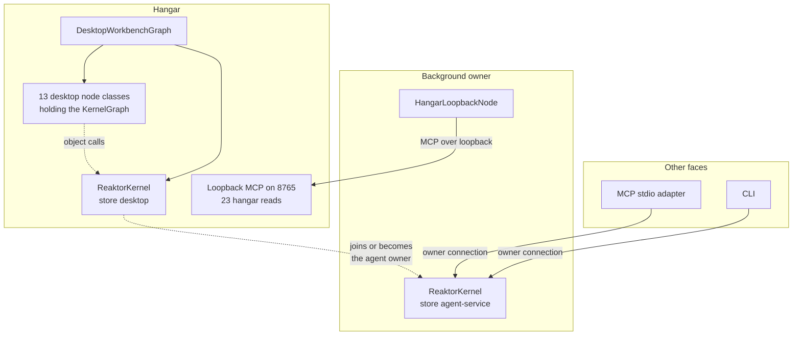
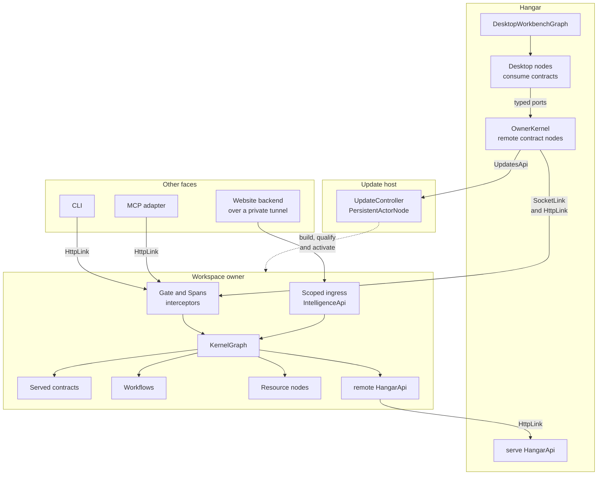
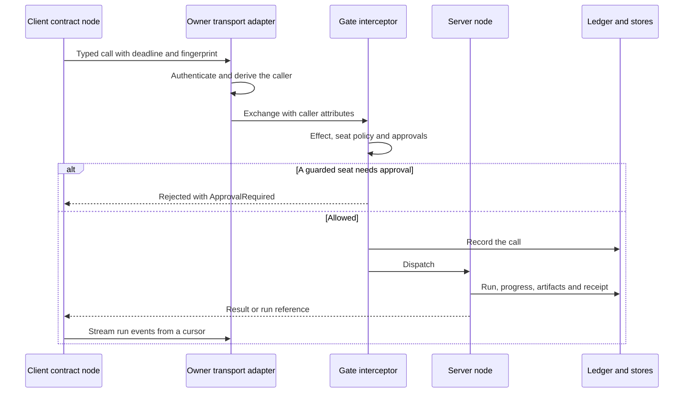
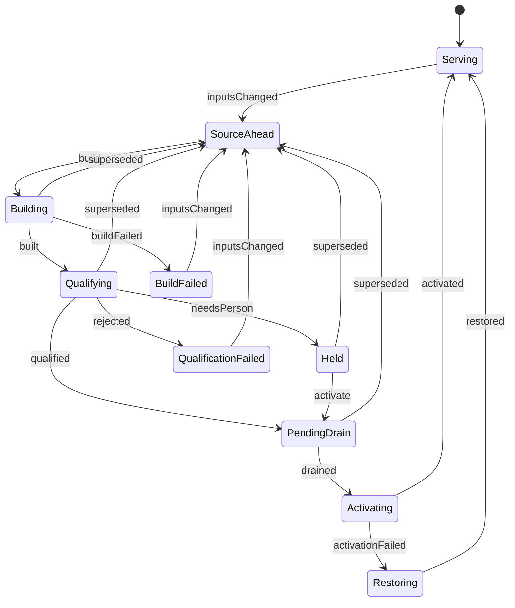
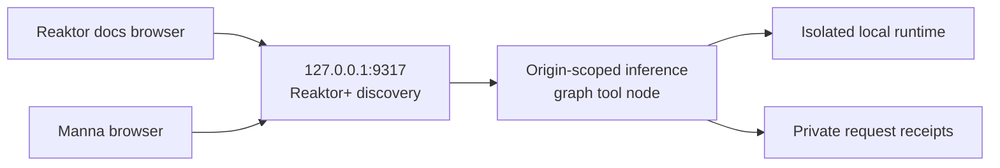
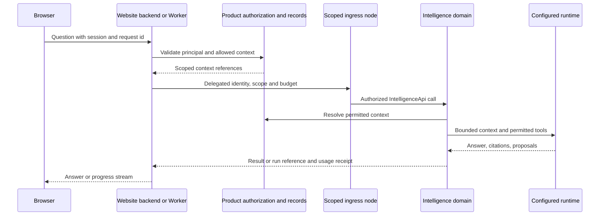
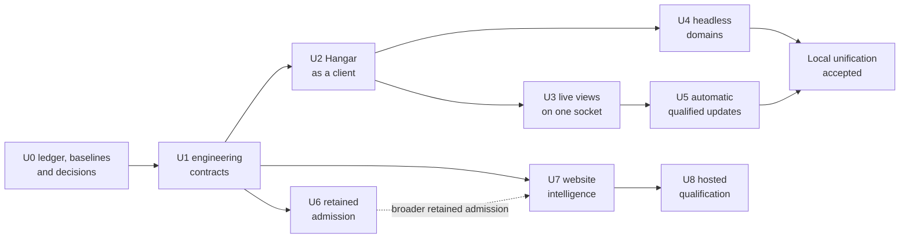

# Reaktor tooling unification: HLD and delivery plan

Written 28 October 2026 for Codex to implement, and revised the same evening. Not published.

**What this revision changes.** The morning draft's outcomes and boundaries stand. This revision builds them from reaktor-graph primitives. Every kernel capability becomes a `reaktor-service` contract that the workspace owner serves as a graph node, and every client reaches it through contract client nodes and typed ports. The update controller is a `PersistentActorNode`, long work runs as `Workflow`s, and stores and outside systems are resource nodes. The revision also corrects five current-state statements (§2.3), writes each work package in the handoff's format (steps, acceptance, budget, don'ts), drops the gRPC trial (§11.2) and orders retained admission after automatic updates (§9).

**Documents.**
- This file holds the target design, the work packages and their acceptance.
- [kernel-handoff.md](/Users/ovd/dev/reaktor/plans/kernel-handoff.md) stays the status ledger. Codex writes each package's budget, evidence and status there; §12 maps the packages to its K rows.
- [graph-protocol-hld.md](/Users/ovd/dev/reaktor/plans/graph-protocol-hld.md) (`rgp/1`) stays the long-term protocol. This plan delivers its local Connect, Query, Watch and Invoke behaviour through the service layer and freezes none of its schemas.
- [cli-kernel-hld.md](/Users/ovd/dev/reaktor/plans/cli-kernel-hld.md) stays the CLI contract. Its grammar, JSON output, request ids, detach behaviour and exit codes do not change.

## Summary

One workspace owner per canonical root runs the kernel graph all the time. Every operation that Hangar, the CLI, MCP and website backends use becomes an operation of a `reaktor-service` contract, served by the owner as a graph node. Each client reaches those contracts through contract client nodes and typed ports, the same way BestBuds screens reach the Workers. Hangar keeps rendering, navigation and local interaction. The owner keeps semantic state, admission and execution. A small update host rebuilds the owner from source, qualifies the candidate and swaps it in.

This design reuses what already runs in production for the BestBuds app and Workers: `ContractNode` through `serve` and `remote`, links, interceptors, the four failure kinds, contract fingerprints and `Compatibility`, the `Backend` relay pattern, `Workflow` activities, `PersistentActorNode`, resource nodes and island shapes. It also finishes the merge that the [service layer page](/Users/ovd/dev/bestbuds/targets/reaktorWeb/docusaurus/docs/reaktor-service.md) names as the largest one left: the kernel, the conductor, DevTools and Hangar's agent reads still declare their operations in a second model, with 88 hand-written MCP tool schemas.

The gaps, highest leverage first:

1. **Hangar builds a second kernel.** Production startup calls `ReaktorKernel.open` inside the Hangar process, on the `desktop` control-plane store, while the background owner runs on `agent-service`. Thirteen desktop node classes receive that `KernelGraph` as a constructor argument, so their kernel calls are object calls the graph cannot show, count or reroute. [E8, E17]
2. **Kernel operations live outside the service layer.** They miss the contract fingerprint, drift detection, deadlines, `OutcomeUnknown`, retries and per-call spans. The MCP and CLI faces describe them from tooling schemas, partly hand-written. [E1, E2, E18]
3. **Source changes reach the owner only by hand.** Someone builds `:kernel:agentDist`, copies it into `~/.reaktor/dist/conductor` and runs `--upgrade`, which drains by polling once a second for up to five minutes and blocks every agent meanwhile. [E5, E6]
4. **Twenty-three capabilities need an open window.** The `hangar.*` reads, including DevTools and the Cloud views, exist only while Hangar runs. [E9]
5. **Hangar polls.** It learns about runs and snapshots by long-polling `kernel.watch`. The owner's rule for live data is sockets, with polling only while a socket is down. [E19]

Delivery follows the owner's order: code intelligence, then native agents, then system ownership, then verification, and working behaviour before resilience. The packages are U0 ledger and baselines, U1 engineering contracts, U2 Hangar as a client, U3 live views on one socket, U4 headless domains, U5 automatic qualified updates, U6 retained admission, U7 website intelligence and U8 hosted qualification (§9). gRPC, FFI as the owner link, distributed ownership, a new agent harness and new approval prompts for local seats are outside this plan; §11.2 says why and when to revisit each.

## 1. Rules for every package

These bind every package. They come from [BestBuds AGENTS.md](/Users/ovd/dev/bestbuds/AGENTS.md) (§1 first moves, §2 design bar, §6 coding rules, §7 stop conditions, §8 verification and §9 kernel coordination), [Reaktor AGENTS.md](/Users/ovd/dev/reaktor/AGENTS.md), the [agent guide](/Users/ovd/dev/bestbuds/targets/reaktorWeb/docusaurus/docs/agent-guide.md) and `kernel-handoff.md` §7.

**Design**
- **The graph is the foundation.** A capability is a node with typed ports, a contract served by a node, a workflow, an actor or a resource node. No new code reaches the kernel through a direct object reference, a global or a service locator. A graph-agnostic facade is added only when a real consumer needs one. See [Graph](/Users/ovd/dev/bestbuds/targets/reaktorWeb/docusaurus/docs/reaktor-graph.md) and [Services](/Users/ovd/dev/bestbuds/targets/reaktorWeb/docusaurus/docs/reaktor-service.md).
- **The least change that meets the design.** Before a package's first edit, write its acceptance evidence and change budget in the handoff Log: new concepts, public API, parameters, stored state and dependencies. Everything unnamed is zero. Reuse costs nothing; then come extending the owning type, a private function, a new type, new public API, a new parameter or stored field, a new dependency, and last a new module. Stop when the evidence passes, then make one removal pass over your own diff.
- **Working behaviour first.** Ship the working path before general recovery or hardening, and keep the correctness and authority checks that path needs. For telemetry, prove application to service to Hangar before anything else.
- **Full access stays the default for local seats.** Add no approval prompts, read-only defaults or confirmation steps for agents. The existing gates stay as they are: reviewed plans for `build.run`, `code.apply` while a Hangar run is active, and production two-person rules. Website principals are external users under product authorization (§7), which is a separate question.
- **Live data travels over sockets.** Polling is allowed only while a socket is down, followed by one catch-up read.
- **Layer boundaries hold.** The kernel stays headless: `verifyKernelBoundary` keeps Compose, Skiko, `engine`, `design`, `app`, `reaktor-ui`, `reaktor-graph` and `reaktor-desktop` out of it [E11]. Generic mechanisms go in Reaktor; product composition stays in BestBuds or Manna. Workbench chrome stays in `modules/engine`.
- **Hangar UI goes through Surface and MachineSignal.** Add no pane, header row or info box. Owner and update status go in the existing Workspace popover and in toasts. Every datum carries its `TruthClass`, and a value that is not wired says what is missing. Identifiers are shown in full.

**Code**
- No comments in new code.
- Use the Kotlin idioms from the agent guide: services as open root classes, `super.op.handle`, `over`, `serve`, `remote`, `consumes`, `autoWire` and `wire`, explicit `StateFlow` backing fields, no `.impl!!`, and no port reads from `init`.
- Use maintained libraries only, pinned in Dependeasy's Kotlin `Versions.kt`. There is no TOML catalog.
- Never hand-edit generated trees.

**Verification**
- Acceptance comes from the modules' existing checks, from model and API facts, and from headless Hangar flows for Hangar behaviour. Never add tests that scan source text.
- Mobile checks use the physical phones on `m1-worker`, and desktop UI checks run on this Mac. Never start an emulator or a simulator.
- Select checks with `checks.affected` and run them as one Gradle run, as BestBuds AGENTS.md §1 item 8 describes, or with `check_run`. Follow a run with `run.wait` at 45 seconds or less, and use the narrowest loop that proves the change.

**Shared checkouts**
- Draw each package with `plan.write` before the first change and keep its statuses current. Call `agent.radar` before editing shared code.
- Commit only your own paths and look at `HEAD` first. No destructive git. Stop only processes you started. Delete only through the guarded helpers.
- Run `~/dev/tools/dev-storage cleanup` before large builds and before finishing. Keep `.remote-dev` and temporary work under their 40 GB budgets.
- Stop and write the reason in the Log when an acceptance needs a new owner decision, another agent's edits overlap yours, a layer boundary would have to be crossed, a step would delete data or untrack `bestbuds/config`, or a step would let an agent approve its own effect.

## 2. Current state

Checked on 28 October 2026 against Reaktor `3b01c8c6` and BestBuds `af2ef501` with their working trees, and against the BestBuds owner built at 16:38 that day. Statements about the running owner are a dated snapshot.

### 2.1 What exists and is reused

| Area | What exists | Evidence |
|---|---|---|
| Service contracts | `open class XApi : Service("id")` declares `get`, `post`, `call`, `stream`, `topic` and `queue` operations. Each declares its `effect`, `idempotency` and `deadline`. Servers override operations with `super.op.handle`, and an operation nobody answers returns 501. | E18 |
| Links | `LocalLink`, `HttpLink` for unary calls, `SocketLink` for calls, cancellable streams, publish and subscribe on one WebSocket, `QueueLink` and the Cloudflare binding links. `SocketSession` serves the socket protocol through a `send` function and `receive(text)`. `Served.dispatch` hands an HTTP request to the right operation. | E20 |
| Call semantics | Deadlines travel as `reaktor-deadline`. `Retry` has a shared budget. Failures are `Rejected`, `Unavailable`, `OutcomeUnknown` or `ContractDrift`. Every call sends `reaktor-contract: <id>@<fingerprint>`, and `Compatibility.between(client, server)` answers Exact, Compatible or Incompatible. | E18 |
| Interceptors | Ordered by position, side and family. They install per process, per graph with `graph.intercept`, per node or per link. `reaktor-auth` supplies `BearerAuthentication`, `AuthRequirements` and `ServiceAccount`. | E18, E21 |
| Graph nodes | `serve` and `remote` create `ContractNode`s with one port per service and one per call. Consumers use `consumes(XApi())` or `consumes(XApi().op)`. `relay` and `Provides` build switchable backends, as in BestBuds `Backend`, `Remote`, `Mocked` and `Build`. `Workflow` has `activity` and `stage`. `PersistentActorNode` has named states, transitions and an `ActorStore`. `ActorNode` has a mailbox. `ResourceNode` is used through `uses(...)`. `Graph.shape()` and island catalogs describe it all as data. | E21 |
| Tooling operations | `Operation<I,O>` carries its own `SafetyClass` with twelve values, a schema, `effectFor` and `appliesOwnPlan`. Operations sit on `OperationNode`s, which the `OperationKernel` finds by walking the graph. `OperationJson` rejects unknown keys. Replies are replayed from a 256-entry in-memory cache. | E1, E2, E23 |
| Kernel graph | `KernelGraph` holds 17 nodes, from operations, catalog and database to agents, ledger, code, engineering, crashes and telemetry. It autowires and checks `requireFullyWired()`. `kernel.graph` reads it live. | E10 |
| Owner | `AgentWorkspaceConnection` takes `owner.lock` and publishes root, version, port, token, process id, incarnation, catalog digest and host kind (`service` or `hangar`). Whoever opens first without finding a lock becomes the owner. `AgentBackgroundService` installs a launchd agent, connects, stops and upgrades. `AgentServiceRuntime` snapshots content-addressed images. | E4, E5, E6 |
| Owner entry | `KernelAgentService` opens `ReaktorKernel` on the `agent-service` store and attaches the Hangar loopback bridge. | E17 |
| Clients | `KernelLink` and `OwnerLink` forward `Invocation`s. The CLI's `runKernelCli` uses `OwnerLink`. The MCP host projects `kernel` and direct tools from the catalog. | E7 |
| Hangar | `DesktopWorkbenchGraph` mounts the kernel graph under a `/kernel` container and passes it to its desktop nodes. Production startup opens its own kernel. The `hangar.*` reads reach the owner through `HangarLoopbackNode` while Hangar runs. | E8, E9, E17 |
| Observation | `kernel.watch` long-polls for up to 25 seconds and pages at most 64 items or 192 KiB, with collection fingerprints. | E19 |
| Freshness | `kernel.status` names the running image, its build time, the process start, a capabilities digest and the commits made since the build. | live |
| Admission precedent | `KernelAgentCheckRunner` records a check admission before dispatch, refuses a reused request id with different content, and reports the gap after a crash as an unknown outcome. | E22 |
| Coverage | `graph.coverage` compares compiled islands with the worker fleet and manifests. `DesktopGraphCoverage` reports Hangar's wired modes and unconnected consumers. | E21, E8 |
| Plans | The live owner serves `plan.write` and `plan.attach`, with `agent.plan.read` and `agent.plan.shape` beside them. | live |

### 2.2 The live catalog by Hangar mode

`operation.catalog` lists 272 entries, and `kernel.status` counts 286 operations. 98 entries are `agent.*`, and 48 of those repeat a top-level id such as `plan.write` or `taskgraph.start`. 23 entries are `hangar.*` reads that exist only while Hangar runs. This table is the starting point for the parity ledger in U0; it counts operations, and parity is measured in pane actions.

| Hangar mode | Headless operations today | Only while Hangar runs |
|---|---|---|
| Graph | `graph.describe`, `graph.query`, `graph.coverage`, `kernel.graph`, `atlas.graph`, `islands.refresh`, `system.topology` | `hangar.app-graph-*` (5), `hangar.graph-snapshot`, `hangar.system-trace`, `hangar.architecture-snapshot`, `hangar.list-apps` |
| DevTools | `device.inventory` | `hangar.devtools-*` (7) |
| Studio | `subgraphs.*` (3) | `hangar.subgraph-source` |
| Agent | `agent.*`, `task.*`, `taskgraph.*`, `plan.*`, `board.*`, `message.*`, `memory.*`, `profile.*`, `peer.exchange`, `session.*` | none |
| UI | none | `hangar.workbench-selection` |
| Data | `database.schema` | none |
| Auth | `auth.check`, `auth.inspect`, `auth.interchange`, `auth.propose` | none |
| AI | `inference.ask`, `context.query`, `context.select` | none |
| Testing | `check.*` (6), `checks.affected`, `build.affected` | none |
| Build | `build.*` (11), `run.*` (5), `ship.*` (5) | none |
| Cloud | `cloud.api.*` (6) | `hangar.cloud-*` (5) |
| Telemetry | `telemetry.*` (9) | none |
| Analytics | none | none |

The table leaves out code intelligence (`atlas.query`, `atlas.read`, `atlas.providers` and `change.*`), the operations that serve the faces themselves (`operation.*`, `tool.*`, `provider.*`, `connection.status`, `control.plane.snapshot` and `access.map`) and cross-cutting ones (`bench.*`, `work.*`, `radar.start`, `mcp.tasks` and `source.declaration`). U0's contract list assigns each of them to a contract.

Thirteen desktop node classes take the `KernelGraph` as a constructor argument: the database, auth, radar, cloud, telemetry, agent, notices, pane-state, work-host, system-links, graph-pane, shell and per-mode pane nodes. The log index takes the kernel's operations node.

### 2.3 Corrections to the morning draft

- The draft said `DesktopWorkbenchGraph` "can construct" an embedded kernel. Production Hangar always builds one, on its own `desktop` store, and its agent workspace becomes the owner whenever no background owner holds the lock. [E17]
- The draft reported that the live owner lacked `plan.write`. The current owner serves it, and `kernel.status` already reports the commits made since the running build.
- The draft proposed new handshake fields for catalog digests, protocol versions and contract versions. The service layer already provides fingerprints, `Compatibility`, `ContractDrift`, `OutcomeUnknown`, `Idempotency.Keyed` and deadlines. [E18]
- `SafetyClass` has twelve values and `Effect` has eight. The four local classes, `LocalEphemeral`, `LocalArtifactWrite`, `SourceWrite` and `DeviceWrite`, exist only in tooling. Contract decoding ignores unknown keys, while `OperationJson` rejects them, so agent arguments need strict validation at the adapter after the move. [E23, E24]
- A retained admission with conflict detection already exists for check runs, so retained admission generalizes that pattern. [E22]

### 2.4 The gaps in detail

1. **Two kernels per workspace.** Hangar's runs, history and approvals land in `desktop`, and the owner's land in `agent-service`, so the faces can disagree about history. The handoff's K4 row still lists a single operational store and a fully owner-backed Hangar as open, and its 25 October qualification records an earlier owner-lock blocker between Hangar and the owner.
2. **Kernel calls bypass the graph.** The Graph pane cannot draw these edges, spans carry no wire ids, and the kernel cannot be swapped for a remote one by rewiring.
3. **Two contract models.** `Operation` and `Service` both describe typed calls with effects. Kernel calls get none of the service layer's fingerprint, drift, deadline and outcome semantics, and the operation catalog is a second registry beside the contract shapes.
4. **Manual activation.** The running owner lags the source until a person installs a new distribution. The staged `modules/kernel/build/agent-dist` is rewritten by anyone's build, and the installed owner can reject a build model exported from newer source.
5. **GUI-only capabilities.** DevTools devices, app-graph reads, Cloud resource views and the workbench selection need an open window. The device endpoint terminates in Hangar.
6. **Polling for live views.** `kernel.watch` and the upgrade drain both poll.
7. **No general retained admission.** Replay is in memory and keyed by caller and request id. Only check runs keep an admission across a restart. Automatic restarts and website retries need it.

## 3. Target design

### 3.1 Today and the target

Today, two processes can each hold a full kernel:



The target has one kernel, and every face reaches it through contracts:



Arrows run from caller to callee. The owner process runs the kernel graph. Its domain server nodes serve the contracts, gate and span interceptors sit on the whole graph, long work runs as workflows, and stores and outside systems are resource nodes. Hangar holds contract client nodes and serves a small `HangarApi` for what only a window can answer. The CLI and the MCP adapter bind contract clients to the same owner link. A website reaches only the scoped ingress node. The update host is a separate small process that builds, qualifies and activates owner images and publishes its status as a contract.

### 3.2 Kernel capabilities are contracts served by graph nodes

Each kernel domain becomes one contract root with a server beside the domain node that executes it. A migrated operation keeps its id, its input and output types, its effect and its summary; only the way it is declared and served changes. The names in this example come from the run domain:

```kotlin
open class RunsApi : Service("reaktor.run") {
    open val list by call<RunQuery, RunPage>(effect = Effect.ReadOnly)
    open val show by call<RunRef, RunRecord>(effect = Effect.ReadOnly)
    open val logs by call<RunLogQuery, RunLogPage>(effect = Effect.ReadOnly)
    open val wait by call<RunWait, RunRecord>(effect = Effect.ReadOnly, deadline = 30.seconds)
    open val cancel by call<RunRef, RunRecord>(effect = Effect.LocalEphemeral, idempotency = Idempotency.Natural)
    open val events by stream<RunCursor, RunBatch>()
}

class RunsServer(private val ledger: RunLedger, private val control: RunControl) : RunsApi() {
    override val list = super.list.handle { query -> ledger.page(query) }
    override val show = super.show.handle { run -> ledger.record(run) ?: reject(404, "No run ${run.id}") }
    override val logs = super.logs.handle { query -> ledger.logs(query) }
    override val wait = super.wait.handle { request -> ledger.await(request) }
    override val cancel = super.cancel.handle { run -> control.cancel(run) }
    override val events = super.events.handle { cursor -> ledger.events(cursor) }
}
```

`KernelGraph` serves it with `serve(RunsServer(ledger, control))`. The five calls are today's five `run.*` operations with the effects the catalog lists for them. `wait` declares a deadline above its 25-second wait, and U3 adds the `events` stream. The request and result types are the ones the existing operations already use; the example's names stand in for them.

- **Where contracts live.** A contract root lives in the Reaktor module that owns its vocabulary, and its server lives beside the node that runs it, which for most domains is the BestBuds kernel. This keeps the vocabulary open and the host closed, as the kernel plan already decided. §3.8 lists the homes.
- **Operation ids stay the same.** The CLI and MCP id of an operation is the last segment of its contract id, a dot, and the operation's name. Operations whose current verb is not a Kotlin property name, such as `telemetry.fleet-refresh` or `taskgraph.template.convert`, declare it with `name`.
- **Summaries are part of the contract.** Every face shows one, so `Operation` and `OperationShape` gain a `summary`. It is descriptive and stays out of the fingerprint, so rewording a summary never reads as contract drift.
- **Argument schemas come from the serializers.** The existing `jsonSchema()` and `@Describe` produce the MCP and CLI forms from each operation's request serializer. Agent and CLI arguments stay strictly validated at the adapter, so a misspelled argument is still refused even though contract decoding between Reaktor processes ignores unknown keys.
- **One effect vocabulary.** `Effect` gains `LocalEphemeral`, `LocalArtifactWrite`, `SourceWrite` and `DeviceWrite`, placed in `SafetyClass` order. `SafetyClass` remains only as the door policy's ranking over `Effect` and goes once nothing declares it (O3).
- **Effects that depend on arguments.** An operation whose effect depends on its input, such as a SQL statement, declares its lowest effect on the contract and keeps its classifier on the server node. The gate takes the higher of the two, so a classifier can only raise an effect. Owner decision during implementation: `change.apply` keeps its advertised `SourceWrite` effect and its existing exception for a saved receipt. Its server may classify only that receipt-only replay as `ReadOnly`; fresh applications retain the source-write gate.
- **Outcomes.** A completed call returns its value. Approval-required, denied and refused become `Rejected` failures carrying typed problems (`ApprovalRequired`, `Denied`, `Refused`) that clients read with `problemAs`. A failed call becomes `Rejected` or `Unavailable` according to its cause, and a lost reply is `OutcomeUnknown`. The CLI keeps exit codes 0, 1, 2 and 3, and MCP keeps its outcome types.
- **A bridge while the migration runs.** `KernelApi` serves `hello`, `catalog`, `describe` and `invoke`. `invoke` carries every operation that has not moved yet, so the CLI and MCP keep working through one link. Each migrated domain removes its operations from the bridge, the catalog becomes the union of contract shapes and remaining bridge entries, and the bridge's `invoke` is deleted when it carries nothing (K8).

### 3.3 One gate for every face

The owner's transport adapter authenticates each connection: the owner bearer for local faces, scoped credentials for the ingress. It derives the caller (seat, session, run and principal) and places it in the exchange attributes. Arguments never carry authority, so a `caller` field or an open TTY grants nothing.

`OperationKernel`'s decision path moves into a server interceptor installed once with `graph.intercept(...)` on the owner graph: seat policy, approvals, confirmation phrases, the call log, the run sink and invocation telemetry. It keeps the same policy files, the same approvals directory and the same full-access default. Every served contract passes it, whichever face made the call.

A `Spans` interceptor on the owner graph, built with the owner's island id and the kernel's span sink, turns each kernel call into a span carrying the node, port and wire. `telemetry.signals` and the Atlas `runtime` preset then cover the owner island the way they cover a Worker.



Long operations return a run reference within their deadline. A call's deadline ends observation and leaves the run alone; `RunsApi.cancel` is the only way to cancel accepted work. Today cancelling an invocation can reach into its execution [E2], so each migrated long operation is qualified for that.

### 3.4 Clients reach the owner through contract client nodes

**Hangar** follows the BestBuds backend pattern [E21]:

```kotlin
abstract class KernelServices(parent: Graph) : Graph(parent, label = "Kernel") {
    abstract val runs: Provides<RunsApi>
    abstract val atlas: Provides<AtlasApi>
    abstract val checks: Provides<ChecksApi>
}

class OwnerKernel(parent: Graph, calls: Link, streams: Link) : KernelServices(parent) {
    override val runs by lazy { remote(RunsApi() over streams) }
    override val atlas by lazy { remote(AtlasApi() over calls) }
    override val checks by lazy { remote(ChecksApi() over calls) }
}
```

- `OwnerKernel` provides each contract with `remote(XApi() over link)`. Its members are lazy, so an unused contract opens nothing. Until U3 adds the socket, `calls` and `streams` are the same `HttpLink`, and live views keep reading `kernel.watch`.
- `LocalKernel` opens a disposable owner graph on temporary state and binds each contract with `LocalLink` to the `Served` of that graph's server node. `Served.call` runs the server pipeline, so tests pass through the same interceptors and gate. Construction picks the variant; nothing falls back from one to the other.
- `DesktopWorkbenchGraph` receives a `KernelServices` graph. Its `kernelGraph` parameter, the `ownedKernel` it builds and the `/kernel` container go away. Desktop nodes declare `consumes(RunsApi())` or `consumes(RunsApi().cancel)`, and `wire()` connects them.
- What only a window can answer, such as the workbench selection, becomes `HangarApi`, served on Hangar's existing loopback port. The owner consumes it with `remote(HangarApi() over …)`, and `HangarLoopbackNode` goes. While Hangar is closed its calls return `Unavailable` with the reason.

**The CLI** keeps its grammar, JSON output, request ids, detach behaviour and exit codes. `OwnerLink` becomes a `KernelApi` client, and commands of migrated domains call their typed contracts.

**MCP** keeps `kernel` and up to eight direct tools (handoff D5), projected from the served contract shapes and the bridge. Discovery and authorization follow the MCP standard, and the protocol era is handled at the adapter.

### 3.5 Links, compatibility and the loopback carrier

- **First cut, U1 and U2.** The owner's existing authenticated loopback server gains a contract route that hands each request to `Served.dispatch`. Clients use `HttpLink` with the owner bearer from the discovery file. This needs no new dependency.
- **Live views, U3.** The JDK `HttpServer` behind `LoopbackMcpServer` has no WebSocket support, so U3 moves that listener onto Ktor's CIO server engine with the websockets plugin, at the pinned Ktor 3.1.0, keeping its paths, token checks and limits. `ktor-server-core` already reaches the kernel through the MCP SDK 0.7.2 [E26], and the CIO engine and the websockets plugin are the one new dependency in this plan (O4). A WebSocket route on the owner's port runs one `SocketSession` per connection over the served contracts. Hangar binds streaming contracts to `SocketLink` and keeps unary calls on `HttpLink` unless U3's measurements give a reason to move them.
- **Compatibility.** On connect, a client calls `KernelApi.hello`. The answer carries the owner incarnation, the active release, the source and image digests, the update status and the served `ContractShape`s. The client runs `Compatibility.between` for each contract it consumes. The client never calls an Incompatible contract, and it shows "owner behind source" or "Hangar behind owner" from the update status. Every call still carries `reaktor-contract`, so drift after a reconnect arrives as `ContractDrift`.
- **Other carriers.** gRPC and FFI do not carry the owner link in this plan (§11.2). Each would be one more `Link` implementation if a measured need appears.

### 3.6 Long work, stores and the owner's island

- **Long work is a workflow.** Build runs, check runs, agent task dispatch and candidate builds are `Workflow`s whose steps are activities with declared effects. The Graph pane shows their step graphs, and their spans carry definition ids.
- **Stores and outside systems are resource nodes.** The control-plane store, run ledger, plan store, admission store, receipts and image store are resource nodes, as are the Gradle router and `m1-worker`, launchd, the native Claude and Codex runtimes, the docs corpus and the Manna API. Each access goes through `uses(...)`, so it is a graph call with an effect.
- **The owner is an island.** `kernel.graph` already reads the live kernel graph. A `GraphApi.shape` operation serves it as an `IslandShape` with the owner host, incarnation and release. Hangar's Graph pane draws it beside Hangar's own graph and the app islands. Stitch wires between Hangar's contract client nodes and the owner's server nodes rest on the contract link, which is the second exception the Graph pane rule allows.
- **Coverage is measured.** `graph.coverage` extends to the owner island: each served contract, each client node wired to it, each required workflow activity, and each resource node reached through a port. This is how the plan measures graph coverage (§10).

### 3.7 Definitions, activations and truth

The graph describes capabilities, contracts, ownership and relations. A running provider is an activation of those definitions, with an incarnation, an environment, a principal, a revision and a health. These stay separate, so a stale index, a disconnected device or a closed Hangar never makes a capability's definition disappear, and an old observation never passes for a current one.

Availability is explicit: available, starting, stale, disconnected, unsupported or denied, with the time and source of the last observation. Existing `TruthClass` and `Fact` semantics carry it to the panes. Features proposed for Reaktor V2 are not prerequisites unless they are built and qualified for this path.

### 3.8 Where each piece lives

| Piece | Home | Reason |
|---|---|---|
| Four local `Effect` values, `summary` on operations, the keyed admission interceptor | `reaktor-service` | The contract layer owns effects, idempotency and server interceptors |
| `KernelApi` and the contract roots for runs, build, ship, checks, Atlas, changes, data, auth, cloud, graph, devices, studio, telemetry and intelligence, with their request and result types | `reaktor-tooling`. A domain whose types already live in another Reaktor module that depends on `reaktor-service` keeps its root there | The open vocabulary lives in `reaktor-tooling` (kernel plan), which already depends on `reaktor-service`, `reaktor-code` and `reaktor-telemetry`. `reaktor-code` keeps `CodeWorkspace` and gains no dependency |
| Contract roots for agents, tasks, task graphs, plans, board, messages, memory, profiles, peers and updates; `UpdateController` | `reaktor-conductor` | It owns workspace supervision, the update mechanics and the agent lifecycle |
| `HangarApi` | Root in BestBuds `modules/kernel`, server in `targets/reaktorDesktop` | The owner consumes it, and the kernel may not depend on the desktop target |
| Loopback listener, contract route and socket route | `LoopbackMcpServer` in `reaktor-tooling`, which `AgentWorkspaceConnection` in `reaktor-conductor` opens | The owner's carrier lives there |
| Servers, gate composition, product domains, the owner graph | BestBuds `modules/kernel` | The closed product host |
| `KernelServices`, `OwnerKernel`, `LocalKernel` and pane consumers | BestBuds `modules/engine` | The workbench host |
| CLI grammar | BestBuds `targets/reaktorCli` | Unchanged |
| MCP projection from shapes | BestBuds `KernelAgentMcpHost`, with generic pieces in `reaktor-mcp` and `reaktor-tooling` | Product composition over generic mechanics |

The plan adds no module. Hangar already pays for the kernel module's dependencies today. A separate client-only contract module is worth its cost only if U0 measures a distribution-size or startup cost that the split removes, which is the `reaktor-module` skill's test.

## 4. Hangar capability parity

Parity means an authorized client can complete the same operational workflow and inspect its evidence. Reproducing every pane gesture in a terminal is out of scope. The ledger starts from real pane actions and their backend calls; counting operation names says nothing about parity.

| Hangar mode | Target contracts | Extraction needed first | Stays in Hangar |
|---|---|---|---|
| Graph | `GraphApi`: shapes, islands, findings, paths, explanations | App-graph reads move to the owner once device connections terminate there | Canvas, layout, selection |
| DevTools | `DevicesApi`: inventory, attachment, elements, logs, requests, sockets, audits | The device endpoint moves from Hangar into the owner | Window control and capture |
| Studio | `StudioApi`: read, validate and propose authored definitions through `change.plan` | Definitions are read from source in the owner | Visual composition, previews, editor state |
| Agent | Conductor contracts for tasks, plans, board, messages, memory and peers | Delete the 48 `agent.*` aliases | Conversation rendering, approval clicks |
| UI | `HangarApi.selection` and UI inspection through `DevicesApi` | Inventory supported UI schemas | Rendering, pointer input, platform windows |
| Data | `DataApi`: connections, bounded reads, query plans, reviewed mutations, exports | Database sessions move out of `DesktopDatabaseNode` | Grid, selection, query editing |
| Auth | `AuthApi`: directory, sessions, drafts and authorized management | Directory sessions move out of `DesktopAuthNode` | Credential entry, interactive provider login |
| AI | `IntelligenceApi`: scoped context, inference, citations, usage | None | Prompt editing, results |
| Testing | `ChecksApi`: discover, plan, run, cancel, correlate artifacts and device results | None | Result inspection, replay controls |
| Build | `BuildApi`, `RunsApi`, `ShipApi` | None; already headless | Tree, plan and artifact views |
| Cloud | `CloudApi`: resource queries, diffs, plans, apply, reconcile | Resource reads behind `hangar.cloud-*` move into the owner | Resource views, plan review |
| Telemetry | `TelemetryApi`: ingestion status and retained queries correlated to workspace, app and run | Prove one real event end to end first | Charts, traces, incidents |
| Analytics | Inventory the exact queries and metrics first | Everything | Dashboard layout, exploration state |

For every action the ledger records its definition, current backend owner, GUI dependency, operation id, target contract and operation, input and output types, effect, principal, target scope, freshness, run behaviour, provider requirements and qualification evidence, and one disposition: exposed, extraction needed, desktop-only or unsupported. A row closes when Hangar's graph shows the pane consuming the contract. The ledger is the definition of done for parity.

Extract each backend decision before putting it behind a contract. A database write moves its validation and reviewed mutation plan into a domain operation; calling a pane callback remotely would keep the dependency this work removes. A desktop-only operation stays explicitly dependent on a desktop provider and reports that dependency when the provider is absent.

## 5. Continuously running and continuously updated

### 5.1 Ownership

The background owner is the only production owner. Hangar's startup discovers the workspace, connects through `AgentBackgroundService.connect`, which installs or starts the launchd agent when needed, and builds `OwnerKernel` over the discovery record. Hangar never opens `owner.lock`, never hosts and never falls back to an embedded writer. This supersedes handoff decision D3, which let Hangar host when it started first (O1). Tests and headless flows that need a disposable owner build `LocalKernel` on temporary state.

The `desktop` store's runs and history migrate into the owner's store once, and the per-surface sessions stop being written (K4 step 2). One owner per canonical root remains the rule. Overlapping physical source scopes across different owners, such as the Reaktor checkout included by both BestBuds and Manna, keep one writer at a time through the existing source-scope checks and `agent.radar`; two root locks do not protect one shared checkout.

"Always running" means an OS-supervised user service while the Mac is awake. It does not promise internet availability while the Mac sleeps; production website availability needs a qualified hosted owner (U8) or an explicit agreement about the local host (O7).

### 5.2 The update host

The update host is a small, separately supervised process with its own launchd label, launched from the pinned last-good image. Its graph holds one `UpdateController`, a `PersistentActorNode` with the states and transitions below and an `ActorStore` file in its own directory, plus resource nodes for the build router, the image store, launchd and the owner. It serves `UpdatesApi` (status, candidates, hold and activate) on its own loopback endpoint with the same token scheme. Hangar and the CLI read it, and the owner reads it to fill the update status in `hello`.

It has no product graph, no inference loop and no build scheduler of its own; it drives the existing build router and service administration code. A per-workspace update lock serializes it with manual upgrades. Its status stays available while the owner is stopped. Updating the update host itself is a separate, manual activation, so a broken kernel change can never remove the only updater.

```kotlin
class UpdateController(graph: Graph, private val candidates: Candidates, store: (Graph) -> ActorStore<UpdateInput, UpdateState>) :
    PersistentActorNode<UpdateInput, UpdateState>(graph, "updates", "Updates", UpdatePhases, UpdateTransitions, { it.phase.name }, store) {
    private val host = uses("gradle", "images", "launchd")
    private val owner by consumes(KernelApi())

    val build = transition("build", Effect.LocalArtifactWrite) { input, state -> host { candidates.build(input, state) } }
    val qualify = transition("qualify", Effect.LocalEphemeral) { input, state -> host { candidates.qualify(input, state) } }
    val activate = transition("activate", Effect.LocalArtifactWrite) { input, state -> host { candidates.activate(input, state, owner) } }
}
```

`Candidates` holds the build, qualification and replacement steps. It reaches Gradle, the image store and launchd through `resource(...)` calls, which the `uses` block routes through ports to the update host's resource nodes, so every step is a traced graph call with its effect. The owner's drain stream and `hello` arrive through the consumed `KernelApi`. The other messages in §5.3 follow the same form.

### 5.3 Update states



The old owner keeps serving while a candidate builds and qualifies; the states describe the update, and the service stays up through all of them until `Activating`. `Held` is a qualified candidate that needs a person, such as one with an incompatible store or contract change. Every transition keeps the candidate digest and its failure evidence, so anyone can see why source and executable differ.

### 5.4 Building and qualifying a candidate

1. **Inputs.** Read the declared runtime inputs of `:kernel:agentDist` from the exported build model: Kotlin, TypeScript and native sources, build logic, generated contract inputs, resources and toolchain facts. `build.affected` already computes declared input changes, so no second filesystem scanner is needed. A docs edit does not rebuild the kernel; published tool contracts do take part.
2. **Coalescing.** Coalesce rapid edits by input digest and build one candidate at a time per owner. A newer digest supersedes an unactivated candidate; it never stops the active owner or unrelated builds.
3. **Build.** Build each candidate into its own output directory under the update host's state, through the configured `./gradlew` wrapper and the load router. Never build into the shared `modules/kernel/build/agent-dist`, which other sessions rewrite. Run storage cleanup first.
4. **Image and manifest.** Snapshot the candidate into the content-addressed image store and write its release manifest: commit ids, the working-tree input digest, toolchain and build facts, the operation catalog digest, contract fingerprints, the build-model schema version, compatible store versions, checks and artifact checksums. A commit id alone cannot identify a candidate while agents have uncommitted edits.
5. **Consistent inputs.** If sources changed during compilation and the build cannot establish one consistent input set, reject the candidate and build the newer digest. Never label mixed output with the last observed source digest.
6. **Qualification in isolation.** Start the candidate with a temporary state directory, no owner lease, no agent starts and no effectful credentials. Probe `hello`, the catalog, contract compatibility with the clients in use (the installed Hangar, the CLI and the MCP adapter), migrations on a disposable copy of the state, the build-model reader against the current `model.json`, and focused checks. A candidate never takes the production lease to prove it is ready.
7. **Activation policy.** Activate qualified compatible candidates automatically. Hold incompatible ones for a person, and keep failed ones visible while the last good release serves.

Physical-device checks and installation run on `m1-worker`, desktop UI checks stay on this Mac, and only the active and last-good images plus a bounded candidate history are retained. See the [tools guide](/Users/ovd/dev/tools/README.md).

### 5.5 Activation and recovery

The first implementation extends the existing serial replacement. The owner publishes its drain state as a stream, and the update host subscribes to it, replacing today's once-a-second poll. During the drain the owner refuses new effectful and long calls with `Unavailable` and a `Retry-After`, reads continue, and accepted runs finish. Then it flushes retained state and stops. The new process starts from the candidate image, takes the lease, publishes discovery atomically, and clients reconnect through `hello`.

A reply lost exactly at the switch reaches its caller as `OutcomeUnknown`, which `Retry` never repeats for an unsafe call. That bounds the risk of automatic activation before retained admission (U6) adds lookup and recovery.

Native agents are never killed to meet a timer. While runs block the replacement, the status reads `update pending` and names them. Moving agent execution into separately supervised workers is worth doing only if measured update delays justify a new recovery protocol; a new kernel cannot inherit arbitrary JVM objects or native sessions from the old one.

Incarnation changes invalidate transient streams, while durable run and approval ids stay stable. Two writers never share the production stores to simulate zero downtime. State changes use expand-and-contract migrations where possible. A destructive migration needs its own reviewed procedure, and when safe recovery cannot be established the activation fails before it touches the store. Keeping an old image does not make rollback safe after a new program has written an incompatible store.

## 6. Retained admission

Effectful kernel operations declare `Idempotency.Keyed`. A server interceptor in `reaktor-service`, backed by an admission store reached through a port, gives keyed calls these properties:

- The admission is recorded before dispatch. Its key is scoped to the workspace, the authenticated principal and the request id. Its digest covers the operation contract, the target, normalized arguments, the principal and delegation scope, and the plan or preconditions, and leaves out delivery-only fields such as trace ids.
- The same key with a different digest is `Rejected` as a conflict. Concurrent identical submissions join one admission.
- A crash between an external effect and its receipt leaves the admission as an unknown outcome with a lookup reference, and nothing is dispatched a second time. Reconciliation uses provider idempotency keys or inspection of external state where available. The plan claims no exactly-once behaviour for arbitrary outside systems.
- Looking up a recovered result authorizes the caller again. Admission records have an advertised retention, and an expired key is refused.
- States distinguish admitted, awaiting approval, executing, succeeded, failed, cancelled and unknown.

`KernelAgentCheckRunner` moves onto the shared admission, and its private store goes. Admission, reviewed plans, approvals, terminal receipts and artifact references are recovery-critical state. Semantic indexes and compiled projections are rebuildable. Logs, telemetry and large artifacts each get their own retention. Secrets are redacted by domain-aware policy before any argument or result is stored or exposed.

## 7. Agent and website intelligence

### 7.1 Agent ownership

The native-agent runtime boundary stays. The kernel owns task identity, tool authority, context selection, run references and evidence; the selected runtime owns its reasoning and tool loop. MCP is a tool interface, peer exchange is agent-to-agent communication, and the runtime protocol drives the harness. These roles stay distinct.

Website questions and engineering tasks may share context and tool primitives, but they use different principals, allowed operations, time and cost budgets and execution environments. A public website request never becomes an unrestricted development agent, and it is never charged to a personal native-agent subscription; runtime credentials and permitted use are configured for that service.

`IntelligenceApi` is the domain contract: authorized context selection, a bounded context packet with provenance, a runtime call, an answer with citations, proposed actions, and usage and receipt references. Mutations stay typed proposals under the product's own authority.

### 7.2 Scoped ingress

**Owner priority, 28 October.** Reaktor+ websites come first. The first useful vertical is browser-to-localhost on an admin machine: an explicitly selected, OS-supervised owner listens at `http://127.0.0.1:9317/reaktor-plus/v1`. Manna and Reaktor docs discover that endpoint automatically; absence means local intelligence is unavailable and ordinary website functionality continues. Presence is a machine capability, not proof of a Manna user or record permission. The fixed listener exposes only the existing graph-owned question-only inference projection, with exact approved origins and separate per-origin browser credentials. It never exposes the owner bearer or engineering tools. The existing isolated signed-in Antigravity runtime serves this admin-operated local use; it is not public backend inference.

This first slice precedes the remaining Hangar migration and automatic updater. It keeps request-id admissions and answers in the existing private browser-inference store so reconnecting cannot start a second costly call. Public docs retain deployed corpus revisions and citations. Manna initially sends only the typed question; its existing API must authorize any later record context and retain the product receipt. The typed IntelligenceApi and backend-to-ingress path below follow this working browser vertical.




The ingress is a second served node on its own listener, with its own secret. Its server side runs reaktor-auth's `BearerAuthentication` and `AuthRequirements`, which admit only the website service principals, and the docs Worker attaches its credential with `ServiceAccount` on the client side. It serves only `IntelligenceApi`. It follows the existing `HybridConnector` pattern, a separate loopback listener with its own secret that a tunnel can expose [E25]. A remote Worker reaches it through a configured tunnel or outbound connector. The browser and the website never receive the owner bearer, and the ingress refuses it.



### 7.3 Ask Reaktor docs

The docs Worker handles authentication, comments and private assets today, and browser WebMCP registers docs-search tools [E15]. Neither is kernel intelligence yet.

- The corpus is the published public docs at the deployed revision, built from the generated `llms.txt`, `graph.json`, `outline.json` and the page Markdown. Every answer records that revision and cites pages.
- Public requests see public material only. Private docs and workspace source need their own authenticated audience and never enter public caches or answers. The existing private-asset protections stay.
- The Worker stays thin: it authenticates the browser, calls the ingress with its service credential and streams progress. When the owner is offline, ordinary docs and search keep working and the page says intelligence is unavailable.
- An ask reconnects by request or run id. A dropped connection never produces a made-up answer or silently starts the same costly request again; this uses U6's keyed admission.

### 7.4 Manna

Manna already has an intelligence ask client and retained conversation fields for citations, context, proposals and usage [E16]. Its public API stays the contract, and the kernel never becomes Manna's record authority.

- Manna resolves record visibility, agent identity and transitive privacy through its own API rules, then calls `IntelligenceApi` with product-scoped credentials. The kernel receives only permitted context.
- Private records are never mirrored into a workspace index. An MCP principal never bypasses the public application's authorization.
- Revocation, deletion and redaction apply to retained retrieval artifacts and to answer access.
- The first vertical is a read-only answer over a small authorized context, with citations and a retained Manna receipt. Typed proposals come after it works. Citations and proposed actions resolve under the same principal that asked.

## 8. Hosted placement on Cloudflare

Cloudflare Containers route through a Worker and a Durable Object, accept HTTP ingress, run Linux amd64 images and have no durable disk [Container architecture](https://developers.cloudflare.com/containers/concepts/architecture/). A hosted owner therefore needs a foreground entry point and explicit persistence, and it cannot depend on the desktop's launchd service.

- Pin the qualified distribution and runtime into an immutable image, and put the image identity in the release manifest [Image management](https://developers.cloudflare.com/containers/guides/image-management/). Persist admissions, receipts and artifact references outside the container's disk, choosing each store from its domain's needs.
- Worker and container releases overlap during rollouts, so contracts stay compatible across that window and state migrations are gated separately [Container rollouts](https://developers.cloudflare.com/containers/configuration/rollouts/).
- One authoritative owner placement per workspace. A cloud owner delegates local builds and device access to authenticated providers; a local owner serves scoped remote intelligence. Distributed takeover needs a real lease and fencing design first.
- The hosted link is HTTP plus the socket protocol through the Worker and Durable Object, qualified on the real path.

Sequence: serve docs intelligence from the local owner through the ingress (U7); package a read-only docs owner in a container and prove authentication, corpus restoration, answers, retained receipts and restart recovery on the platform (U8); host a writable repository owner only after checkout persistence, secret scope, resource budgets and recovery qualify; add a local execution provider for devices that accepts explicit scoped jobs. The [server deployment report](/Users/ovd/dev/reaktor/reports/server-agent-deployment-2026-10-28.md) covers native-agent placement and model evaluation; reuse it and add no inference router or orchestration loop here.

## 9. Work packages

### 9.1 Order



The owner now prioritizes U0/U1, then the first useful U7 browser vertical, followed by U2, U3, U5, U4 domain slices, broader U6/U7 and U8. U5 comes before most of U4 because an owner that follows the source helps every later package. U5 waits for U2 because an embedded Hangar owner can take the lock during an activation. The first U7 vertical retains its own bounded request admission using the existing private inference directory; generalized U6 admission follows. Neither U7 nor U8 blocks local unification.

### U0. Ledger, baselines and decisions

Goal: start from measured facts and settled decisions.

Steps:
1. Add the U0–U8 rows to the handoff's status table and a dated Log entry.
2. Build the parity ledger in the handoff, one row per pane action across the 13 modes, with the fields in §4.
3. Record the contract list: ids, homes (§3.8) and the package that migrates each domain.
4. Measure baselines on this Mac and on the worker, recorded as `reaktor-performance` samples in its `Tooling`, `Build` and `Runtime` domains: owner cold start, Hangar cold start to its first interactive frame, client reconnect after an owner restart, `operation.catalog` and `operation.describe` latency and payload, `kernel.watch` event latency, a typical `run.wait`, `:kernel:agentDist` build time, image snapshot time, `--upgrade` drain wait, and owner and Hangar peak memory. Keep the samples with the qualification receipts.
5. Ask the owner to settle O1–O9 (§11.1). Where the owner accepts a default, record it.

Acceptance: the ledger covers every pane action of the 13 modes; the baseline report names its environment; the decisions are recorded.

Budget: documentation and one performance report. No code.

Don't: count catalog entries as parity, or start U2 before O1 is settled.

### U1. Engineering contracts

Goal: Atlas, changes, checks, runs and plans become contracts served by the owner graph behind one gate interceptor, and MCP and the CLI read their catalog from contract shapes. Agents benefit at once: kernel calls become typed, fingerprinted and traced, with stable outcomes.

Steps:
1. In `reaktor-service`, add the four local `Effect` values in `SafetyClass` order, with `retriable` following the existing rule, and add `summary` to operations and `OperationShape`, outside the fingerprint.
2. Declare the five contract roots in their Reaktor homes (§3.8). Request and result types declared in the BestBuds kernel move with their roots. Each migrated operation keeps its id, types, effect and summary.
3. Write the servers in the BestBuds kernel beside the existing domain nodes and serve them in `KernelGraph`.
4. Move `OperationKernel`'s decision path into the gate interceptor and install it with `Spans` on the owner graph. Derive the caller from the authenticated connection.
5. Add the contract route to the owner's loopback server and serve `KernelApi` as the bridge for every operation not yet moved.
6. Project the catalog from contract shapes plus the bridge. Validate agent and CLI arguments strictly at the adapters. Retire the hand-written MCP schemas of migrated operations.
7. Map outcomes to typed problems and keep the CLI exit codes and MCP outcome types.
8. Install the distribution and upgrade the three owners with the known sequence (`:kernel:agentDist`, copy, `--upgrade` while idle), then probe fresh MCP and CLI sessions.

Acceptance:
- `reaktor-service` and `reaktor-graph-runtime` JVM and JS tests pass, including shape and fingerprint tests that cover the new field and effects.
- The kernel and CLI suites and the kernel boundary check pass unchanged.
- For every migrated id, `operation.catalog` and `operation.describe` from a fresh MCP session match the answers recorded before the migration in id, effect, argument schema and summary. A before-and-after pair of recorded answers is the evidence.
- With `DoorPolicy.Guarded`, a guarded call still returns approval-required through the contract path and runs once after approval.
- A kernel call through a contract writes a span with its node, port and wire, and `telemetry.signals` shows the owner island.
- `kernel.graph` and `atlas_query {preset: "wiring"}` show the five contract nodes and their consumers.
- In fresh Claude Code and Codex sessions on all three owners, `atlas_query`, `change_plan`, `change_apply`, `check_run` and `plan.write` work.

Budget: in Reaktor, four `Effect` values, one `summary` field, five contract roots, one gate interceptor type and one bridge contract; in BestBuds, five servers and the projection. No new module, dependency, stored state or flag.

Don't: change operation ids, CLI grammar or MCP tool names; decode agent arguments leniently; let arguments carry caller identity; leave two gates running.

Handoff: K8 for the first domains, K9, and part of K7.

### U2. Hangar is a client of the owner

Goal: production Hangar never constructs a kernel. It connects to the owner, consumes contracts through ports, and shares one store, one history and one set of approvals with the CLI and MCP.

Steps:
1. Add `KernelServices`, `OwnerKernel` and `LocalKernel` in `modules/engine`, following BestBuds `Backend`.
2. Move desktop nodes onto contract ports pane by pane in ledger order, starting with Build, Agent and Testing, whose contracts U1 delivers. A node that still needs an unmigrated capability calls `KernelApi.invoke` through its port until U4 moves that domain.
3. Replace `openDesktopKernel` with a connection through `AgentBackgroundService.connect` at all three call sites: startup, the workspace switch and the `--mcp-only` mode in `Main.kt`. Delete `ownedKernel`, the `kernelGraph` parameter, the `/kernel` container and the `hangar` host kind. Headless flows that need a disposable owner use `LocalKernel`.
4. Migrate the `desktop` store's runs, plans and history into the owner's store once, then stop writing per-surface sessions.
5. Replace `HangarLoopbackNode` with `remote(HangarApi() over …)` in the owner.
6. Show the connected owner, its release and incarnation, and the update status in the existing Workspace popover and as toasts.

Acceptance, through headless Hangar flows and the existing suites:
- A run started with `reaktor build run` appears in Hangar's runs drawer, and a run started in Hangar appears in `reaktor run list`. An approval given in Hangar unblocks the same call for the CLI.
- Quitting Hangar keeps a running build alive, its receipt lands, and reopening Hangar shows it.
- Starting Hangar with no owner installs or starts the owner and connects. Two Hangar windows and a CLI share one owner.
- Exactly one operational store exists per workspace. The Hangar process holds no `owner.lock`, and its graph shape contains no kernel scope.
- `DesktopGraphCoverage` reports every mode wired with no unconnected consumers, and every pane input for a kernel capability is provided by a contract client node.
- `hangar.*` reads work while Hangar runs and answer `Unavailable` with a reason when it is closed.
- `:engine:jvmTest`, `:reaktorDesktop:test` and the Hangar flows by area pass. Hangar cold start and reconnect stay within budgets set from the U0 baselines.

Budget: three engine types, one `HangarApi` contract, one store migration. It removes `ownedKernel`, `openDesktopKernel`, the `/kernel` container and the `hangar` host kind. No new dependency or flag.

Don't: fall back silently to an embedded owner; point two processes at one store; give a pane its own control plane; reuse another mode's pane body.

Handoff: K4 and K5.

### U3. Live views on one socket

Goal: Hangar receives runs, snapshots, drain state and update status as streams over one socket and stops polling.

Steps:
1. Settle O4, move `LoopbackMcpServer` onto the Ktor server, and add the WebSocket route on the owner's port, running `SocketSession` over the served contracts and authenticating with the owner bearer.
2. Declare the stream operations: `RunsApi.events`, snapshot streams per domain and `KernelApi.drain`. Each item is one bounded batch with `from` and `to` cursors, or a reset. Each subscription has one bounded buffer, and a subscriber that falls behind receives a reset and reads a fresh snapshot. Durable run events, transient selections and telemetry samples are separate streams, so their retention costs stay visible.
3. On reconnect, resume from the last cursor while it is retained, otherwise reset. A new incarnation invalidates every cursor.
4. Replace the once-a-second drain poll in `AgentBackgroundService.upgrade` with the drain stream.
5. Keep `kernel.watch` and `run.wait` for MCP and the CLI, which are request-and-reply faces.

Acceptance:
- A run started from the CLI reaches Hangar's drawer within the U0-derived latency budget, and the owner's call log shows no `kernel.watch` call from Hangar while its socket is open.
- A deliberately slow subscriber keeps owner memory bounded and receives a reset. A reconnect within retention resumes without a gap, and a reconnect after an owner restart resets.
- When the socket drops, Hangar makes one bounded read per reconnect attempt and resumes streaming when the socket returns.
- The `reaktor-service` socket tests, the kernel connection tests and the Hangar flows pass.

Budget: one dependency family (O4), the listener move, one route, and stream operations on existing contracts. No new store.

Don't: change the listener's paths, token checks or limits while moving it; send raw invocation JSON to every subscriber, since redaction is per domain; let a subscriber block graph execution; poll while the socket is open.

Handoff: K4 step 3.

### U4. Headless domains

Goal: Telemetry, Data, Auth, Cloud, Devices, Graph and Studio complete their workflows without a Hangar process, through contracts that Hangar also uses.

Order: Telemetry, then Data and Auth, then Cloud, then Devices with the Graph reads, then Studio. UI and Analytics finish their ledger inventory and stay desktop-only where they must.

Steps for each domain slice:
1. Write the slice's budget in the Log.
2. Move the backend decision from the desktop node into the domain node in the kernel, keeping its tests; for Data, the read session and the reviewed mutation plan leave `DesktopDatabaseNode`.
3. Declare and serve the contract. Long work is a workflow, and store and outside access goes through resource nodes.
4. Switch the Hangar node to consume the contract and close its ledger rows.
5. Remove the domain's `hangar.*` bridge reads once the contract answers them.

Telemetry starts with one real application event from a physical phone on `m1-worker`: it reaches the telemetry service, is readable through `TelemetryApi` from the owner, and appears in Hangar's Telemetry pane with its graph identity. Recovery work in that domain comes only after this path works. For Devices, the device endpoint moves from Hangar into the owner, and Hangar keeps window capture as a desktop provider.

Acceptance for each slice: its ledger rows are exposed, or marked desktop-only with the provider they need; the same call from Hangar and from the CLI returns the same plan fingerprint and result; Data, Auth and Cloud effects keep reviewed plans; the Devices contract answers with Hangar closed; `graph.coverage` reports the owner island complete for the domains moved so far; affected module checks and Hangar flows pass.

Budget for each slice: one contract root, one server and the extraction.

Don't: call pane callbacks remotely; move presentation state into the kernel; hold the first website request (U7) until every pane has parity.

Handoff: K5, K12, and WP26 under decision D4.

### U5. Automatic qualified updates

Goal: a source change by Claude, Codex or a person becomes a qualified owner within minutes, and a broken change leaves the last good owner serving.

Steps:
1. Create the update host from the conductor's existing service mechanics: its own launchd label, launch from the pinned last-good image, its own loopback endpoint and token, and its own state directory.
2. Implement the states and transitions of §5.3 on `PersistentActorNode` with an `ActorStore` file. Each transition's work is an activity with its effect.
3. Read the declared runtime inputs of `:kernel:agentDist` from the build model and coalesce by input digest.
4. Build each candidate into its own directory through the configured wrapper, snapshot it into the image store and write its manifest.
5. Qualify in isolation as §5.4 describes.
6. Activate compatible qualified candidates automatically through the drain stream and the existing serial replacement, and hold the rest for a person.
7. Show the status in the CLI under its existing grammar and in the Workspace popover. Once U5 qualifies, replace the manual install steps in BestBuds AGENTS.md "Local agent access" with the new flow.

Acceptance:
- An uncommitted kernel edit reaches the active owner, and the manifest names its working-tree input digest.
- An uncompilable edit keeps the last good owner serving, and the CLI and Hangar show the failed candidate with its log.
- An edit during a build rejects that candidate and builds the newer digest; rapid edits produce one candidate.
- A long agent run keeps the update pending and names the run; nothing is killed.
- An activation failure restores the last good image, and an incompatible store change is held before any write.
- The update host keeps working while the owner is broken. Updating the update host is a separate manual step.
- Candidate and image storage stays inside the dev-storage budgets, and `dev-storage cleanup` runs before each candidate build.

Budget: one process role, `UpdateController`, `UpdatesApi`, one manifest type and one actor store file. No new dependency.

Don't: let two writers share the production stores; kill native agents to meet a timer; build into the shared `modules/kernel/build/agent-dist`; let a candidate take the owner lease while it qualifies.

Handoff: a new K row for continuous update.

### U6. Retained admission

Goal: effectful calls survive lost replies and owner replacement without duplicate effects.

Steps:
1. Add the keyed admission interceptor and its store port in `reaktor-service`, with the semantics in §6.
2. Declare `Idempotency.Keyed` on the kernel's effectful operations, starting with the ones a website or an automatic activation can retry.
3. Move `KernelAgentCheckRunner` onto it and delete its private store.

Acceptance: a repeated request id returns the same run or result across an owner replacement; the same id with a different payload is refused as a conflict; simultaneous identical submissions produce one admission and at most one dispatch; a crash between effect and receipt becomes an unknown outcome with a lookup reference and no second dispatch; a forged caller, an expired decision, a changed plan or revision, or an out-of-scope principal cannot gain effect authority or read another principal's retained result; the existing check-admission tests pass on the shared store.

Budget: one interceptor, one store port and its file store, and `Keyed` declarations. No new dependency.

Don't: claim exactly-once for outside systems; treat a missing record as proof that nothing happened.

Handoff: K7 and K10.

### U7. Website intelligence

Goal: automatic local Reaktor+ discovery and "Ask Reaktor docs" first, then Manna's read-only ask. Deliver the existing question-only browser vertical before the broader contract/backend migration below.

Steps:
1. Declare `IntelligenceApi` and serve it on the scoped ingress node and listener (§7.2), with reaktor-auth interceptors and keyed admission.
2. Build the public docs corpus from the generated docs views at the deployed revision (§7.3).
3. Keep the docs Worker thin: browser authentication, the ingress call with its service credential, and progress streaming.
4. Integrate Manna behind its existing API (§7.4).

Acceptance: a docs answer arrives with its corpus revision and citations while Hangar is closed; the website holds no owner bearer and the ingress refuses one; budgets and audience are enforced, and public answers never draw on private docs or source; a dropped ask reconnects by request id without a second run; Manna answers respect product visibility and revocation and retain Manna's receipt.

Budget: one contract, one ingress node and listener, one corpus index.

Don't: expose the general catalog to a website principal; charge public requests to a personal subscription; mirror Manna's private records into a workspace index.

Handoff: K11.

### U8. Hosted qualification

Goal: a read-only docs owner runs in a Cloudflare container with retained state.

Steps: add a foreground entry point, persistence adapters chosen per store, and the image release path; route the scoped ingress through the Worker and Durable Object; qualify on the real platform.

Acceptance: a real end-to-end ask in the container; retained state and request identity survive a container restart; contracts stay compatible across a mixed Worker and container rollout; the owner placement is explicit. Coding and device providers come only after this path works.

Budget: written at the start of U8, once U7's measurements exist.

Don't: depend on container disk for final evidence; run two active owners for one workspace.

## 10. Qualification matrix

| Scenario | Acceptance |
|---|---|
| Three faces, one path | Hangar, the CLI and MCP see the same contract shape, effect, gate decision, run reference and evidence |
| Graph coverage | Every kernel capability Hangar uses arrives through a contract client node; `graph.coverage` reports the owner island complete for migrated domains; spans name node, port and wire |
| GUI absent | Code, agent, build and the migrated Data, Auth and Cloud workflows complete without Hangar; desktop-only capture reports its missing provider |
| Contract drift | An Incompatible client shows "owner behind source" or "Hangar behind owner" and makes no call to that contract; drift after a reconnect arrives as `ContractDrift` |
| Owner race | Two clients starting together get one owner lease and one store |
| Workspace selection | BestBuds, Manna and a worktree resolve to their declared identities; overlapping source writers are prevented or coordinated |
| Accepted long task | Closing a client or reaching a call deadline keeps accepted work; explicit cancellation reaches the owning runtime |
| No polling | While Hangar's socket is open, the owner's call log shows no `kernel.watch` from Hangar; the drain is an event |
| Observation pressure | Slow subscribers stay within bounded memory and resume or reset explicitly after retention or incarnation changes |
| Build failure | An uncompilable kernel edit keeps the last good owner serving and shows the failed candidate |
| Source churn | Obsolete or mixed-input candidates never activate; the manifest names the real working-tree inputs |
| Upgrade | A compatible candidate drains accepted work, replaces the owner and reconnects clients with stable run ids and a new incarnation |
| Long agent during update | The update stays pending with a named blocking run; the agent is not killed |
| Activation failure | Compatible recovery restores the last good image; an incompatible state is detected before an unsafe write |
| Lost effect reply | A repeated request id recovers the admitted run or result across owner replacement; a different payload with the same id conflicts |
| Uncertain external effect | A crash between effect and receipt becomes inspect-and-reconcile, never a blind second dispatch |
| Authority | A forged caller, expired decision, changed plan or revision, or out-of-scope principal gains no effect authority and reads no other principal's result |
| Telemetry | One real application event is retained by the service, readable through the owner and visible in Hangar with its graph identity |
| Website isolation | Public docs never retrieve private docs or source; Manna visibility and revocation apply to answers and citations; budgets hold |
| Hosted restart | A real container restart restores authoritative state and request identity without relying on ephemeral disk |
| Real devices | Mobile checks use physical devices on `m1-worker`; desktop checks use this Mac |

Each slice runs its focused behavioural checks, then the affected module checks and its real vertical. Reuse the existing owner, connection, authority, native-agent, build and UI harnesses, choose Gradle targets from the build graph, and add no mock-only test system.

Record startup and reconnect time, candidate build time, drain wait, source-to-active lag, call and stream latency, peak memory and disk, queue depth, stream resets and per-ask usage as `reaktor-performance` samples. Numeric budgets become `ReaktorPerformanceBudget`s set from the U0 baselines and the website's chosen availability; this design implies no latency or uptime guarantee.

## 11. Decisions and what this plan leaves out

### 11.1 Owner decisions

| # | Decision | Default Codex follows unless the owner says otherwise | Needed before |
|---|---|---|---|
| O1 | Who owns the kernel | The background owner only; Hangar is always a client. This supersedes D3. | U2 |
| O2 | The shape of the merge | One contract root per domain, with `KernelApi.invoke` as the bridge until every operation has moved | U1 |
| O3 | One effect vocabulary | `Effect` gains the four local classes; `SafetyClass` stays only as the door's ranking, then goes | U1 |
| O4 | The socket carrier | Ktor's CIO server engine and websockets plugin at the pinned Ktor 3.1.0, carrying the owner's whole loopback listener | U3 |
| O5 | What activates automatically | All three owners, uncommitted inputs included, compatible candidates only | U5 |
| O6 | Native agents during replacement | Wait for them to finish; never force-kill | U5 |
| O7 | Website availability and budget | The local owner while the Mac is awake; the owner sets the per-request budget | U7 |
| O8 | Distribution boundary | Contract roots open in Reaktor; servers, host and CLI closed in BestBuds | U1 |
| O9 | gRPC | Not adopted (§11.2) | none |

### 11.2 Not in this plan

- **gRPC.** The owner link is a `Link`, and `SocketLink` already carries typed calls, cancellable streams and publish and subscribe over one socket, with the service layer's outcomes, deadlines and fingerprints. gRPC would add a second wire format, code generation and a runtime dependency with no present requirement. Browsers would also need gRPC-Web, and the Worker-to-container path is unproven for HTTP/2 trailers. Revisit if `SocketLink` misses a U3 budget measured on the real Mac and worker setup, or if a non-JVM native client needs HTTP/2 streams.
- **FFI as the owner link.** FFI joins code inside one process, and independent processes still need IPC. Today's FFI makes synchronous JSON calls under thread confinement on mobile, and its JVM mobile factory is unsupported [E13]. The FFI page's design makes native calls a service `Link`; revisit when that link exists and a same-process face needs the kernel.
- **Distributed ownership.** It needs a real lease and fencing design and a storage design first.
- **A new agent harness, inference router or global scheduler.** Native runtimes, the build router and the existing stores stay.
- **Approval prompts for local seats.** Full access stays the default until the owner asks to secure it, and then the work starts from `DoorPolicy.Guarded`.
- **A new module.** §3.8 explains when one would be justified.
- **Freezing `rgp/1` schemas.** The four decisions listed in its HLD stay open; this plan's contracts are its first local profile.

## 12. Relationship to existing plans

| Plan | How this plan relates |
|---|---|
| [Kernel handoff](/Users/ovd/dev/reaktor/plans/kernel-handoff.md) | Stays the status ledger. U2 completes K4 and K5 and rewrites K4 step 4 under O1. U1 and U4 carry K8, U1 carries K9, U6 carries K7 and K10, U4 carries K12, U7 carries K11, and U5 adds a continuous-update row. Its §7 rules apply to every package. |
| [Kernel plan](/Users/ovd/dev/reaktor/plans/reaktor-kernel-plan.md) | Keeps its direction of one kernel, one catalog and one gate per workspace, and supplies the ownership, contract and update design. |
| [CLI HLD](/Users/ovd/dev/reaktor/plans/cli-kernel-hld.md) | Its grammar, JSON behaviour, request ids, detach behaviour and exit codes are unchanged; update and owner status fit that grammar. |
| [Graph protocol HLD](/Users/ovd/dev/reaktor/plans/graph-protocol-hld.md) | Its Connect, Query, Watch and Invoke domains get their first local profile here, through contracts, `hello`, streams with cursors and resets, and the outcome table mapped to service failure kinds plus run references. |
| [Service contracts](/Users/ovd/dev/reaktor/plans/service-contracts.md) and the [service layer page](/Users/ovd/dev/bestbuds/targets/reaktorWeb/docusaurus/docs/reaktor-service.md) | This plan carries out the tooling merge listed under "What is left", and reuses `Compatibility` for drift checks as §7 item 5 of the contracts plan proposes for Hangar. |
| [Graph coverage](/Users/ovd/dev/bestbuds/plans/graph-coverage.md) | Its definition of coverage, the Graph pane rule and `graph.coverage` extend to the owner island. |
| [Unified agent work](/Users/ovd/dev/bestbuds/plans/unified-agent-work.md) | Plans stay each thread's checklist; the plan operations move onto `PlansApi` in U1. |
| [Code agent HLD](/Users/ovd/dev/reaktor/plans/code-agent-hld.md) and [engineering kernel](/Users/ovd/dev/bestbuds/plans/engineering-kernel-implementation.md) | Code intelligence and native runtimes stay ahead of broader orchestration. Its inspection path deliberately added no mandatory agent owner and lets clients use an existing Hangar or headless endpoint. O1 makes the background owner mandatory, so U2 records that change in the engineering plan. |
| [FFI](/Users/ovd/dev/bestbuds/targets/reaktorWeb/docusaurus/docs/reaktor-ffi.md) | Stays separate; native calls become a `Link` there. |
| [Server deployment report](/Users/ovd/dev/reaktor/reports/server-agent-deployment-2026-10-28.md) | Owns native-agent placement and model evaluation for hosted owners. |

## 13. Evidence

These links anchor the current-state statements. Proposed types and workflow changes in this plan are distinct from these implementations.

- **E1** [Typed operations, invocations, outcomes and strict JSON](/Users/ovd/dev/reaktor/reaktor-tooling/src/commonMain/kotlin/dev/shibasis/reaktor/tooling/operation/Operation.kt:43).
- **E2** [Operation kernel: gate, replay cache and receipts](/Users/ovd/dev/reaktor/reaktor-tooling/src/jvmMain/kotlin/dev/shibasis/reaktor/tooling/operation/OperationKernel.kt:56).
- **E3** [Product kernel composition and source watcher](/Users/ovd/dev/bestbuds/modules/kernel/src/main/kotlin/ai/bestbuds/reaktor/kernel/ReaktorKernel.kt:18).
- **E4** [Owner lock, endpoint and host kinds](/Users/ovd/dev/reaktor/reaktor-conductor/src/jvmMain/kotlin/dev/shibasis/reaktor/conductor/workspace/AgentWorkspaceConnection.kt:263).
- **E5** [Background service connection and polled draining upgrade](/Users/ovd/dev/reaktor/reaktor-conductor/src/jvmMain/kotlin/dev/shibasis/reaktor/conductor/workspace/AgentBackgroundService.kt:65).
- **E6** [Content-addressed service images](/Users/ovd/dev/reaktor/reaktor-conductor/src/jvmMain/kotlin/dev/shibasis/reaktor/conductor/workspace/AgentServiceRuntime.kt:11).
- **E7** [KernelLink and OwnerLink](/Users/ovd/dev/bestbuds/modules/kernel/src/main/kotlin/ai/bestbuds/reaktor/kernel/KernelAgentMcpHost.kt:22), the [CLI owner connection](/Users/ovd/dev/bestbuds/targets/reaktorCli/src/main/kotlin/ai/bestbuds/reaktor/cli/KernelCli.kt:902) and the [CLI and MCP owner fixture](/Users/ovd/dev/bestbuds/targets/reaktorCli/src/test/kotlin/ai/bestbuds/reaktor/cli/KernelCliTest.kt:559).
- **E8** [Workbench graph, its owned kernel](/Users/ovd/dev/bestbuds/modules/engine/src/jvmMain/kotlin/ai/bestbuds/reaktor/workbench/graph/DesktopWorkbenchGraph.kt:87) and [DesktopGraphCoverage](/Users/ovd/dev/bestbuds/modules/engine/src/jvmMain/kotlin/ai/bestbuds/reaktor/workbench/graph/DesktopWorkbenchGraph.kt:227).
- **E9** [Hangar loopback bridge](/Users/ovd/dev/bestbuds/modules/kernel/src/main/kotlin/ai/bestbuds/reaktor/kernel/HangarReads.kt:26) and the [desktop operations](/Users/ovd/dev/bestbuds/targets/reaktorDesktop/src/main/kotlin/ReaktorDesktopMcp.kt:118).
- **E10** [KernelGraph and its nodes](/Users/ovd/dev/bestbuds/modules/kernel/src/main/kotlin/ai/bestbuds/reaktor/kernel/KernelGraph.kt:43).
- **E11** [Kernel dependency boundary](/Users/ovd/dev/bestbuds/modules/kernel/build.gradle.kts:19).
- **E12** [Hangar modes](/Users/ovd/dev/bestbuds/modules/engine/src/jvmMain/kotlin/ai/bestbuds/reaktor/workbench/render/compose/shell/WorkbenchModes.kt:7).
- **E13** [FFI scope](/Users/ovd/dev/reaktor/reaktor-ffi/README.md), its [synchronous kernel interface](/Users/ovd/dev/reaktor/reaktor-ffi/src/commonMain/kotlin/dev/shibasis/reaktor/ffi/interop/kernel/InteropKernel.kt:4) and the [unsupported JVM mobile factory](/Users/ovd/dev/reaktor/reaktor-ffi/src/jvmMain/kotlin/dev/shibasis/reaktor/ffi/interop/kernel/MobileKernel.jvm.kt:3).
- **E14** [Native run and session attribution](/Users/ovd/dev/bestbuds/modules/kernel/src/main/kotlin/ai/bestbuds/reaktor/kernel/KernelPrincipal.kt:13).
- **E15** [Docs Worker](/Users/ovd/dev/bestbuds/targets/reaktorWeb/worker/index.ts:1) and [browser docs WebMCP](/Users/ovd/dev/bestbuds/targets/reaktorWeb/docusaurus/src/site/webmcp.ts:1).
- **E16** [Manna intelligence ask client](/Users/ovd/dev/manna/modules/app/src/commonMain/kotlin/dev/shibasis/manna/data/api/IntelligenceClient.kt:208) and the [retained ask conversation](/Users/ovd/dev/manna/modules/app/src/commonMain/kotlin/dev/shibasis/manna/MannaAskConversation.kt:43); product authority is governed by [Manna's instructions](/Users/ovd/dev/manna/AGENTS.md).
- **E17** Two stores: [Hangar's kernel startup](/Users/ovd/dev/bestbuds/targets/reaktorDesktop/src/main/kotlin/WorkspaceBootstrap.kt:152), [ReaktorKernel.open](/Users/ovd/dev/bestbuds/modules/kernel/src/main/kotlin/ai/bestbuds/reaktor/kernel/ReaktorKernel.kt:237), the [default `desktop` session](/Users/ovd/dev/bestbuds/modules/kernel/src/main/kotlin/ai/bestbuds/reaktor/workbench/operations/ControlPlaneStore.kt:87) and the [owner's `agent-service` store](/Users/ovd/dev/bestbuds/modules/kernel/src/main/kotlin/ai/bestbuds/reaktor/kernel/KernelAgentService.kt:45).
- **E18** The service layer: [Service roots](/Users/ovd/dev/reaktor/reaktor-service/src/commonMain/kotlin/dev/shibasis/reaktor/service/contract/Service.kt:12), [Effect and Idempotency](/Users/ovd/dev/reaktor/reaktor-service/src/commonMain/kotlin/dev/shibasis/reaktor/service/contract/Operation.kt:96), [ContractShape](/Users/ovd/dev/reaktor/reaktor-service/src/commonMain/kotlin/dev/shibasis/reaktor/service/contract/Shape.kt:122), [Compatibility](/Users/ovd/dev/reaktor/reaktor-service/src/commonMain/kotlin/dev/shibasis/reaktor/service/contract/Compatibility.kt:9) and the [remaining tooling merge](/Users/ovd/dev/bestbuds/targets/reaktorWeb/docusaurus/docs/reaktor-service.md).
- **E19** [kernel.watch](/Users/ovd/dev/bestbuds/modules/kernel/src/main/kotlin/ai/bestbuds/reaktor/kernel/KernelOperations.kt:514).
- **E20** Links: [default stream path](/Users/ovd/dev/reaktor/reaktor-service/src/commonMain/kotlin/dev/shibasis/reaktor/service/contract/Link.kt:58), [HttpLink](/Users/ovd/dev/reaktor/reaktor-service/src/commonMain/kotlin/dev/shibasis/reaktor/service/contract/HttpLink.kt:33), [SocketLink](/Users/ovd/dev/reaktor/reaktor-service/src/commonMain/kotlin/dev/shibasis/reaktor/service/contract/Socket.kt:102), [SocketSession](/Users/ovd/dev/reaktor/reaktor-service/src/commonMain/kotlin/dev/shibasis/reaktor/service/contract/Socket.kt:191) and [Served.dispatch](/Users/ovd/dev/reaktor/reaktor-service/src/commonMain/kotlin/dev/shibasis/reaktor/service/contract/Served.kt:95).
- **E21** Graph primitives: [ContractNode](/Users/ovd/dev/reaktor/reaktor-graph-runtime/src/commonMain/kotlin/dev/shibasis/reaktor/graph/ContractNode.kt:50), [serve](/Users/ovd/dev/reaktor/reaktor-graph-runtime/src/commonMain/kotlin/dev/shibasis/reaktor/graph/ContractNode.kt:103), [remote](/Users/ovd/dev/reaktor/reaktor-graph-runtime/src/commonMain/kotlin/dev/shibasis/reaktor/graph/ContractNode.kt:109), [graph interceptors](/Users/ovd/dev/reaktor/reaktor-graph-runtime/src/commonMain/kotlin/dev/shibasis/reaktor/graph/ContractNode.kt:182), [relay](/Users/ovd/dev/reaktor/reaktor-graph-runtime/src/commonMain/kotlin/dev/shibasis/reaktor/graph/Relay.kt:36), [Workflow](/Users/ovd/dev/reaktor/reaktor-graph-runtime/src/commonMain/kotlin/dev/shibasis/reaktor/graph/Workflow.kt:53), [PersistentActorNode](/Users/ovd/dev/reaktor/reaktor-graph-runtime/src/commonMain/kotlin/dev/shibasis/reaktor/graph/PersistentActorNode.kt:26), [ResourceNode](/Users/ovd/dev/reaktor/reaktor-graph-runtime/src/commonMain/kotlin/dev/shibasis/reaktor/graph/Resources.kt:13), [IslandCatalog](/Users/ovd/dev/reaktor/reaktor-graph-runtime/src/commonMain/kotlin/dev/shibasis/reaktor/graph/core/IslandCatalog.kt:6) and the [BestBuds Backend](/Users/ovd/dev/bestbuds/modules/app/src/commonMain/kotlin/ai/bestbuds/app/Backend.kt:64).
- **E22** [Retained check admission](/Users/ovd/dev/bestbuds/modules/kernel/src/main/kotlin/ai/bestbuds/reaktor/kernel/KernelAgentCheckRunner.kt:23).
- **E23** [SafetyClass](/Users/ovd/dev/reaktor/reaktor-tooling/src/commonMain/kotlin/dev/shibasis/reaktor/tooling/ToolingModels.kt:152).
- **E24** [Shared JSON defaults that ignore unknown keys](/Users/ovd/dev/reaktor/reaktor-core/src/commonMain/kotlin/dev/shibasis/reaktor/core/framework/Json.kt:21).
- **E25** [HybridConnector listener](/Users/ovd/dev/reaktor/reaktor-conductor/src/jvmMain/kotlin/dev/shibasis/reaktor/conductor/workspace/HybridConnector.kt:73).
- **E26** [Ktor pin](/Users/ovd/dev/reaktor/dependeasy/gradle/src/main/kotlin/dev/shibasis/dependeasy/Versions.kt:81) and the [MCP SDK pin](/Users/ovd/dev/reaktor/dependeasy/gradle/src/main/kotlin/dev/shibasis/dependeasy/versions/ToolingLibraries.kt:31); `kotlin-sdk-server-jvm` 0.7.2 depends on `ktor-server-core-jvm` and `ktor-server-sse-jvm`.
