# Dependeasy and the Reaktor build plane: architecture, delivery status and benchmarks

Initial audit observed 28 October 2026, 14:15 IST; diagram and component status reconciled through the implementation and compatibility checks below. The implementation follow-up records exact candidate and qualification boundaries. This reconciles the interrupted Codex run, Claude's 27–28 October work, current source, installed interfaces, retained qualification and the controlled September/main benchmark.

**The foundation is delivered. The remaining work is chiefly integration, rollout, authority, delivery acceptance and performance.** The old package table overstates how much is unimplemented. It also understates several actual failed gates. CLI consolidation is one client migration inside this larger system.

## Current qualification — 29 October, 15:10 IST

The installed owner now reads production telemetry successfully. The ClickHouse topology query used an aggregate alias in `WHERE`, which ClickHouse expanded and rejected with Code184. Qualifying the source columns fixes the actual native adapter. **250 tooling tests pass with one declared skip in57 fresh suites.** Normal publication succeeds; execution56.59s and publication queue930.37s are recorded separately. Only this checked tooling JAR is installed in both distributions, followed by the standard graceful owner upgrade to PID35565. The checked kernel `d103c6eee6b5` and benchmarked service remain unchanged. [Tooling qualification](span-topology-tooling-proof.json), [installed JARs](span-topology-installed-library-proof.json), [active owner](span-topology-active-owner-proof.json).

A real `telemetry.refresh` now produces backend receipt `run-1793264144189-1`. The retained BestBuds **web** journey contains its application session, installation, build and graph identities, a `sessionRefresh` client span, and a directly parented200-status server span. `telemetry.verify` returns **Imported** for both required stages, with no missing parents. This is a fresh read of an existing production trace, available through the owner observation contract. It does not qualify a new deployment, physical push receipt, producer acknowledgement, crash delivery or a visual Hangar pane. Configured Claude/Codex superadmin authority covers this user-initiated read; no sign-in prompt or authority change was needed. The headless owner's own span-export identity is a separate path. [Exact trace and verification](span-topology-installed-trace-proof.json).

The schema fingerprint implementation remains installed and active: **30.6% less function time and75.6% fewer allocated bytes**,110 JVM/JavaScript tests, matching checked client packages and both real980,159-byte six-tool MCP acceptance sessions. All283 primary/274 agent libraries originally matched those packages; the sole subsequent tooling JAR replacement is recorded above. Both installed MCPs are freshly checked again after that replacement: initialize, all six tools, Atlas, the980,159-byte request and following status on the same owner pass. These are function improvements, with no whole-engine or build gain inferred. [Comparison](schema-fingerprint-qualified-comparison.json), [client qualification](schema-fingerprint-client-tests-proof.json), [latest installed MCP acceptance](span-topology-installed-mcp-acceptance.json).

Whole web bundles publish from the typed producer directory. **131 plugin,26 model and51 router tests pass.** A real reserved-slot-1 build removes an owned obsolete hashed asset and publishes **112 byte-exact files**; the unchanged20,000-byte Brotli budget passes at **13,792 bytes**. [Publication proof](web-bundle-real-publication-proof.json).

The latest complete image attempt is **Failed**, `run-1793262055227-301`. Current kernel tests pass, but table wheel ratio **1.236** exceeds the unchanged1.1 limit; PageDown also measures1.119. The engine reaches its original600s budget after333 reported cases while auth render images are progressing. No completed fresh engine XML is emitted, so prior XML is excluded from fresh pass counts. This proves neither a deadlock nor a qualified image. No image digest or provider/deployment effect is claimed. The independent shipping-audit fixture repair passes **513 kernel tests with11 declared skips**, plus the boundary. [Fresh image proof](server-image-tooltip-final-proof.json), [exact native run](server-image-tooltip-final-native-final.json), [kernel repair](shipping-audit-fixture-kernel-proof.json).

The tooltip fixture repair passes all **five** normal Gradle tooltip/table cases and **16** additional cases across eight fresh JVMs, preserving every original assertion and production timer. The earlier full engine run passed **691 cases in196 fresh suites**; this historical success remains distinct from the latest failed image. Concurrent auth/UI changes are preserved. [Tooltip repeat](tooltip-scene-repeat-proof.json), [prior engine scope](schema-fingerprint-engine-qualified-proof.json).

| Recent normal worker qualification | Worker execution | Collection | Publication queue | Reserved end to end |
|---|---:|---:|---:|---:|
| Whole web bundle |136.23s|8.32s|253.91s|551.69s|
| Matched client package |209.69s|7.90s|170.25s|415.65s|
| Primary archive packaging |27.90s|6.54s|1,124.34s|1,184.00s|
| Telemetry tooling |56.59s|46.37s|930.37s|1,234.16s|

The telemetry row measures native check start to terminal success (1,234.16s); admission50.13s, sync122.71s and publication938.86s total are separately retained. The router's post-sync start-to-finish wall is1,042.04s. The queue is not Gradle time. Shared local Gradle/output leasing is a measured bottleneck.

Read-only deployment planning executed verification prerequisites in its provider-preview subinvocation. The repair now retains the complete original dry-run plan and omits explicitly modeled verification tasks only from provider preview. **All131 plugin and26 model tests pass in52 fresh suites**,0skips/failures/errors. The real worker bridge fixture proves check nodes remain selected, bundle production succeeds, preview invokes no verification, actual execution runs checks, and a failing check prevents provider writes. Configuration-cache checks remain enabled. Gradle517s, worker519.464s, admission89.948s, sync17.093s, collection4.407s and publication queue106.936s are separate; normal publication succeeds. No new scheduler, public flag, dependency or approval bypass is introduced. [Exact full-suite proof](readonly-preview-full-proof.json), [focused behavior proof](readonly-preview-focused-proof.json).

The computer-use surface inventory was attempted twice, including a fresh kernel reset, and both attempts failed before discovery with “failed to write kernel assets: No such file or directory”. No actual Hangar window was inspected in this continuation. This is a tool initialization failure; it is not an authentication refusal or a reason to ask the user to sign in. The backend trace and typed owner receipt above remain the qualified evidence.

The actual installed CLI now completes the production **plan**, including definition sealing. Request `dependeasy-readonly-preview-prod-retry-20261029-1456` returns a **2,105-task** graph, with `:engine:jvmTest` still selected and one deployment preview. The actual provider-preview invocation executes no engine, kernel or PR verification task. This is a read-only plan; no apply or provider mutation was requested. Source hashes match the full-suite qualification. Total CLI wall is **458.652s**: export execution14.743s, plan execution114.786s, and their recorded admission115.029s +47.267s. The remaining166.826s covers router pre/post processing, cleanup, owner work and transport; these components are not individually attributed. The plan reports23.824s configuration; nested Gradle logs are retained and their overlapping totals are not added. This current shared-source/load run establishes live behavior, not a paired preview speed percentage. [Successful installed call and exact timing](readonly-preview-prod-retry-live-proof.json), [complete returned sealed plan](readonly-preview-prod-retry-live-plan.json).

Two earlier failures remain evidence: the shared `production` selection was rejected before Gradle because this declaration uses `prod`; the existing per-request `--dependeasy.environment prod` option resolves it without changing shared selection. The next call completed Gradle in56.929s but failed ignored task-definition directory discovery after398.805s total. Three exact reads through the installed process executor then completed in357.9/215.1/172.8ms, and the actual retry sealed successfully. No timeout, definition check or authority gate was weakened. [Earlier failure boundary](readonly-preview-prod-live-proof.json), [installed diagnostic](definition-read-installed-diagnostic.log).

Storage cleanup expires closed generated compiler/configuration-cache reports and two completed owned package artifact trees, retaining canonical XML, benchmark evidence, complete library hashes and installed packages. The subsequent normal router cleanup records18.01GB free,22.89GB remote and15.12GB temporary work, within both40GB limits and the15GB free-space floor; source, Git checkouts and active/open work are preserved. [Owned cleanup](storage-owned-preview-cleanup.json), [final budget check](storage-final-preview-proof.json).

Both CLIs work and the owner exposes290 operations. The separate unification chat has qualified lazy authenticated owner clients and desktop compilation; its explicit disposable local client is applied, and a paged build-model owner operation is being checked. These separate active changes are not certified by this report. Complete production pane/store cutover, caller/approver parity and terminal UI have distinct gates. Pencil and`.pen` designs are excluded as instructed.

## Performance decisions from the evidence

| Priority | Measured constraint | Concrete next optimization and acceptance |
|---|---|---|
|1 · Cold compilation | Equal cache-disabled cold Gradle50.35s September vs81.92s current. Current build-logic/settings work is heavier; compiler waiting dominates the cold profile. | Reduce bootstrap/build-logic compilation and classpath work. Keep the same slot, JDK, workers, cache state and target; require equivalent archive bytes and declaration invalidation. Existing small backend-thread experiments did not justify adoption. |
|2 · Operator wait | Actual publication queues170–1,124s; successful preview458.65s wall vs129.53s combined wrapper execution and162.30s recorded admission. | Shorten time under shared local/output leases and reduce redundant storage/definition scans. Preserve publication ordering, source freshness and the storage floor. Compare Gradle, admission, sync, collection, publication and total wall separately under the same competing workload. Read-only preview no longer runs PR verification while holding that lease. |
|3 · Incremental development | Both stacks log the compiler's nonincremental fallback for the controlled edit. Current cache treatment gives11s Gradle/19.86s reserved wall. | Recover actual compiler incrementality and avoid unnecessary downstream work. Require real source-body edits, the exact changed class set, fresh invalidation probes and alternating same-slot samples. |
|4 · Control-plane reads and allocation | Receipt batching20.32×, ledger14.7–21.6%, source capture35.7%, schema30.6% and route17.9% function improvements are qualified independently. | Keep these installed improvements; measure user operations before crediting them to CLI or Hangar latency. Node-page improvements have a retained9% edge-page regression; whole route UI shows no speed gain. |
|5 · Delivery acceptance | Latest image fails table wheel ratio1.236/1.1 and the original600s engine budget. Two-phone receive acceptance fails. | Profile the actual failed paths and qualify under the existing assertions. A core build, prior engine pass or successful provider preview cannot certify the image, devices or production rollout. |

These priorities address different dimensions. Function speedups are not added together, and current-stack cache improvements do not establish a migration speedup. No measured energy, cloud cost, whole-process peak memory, fleet reliability or latency percentile is claimed.

## Installed deadline repair and current integration — 29 October, 12:12 IST

The conductor run and dependent package run both finish normal publication successfully. Their publication queues are **697.257s and726.447s**, separate from Gradle346s and209s, worker execution348.005s and212.378s, and admission86.711s and17.501s. The wait is not reported as compiler time. The primary installDist is collected under its original slot lease; its kernel, CLI and conductor producer hashes match before packaging. The existing installer installs that exact archive. The normal agent install and graceful owner upgrade then succeed, and both installed MCP paths pass real status, Atlas and980k request checks.

The image planning request that timed out reached terminal Failed before the next request. The subsequent installed-client image execution failed at the engine timeout and duplicate web bundle budget, retained above. Both scoped repairs now qualify; the fresh full execution above uses a new request and the checked installed CLI. No image digest or production rollout is inferred.

The separate chat “Plan Reaktor tooling unification” has added lazy authenticated KernelServices/OwnerKernel clients; its focused test and desktop compilation pass. That source work is distinct from the installed build-plane package above. Full owner/store migration, caller/approver parity and TUI retain separate acceptance gates. Pencil designs and .pen parity are excluded as instructed.

## Benchmark-driven implementation completed in this continuation

The controlled September comparison remains the reference: cache-disabled cold Gradle regresses **50.35→81.92s**, warm **10.02→11.32s**, and a real body edit **14.30→16.98s**. Reserved end-to-end times and admission are reported separately. The migration provides typed ownership, inspectable plans, output provenance and shared execution interfaces; it has not demonstrated a total build-speed improvement under those controls.

The implemented performance treatment enables Reaktor configuration reuse and transfers declared JVM archives instead of compiler output trees. The final compatible warm checks take **4s Gradle /13.09s median reserved E2E**; the real body edit takes11s /19.86s and changes only `TimeKt.class`. Declaration edits invalidate correctly. This is a cache treatment on the current stack, not a September migration speedup.

The subsequent work completes compatible lazy analysis/JS metadata, model-regeneration dependencies, bounded diagnostic-history collection and checked source synchronization. A24-command alternating campaign finds no further timing improvement from the three lazy production files. Six sync pairs likewise find no material timing improvement. These results are retained, including the slower samples and first-use misses. The full corrected Dependeasy suite passes129 plugin plus25 model cases; a separate real compile/repeat proves analysis classes and argument-file correctness.

The ordinary planner now avoids a redundant export wrapper when `PlanTask` can run its existing export dependency itself. Explicit properties, changed declarations and changed modeled environment still trigger the refresh handshake. Environment/seal regressions are covered. Primary/compatibility CLI identity and help are clarified, and the connection-owned HTTP carrier keeps machine output free of request logs. Final packaged-client acceptance is recorded with the exact archive and source boundary below.

The broader production and device rows below retain their actual acceptance status. They are not inferred from a core-JAR benchmark or a packaged CLI check.

| Dimension | Actual benefit | Cost or qualification limit |
|---|---|---|
| Build correctness and explainability | Typed nodes, declared producers, source origins, stale-input rejection and sealed requests; real missing-model regeneration passes. | The exported graph does not replace Gradle scheduling or make third-party tools hermetic. |
| Cold latency | Bootstrap cost is now measured and attributed to included build-logic compilation. | September50.35s vs candidate81.92s Gradle under equal cache-disabled controls:62.7% slower. No cold-speed victory is claimed. |
| Repeated development builds | Valid configuration reuse reaches4s Gradle /13.09s reserved E2E; declaration edits invalidate correctly. | Current-stack cache treatment; September can benefit from caching too. Shared compiler fallback remains. |
| Operator planning | Actual packaged CLI median15.45→11.91s; redundant wrapper2→1; exact request/model seals match. | Three alternating pairs with recorded worker contention; no global latency percentile. |
| Evidence reads | Owner batching reduces equal-output22-node receipt-read median2.7865→0.1371s and fixes environment-before-page selection. | Local function benchmark excludes RPC, UI and builds. Whole-client rollout is separate. |
| Transport and storage | Typed JVM archive collection and bounded automatic history avoid broad compiler trees; exact frozen nested-repository sync is checked. | No material measured sync latency gain; other target families still need their own output qualification. |
| Operations and maintenance | Shared CLI/Hangar/MCP operation contracts, retained reviewed plans and recorded delivery provenance. | Single-owner/store/caller migration, authenticated approval parity and TUI add substantial implementation and rollout work. |
| Delivery | Typed dev apply/rollback and exact receipt joins are qualified in their retained scope. | Current server prerequisites and physical push receives fail; Pulumi adoption and production rollout are not certified. |

The ledger reader also avoids hashing unselected receipt files. Controlled equal-output measurements on 5,952 retained files reduce list/show time by **14.7–21.6%**; the full headless tooling/kernel/CLI check passes **776 tests with 12 declared skips**. File-watch demand startup now avoids unsolicited Gradle configuration, with the first consumer still triggering export. Its watcher tests and focused Build pane checks pass. The task-graph shutdown fix then passes a full conductor/kernel/CLI run: **1,010 passing tests and 27 declared skips**, with the headless boundary passing. Matching distributions contain byte-identical checked production classes; installed-owner acceptance is recorded separately below.

Storage accounting now executes its two required independent `du` passes concurrently with a fixed bound of two. The production function retains the maximum apparent/allocated charge per path, every hard-link name, sparse-file accounting, symlink handling, missing-file retry, 128-path command batches and failure refusal. **102 storage/router/build/retention/lease tests pass**. Four alternating pairs on the same unchanged173,246-entry snapshot (19.599GB charged) give median **2.410→1.550s,35.7% faster**, with identical charges and before/after metadata identity. This measures the scan function, excluding whole cleanup, admission and Gradle; it is not a total build-speed claim. [Measured production proof](storage-production-scan-benchmark.json).

Source capture now runs untracked diffs in fixed batches of four, consumes their results in the original order and retains the existing 200-file/16MB limits and all source-isolation checks. Four alternating pairs using only the checked class overlay, identical runtime and unchanged source give **5.308→3.415s median,35.65% faster**; candidate identity, every metadata field except observation time, and diff bytes match all eight samples. The foreign dirty submodule still correctly reports incomplete capture. A first campaign that wrote evidence into the captured tree was rejected; the accepted run writes outside it. The normal worker check passes **1,016 tests with27 declared skips** and the boundary, with owned sources matching the worker. Both installed MCPs pass a fresh980k request and following calls. This is capture-function time, not Gradle or whole-build latency. [Qualification](source-capture-qualified-proof.json), [comparison](source-capture-comparison.json), [installed package proof](source-capture-install-library-proof.json).

The navigation profile identifies repeated boxed heap, neighbor and box-iterator allocation inside the existing private `navigationPath`. Primitive heap storage and indexed traversal now preserve the exact Dijkstra comparisons, insertion order, neighbor order and returned path. Six alternating pairs of fresh512MiBJVMs change only `NavigationLayoutKt.class`: median303.964→249.611ms (**17.9% faster**) and318,537,852→56,433,840exact allocated bytes (**82.3% fewer**). All222route outputs have the same hash. Fresh normal-worker checks pass96JVM+7JavaScript cases; Gradle86s, execution89.663s, admission59.963s, collection41.421s. Normal publication has now finished successfully; the retained router receipt separates its lease wait from execution. These are route-function results, excluding UI, Gradle and image E2E. Four alternating unchanged full UI flows now pass with identical435-entry frozen runtime and every original assertion. Old/new median JVM time138.152/139.062s shows **no whole-flow speed gain** (new0.66%slower); load16→182on14cores is retained. Capture/pan/zoom budgets all pass. The route-function optimization is retained for its17.9%isolated runtime and82.3%allocation reduction; it is not credited with removing the full engine timeout. [Function comparison](navigation-routing-comparison.json), [qualification](navigation-routing-qualification-proof.json), [UI comparison](navigation-flow-frozen-summary.json).

The compatibility CLI used a35s default HTTP timeout for kernel calls while the primary typed client already allowed15minutes. The existing cap now also covers the default compatibility kernel carrier, preserving ordinary calls and explicit deadlines. The new authenticated HTTP test actually waits36s on native and MCP transports. After correcting the first fixture's primitive/object response mismatch, the full conductor check passes **487tests with16declaredskips**, no failures/errors; all eight invocation cases pass. The real delayed test takes36.054s. Gradle346s, execution348.005s and admission are separate in the receipt. That exact deadline repair is now installed and live-checked as recorded above. [Qualified XML](compatibility-deadline-qualified-results.zip), [proof](compatibility-deadline-qualification-proof.json).

## How to read status

- 🟢 Implemented with qualification in the named, recorded scope. This does not certify every current working-tree change or platform.
- 🟡 Implemented partially, or implementation exists but integration/rollout/acceptance remains.
- ⚪ Planned and not delivered.
- 🔴 A real end-to-end acceptance attempt failed. The failure can be downstream of a working adapter.

Implementation, checked scope, installed version and observed provider state are separate facts. Source declarations do not establish live health. Old green receipts remain historical evidence.

## Full HLD

```mermaid
flowchart TB
  subgraph authoring["Dependeasy declarations and build contracts"]
    dsl["CHECKED: Product DSL and typed handles"]
    isolation["CHECKED: Private plugin and toolchain isolation"]
    specs["CHECKED: Typed inputs, outputs, options and Kotlin kernels"]
    bindings["CHECKED: Thin Gradle bindings"]
    model["CHECKED: Versioned model, origins, freshness and JVM archives"]
    dsl --> isolation --> specs
    specs --> bindings
    specs --> model
  end
  subgraph clients["Operator and agent clients"]
    cli["PARTIAL: reaktor and reaktor-agent; packaged plan/run checked"]
    hangar["PARTIAL: Hangar Build, Deploy and evidence; receipt read uses owner"]
    mcp["PARTIAL: MCP; 980 KB transport checked and installed; caller parity pending"]
    tui["PLANNED: Interactive terminal"]
  end
  subgraph plane["Reaktor workspace build plane"]
    kernel["LIVE: Graph-owned kernel; catalog, effects and invocation gate"]
    fileWatch["CHECKED: Java-owned native watcher; kernel 510 pass, 11 skips"]
    graphLayout["CHECKED: Compact graph packing; 96 JVM, 7 JS and full engine pass"]
    sourceCapture["CHECKED: Source capture 35.7% faster; 1016 passes, 27 skips; installed"]
    routing["CHECKED: Routing function 17.9% faster, 82.3% fewer allocations; 103 tests and 4 real UI flows pass"]
    cliDeadline["CHECKED: Compatibility kernel deadline; 487 conductor and 530 client passes; installed and live MCP checks pass"]
    lifecycle["CHECKED: Task graph shutdown joins writers; 1010 passes, 27 skips"]
    plans["CHECKED: Retained sealed plans; original scope revalidated at execution"]
    ledger["PARTIAL: Runs, artifacts and receipts; final store cutover pending"]
    receiptRead["CHECKED: Bounded ship.receipts; one model read per batch"]
    runRead["CHECKED: Run reads; 776 passes, 12 skips; ledger reads 15-22% faster"]
    atlas["CHECKED: Atlas and native agent adapters"]
    identity["PARTIAL: Principal and distinct-approver parity"]
    modelRead["CHECKED: Bounded model pages; 552 passes, 11 skips; node pages 12-18% faster"]
    owner["LIVE: Owner PID35565; kernel d103c6eee6b5; checked tooling adapter installed; 290 operations"]
    ownerClients["PARTIAL: Typed owner clients qualified; explicit local client applied; model paging checking; full store cutover pending"]
    ownerClients --> kernel
    kernel --> fileWatch
    kernel --> graphLayout
    graphLayout --> routing
    cli --> cliDeadline --> kernel
    schemaFingerprint["CHECKED: Schema fingerprints 30.6% faster, 75.6% fewer allocated bytes; 110 service and 691 prior engine passes; installed"]
    kernel --> schemaFingerprint
    kernel --> sourceCapture
    kernel --> lifecycle
    kernel --> atlas
    kernel --> receiptRead
    kernel --> runRead
    kernel --> modelRead
    runRead --> ledger
    identity --> plans
    plans --> ledger
    owner -.-> kernel
  end
  subgraph execution["Execution and delivery"]
    gradle["CHECKED: Gradle task closure and scheduling"]
    router["PARTIAL: Mac, m1-worker and Dagger; frozen source and JVM copy-back checked"]
    storage["CHECKED: Storage scan 35.7% faster; 102 router/storage tests"]
    native["CHECKED: Shared Kotlin kernels and native compilers/tools"]
    worker["CHECKED: Cloudflare dev apply, rollback and receipt joins"]
    server["FAILED: Latest image: wheel1.236 exceeds1.1 and engine600s; kernel passes; tooltip scoped checks pass"]
    pulumi["PARTIAL: Pulumi adoption and live release acceptance"]
    phones["FAILED: Two-phone dev push receipt acceptance"]
    telemetry["PARTIAL: Retained production web CLIENT to SERVER journey verified; visual pane, devices and producer ack separate"]
    performance["PARTIAL: Warm cache, planning and receipt gains; cold regression"]
    gradle --> router --> native
    bundlePublication["CHECKED: Typed web bundle publication; 157 model/plugin and 51 router passes; real slot-1 exact copyback"]
    router --> bundlePublication
    preview["CHECKED: Read-only provider preview; 157 tests; installed sealed 2105-task plan passes"]
    plans --> preview --> gradle
    router --> storage
    native --> worker
    native --> server
    native --> pulumi
    native --> phones
    native --> ledger
    ledger --> telemetry
    router -.-> performance
  end
  model --> kernel
  cli --> kernel
  hangar --> kernel
  mcp --> kernel
  tui -.-> kernel
  bindings --> gradle
  kernel -->|"prepare and review"| plans
  plans -->|"sealed build and delivery request"| gradle
  ledger -->|"recorded deployment evidence"| receiptRead
  receiptRead --> hangar
  classDef checked fill:#e7f5ec,stroke:#24804a,color:#143e25
  classDef partial fill:#fff4d7,stroke:#ae7b17,color:#513b10
  classDef failed fill:#fce7e7,stroke:#b83b3b,color:#682222
  classDef planned fill:#eeeeee,stroke:#777777,color:#333333
  class schemaFingerprint,bundlePublication,cliDeadline,routing,sourceCapture,storage,dsl,isolation,specs,bindings,model,kernel,fileWatch,graphLayout,lifecycle,plans,receiptRead,runRead,modelRead,atlas,gradle,native,worker checked
  class ownerClients,cli,hangar,mcp,ledger,identity,owner,router,pulumi,telemetry,performance partial
  class phones,server failed
  class tui planned

  class preview checked
```

Solid arrows show declarations, requests or execution/evidence flow; dashed arrows show planned clients, freshness annotations or returned evidence. These are architectural relationships, not invented module dependencies.

The domain model has typed build identities, inputs, outputs, options, tools and dependency edges. The workspace graph owns operation discovery, effects and invocation. Gradle still computes the actual task closure and schedules builds. Kotlin, pnpm/Vite, CMake and Apple tools retain their respective compiler/resolver responsibilities. The exported model is a projection for clients; builds do not require that projection to run.

The diagram groups native agent/Atlas capabilities to preserve the full workspace context. They are not another build scheduler. Browser pairing is a separate, constrained inference projection (`inference.ask`), not general access to build/deploy authority.

## What changed after the long Codex run

| Area | Reconciled state | Evidence and qualification limit |
|---|---|---|
| WP15 input origins | **Closed on 27 October by owner decision.** Third-party AGP/KGP/Compose/toolchain probes remain audited; authored build logic must still declare inputs. | [Decision §10.8](/Users/ovd/dev/reaktor/plans/dependeasy-handoff.md:1304). Codex's audit found no remaining undeclared authored reads; `97ffffeb` corrected nested origins. Requiring upstream plugin rewrites is no longer the acceptance gate. |
| Dependeasy suite repair | Claude fixed four obsolete script/check fixtures and a Dagger file-watching race. | `ce2a9b64`; 127/127 at takeover repair. Later exchange suite: 129 plugin/20 model cases. Current retained files now contain 129 plugin and 25 model cases, all zero failures; these are separate retained observations, not a fresh whole-candidate run. |
| WP18 script migration | **Implementation complete except `deployServer`, owned by WP23.** Build/test/release recipes became typed nodes with generated aliases. | [27 October log](/Users/ovd/dev/reaktor/plans/dependeasy-handoff.md:2122). Recorded final inventory: 80 authored /216 generated scripts across43 manifests. Remaining authored dev servers, ops, provisioning/imports and approved rewriting tools are intentional. This audit did not rescan the entire inventory. |
| Release adapters | Store/Firebase and cross-platform lanes are typed. Gates precede consumed producers; gate-output cycles are rejected. Composed aliases keep their own identity alongside plain aliases. | `f72be547`, `bfca1d31`, BestBuds `04e8f344`/`0de34f8f`. Eleven release nodes, `pr` and `buildAll` dry-run without a cycle. **No release execution is claimed by those dry runs.** |
| Browser and specialist checks | Playwright, live node checks, declared environment/source inputs, Karate/k6 aggregates, desktop operational checks and CompanyOS Lighthouse are modeled. | Claude's retained worker checks pass in the named scopes. Manna's direct mock/native-catalogue checks pass, but its normal worker Gradle path hit a stale imported pnpm manifest/lock mismatch. |
| Two-phone exchange | **Runner implemented and fixture-qualified; real push acceptance red.** Both directions are attempted and reported before failure. | `e132a444`/`076857ee`. Fourth physical run27Oct20:49: both sends pass, both receives fail; endpoints registered, no new dev deliveries observed. Investigate message completion/queue/moderation/recipient selection/dispatch. The exact failing service stage is not yet proved. Links fix remains unproved on phones because no notification arrived to tap. |
| Browser runtime linkage | New28Oct change links one ES module per Kotlin file. | Reaktor `008e0e31`; current Manna HEAD `12d00930`. Do not attribute a measured payload/startup improvement without a controlled before/after measurement. |
| Hangar launch pass | Build Targets now lists targets/last run; loading states, Cloud ordering, read-failure handling and damaged receipt tolerance improved. | BestBuds `898caa88`, `92be1ed1`, `d63ee7b3`; Reaktor `8635b2d3`. Claude reports a fresh13:56 installed bundle with jar/codesign checks. This is different from the still-old background owner. Full current Hangar qualification is not green. |

The latest native read recovered the final interrupted Codex turn and Claude's recent work summaries. I did not reread every turn of two weeks of history. Canonical plans, commits, retained proofs and live source were used together.

## Initial-audit component and pending-work matrix — 28 October

The current qualification at the top and the HLD supersede this retained audit where later repairs and checks are recorded.

| Component / packages | Current status | Actual remaining gate |
|---|---|---|
| Stable toolchain/private plugin isolation; typed DSL/handles; product ownership (WP1–5,12–14,16–17) | 🟢 Foundation qualified and published in scoped packages. Private implementation edits previously caused zero consumer compilation/packaging. | Preserve these invariants during optimization. A public API/toolchain edit has different invalidation behavior. No total cold-speed win follows from isolation. |
| Inputs, origins, options and source navigation (WP15/K2) | 🟢 WP15 closed; 🟡 final orchestration audit. | Complete K2's eight facts, including public API dump, origins, aliases/tree parity and owner readability on the final candidate. Do not reopen the closed upstream-probe requirement. |
| Build model and artifact inventory | 🟢 Typed JVM archive implementation qualified; 🟡 final integration. | Fresh paired builds and fixture checks cover archive production/collection. A proposed lazy-analysis subtype broke the old owner’s strict reader and was withdrawn; final compatible export and live acceptance are recorded below. Broader artifact inventory remains open. |
| Web/package/Apple/native adapters (WP6–8,16–18) | 🟢 Major implementation; 🟡 complete current platform acceptance. | Resolve Manna worker pnpm drift; qualify Android producer changes with a real release build; keep signing/release and host-specific gates explicit. Recorded Apple/TestFlight/native successes certify their original candidate. |
| Device runners (WP9/18) | 🟢 Single-device and exchange implementations; 🔴 actual push integration. | Demonstrate delivery and notification-tap navigation both directions on the physical phones. No emulator/simulator qualification substitute. |
| Local/worker execution and copy-back | 🟢 JVM collection and fresh normal suite/distribution copy-back qualify; 🟡 broader transport. | All primary benchmark artifacts match and normal publication completes. Earlier exit74/JSON failures on other paths remain a separate recovery/target-family gate. Publication waits still dominate some runs. |
| Dagger/local portable CI (WP22) | 🟢 **Complete in the retained26Oct scope.** |1056 tests pass,12 declared skips,0 failures; exact receipt `c81c3c22-39b9-4c10-980c-71bce7a14f38` joins CLI/Hangar/shared ledger. Earlier OOM/download failures are history, not the current WP22 blocker. Fresh-candidate portability remains part of final rollout. |
| Worker fleet/deploy contract (WP19–21) | 🟢 Typed fleet and real approved dev apply/rollback qualified. | Preserve exact environment/service/version joins. This does not authorize or qualify a new production release. |
| Secrets and migrations (WP24) | 🟢 Canonical implementation and packaged consumer acceptance qualified. | Distinguish adapters/read-only plans from actual schema state. T201 reports subsequent real ClickHouse acceptance via guarded kubectl while canonical catalog freshness was blocked; it does not by itself prove current CLI migration execution parity. |
| Server image/digest release (WP23) | 🟡 Implementation/fixtures exist; 🔴 fresh image prerequisites. | Actual `:serverImage` fails app architecture and Hangar tests before producing an image. Fix those gates, then qualify image/push, mixed-host release and reviewed live joins before retiring the four legacy mutation paths and `deployServer`. |
| Pulumi/observability adoption (WP25) | 🟡 Typed Kotlin path and protected read-only preview exist. | Last retained preview:28 imports,8 updates,3 creates/state-provider records,0 replacements/deletions. Require reviewed current adoption, ownership evidence and no-change preview before retiring old writers. Do not confuse an empty/local adapter update test with live-resource adoption. |
| Delivery projections (WP26) | 🟡 Substantial classifier/action duplication removed. | Complete remaining Pulumi membership, server/observability retained/live joins, and local server-starter retirement. |
| Single owner and shared stores (K4) | 🟡 Lease/discovery/watch/graph ports and managed owners qualify in slices. | Preserve all historical stores while completing single-store adoption, Hangar owner-client startup/background handoff and auxiliary-discovery retirement. The last register records a correction applied/waiting; no final qualified cutover proof was found. |
| Hangar build/shipping/forms (K3/5/6) | 🟡 Working model/receipt views and build/cancel/ship slices. | Complete shared forms, exact authority/ledger parity and remaining current UI acceptance. Claude reports concurrent Graph/Agent changes and unrun areas; do not call the whole app qualified. |
| Plans, approvals and ledger (K7/10) | 🟢 Reviewed plans survive catalog/context changes and revalidate their original scope; 🟡 operator identity/store cutover. | Fresh4kernel+23engine checks and boundary pass. Authenticate operators, bind approvers/principals and prove distinct-approver/phone-approved identical retries. A seat label is attribution, not identity. |
| Catalog/MCP retirement (K8/9) | 🟡 Native graph operations and catalog-derived MCP significantly delivered. | Actual Codex/Claude verification/source-write parity and caller cutover before deleting remaining McpTool/ToolNode/legacy wire adapters. Working reads are not full write-parity acceptance. |
| CLI and three-workspace rollout (K1/3/11) | 🟡 Primary/compatibility entry points and packaged owner work in retained scopes; current integration checks are recorded separately. | The matched owner ec4612de9ae9 was built29Oct04:00 and started04:01, with290 operations. Both installed distributions match the tested production classes and each other’s shared libraries. Fresh primary CLI, agent Atlas and both stdio MCP entry points pass against this owner. Fresh build.list reads1903nodes with stale=false. Compilation export remains733compilations and aboutonehourold; it has not been requalified here. See matched-owner-status.json and matched-installed-acceptance.json. Earlier owner observations remain historical. The earlier22:08/266-operation and16:38/286-operation observations remain historical evidence. Source version/help corrections are implemented. Current contract migration, caller/forms mapping and matched three-root execution need their own acceptance. |
| TUI (K1-TUI) | ⚪ Planned. | Four existing specified views: Overview, Builds, Runs, Operations. Implement after owner/plan/identity lifecycle; installed PTY walkthrough. |
| Telemetry, story and docs (K12) | 🟡 Story/receipts/UI/instrumentation delivered in slices. | Prove application→service→Hangar invocation spans end to end, including actual build/run linkage. The29Oct observation retains bounded owner-local client/server spans, but the source is Partial after a failed refresh and no application/session/build joins are present. See telemetry-continuation-observation.json. Then complete documentation/current runtime rollout. |

This replaces a flat count of “18 outstanding checkpoints” as a decision aid. The26Oct register has not incorporated the27Oct WP15/WP18 closures; its kernel table also predates delivered K6/K7/K9/K12 slices. Do not turn its29 domains into a percentage or treat each board-generated qualification task as an independent missing feature.

## Initial audit observations — 14:15 IST

These observations preceded the source changes and fresh builds in the implementation follow-up. The diagram and component matrix above include the later results.

1. **Installed source/runtime drift is real.** The BestBuds owner reports a27Oct15:57 binary,272 operations,2 relevant BestBuds and8 Reaktor commits behind; its compilation export is105minutes old. The semantic index is3332/3332 Kotlin files. Source can be indexed while the process still executes older code. The owner reports215 BestBuds and59 Reaktor uncommitted files in its scope. HEAD alone therefore does not identify the candidate.

2. **The live catalog has a different counting projection from the status total.** `operation.catalog` returns258 preferred operation IDs; `kernel.status` reports272 operations. Cached CLI help is another snapshot. Do not call the258/272 difference a defect without accounting for aliases/projections. A client should expose which count/version/snapshot it displays.

3. **At the initial audit, every catalog replacement dropped all pending plans; the continuation repairs this below.** [OperationalControlPlane.replaceCatalog](/Users/ovd/dev/bestbuds/modules/kernel/src/main/kotlin/ai/bestbuds/reaktor/workbench/operations/OperationalControlPlane.kt:106) then set `pendingPlans = emptyMap()` at127. This matches Claude's finding. Recommended behavior: retain plan records whose subjects still exist, preserve their original scope, show stale/withdrawn state explicitly, and revalidate fingerprints/authority before execution. Keeping a card is not approval or permission to execute stale work. Removed/incompatible tasks need explicit invalidation.

4. **CLI consolidation must migrate real callers.** Fresh `access.map` finds project/global configurations launching both `reaktor` and `reaktor-agent`; Antigravity's agent launcher lacks `--dir`. Removing a binary first would break working clients. These are real compatibility edges, not merely branding issues.

5. **Current test files are green within their recorded scope.** Inspected retained XML:44 plugin files/129 cases,8 model files/25 cases,3 CLI files/17 cases; zero failures/errors/skips. Latest mtimes28Oct11:49,12:01,12:45 respectively. They do not establish a fresh, source-hashed complete suite for today's dirty composite. No new Gradle run or provider write was performed in this audit.

6. **Manna coverage is explicitly limited.** The connected Manna tool's current version differed from its advertised version, so further calls were stopped according to repository instructions. Local source/handoff/retained proofs contribute context; fresh connected Manna execution parity is not claimed.

## CLI consolidation target

**One product command, one installed distribution and one kernel operation contract.** Keep separate internal modules and narrow bootstrap/stdio mechanics where required. Consolidation should remove duplicate product semantics, not move an owner into the CLI.

The existing [CLI HLD](/Users/ovd/dev/reaktor/plans/cli-kernel-hld.md) already specifies the correct direction. The current [CLI README](/Users/ovd/dev/bestbuds/targets/reaktorCli/README.md) documents shipped capabilities; many proposed conveniences already exist.

| Concern | Already present | Next change |
|---|---|---|
| Operation execution | `reaktor <domain> <verb>`, typed inputs, effects, JSON, request IDs, durable follow/logs/cancel. | Keep owner descriptors as authority; complete actual schema/forms/caller parity rather than introducing a second handwritten command tree. |
| Atlas | Primary catalog already exposes `atlas.query/read/graph/providers`; agent CLI dispatches its `atlas` branch. | Map richer agent helpers for change/check to existing `change.*`/`check.*` contracts; preserve output/exit behavior and documented compatibility aliases. Do not create duplicate execution paths. |
| Workspace/owner lifecycle | `reaktor-agent workspace` supplies bootstrap/discovery/service mechanics; `reaktor mcp` already supplies the bridge/install path. | Expose a coherent lifecycle entry under the primary distribution; retain minimal local bootstrap when an owner cannot yet exist. Never require owner startup for help/version/static completion. |
| Standalone conductor | Agent CLI owns prompt/protocol/roster/context/file-thread execution. | Inventory intentional standalone behavior and owner-backed orchestration separately. Route domain actions through catalog operations; a standalone mode must be explicitly named and preserve its lifecycle semantics during migration. |
| Packaging/identity | Primary installer, Java selection and previous-distribution rollback already exist. | One manifest and install transaction covering launchers/runtime; report released version plus source/build identity. Keep `reaktor-agent` as a compatibility dispatcher until config/guide callers are migrated. |
| Freshness | Cached help/completion and owner/model freshness exist separately. | Show client version, owner build, wire/model compatibility and catalog snapshot age clearly. Source now reports the packaged JAR identity and names the agent lifecycle/Atlas role without starting an owner. The original `development`/“conductor” observation remains historical; packaged qualification is recorded separately below. |
| Human terminal | Typed shell is working; TUI design exists. | Implement the four planned views over the same descriptors, forms, plans, authority and runs. A TTY/`--seat` cannot grant human authority. |

Do not remove `codex`, `claude`, `agy` or `gemini`: external provider executables are outside consolidation of the two Reaktor launchers. The actual standalone entry currently constructs Claude/Codex/Echo runtimes, while browser inference uses Antigravity; “every CLI uses every provider” would be inaccurate.

A bounded consolidation acceptance walk should cover:
- Owner-free help/version/static completion outside a repository; explicit workspace discovery/start/stop behavior.
- Existing Atlas query/read plus plan/apply/check compatibility, with identical request/receipt semantics.
- Codex/Claude stdio discovery through the new launcher; explicit Antigravity workspace resolution.
- Standalone dry-run/protocol/thread compatibility, cancellation, stdout/stderr/JSON and exit codes.
- Plan/follow/cancel/reconnect on a single owner; exact approval retry without automatic effect replay.
- BestBuds/Reaktor/Manna with one matched distribution/model contract; current versus cached catalog clearly labeled.
- Installed rollback and continued operation of the compatibility launcher before its eventual retirement.

This is the proposed consolidation scope. The initial audit changed no launcher/configuration/product source; the implementation continuation below records subsequent changes.

## Multidimensional improvement sequence

| Order | Work | Why now / measurable acceptance |
|---|---|---|
| 1 | Establish one coherent candidate and status record | Capture committed revisions plus owned dirty patches, build/distribution/model identities and qualification receipts. Refresh the owner through its normal upgrade path; verify no history loss. Keep the old raw register as history and reconcile delivered packages rather than restarting them. |
| 2 | Finish owner/plan/store lifecycle and caller cutover | K4/K7 are shared dependencies for CLI, MCP, Hangar and TUI. Fix plan withdrawal semantics, qualify store preservation and full owner-client handoff; prove cross-face plan/run/receipt identity. |
| 3 | Consolidate CLI packaging and complete identity/parity | Incrementally migrate launch/config callers while preserving the existing dynamic catalog. Finish K10/K9 authority and actual retry acceptance before declaring write parity. TUI follows these contracts. |
| 4 | Close real execution/delivery gates | Reproduce normal copy-back failures; resolve physical push dispatch; qualify pending Android/Manna paths. Finish WP23 server and WP25 adoption with their concrete reviewed candidates, then WP26 legacy retirement. These can progress independently where resource/authority boundaries allow. |
| 5 | Expand the qualified routed configuration-cache path | Actual core JAR plus export store/reuse, source edit and declaration invalidation now pass; Reaktor defaults to reuse. Extend the same acceptance to other roots/target families and retain the profiled callback failure. September benefits too. |
| 6 | Reduce cold bootstrap/configuration and unnecessary model work | Controlled current cold81.92s vs September50.35s; identical-source gap remains29.76s. Try stable prebuilt build logic and valid cache reuse without losing private-implementation isolation. Avoid fetching analysis artifacts for unrelated model exports. |
| 7 | Expand exact artifacts and bound history | Typed JVM archive coverage and collection are now delivered; the experimental paired cold paths fall2,412→35 and bytes21.54→5.61MB; final compatible cold diagnostic is29 paths /7.40MB. Extend to other target families and bound history without removing digest/freshness checks; prior history calls took 21–31s. |
| 8 | Complete live tracing and expand the experimental matrix | First prove application→service→Hangar spans. Then compare representative desktop/Android/web/native/portable gates and product/runtime outputs with the same host/cache/edit controls. Measure total process-tree resources and ordinary queue distributions before making cost/scheduler claims. |

The shared Kotlin `KT-62686` non-incremental fallback remains another concrete investigation: both stacks changed only `TimeKt.class`, yet both compiled through the fallback. Improving it requires correctness and output checks, not simply suppressing a diagnostic.

## Benefit/cost assessment carried forward

The new system has obtained typed cross-language graph visibility, less repeated consumer glue, implementation isolation, explainable selection, common source/receipt navigation and stronger request provenance. Those are functional gains. Costs include larger framework implementation/maintenance scope, cold/configuration overhead, history/transport costs, and more rollout/identity contracts to keep consistent. It is not a universal remote cache or a fully hermetic build, and affected selection remains conservative with result reuse disallowed.

The completed [controlled benchmark](/Users/ovd/dev/reaktor/reports/dependeasy-benchmark-2026-10-28/report.md) measured the same `:reaktor-core:jvmJar` in the same worker slot against30September `origin/main`. All18 primary builds passed. Median Gradle times:

| State | September | Candidate | Delta |
|---|---:|---:|---:|
| Cold build state |50.35s|81.92s|+62.7%|
| Warm unchanged |10.02s|11.32s|+13.0%|
| One-file edit |14.30s|16.98s|+18.7%|

Reserved end-to-end medians were66.55→102.62s,24.81→29.07s and27.95→35.49s. The20.98-minute campaign admission is separate and is not a normal queue percentile. These establish **no build-speed win under the common cache-disabled controls**. Candidate `423e607f` predates the current source. The separately controlled follow-up below measures the owned implementation against a frozen 28 October working tree; it must not be pooled with these September comparisons. The final all-platform release-candidate comparison remains open; the JVM experiment itself is complete.

The [migration investigation](/Users/ovd/dev/reaktor/reports/dependeasy-migration-2026-10-27/report.md) supplies the broader before/after dimension matrix. Its earlier uncontrolled timings must not be pooled with the controlled experiment.

## Evidence map

- [Live snapshot, catalog, access-map findings and reconciled statuses](/Users/ovd/dev/reaktor/reports/dependeasy-build-plane-hld-2026-10-28/evidence.json).
- [Editable HLD source](/Users/ovd/dev/reaktor/reports/dependeasy-build-plane-hld-2026-10-28/hld.mmd).
- [Dependeasy package status](/Users/ovd/dev/reaktor/plans/dependeasy-handoff.md:15), [27Oct decision](/Users/ovd/dev/reaktor/plans/dependeasy-handoff.md:1304), [Claude work log](/Users/ovd/dev/reaktor/plans/dependeasy-handoff.md:2122).
- [Delivery status and final acceptance](/Users/ovd/dev/reaktor/plans/delivery-handoff.md:5).
- [Older kernel package table](/Users/ovd/dev/reaktor/plans/kernel-handoff.md:654), [canonical CLI/TUI HLD](/Users/ovd/dev/reaktor/plans/cli-kernel-hld.md).
- [Graph-owned kernel](/Users/ovd/dev/bestbuds/modules/kernel/src/main/kotlin/ai/bestbuds/reaktor/kernel/KernelGraph.kt:43), [shared authority/kernel](/Users/ovd/dev/reaktor/reaktor-tooling/src/jvmMain/kotlin/dev/shibasis/reaktor/tooling/operation/OperationKernel.kt:39).
- [Installed operations CLI implementation](/Users/ovd/dev/bestbuds/targets/reaktorCli/src/main/kotlin/ai/bestbuds/reaktor/cli/KernelCli.kt:902), [agent CLI entry](/Users/ovd/dev/bestbuds/modules/kernel/src/main/kotlin/dev/shibasis/reaktor/conductor/cli/ConductorCli.kt:57).
- Native sessions read: Codex `01a13659-4f13-7591-97a3-a11b892365b9`; Claude Dependeasy `772ba7b1-f5c6-4cd5-8c73-4109af121389`; Claude Hangar `9d664500-dd0f-419a-b25c-6ce167833804`.
- Historical qualification [register](/Users/ovd/dev/reaktor/build/dependeasy/receipts/qualification/wp13/full-status.json): retained evidence, not a current completion score.

## Implementation follow-up — 28 October, from 15:40 IST

The audit above is retained as history. The performance continuation changes product code and does not certify the whole build plane. [Performance report](performance.md), [acceptance and budget](completion-plan.json), [bounded product patch](implementation.patch), [owned router patch](tools-implementation.patch) and [source-hashed proof](implementation-proof.json) describe the candidate. Foreign staged and unstaged work is preserved; no commit or push was made by this continuation.

- **Typed JVM archives and bounded copy-back:** the nine original experimental pairs produce byte-identical JARs; each body edit changes only `TimeKt.class`. Their cold collection is 2,412 paths /21.54MB →35 /5.61MB. The final compatible-candidate cold recheck collects29 paths /7.40MB with the profiler removed; this is a separate diagnostic, not a paired74% final-source claim. Required model/report payload grows across repeats and still needs reduction. The primary pairs establish no Gradle speedup.
- **Analysis compatibility:** the typed lazy-analysis experiment passed its fixture and real compilation, but the old live owner could not decode its new serial subtype and `build.list` failed. That optimization was withdrawn. The existing `Process` export format is retained; that first experiment did not qualify compatible lazy resolution. The subsequent Process/argument-file implementation below delivers compatible laziness and actual compilation without changing the serial subtype. Failed live evidence is preserved in [jvm-archive-live-read.json](jvm-archive-live-read.json).
- **Configuration reuse:** Reaktor's root defaults to configuration cache. All seven final compatible-candidate commands pass: cold/store, warm, real body edit, declaration edit and restoration. Two warm reuses take4s rounded Gradle /13.09s median reserved E2E; the body edit takes11s /19.86s and changes only `TimeKt.class`. The first warm `TOKEN` miss remains. The [final proof](default-cache-proof.json) is separate from the [earlier experimental proof](experimental-default-cache-proof.json), whose failed profiler callback remains failed. This qualifies the core-JAR-plus-export invocation, not every root or task family.
- **Fresh checks:** the experimental candidate passes129 plugin +25 model cases. After compatibility withdrawal, all6 DSL cases and all25 model tests pass; fresh final router/build/retention checks pass68/68. Normal final test and two-root model publication complete without copy errors, with about4.2-minute publication waits separate from Gradle. Earlier full-suite publication waited12minutes. All17 CLI cases pass during server prerequisites; no fresh full-kernel suite is claimed.
- **Initial ordinary-planning attempt — failed, retained:** the live JVM `build.plan` reaches a successful43s worker export, but its wrapper is interrupted after8m57s while awaiting primary-checkout publication. The receipt separates284.38s admission,33.39s sync,45.86s execution and8.70s collection. An earlier local-process diagnosis incorrectly called all this admission; the complete output corrects it. [Normal publication recovery](jvm-archive-plan-publication-recovered.json) completes with exit0 and no copy errors; the original plan remains failed. This attempt did not qualify the second Gradle planning pass or typed-node execution; subsequent packaged acceptance is recorded separately below. `run.cancel` returnsfalse for this request. See [corrected evidence](jvm-archive-live-plan-interruption.json).
- **Concrete server blocker:** the real `:serverImage` attempt fails app architecture and Hangar prerequisite tests. The own attempt stops after failures; no gate is skipped, and no image, digest, push or rollout is claimed. [Failure evidence](server-attempt-failures.txt) and [transport](server-attempt-transport.json) retain this boundary.
- **Distribution and BestBuds owner adoption:** `:kernel:agentDist :reaktorCli:distZip` builds and completes normal publication; the normal CLI installer and all 276 agent files install byte-exact. The first upgrade times out behind an application JVM test. After it succeeds, a second supported attempt drains/stops the old owner and starts the new process, but its client times out awaiting startup. Subsequent [status](owner-upgrade-second-status.json) and [archive query](jvm-archive-live-read-after-upgrade.json) succeed: the 16:38 build serves 286 operations, 1,908 model nodes and 44 JVM archive nodes. An initial query marks the rollback stale; after normal compatible model publication the retry finds44 nodes with `stale=false` and no changed declarations. A separate earlier read returns `delivery_unknown`, retained as a failure. All 475 pre-inventory history files remain present. [Proof](owner-install-proof.json) retains both failed command outcomes; this is BestBuds runtime adoption, not final three-root parity or a full store-cutover acceptance.

### Actual benefits and costs across dimensions

| Dimension | Evidence of benefit | Cost / remaining constraint |
|---|---|---|
| Cold speed | Typed graph identifies setup, configuration and execution separately. | Original controlled migration result is 50.35→81.92s Gradle, 62.7% slower. The new no-cache follow-up also establishes no Gradle gain. Cold bootstrap is the top remaining compute regression. |
| Warm/edit speed | Actual cache reuse now reaches about 4–5s Gradle; real edited-body reuse passes. | Both September and current stacks benefit from cache. Cache-disabled migration results were 13.0% slower warm and 18.7% slower on edit. Cache store/invalidation has a real cost. |
| Transfer scope | Experimental paired collection drops21.54→5.61MB and2,412→35 paths; final compatible cold diagnostic is7.40MB /29 paths with exact JAR bytes. | Required models/indexes/reports still exceed the 167KB JAR. Other target families and historical transport faults need their own qualification. |
| Build logic isolation | Earlier scoped private-plugin implementation edits caused zero consumer compilation/packaging. | API/toolchain changes invalidate differently; isolation has not recovered cold setup cost. |
| Discoverability and source navigation | Typed identities, outputs, edges, origins and tools feed the same CLI/Hangar/model views; JVM archive coverage is now added. | Completeness is only meaningful for modeled nodes. The proposed new analysis subtype exposed a strict-reader compatibility failure; it was withdrawn. Final runtime and model freshness acceptance is separate from source indexing. |
| Consumer glue | WP18's retained inventory records 216 generated aliases and 80 intentional authored scripts across 43 manifests. | Framework ownership and adapter maintenance grow. Generated aliases do not remove native compiler/resolver responsibilities. |
| Scheduling and portability | Gradle retains closure/scheduling; portable WP22 receipt records 1,056 pass /12 declared skips. | Fresh all-platform qualification, host boundaries and mixed-host release execution remain open. |
| Authority and provenance | Sealed plans, fingerprints, environment/version joins and retained receipts are implemented and qualify in slices. | Authenticated principal/distinct-approver parity, refresh withdrawal semantics and final store adoption remain open. |
| Operability and latency | Runs, artifacts, logs and receipts can be joined to exact subjects and sources. | Real publication/admission waits can dominate a successful build; history reads previously took 21–31s. No whole-system p95, peak-RSS or cost win is established. |
| Delivery | Approved dev apply/rollback and several release adapters have recorded acceptance. | Server image prerequisites fail now; Pulumi live adoption, push receives and final legacy-writer retirement are open. |
| CLI experience | Both interfaces have retained working scopes. Primary version/help and compatibility branding are corrected in source; the HLD defines one operation contract and packaging direction. | Shared contract migration is actively changing the client/owner path. Fresh checks and packaged acceptance below supersede earlier17-case observations; complete caller migration and the TUI remain separate scope. |

The [performance report](performance.md#next-performance-budgets) ranks the next measurable work. Cold bootstrap, normal queue distributions, bounded history, representative Android/web/native targets, whole-process resources and application→service→Hangar tracing remain open. Server/Pulumi rollout still requires a concrete qualified candidate and the owner go required by BestBuds AGENTS.md; there is no deployable server candidate to approve yet. No legacy production writer was retired.

## Compatible continuation — 20:20 IST

The second implementation avoids the rejected model subtype. It generates a Java argument file through the existing analysis task and keeps compiler/runtime configuration identities in the existing `Process` model. JavaScript package/runtime/asset metadata is deferred with its producer dependencies retained. The corrected full Dependeasy suite passes129 plugin plus25 model cases. Real analysis compilation and a cache-reusing repeat pass with identical class bytes; a fresh missing-model planning fixture proves the export producer runs automatically.

Automatic protocol-history collection is now bounded to the worker invocation on both success and failure. Explicit pull preserves the historical view and no worker history is removed. The history-filtering suite passed69 cases; the subsequent sync-coalescing regression brings the suite to70 passing cases. The new24-command alternating campaign compares only the three compatible lazy-configuration production files against the retained compatible baseline, using the same current router and default configuration cache in both. All commands pass and all12 paired JARs are identical. Gradle medians are86→89s cold,16→16s first warm,4→4s steady warm and10→10s body edit. This establishes no additional speed win; the earlier configuration-cache gain remains the useful warm-path result. Admission is54.02s, separate from the reserved E2E medians96.73→101.08s,26.09→25.55s,12.91→13.27s and19.49→19.19s.

[Current performance detail](performance.md#compatible-continuation--24-paired-commands-and-real-producer-qualification), [controlled summary](continuation-benchmark-summary.json), [real producer/analysis qualification](continuation-qualification-results.json) and [complete-suite evidence](continuation-dependeasy-suite.json) supersede the earlier statements that compatible lazy analysis and history filtering had not been delivered. Earlier failed and withdrawn experiments remain in the record. The HLD status describes only the named checked scope; it does not mark unrelated server, phone, identity or store gates green.

## Combined integration qualification — 21:48 IST

The configured router's slot1 run `20261028-214315-880975b4-bestbuds` passes the current combined checks and builds both distributions plus both model exports. Gradle takes4m49s. No failed archive is installed or used for acceptance.

| Fresh suite | Passing cases | Declared skips | Failures/errors |
|---|---:|---:|---:|
| Main operations CLI |17|0|0|
| Tooling, including planner/environment/seal regressions |245|1|0|
| Conductor |475|16|0|
| Kernel |501|11|0|
| **Combined** |**1,238**|**28**|**0**|

The kernel boundary check also passes. Nineteen owned or integration-source hashes remain unchanged between request, admission and collection. [Qualification proof before the inherited-environment correction](final-qualification-before-inherited-environment-fix.json) records the XML hashes, exact staged distribution and the observed source boundary; the earlier154-case Dependeasy suite,70 router checks and frozen benchmarks retain their own candidate scopes. A fresh integration result does not merge those scopes into one all-platform release certification.

Transport records70.90s admission,27.21s sync,290.88s execution,21.77s collection, less than1ms publication queue and5.74s publication. The202MB distribution contributes to collection; these timings describe the combined qualification, not core-JAR latency. Earlier failing attempts are retained separately, including stdout contamination, stale-environment rejection, the wrapper fixture's deliberate model mutation and the missing audit identity.

The CLI output fix owns and closes a quiet HTTP client for the protocol carrier. Global logging is preserved. `operation.catalog` and `operation.describe` retain their canonical identities through the existing authority gate, so client attribution and audit policy survive the typed transport migration. A new browser discovery fixture also declares its required effect annotations explicitly. No authority check or assertion is removed.

## Final planner correction and frozen-source transport

The packaged client exposed a guard mismatch that wrapper fixtures had not covered: modeled environment was compared only with explicit overrides, although the child inherits the process environment. The guard now uses the same effective value as execution. This removes the redundant export wrapper for unchanged inherited context while retaining explicit-property, declaration, environment, sensitive-input and executable-seal checks. The affected qualification `20261028-222301-0953f474-bestbuds` succeeds in42s Gradle:245 tooling passes/1 declared skip,17 previously executed CLI passes reused, boundary, distributions and exports succeed. Nineteen owned/integration source hashes remain stable through request, admission and collection. [Affected result](inherited-environment-recheck-result.json) records the exact task outcomes and XML identities. The earlier21:48 broad result predates this two-file correction.

One earlier tooling run hit an intermittent Kubernetes tunnel-close assertion; the full tooling rerun passed without a Kubernetes source or test change. [First attempt](inherited-environment-attempt-1-result.json) remains failed and is not described as a repaired tunnel defect.

The packaged-source check also caught omitted nested repositories before Gradle started. Those repositories were staged as Git links but absent from the parent commit, so rediscovery from the materialized committed index was incomplete. Frozen synchronization now uses the manifest's exact repository and source lists. The new real-Git staged-submodule regression and the full router/build/retention suite pass **71/71**. [Test log](frozen-submodule-transport-tests.log) and [full package input manifest](qualified-package-input-manifest.json) retain the proof. This is a source-correctness repair; no new synchronization speedup is claimed.

The installed owner was independently observed at22:47: binary built22:08,266 operations,1,907 model nodes, compilation export22 minutes old. [Observed status](owner-status-final-observation.json) supersedes the diagram's earlier17:49 observation. Its refresh came from concurrent work; installed-owner state and the frozen packaged candidate are separate observations.

## Packaged acceptance and planning benchmark — 23:00 IST

The fresh frozen package **`c69182557c93e8f7b902791de413c2f46b28bb09c0c9509c9bf87788263422a6`** passes17 CLI and245 tooling cases, with1 declared tooling skip and no failures/errors. Both test tasks execute; the kernel boundary is up to date and `distZip` executes. Gradle takes40s; the worker command takes40.80s and slot admission83.35s is separate. Sixteen packaged library hashes match the checked producers. The archive is copied under the same lease, then the full29192-file source manifest is verified again. [Package result](qualified-archive-retrieval.json), [XML identities](qualified-package-suite-results.json) and [final qualification proof](final-qualification-proof.json) retain the exact boundary.

The actual launcher, both owner-free CLI help/version paths, matching isolated owner, typed JVM plan, build and receipt queries all pass. First and repeat planning each invoke one Gradle wrapper. Repeat planning takes10.00s; the build call takes29.28s and reaches `Succeeded`. Its167296-byte JVM JAR has SHA-256 `62b3136043b4510f4bef8cfc296d9be9d0a6659da57dbe1b2726d8b872a2c269`. The Gradle result and all associated receipts join to the same operation run and request digest. Seventeen actual client calls complete successfully, including warmups and measured trials. The bootstrap export runs before owner startup and outside the timed calls.

Three alternating before/after planning pairs use the same frozen source, worker slot1, JDK25, environment and cache. Only the two `GradleBuildPlanner` class entries differ between the tooling JARs; every other library is identical. Owner startup and two priming calls are excluded. All six measured calls have identical model/context/request digests.

| Measured planning call | Before CLI wall | After CLI wall | Before / after wrappers |
|---|---:|---:|---:|
| Pair1 |16.40s|12.36s|2 /1|
| Pair2, reversed order |15.44s|11.91s|2 /1|
| Pair3 |15.45s|10.72s|2 /1|
| **Median** |**15.45s**|**11.91s**|**2 /1**|

The observed median reduction is **22.9%**. Worker load averages range13.90–20.83 and remain in the raw samples; this is a small controlled campaign under recorded contention. It measures CLI wall time and wrapper count, not Gradle-only duration, September migration speed, a queue percentile or a production SLO. [Packaged evidence](packaged-cli/summary.json) and [reservation/variant identities](packaged-cli-reservation.json) retain all samples and controls. The original September cold regression and the no-gain lazy/sync campaigns remain unchanged.

The isolated owners are stopped and the experiment's remote homes and local materialized workspace are removed after retaining evidence. This package acceptance does not replace the concurrently changing installed owner. Caller migration, TUI and the server/device/principal/store/tracing gates stay represented individually in the HLD.

Final storage audit: `.remote-dev`32.04GB/40GB, combined temporary work20.15GB/40GB, Mac free22.66GB above the15GB floor. An already-running cleanup owned the maintenance lock; the separate exact budget check passes all three limits. [Owned cleanup](final-owned-cleanup.json) and [budget check](final-storage-budget-check.json) retain the results.

## Receipt read and retained-plan continuation — 29 October

A fresh server-image prerequisite run took6m47s and failed16 of633 engine cases (one skipped), then its JFR sampler aborted. The retained failure is not a successful image build. Three fixture cleanup violations now use the existing bounded deletion helper. Engineering service ports now use the canonical service id for both provider and consumer, so the graph can expose named ports without changing operation names or bypassing type matching. These changes require the current graph and Hangar checks below.

Reviewed pending plans now survive catalog, environment and target selection changes. Execution revalidates the original environment, task availability, target, confirmation phrase, second-approver policy and existing sealed fingerprint. A changed command still cannot execute from an old review. Explicit rejection removes the retained review. The first broad kernel run reports514 cases, zero failures/errors and11 declared skips, but warns that shared source changed during execution; it does not certify a single current snapshot. The later4kernel+23engine focused recheck and boundary pass39s, with exact source/XML proof below.

The actual server acceptance thread sample found `CloudAssembly.follow` repeatedly decoding the full build model, validating declaration hashes and scanning membership for each deployment node. Hangar now reads `ship.receipts` through the existing graph-provided `KernelLink`. The owner validates the model once per batch, reads each owning build's receipt directory once, filters the exact environment before choosing the newest receipt per service, and returns at most64 nodes/192KiB. The result labels recorded evidence separately from source freshness. There is no filesystem fallback when the owner is absent. An evidence-read error clears after a successful retry without clearing other errors.

The new model fixture covers included builds, environment separation, multiple services, newer receipts for another environment, stale declarations, unknown/non-deploy nodes, duplicate/empty/oversized selections and response bounds. All26 model cases pass in33s Gradle; the router records37.31s execution,74.84s admission,14.61s sync and34.35s collection separately. Source scanner changes had already passed the full model/plugin gate. The initial focused kernel/Hangar recheck encountered active auth-source compilation errors; the later focused run passes as recorded below. The earlier failure is retained.

### Measured receipt path

The fixed-input comparison uses the same current model runtime and NIO scanner in one local JDK25 JVM. It freezes the real BestBuds model,439 unique declaration files and719 retained receipt files. For the equal-join control it adds22 explicitly synthetic newest dev receipts to both variants, one per selected real deployment node, retaining existing service identity where available. No deployment occurs. Model and fixture hashes remain unchanged. Rep0 is warmup; four subsequent pairs alternate order.

| Function-call scope | Per-node reader | Batched reader |
|---|---:|---:|
| Median,22 nodes |2.7865s|0.1371s|
| Relative read cost |1.00|0.0492|
| Joined service receipts |22|22|

The measured reduction is95.08% (20.32× lower median read time). Every control sample has the same joined-evidence SHA256. This excludes CLI/RPC startup, Gradle, source synchronization, admission and native UI rendering; it is not a cold-build or whole-system speedup. The original-history diagnostic is retained separately: the old ten-item page hides one valid dev receipt behind newer receipts, while the environment-first batch returns it. That correctness difference is not mixed into the equal-output timing comparison.

[Raw controlled pairs](receipt-read-controlled.jsonl), [summary](receipt-read-controlled-summary.json), [fixed input/runtime proof](receipt-read-controlled-proof.json), [original history diagnostic](receipt-read-original-history-diagnostic.jsonl), [harness](ReceiptReadBenchmark.java).

The installed BestBuds owner was independently observed built29Oct00:27 with290 operations, including read-only `ship.receipts`. After explicit catalog refresh the installed `reaktor` discovers the same schema. Three actual22-node CLI calls complete successfully in29.85s,6.77s and2.74s, with one retained dev receipt and explicit stale-source disclosure. The first slow call remains in the record; these changing-workspace calls establish working access, not a controlled speedup. [Actual CLI timing and arguments](live-cli-ship-receipts-timing.json), [first result](live-cli-ship-receipts-0.json).

The scanner-only earlier diagnostic uses matching path membership and alternating pairs; its roughly9.5% local improvement is separate from the batched receipt change. The original September cold/warm/edit regression remains unchanged. Full owner/store, caller/TUI, server/Pulumi, physical push and tracing acceptance each retain their own HLD status.

### Fresh continuation acceptance — 29 October, 00:38–00:47 IST

The focused integration recheck now passes in39s Gradle:4 kernel cases (`CatalogNodeTest`, `KernelBuildNodeTest`),23 engine cases (`CloudPipelineTest`, `DesktopOperationalReadsTest`, `DesktopGraphCoverageTest`, `PlanBoardModelTest`) and the kernel boundary. The actual graph-runtime suite passes39 JVM and39 JavaScript cases in45s; the worker receipt separately records272.46s admission,15.08s sync,46.21s execution and1.08s collection. Safe-delete device/browser fixtures pass all6 cases in34s on the worker. [XML hashes and unchanged production-source observation](build-plane-continuation-check-proof.json) retain the exact scope; old XML elsewhere in the output trees is excluded.

A separate20-case UI prerequisite subset fails9 cases in table/kit/splitter/text-scale/responsive/ink checks; `PanePartsTest` passes. Removing two table line-box minimums does not improve geometry, so that diagnostic edit is withdrawn and the original scaling safeguards restored. Existing expectations and tolerances are unchanged. The original theme-matrix/retirement failures and JDK25 sampler abort still require resolution before server-image acceptance; the focused passing checks do not certify an image. [UI prerequisite log](shared-ui-prerequisite-checks.log), [unchanged-result table recheck](table-geometry-recheck.log).

## Cold bootstrap profile — 29 October

A frozen cache-disabled JDK21 cold diagnostic on the same reserved worker slot succeeds in90.800s Gradle /103.960s reserved E2E. Campaign admission49.298s is separate. Root evaluation lasts22.545s. The Gradle daemon spends20.059s parked during that interval, including one19.823s latch wait while the included model/plugin build compiles. The profile records model compilation10.519s, plugin9.087s and buildSrc9.773s; these overlap evaluation and must not be added to it. Dependency-resolution time is small; this diagnostic does not identify network downloads as the cold bottleneck.

The observation supports reducing bootstrap compilation and reusing valid configuration. Fifteen root execution samples are too sparse to estimate CPU percentages or identify one hot method. The retained JFR contains only an explicit allowlist of execution/native samples, thread/monitor waits, GC and CPU events; environment, system-property and other event families are removed with `jfr scrub`. The original and retained hashes are recorded. This diagnostic uses the compatible frozen continuation, not the later receipt/UI edits, and is not an extra September pair.

[Diagnostic result](cold-diagnostic-result.json), [reservation](cold-diagnostic-reservation.json), [root waits](cold-root-waits.json), [root samples](cold-root-profile.json), [scrubbed recording and hashes](cold-diagnostic-recording.json), [harness](cold_diagnostic.py).

## Bootstrap compiler treatment — completed, not adopted

Eighteen routed commands compare the compatible frozen continuation with two backend compiler threads in Dependeasy's existing bootstrap build scripts. Only `dependeasy/build.gradle.kts` and `dependeasy/buildSrc/build.gradle.kts` differ between variants. Three pairs alternate execution order; each runs cold, warm and the same real one-file edit. Both use worker slot1, JDK21, six workers,8GB Gradle/Kotlin heaps, no daemon, no build-result cache and no configuration cache. Cold resets owned generated build state while preserving downloaded dependencies. The normal router and exact source-manifest verification remain in the path.

| State | Before Gradle | Treatment Gradle | Before reserved E2E | Treatment reserved E2E |
|---|---:|---:|---:|---:|
| Cold |91.070s|87.770s|101.047s|97.364s|
| Warm |16.641s|16.548s|25.229s|25.320s|
| Real source edit |21.990s|21.380s|31.921s|30.813s|

All18 commands pass, all9 paired archives are byte-identical, and each of6 edits changes only `TimeKt.class`. The observed cold median falls3.62%; edited Gradle median falls2.77%; warm E2E rises0.36%. The treatment's last edit is26.473s Gradle /36.263s E2E and remains included. Worker1-minute load ranges11.56–28.05. These small and inconsistent changes under contention do not establish a reliable material improvement, so the compiler flags are **not adopted**. The existing configuration-cache, planning and receipt-read gains remain the accepted improvements. The September cold regression is not resolved by this experiment.

The campaign acquires its slot in0.118s, separately from each reserved E2E sample. The raw router `queue_seconds` field accumulates campaign bookkeeping under the manually held reservation; it is not a per-command admission delay and is not added to the measured wall time. This campaign must not be pooled with either the September comparison or the cache-enabled continuation.

[All18 results](bootstrap-parallel-results.json), [medians and9archive/6edit assertions](bootstrap-parallel-summary.json), [frozen identities](bootstrap-parallel-snapshots.json), [reservation](bootstrap-parallel-reservation.json), [harness](bootstrap_parallel_experiment.py), [analysis](analyze_bootstrap_parallel.py). Owned experiment homes/materializations are removed after retaining evidence; the shared worker slot is preserved.

## Bounded run reads — 29 October

`run.show`, logs and wait polls previously serialized the whole control-plane catalog before selecting a run. The existing read model now projects only runs, and a single-run read selects its ID before serialization. Existing redaction is reused. Retained receipts use the ledger's exact-ID lookup; the Gradle ledger rejects IDs outside its own `gradle-`/`deploy-` namespaces before scanning files. No public operation, state, scheduler or authority rule changes.

A fixed-runtime synthetic microbenchmark on reserved worker slot1 uses2,000 catalog tasks,250 runs and5,000 events. Eight alternating measured pairs per scope follow five warmup pairs; every sample checks identical redacted JSON. Runtime JAR hashes remain unchanged. List projection median falls3.778→0.918ms (75.69%); selected-run projection3.882→0.0179ms (99.54%). This isolates serialization/projection work, excluding ledger access, RPC, UI, Gradle and build E2E. It does not explain or claim elimination of the earlier41–54s live `run.show` timeouts. Worker load19.97 and53.40s admission are disclosed separately.

[Raw samples](run-projection-samples.jsonl), [fixed-runtime proof and all pairs](run-projection-proof.json), [harness](RunProjectionBenchmark.java). The frozen qualification is terminal and green: snapshot `93d47f8e39cbb2bb7d24ccb19de9c9cd942bfd5b41d6bf6b22be73524a319f1c` contains29,253 files and is verified before and after execution. Kernel508 passes/11 skips, CLI17 passes and tooling249 passes/1 skip total **774 passes/12 declared skips**, with no failures/errors; the headless kernel boundary also passes. Gradle takes142s, worker execution142.982s and slot admission73.765s is separate. [Proof and XML archive identity](bounded-runs-proof.json), [raw XML archive](bounded-runs-test-results.zip), [exact source manifest](bounded-runs-manifest.json). This snapshot predates the later palette/typography work and does not qualify desktop, device or release behavior.

## Live run-list diagnosis — 29 October, 02:31 owner

The installed owner now runs kernel JAR `8fe35122e8e86db1aa5c65d9dfd2830cfd84b95627f55e0428b33faa64de9cce`, the kernel JAR used for the bounded projection qualification. Independent installed CLI `run list --limit 5 --json` succeeds in15.387s from BestBuds; direct `run.show` completes in0.930s, while one `run.list` hits its deadline and subsequent list observations take15.277s and9.961s. These changing-workspace observations are not a controlled speedup comparison. An earlier probe from the parent development folder times out and is excluded from valid BestBuds measurements.

A read-only Java thread dump during an actual list call catches `BuildModelReader.digest` under `GradleReceiptEvidence.artifact` and `GradleReceiptRunLedger.entries`. The live receipt history has5,952 JSON files/444,295,648bytes and11,582 candidate node records. The old reader hashes every file before selecting the bounded results. For a1,000-node selection, only412 files/36,007,990bytes supply evidence in this captured history.

The applied continuation defers hashing until selection, deduplicating shared receipt hashes within each call. It retains strict parsing, finish-time ordering, arbitrary receipt filenames, the10,000-file bound, containment checks and eager evidence for watcher/events and correlated build results. It adds no persistent cache or index. A new contract fixture covers bounds, multi-node order, exact and refreshed hashes and symlink rejection.

The fixed-history benchmark is complete: two warmup pairs and four alternating measured pairs for each operation, on reserved secondary worker slot1 with JDK25/2GB heap. All paired complete serialized outputs, including actual evidence hashes, match. The5,952 files/444,295,648 bytes and runtime libraries remain unchanged before/after. Only ledger/evidence bytecode differs.

| Ledger operation | Before median | After median | Reduction |
| --- | ---: | ---: | ---: |
| List5 |3.461s|2.712s|21.6%|
| List1000 |3.184s|2.715s|14.7%|
| Exact show |3.187s|2.514s|21.1%|

These are ledger-function measurements; they exclude RPC/CLI startup, Gradle, source synchronization and build E2E. Campaign admission is0.068s, separate from113.076s measurement wall time. Worker load ranges around18–19. The remaining2.5–2.7s history parsing cost is measurable and remains a performance target. No whole-system or cold-build gain follows from this result. [Proof](receipt-ledger-proof.json), [all samples](receipt-ledger-samples.jsonl), [harness](ReceiptLedgerBenchmark.java). Focused normal-router tooling/kernel/CLI/boundary qualification passes:776 tests,12 declared skips,0 failures/errors. The three ledger fixtures execute. Gradle159s rounded /worker160.008s;admission290.841s,source sync15.987s,collection38.152s andpublication0.520s are separate. This normal shared-checkout run is not a whole-source frozen qualification; exact XML archive and current authored source hashes are retained in [qualification proof](receipt-ledger-qualification-proof.json). The over-broad shared-checkout impact fallback was canceled before execution.

[Installed CLI observation](installed-run-list-check.json), [Java thread dump](list-owner-java-threads.txt), [fixed history identities](receipt-ledger-inputs.json), [benchmark](ReceiptLedgerBenchmark.java). Pen files are excluded at the user's direction.

## Task-graph shutdown and matching package — 29 October continuation

The full watcher check exposed a real lifetime bug: cancelling the task-graph watcher and actors did not wait for their final writes. A deterministic blocked-finalizer regression fails on the old runtime with “Close returned while a graph writer could still persist”. The runtime now closes admission under its existing synchronization, cancels the watcher and owned graphs, and joins their jobs before returning. The fixture preserves guarded deletion and additionally verifies that `sync()` cannot recreate scopes after close. No public API, module, dependency or persistent store was added.

Normal worker run `20261029-034812-8c4768b3-bestbuds` passes 484 conductor, 509 kernel and 17 CLI tests, with 16 conductor and 11 kernel declared skips; the kernel boundary passes. Gradle reports 4m44s; worker execution is 287.527s, admission 29.815s and collection 63.137s. Local publication completes with 418.265s queue time and 419.447s total publication, separate from execution. XML and tested class hashes were captured before the package build in `taskgraph-close-after-test-results.zip` and `taskgraph-close-after-proof.json`. This is current shared-source qualification of those modules, not a frozen entire-product claim.

The matching normal-router `agentDist` and CLI archive contain 274 and 283 JARs respectively. Every shared library hash agrees. All selected production classes from kernel, tooling, conductor and CLI match the successful test run exactly. `matched-distribution-proof.json` retains archive/library hashes and source comparisons. Installation uses the unchanged CLI installer and the normal agent distribution rsync; a tiny disposable installer shim points at the staged archive so primary build outputs need not be overwritten while another local build holds the publication lease. Live-owner upgrade and acceptance are a separate step.

### Matched installed owner acceptance — 29 October, 04:11 IST

Both distributions are installed through the existing installer and rsync paths. The standard drain/upgrade completed successfully, replacing the old owner with PID25781, kernel image `ec4612de9ae94f2a26678442cb80b251a22e73d04b6567f3b0cbb8507e004aab.jar`. The installed agent reports that hash; the primary CLI reports its own unchanged class hash `629be6600d88`. Fresh primary CLI `kernel status`, compatibility-agent Atlas read, and independent initialized stdio MCP sessions through **both** launchers pass. Each MCP session lists all six workspace tools and reads both kernel status and Atlas. Build discovery returns1903 nodes with `stale=false` and no changed declarations at observation. [Client evidence](matched-installed-acceptance.json), [owner/model/check evidence](matched-owner-status.json), [installed library hashes](matched-installed-library-proof.json).

The owner’s completed four-check run reports shared source changed during execution. The1,010 passes/27skips therefore belong to that recorded run; they do not certify a single frozen checkout. The selected tested production class bytes and owned source hashes were independently matched to the built and installed packages. The run’s local publication queue was418.265s, versus287.527s execution; the package build’s publication queue was290.196s, versus31.242s execution. Both now finish successfully. Those queues are material operator latency, separate from Gradle and collection. [Check router](20261029-034812-8c4768b3-bestbuds-terminal.json), [package router](20261029-035454-81b87759-bestbuds-terminal.json).

A fresh local check after aligning the three explicit type-scale expectations runs12cases: typography4pass/1ink-mappingfailure and Lab6pass/1theme-mismatchfailure, with1m47s Gradle/108.04s command execution. All role-size/base/inheritance typography checks now pass. Remaining ink failures are retained rather than changing nine palette expectations without a reviewed source contract. The Lab failure is the actual MachineSignal-only Hangar pane under a HumanSignal theme; no story, language or assertion was excluded. Pen files are not read or used. Nested `reaktor-agent workspace mcp --help` also rejects `--help`; top-level help and the primary CLI help work. This is retained as a compatibility CLI usability gap, separate from the working MCP protocol.

### Current installed package and Lab qualification — 29 October, 04:40 IST

This supersedes the pending help/upgrade and focused Lab failures above. Matched agent/primary distributions contain274/283 JARs, with identical shared libraries and eight checked help class entries. The ordinary owner upgrade completed: PID49459, kernel `8d99ac7b70ba80e3d46051bfa11574a996e12a3dd62bdd344cb6c65bdc55df44`, built04:27, started04:31,290operations, no reported binary drift. Fresh primary CLI status and independently initialized MCP sessions through both installed launchers pass; each lists the six workspace tools and reads status and Atlas. Four actual installed top-level/nested `--help`/`-h` calls succeed with forbidden `--dir /` in0.12–0.28s. [Installed libraries](help-installed-library-proof.json), [help acceptance](workspace-help-installed-acceptance.json), [fresh MCP acceptance](help-owner-mcp-acceptance.json). Compilation-export freshness remains a distinct source-model concern.

All five existing typography and three theme-mode checks now pass. The nine expected pixel colors were aligned with the explicit23October Editor palette change; exact comparisons and tolerances remain. Two Hangar-specific stories moved to their MachineSignal catalogue, with the exact eight unsupported HumanSignal cells documented by the existing coverage fixture. Shared Island stories remain in every language: their embedded code editor/canvas now uses its existing explicit MachineSignal surface while the following Button inherits the enclosing language. All seven Lab render cases and the cross-language qualification case pass, including real painting, unique IDs, named controls and keyboard focus. [Typography evidence](typography-and-hangar-final-proof.json), [final Lab evidence](island-theme-proof.json). No Pen file was consulted. This is focused acceptance; the full UI/engine prerequisite check is independently recorded.

### Bounded model projection — 29 October

The actual `build.list` path requests one metadata page, but `BuildModelReader.modelPage` serialized all1,907 nodes, including kernel specifications, before taking that page. It now selects the requested node/edge page before serialization. Total counts, order, continuation, declaration freshness and containment remain; an out-of-range offset also avoids integer-overflow continuation. Existing behavioral coverage adds middle/edge/empty/max-offset checks. No API, cache, store, dependency or wire subtype was added.

Normal worker slot1 run `20261029-043717-0feff578-bestbuds` passes552 tests with11 declared skips and no failures/errors:26model,509kernel,17CLI. The headless boundary passes. Gradle159s rounded, execution159.844s, admission109.973s, sync14.898s, collection8.148s, publication queue26.832s and total publication28.146s are separate. The checked worker model JAR exactly matches the benchmark JAR; authored model source hashes match. This is a normal shared-checkout check, not a frozen whole-product claim. [Qualification and XML/JAR identity](model-page-qualification-proof.json), [retained archive](model-page-qualified-results.zip).

A fixed real model with1,907nodes/2,216edges excludes declaration filesystem IO to isolate decode/projection. Both bytecode variants run in one JDK25 JVM with separate classloaders, four warmup pairs and eight alternating measured pairs per scope. Every complete JSON output matches; fixture/runtime hashes remain unchanged. Normalized bytecode inspection finds only `modelPage` method instructions changed; five other changed class entries carry no instruction differences. JFR samples show JSON decoding remains dominant.

| Page | Before median | After median | Reduction |
| --- | ---: | ---: | ---: |
| First node, limit1 |44.85ms|37.11ms|17.3%|
| Middle nodes, limit10 |41.56ms|36.52ms|12.1%|
| Final node, limit10 |40.79ms|33.42ms|18.1%|
| Beyond final node |42.22ms|35.97ms|14.8%|
| Middle edges, limit10 |29.74ms|32.41ms|−9.0%|

The edge regression is retained. These are function measurements under recorded Mac load, excluding declaration IO, RPC, owner startup, Gradle and build E2E. They establish no whole-system or cold-build improvement. [Samples and proof](model-page-proof.json), [input identities](model-page-inputs.json), [bytecode scope](model-page-bytecode-scope.json), [JFR](model-page-baseline.jfr), [harness](ModelPageBenchmark.java). The existing cached `BuildModels` reader is in the consuming kernel layer and permits partial forward-compatible reads; silently replacing the strict model reader with it would change semantics. No such shortcut was taken.

## Installed bounded model pages and current prerequisite check — 29 Oct 04:50 IST

The normal package build (`044237-da8cb43f`) passes in 34s Gradle /37.131s execution, with 37.704s admission,15.475s sync and7.073s collection. Publication waits373.264s for the local lease (375.351s total publication); this wait is not Gradle time. The standard installer and normal upgrade activate274 agent and283 primary-CLI libraries. Every shared library matches between distributions; the exact checked model JAR `d862a6b5…` is on the new owner PID58564 classpath. Eight help and41 previously qualified runtime classes still match. The kernel JAR itself remains `8d99ac7b70ba…`; a kernel hash alone therefore does not identify all dependency bytecode. Both actual installed six-tool MCP sessions initialize, read status and read Atlas successfully (2.83s/1.60s). Primary CLI status passes and the owner has a fresh733-compilation export.

Evidence: [distribution](model-page-distribution-proof.json), [installed libraries and running classpath](model-page-installed-library-proof.json), [fresh MCP](model-page-owner-mcp-acceptance.json), [CLI](model-page-owner-cli-status.json), [router terminal receipt](model-page-package-router.json).

The broader local check fails in6m55s. UI:135 cases,127 passes,8 failures,0 skips. Engine XML contains636 cases,627 passes,8 failures and1 skip **before the process abort**; the abort prevents full-suite qualification and those counts are partial evidence. The new fatal report again identifies Temurin25.0.2 `JfrSamplerThread` / `PosixSignals::do_suspend`, not a Gradle scheduling exception. The complete XML archive and failure messages are retained in [the prerequisite proof](current-ui-engine-proof.json). Production and legacy reference rendering have diverged across the deliberate October23 design changes; correction is scoped to proven design intent, with existing pixel assertions and tolerances retained.

Claude's27Oct WP15 closure and WP18 completion supersede the older package register's ambient-read and adapter-conversion backlog. `deployServer` remains WP23. The HLD continues to show actual server, device, authority and integration acceptance independently.

### 29 October 05:45 IST prerequisite qualification

The exact current framework UI token check passes **135/135**, zero skips/failures/errors. The aborted engine candidate retained 193 XML suites with aggregate counts of 668 passes, two failures and one declared skip. The directory included older suites; these aggregate counts are not a fresh full-suite result. The new analytics interaction fixture incorrectly expected seven dates for a seven-day inclusive window; its expected count is corrected to the existing eight-point behavior, with visible Surface actions still required. The unchanged real Hangar frame test also found a tall Shared data frame (2808×4451). A new unequal-height wrapping regression fails the original algorithm (1244×3064); the production wrapper now reuses existing height-balanced lanes and is being checked.

The native diagnostic records `pthread_kill(SIGUSR2)=45` immediately before the JFR sampler assertion. Darwin defines this as `ENOTSUP`; Apple XNU rejects signals to workqueue threads unless enabled. The caller attaching that thread to the JVM is still being identified. The existing owned web callback helper already uses scoped detach, so it is not yet the demonstrated source. No JFR event, assertion or pixel tolerance is disabled. See `qualification-continuation-proof.json` for retained XML/crash archives; Pen files remain excluded.

### 29 October native watcher and graph qualification

The final Blueprint correction passes **95 JVM and seven JavaScript tests**, with no skips or failures. Wrapping now balances both height and the existing maximum cards per column. It preserves every node and avoids overlaps in unequal-height fixtures. The same function-only harness measures 24/100/400 cards at median0.247/0.689/9.375ms. The100-card frame changes from16808×1182 in the intermediate implementation to4328×3492, and400cards from67664×1182 to10568×7902. These are shape and cost observations, not build-speed claims. [Final qualification](graph-height-partition-proof.json), [cost/profile proof](graph-height-partition-cost-proof.json).

Native attachment stacks identify `FSEventStreamSetDispatchQueue` → libdispatch workqueue → FFM `AttachCurrentThreadAsDaemon` as the source of JVM-attached workqueue threads. Their SIGUSR2 rejection explains the JFR sampler abort. The replacement delivers callbacks on a Java-owned `kernel-file-events` thread and gives its callback stub a closeable lifetime. The first native-focused run executes all four cases and records170native/sevenJava samples, including samples on the callback thread. A subsequent full check passes510kernel and17CLI tests with11declaredskips plus the headless boundary. [Focused native proof](kernel-native-watch-proof.json), [full module proof](kernel-native-watch-full-proof.json).

The normal full-engine check then exposes a separate shutdown race in that first replacement: SIGTRAP in `CFRunLoopWakeUp` after a borrowed loop can outlive its thread. Its41fresh XML suites contain130passes/one declaredskip; the process did not complete. The final correction gives the Java-owned thread sole responsibility for stopping, invalidating and releasing its native stream and callback arena. Close marks shutdown and joins the thread, preserving interruption; existing0.3s event-loop waits bound idle shutdown. The new fixture repeatedly opens/closes native watchers under JFR. Final qualification is in progress. [Failed first replacement](engine-first-native-watch-proof.json). The older diagnostic run's671aggregate cases likewise include12older XML suites and ends with512MiB heap exhaustion; it is not a fresh full-suite pass.

No sampler event, test assertion, pixel tolerance, provider approval or server prerequisite was disabled. `FSEventStreamScheduleWithRunLoop` is available in the local SDK but deprecated since macOS13; this compatibility cost is explicit. Pen files remain excluded.

## CLI deadline package qualification — 29 October, 11:53 IST

The corrected real36-second authenticated native/MCP fixture and conductor suite pass487cases with16declaredskips and zero failures. Dependent kernel513passes/11skips, CLI17passes, kernel boundary, agentDist and installDist also pass in normal worker slot1 run`20261029-114543-89cba13d-bestbuds`:209sGradle,212.378sworker execution,17.501sadmission. Collected XML and exact router metadata are retained in`compatibility-deadline-client-package-proof.json` and`compatibility-deadline-client-package-results.zip`. Both successful runs currently wait for local output publication; installed bytecode is not claimed.

The fresh full image planning request`0f55f0f1-d5b2-4e17-9675-ea764a818b74`exceeded the existing15-minute client limit. Its result is outcome-unknown; read-only`build.tasks`returns no current retained plan. No second image execution was submitted. The latest actual full image execution remains the recorded engine ten-minute timeout.
