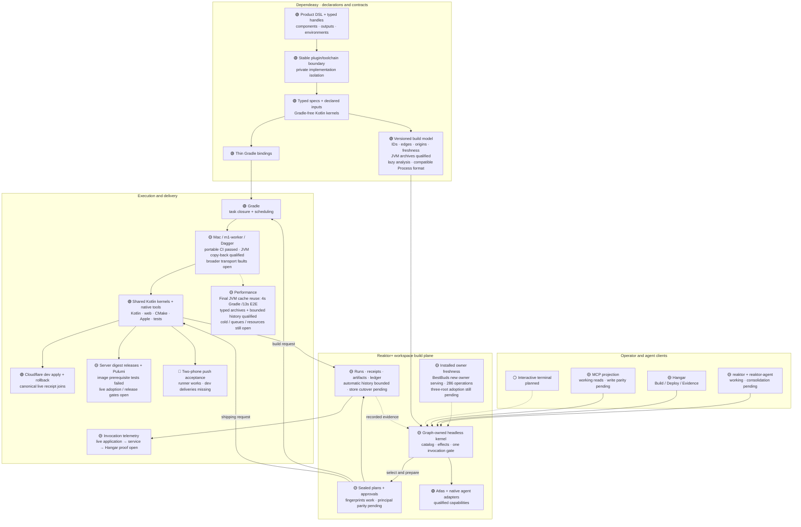

# Dependeasy and the Reaktor+ build plane: reconciled HLD and remaining work

Initial audit observed 28 October 2026, 14:15 IST; diagram and component status reconciled through the implementation and compatibility checks below. The implementation follow-up records exact candidate and qualification boundaries. This reconciles the interrupted Codex run, Claude's 27–28 October work, current source, installed interfaces, retained qualification and the controlled September/main benchmark.

**The foundation is delivered. The remaining work is chiefly integration, rollout, authority, delivery acceptance and performance.** The old package table overstates how much is unimplemented. It also understates several actual failed gates. CLI consolidation is one client migration inside this larger system.

## How to read status

- 🟢 Implemented with qualification in the named, recorded scope. This does not certify every current working-tree change or platform.
- 🟡 Implemented partially, or implementation exists but integration/rollout/acceptance remains.
- ⚪ Planned and not delivered.
- 🔴 A real end-to-end acceptance attempt failed. The failure can be downstream of a working adapter.

Implementation, checked scope, installed version and observed provider state are separate facts. Source declarations do not establish live health. Old green receipts remain historical evidence.

## Full HLD

Solid arrows show declarations, requests or execution/evidence flow; dashed arrows show planned clients, freshness annotations or returned evidence. These are architectural relationships, not invented module dependencies.

The domain model has typed build identities, inputs, outputs, options, tools and dependency edges. The workspace graph owns operation discovery, effects and invocation. Gradle still computes the actual task closure and schedules builds. Kotlin, pnpm/Vite, CMake and Apple tools retain their respective compiler/resolver responsibilities. The exported model is a projection for clients; builds do not require that projection to run.

The diagram groups native agent/Atlas capabilities to preserve the full workspace context. They are not another build scheduler. Browser pairing is a separate, constrained inference projection (`inference.ask`), not general access to build/deploy authority.

## What changed after the long Codex run

| Area | Reconciled state | Evidence and qualification limit |
|---|---|---|
| WP15 input origins | **Closed on 27 October by owner decision.** Third-party AGP/KGP/Compose/toolchain probes remain audited; authored build logic must still declare inputs. | [Decision §10.8](/Users/ovd/dev/reaktor/plans/dependeasy-handoff.md:1304). Codex's audit found no remaining undeclared authored reads; `97ffffeb` corrected nested origins. Requiring upstream plugin rewrites is no longer the acceptance gate. |
| Dependeasy suite repair | Claude fixed four obsolete script/check fixtures and a Dagger file-watching race. | `ce2a9b64`; 127/127 at takeover repair. Later exchange suite: 129 plugin/20 model cases. Current retained files now contain 129 plugin and 25 model cases, all zero failures; these are separate retained observations, not a fresh whole-candidate run. |
| WP18 script migration | **Implementation complete except `deployServer`, owned by WP23.** Build/test/release recipes became typed nodes with generated aliases. | [27 October log](/Users/ovd/dev/reaktor/plans/dependeasy-handoff.md:2122). Recorded final inventory: 80 authored /216 generated scripts across43 manifests. Remaining authored dev servers, ops, provisioning/imports and approved rewriting tools are intentional. This audit did not rescan the entire inventory. |
| Release adapters | Store/Firebase and cross-platform lanes are typed. Gates precede consumed producers; gate-output cycles are rejected. Composed aliases keep their own identity alongside plain aliases. | `f72be547`, `bfca1d31`, BestBuds `04e8f344`/`0de34f8f`. Eleven release nodes, `pr` and `buildAll` dry-run without a cycle. **No release execution is claimed by those dry runs.** |
| Browser and specialist checks | Playwright, live node checks, declared environment/source inputs, Karate/k6 aggregates, desktop operational checks and CompanyOS Lighthouse are modeled. | Claude's retained worker checks pass in the named scopes. Manna's direct mock/native-catalogue checks pass, but its normal worker Gradle path hit a stale imported pnpm manifest/lock mismatch. |
| Two-phone exchange | **Runner implemented and fixture-qualified; real push acceptance red.** Both directions are attempted and reported before failure. | `e132a444`/`076857ee`. Fourth physical run27Oct20:49: both sends pass, both receives fail; endpoints registered, no new dev deliveries observed. Investigate message completion/queue/moderation/recipient selection/dispatch. The exact failing service stage is not yet proved. Links fix remains unproved on phones because no notification arrived to tap. |
| Browser runtime linkage | New28Oct change links one ES module per Kotlin file. | Reaktor `008e0e31`; current Manna HEAD `12d00930`. Do not attribute a measured payload/startup improvement without a controlled before/after measurement. |
| Hangar launch pass | Build Targets now lists targets/last run; loading states, Cloud ordering, read-failure handling and damaged receipt tolerance improved. | BestBuds `898caa88`, `92be1ed1`, `d63ee7b3`; Reaktor `8635b2d3`. Claude reports a fresh13:56 installed bundle with jar/codesign checks. This is different from the still-old background owner. Full current Hangar qualification is not green. |

The latest native read recovered the final interrupted Codex turn and Claude's recent work summaries. I did not reread every turn of two weeks of history. Canonical plans, commits, retained proofs and live source were used together.

## Component and pending-work matrix

| Component / packages | Current status | Actual remaining gate |
|---|---|---|
| Stable toolchain/private plugin isolation; typed DSL/handles; product ownership (WP1–5,12–14,16–17) | 🟢 Foundation qualified and published in scoped packages. Private implementation edits previously caused zero consumer compilation/packaging. | Preserve these invariants during optimization. A public API/toolchain edit has different invalidation behavior. No total cold-speed win follows from isolation. |
| Inputs, origins, options and source navigation (WP15/K2) | 🟢 WP15 closed; 🟡 final orchestration audit. | Complete K2's eight facts, including public API dump, origins, aliases/tree parity and owner readability on the final candidate. Do not reopen the closed upstream-probe requirement. |
| Build model and artifact inventory | 🟢 Typed JVM archive implementation qualified; 🟡 final integration. | Fresh paired builds and fixture checks cover archive production/collection. A proposed lazy-analysis subtype broke the old owner’s strict reader and was withdrawn; final compatible export and live acceptance are recorded below. Broader artifact inventory remains open. |
| Web/package/Apple/native adapters (WP6–8,16–18) | 🟢 Major implementation; 🟡 complete current platform acceptance. | Resolve Manna worker pnpm drift; qualify Android producer changes with a real release build; keep signing/release and host-specific gates explicit. Recorded Apple/TestFlight/native successes certify their original candidate. |
| Device runners (WP9/18) | 🟢 Single-device and exchange implementations; 🔴 actual push integration. | Demonstrate delivery and notification-tap navigation both directions on the physical phones. No emulator/simulator qualification substitute. |
| Local/worker execution and copy-back | 🟢 JVM collection and fresh normal suite/distribution copy-back qualify; 🟡 broader transport. | All primary benchmark artifacts match and normal publication completes. Earlier exit74/JSON failures on other paths remain a separate recovery/target-family gate. Publication waits still dominate some runs. |
| Dagger/local portable CI (WP22) | 🟢 **Complete in the retained26Oct scope.** |1056 tests pass,12 declared skips,0 failures; exact receipt `c81c3c22-39b9-4c10-980c-71bce7a14f38` joins CLI/Hangar/shared ledger. Earlier OOM/download failures are history, not the current WP22 blocker. Fresh-candidate portability remains part of final rollout. |
| Worker fleet/deploy contract (WP19–21) | 🟢 Typed fleet and real approved dev apply/rollback qualified. | Preserve exact environment/service/version joins. This does not authorize or qualify a new production release. |
| Secrets and migrations (WP24) | 🟢 Canonical implementation and packaged consumer acceptance qualified. | Distinguish adapters/read-only plans from actual schema state. T201 reports subsequent real ClickHouse acceptance via guarded kubectl while canonical catalog freshness was blocked; it does not by itself prove current CLI migration execution parity. |
| Server image/digest release (WP23) | 🟡 Implementation/fixtures exist; 🔴 fresh image prerequisites. | Actual `:serverImage` fails app architecture and Hangar tests before producing an image. Fix those gates, then qualify image/push, mixed-host release and reviewed live joins before retiring the four legacy mutation paths and `deployServer`. |
| Pulumi/observability adoption (WP25) | 🟡 Typed Kotlin path and protected read-only preview exist. | Last retained preview:28 imports,8 updates,3 creates/state-provider records,0 replacements/deletions. Require reviewed current adoption, ownership evidence and no-change preview before retiring old writers. Do not confuse an empty/local adapter update test with live-resource adoption. |
| Delivery projections (WP26) | 🟡 Substantial classifier/action duplication removed. | Complete remaining Pulumi membership, server/observability retained/live joins, and local server-starter retirement. |
| Single owner and shared stores (K4) | 🟡 Lease/discovery/watch/graph ports and managed owners qualify in slices. | Preserve all historical stores while completing single-store adoption, Hangar owner-client startup/background handoff and auxiliary-discovery retirement. The last register records a correction applied/waiting; no final qualified cutover proof was found. |
| Hangar build/shipping/forms (K3/5/6) | 🟡 Working model/receipt views and build/cancel/ship slices. | Complete shared forms, exact authority/ledger parity and remaining current UI acceptance. Claude reports concurrent Graph/Agent changes and unrun areas; do not call the whole app qualified. |
| Plans, approvals and ledger (K7/10) | 🟡 Fingerprints, retained plans and ledger delivered; full operator identity acceptance open. | Preserve inspectable plans across compatible refreshes, revalidate at execution; authenticate operators, bind approvers/principals, prove distinct-approver/phone-approved identical retries. A seat label is attribution, not identity. |
| Catalog/MCP retirement (K8/9) | 🟡 Native graph operations and catalog-derived MCP significantly delivered. | Actual Codex/Claude verification/source-write parity and caller cutover before deleting remaining McpTool/ToolNode/legacy wire adapters. Working reads are not full write-parity acceptance. |
| CLI and three-workspace rollout (K1/3/11) | 🟡 Both newly built distributions install; 17 fresh CLI cases pass. | BestBuds new owner is serving after a startup timeout: 286 operations and all 1,908 nodes; a live query discovers 44 JVM archive nodes. Compatible fresh models publish normally; final archive query has `stale=false` and no changed declarations. The initial drain timeout and second startup timeout remain recorded. One distribution/entry contract, branding/help, caller/forms mapping and matched three-root execution remain open. |
| TUI (K1-TUI) | ⚪ Planned. | Four existing specified views: Overview, Builds, Runs, Operations. Implement after owner/plan/identity lifecycle; installed PTY walkthrough. |
| Telemetry, story and docs (K12) | 🟡 Story/receipts/UI/instrumentation delivered in slices. | Prove application→service→Hangar invocation spans end to end, including actual build/run linkage. Current owner retains no production span in the last60minutes. Then complete documentation/current runtime rollout. |

This replaces a flat count of “18 outstanding checkpoints” as a decision aid. The26Oct register has not incorporated the27Oct WP15/WP18 closures; its kernel table also predates delivered K6/K7/K9/K12 slices. Do not turn its29 domains into a percentage or treat each board-generated qualification task as an independent missing feature.

## Initial audit observations — 14:15 IST

These observations preceded the source changes and fresh builds in the implementation follow-up. The diagram and component matrix above include the later results.

1. **Installed source/runtime drift is real.** The BestBuds owner reports a27Oct15:57 binary,272 operations,2 relevant BestBuds and8 Reaktor commits behind; its compilation export is105minutes old. The semantic index is3332/3332 Kotlin files. Source can be indexed while the process still executes older code. The owner reports215 BestBuds and59 Reaktor uncommitted files in its scope. HEAD alone therefore does not identify the candidate.

2. **The live catalog has a different counting projection from the status total.** `operation.catalog` returns258 preferred operation IDs; `kernel.status` reports272 operations. Cached CLI help is another snapshot. Do not call the258/272 difference a defect without accounting for aliases/projections. A client should expose which count/version/snapshot it displays.

3. **Every catalog replacement currently drops all pending plans.** [OperationalControlPlane.replaceCatalog](/Users/ovd/dev/bestbuds/modules/kernel/src/main/kotlin/ai/bestbuds/reaktor/workbench/operations/OperationalControlPlane.kt:106) sets `pendingPlans = emptyMap()` at127. This matches Claude's finding. Recommended behavior: retain plan records whose subjects still exist, preserve their original scope, show stale/withdrawn state explicitly, and revalidate fingerprints/authority before execution. Keeping a card is not approval or permission to execute stale work. Removed/incompatible tasks need explicit invalidation.

4. **CLI consolidation must migrate real callers.** Fresh `access.map` finds project/global configurations launching both `reaktor` and `reaktor-agent`; Antigravity's agent launcher lacks `--dir`. Removing a binary first would break working clients. These are real compatibility edges, not merely branding issues.

5. **Current test files are green within their recorded scope.** Inspected retained XML:44 plugin files/129 cases,8 model files/25 cases,3 CLI files/17 cases; zero failures/errors/skips. Latest mtimes28Oct11:49,12:01,12:45 respectively. They do not establish a fresh, source-hashed complete suite for today's dirty composite. No new Gradle run or provider write was performed in this audit.

6. **Manna coverage is explicitly limited.** The connected Manna tool's current version differed from its advertised version, so further calls were stopped according to repository instructions. Local source/handoff/retained proofs contribute context; fresh connected Manna execution parity is not claimed.

## CLI consolidation target

**One product command, one installed distribution and one kernel operation contract.** Keep separate internal modules and narrow bootstrap/stdio mechanics where required. Consolidation should remove duplicate product semantics, not move an owner into the CLI.

The existing [CLI HLD](/Users/ovd/dev/reaktor/plans/cli-kernel-hld.md) already specifies the correct direction. The current [CLI README](/Users/ovd/dev/bestbuds/targets/reaktorCli/README.md) documents shipped capabilities; many proposed conveniences already exist.

| Concern | Already present | Next change |
|---|---|---|
| Operation execution | `reaktor <domain> <verb>`, typed inputs, effects, JSON, request IDs, durable follow/logs/cancel. | Keep owner descriptors as authority; complete actual schema/forms/caller parity rather than introducing a second handwritten command tree. |
| Atlas | Primary catalog already exposes `atlas.query/read/graph/providers`; agent CLI dispatches its `atlas` branch. | Map richer agent helpers for change/check to existing `change.*`/`check.*` contracts; preserve output/exit behavior and documented compatibility aliases. Do not create duplicate execution paths. |
| Workspace/owner lifecycle | `reaktor-agent workspace` supplies bootstrap/discovery/service mechanics; `reaktor mcp` already supplies the bridge/install path. | Expose a coherent lifecycle entry under the primary distribution; retain minimal local bootstrap when an owner cannot yet exist. Never require owner startup for help/version/static completion. |
| Standalone conductor | Agent CLI owns prompt/protocol/roster/context/file-thread execution. | Inventory intentional standalone behavior and owner-backed orchestration separately. Route domain actions through catalog operations; a standalone mode must be explicitly named and preserve its lifecycle semantics during migration. |
| Packaging/identity | Primary installer, Java selection and previous-distribution rollback already exist. | One manifest and install transaction covering launchers/runtime; report released version plus source/build identity. Keep `reaktor-agent` as a compatibility dispatcher until config/guide callers are migrated. |
| Freshness | Cached help/completion and owner/model freshness exist separately. | Show client version, owner build, wire/model compatibility and catalog snapshot age clearly. `--version` currently says `development`; agent help says “conductor.” Resolve both without starting an owner. |
| Human terminal | Typed shell is working; TUI design exists. | Implement the four planned views over the same descriptors, forms, plans, authority and runs. A TTY/`--seat` cannot grant human authority. |

Do not remove `codex`, `claude`, `agy` or `gemini`: external provider executables are outside consolidation of the two Reaktor launchers. The actual standalone entry currently constructs Claude/Codex/Echo runtimes, while browser inference uses Antigravity; “every CLI uses every provider” would be inaccurate.

A bounded consolidation acceptance walk should cover:
- Owner-free help/version/static completion outside a repository; explicit workspace discovery/start/stop behavior.
- Existing Atlas query/read plus plan/apply/check compatibility, with identical request/receipt semantics.
- Codex/Claude stdio discovery through the new launcher; explicit Antigravity workspace resolution.
- Standalone dry-run/protocol/thread compatibility, cancellation, stdout/stderr/JSON and exit codes.
- Plan/follow/cancel/reconnect on a single owner; exact approval retry without automatic effect replay.
- BestBuds/Reaktor/Manna with one matched distribution/model contract; current versus cached catalog clearly labeled.
- Installed rollback and continued operation of the compatibility launcher before its eventual retirement.

This is the proposed consolidation scope. No launcher/configuration/product source was changed during the audit.

## Multidimensional improvement sequence

| Order | Work | Why now / measurable acceptance |
|---|---|---|
| 1 | Establish one coherent candidate and status record | Capture committed revisions plus owned dirty patches, build/distribution/model identities and qualification receipts. Refresh the owner through its normal upgrade path; verify no history loss. Keep the old raw register as history and reconcile delivered packages rather than restarting them. |
| 2 | Finish owner/plan/store lifecycle and caller cutover | K4/K7 are shared dependencies for CLI, MCP, Hangar and TUI. Fix plan withdrawal semantics, qualify store preservation and full owner-client handoff; prove cross-face plan/run/receipt identity. |
| 3 | Consolidate CLI packaging and complete identity/parity | Incrementally migrate launch/config callers while preserving the existing dynamic catalog. Finish K10/K9 authority and actual retry acceptance before declaring write parity. TUI follows these contracts. |
| 4 | Close real execution/delivery gates | Reproduce normal copy-back failures; resolve physical push dispatch; qualify pending Android/Manna paths. Finish WP23 server and WP25 adoption with their concrete reviewed candidates, then WP26 legacy retirement. These can progress independently where resource/authority boundaries allow. |
| 5 | Expand the qualified routed configuration-cache path | Actual core JAR plus export store/reuse, source edit and declaration invalidation now pass; Reaktor defaults to reuse. Extend the same acceptance to other roots/target families and retain the profiled callback failure. September benefits too. |
| 6 | Reduce cold bootstrap/configuration and unnecessary model work | Controlled current cold81.92s vs September50.35s; identical-source gap remains29.76s. Try stable prebuilt build logic and valid cache reuse without losing private-implementation isolation. Avoid fetching analysis artifacts for unrelated model exports. |
| 7 | Expand exact artifacts and bound history | Typed JVM archive coverage and collection are now delivered; the experimental paired cold paths fall2,412→35 and bytes21.54→5.61MB; final compatible cold diagnostic is29 paths /7.40MB. Extend to other target families and bound history without removing digest/freshness checks; prior history calls took 21–31s. |
| 8 | Complete live tracing and expand the experimental matrix | First prove application→service→Hangar spans. Then compare representative desktop/Android/web/native/portable gates and product/runtime outputs with the same host/cache/edit controls. Measure total process-tree resources and ordinary queue distributions before making cost/scheduler claims. |

The shared Kotlin `KT-62686` non-incremental fallback remains another concrete investigation: both stacks changed only `TimeKt.class`, yet both compiled through the fallback. Improving it requires correctness and output checks, not simply suppressing a diagnostic.

## Benefit/cost assessment carried forward

The new system has obtained typed cross-language graph visibility, less repeated consumer glue, implementation isolation, explainable selection, common source/receipt navigation and stronger request provenance. Those are functional gains. Costs include larger framework implementation/maintenance scope, cold/configuration overhead, history/transport costs, and more rollout/identity contracts to keep consistent. It is not a universal remote cache or a fully hermetic build, and affected selection remains conservative with result reuse disallowed.

The completed [controlled benchmark](/Users/ovd/dev/reaktor/reports/dependeasy-benchmark-2026-10-28/report.md) measured the same `:reaktor-core:jvmJar` in the same worker slot against30September `origin/main`. All18 primary builds passed. Median Gradle times:

| State | September | Candidate | Delta |
|---|---:|---:|---:|
| Cold build state |50.35s|81.92s|+62.7%|
| Warm unchanged |10.02s|11.32s|+13.0%|
| One-file edit |14.30s|16.98s|+18.7%|

Reserved end-to-end medians were66.55→102.62s,24.81→29.07s and27.95→35.49s. The20.98-minute campaign admission is separate and is not a normal queue percentile. These establish **no build-speed win under the common cache-disabled controls**. Candidate `423e607f` predates the current source. The separately controlled follow-up below measures the owned implementation against a frozen 28 October working tree; it must not be pooled with these September comparisons. The final all-platform release-candidate comparison remains open; the JVM experiment itself is complete.

The [migration investigation](/Users/ovd/dev/reaktor/reports/dependeasy-migration-2026-10-27/report.md) supplies the broader before/after dimension matrix. Its earlier uncontrolled timings must not be pooled with the controlled experiment.

## Evidence map

- [Live snapshot, catalog, access-map findings and reconciled statuses](/Users/ovd/dev/reaktor/reports/dependeasy-build-plane-hld-2026-10-28/evidence.json).
- [Editable HLD source](/Users/ovd/dev/reaktor/reports/dependeasy-build-plane-hld-2026-10-28/hld.mmd).
- [Dependeasy package status](/Users/ovd/dev/reaktor/plans/dependeasy-handoff.md:15), [27Oct decision](/Users/ovd/dev/reaktor/plans/dependeasy-handoff.md:1304), [Claude work log](/Users/ovd/dev/reaktor/plans/dependeasy-handoff.md:2122).
- [Delivery status and final acceptance](/Users/ovd/dev/reaktor/plans/delivery-handoff.md:5).
- [Older kernel package table](/Users/ovd/dev/reaktor/plans/kernel-handoff.md:654), [canonical CLI/TUI HLD](/Users/ovd/dev/reaktor/plans/cli-kernel-hld.md).
- [Graph-owned kernel](/Users/ovd/dev/bestbuds/modules/kernel/src/main/kotlin/ai/bestbuds/reaktor/kernel/KernelGraph.kt:43), [shared authority/kernel](/Users/ovd/dev/reaktor/reaktor-tooling/src/jvmMain/kotlin/dev/shibasis/reaktor/tooling/operation/OperationKernel.kt:39).
- [Installed operations CLI implementation](/Users/ovd/dev/bestbuds/targets/reaktorCli/src/main/kotlin/ai/bestbuds/reaktor/cli/KernelCli.kt:902), [agent CLI entry](/Users/ovd/dev/bestbuds/modules/kernel/src/main/kotlin/dev/shibasis/reaktor/conductor/cli/ConductorCli.kt:57).
- Native sessions read: Codex `01a13659-4f13-7591-97a3-a11b892365b9`; Claude Dependeasy `772ba7b1-f5c6-4cd5-8c73-4109af121389`; Claude Hangar `9d664500-dd0f-419a-b25c-6ce167833804`.
- Historical qualification [register](/Users/ovd/dev/reaktor/build/dependeasy/receipts/qualification/wp13/full-status.json): retained evidence, not a current completion score.

## Implementation follow-up — 28 October, from 15:40 IST

The audit above is retained as history. The performance continuation changes product code and does not certify the whole build plane. [Performance report](performance.md), [acceptance and budget](completion-plan.json), [bounded product patch](implementation.patch), [owned router patch](tools-implementation.patch) and [source-hashed proof](implementation-proof.json) describe the candidate. Foreign staged and unstaged work is preserved; no commit or push was made by this continuation.

- **Typed JVM archives and bounded copy-back:** the nine original experimental pairs produce byte-identical JARs; each body edit changes only `TimeKt.class`. Their cold collection is 2,412 paths /21.54MB →35 /5.61MB. The final compatible-candidate cold recheck collects29 paths /7.40MB with the profiler removed; this is a separate diagnostic, not a paired74% final-source claim. Required model/report payload grows across repeats and still needs reduction. The primary pairs establish no Gradle speedup.
- **Analysis compatibility:** the typed lazy-analysis experiment passed its fixture and real compilation, but the old live owner could not decode its new serial subtype and `build.list` failed. That optimization was withdrawn. The existing `Process` export format is retained; avoiding eager analysis resolution remains pending a versioned reader/writer rollout. Failed live evidence is preserved in [jvm-archive-live-read.json](jvm-archive-live-read.json).
- **Configuration reuse:** Reaktor's root defaults to configuration cache. All seven final compatible-candidate commands pass: cold/store, warm, real body edit, declaration edit and restoration. Two warm reuses take4s rounded Gradle /13.09s median reserved E2E; the body edit takes11s /19.86s and changes only `TimeKt.class`. The first warm `TOKEN` miss remains. The [final proof](default-cache-proof.json) is separate from the [earlier experimental proof](experimental-default-cache-proof.json), whose failed profiler callback remains failed. This qualifies the core-JAR-plus-export invocation, not every root or task family.
- **Fresh checks:** the experimental candidate passes129 plugin +25 model cases. After compatibility withdrawal, all6 DSL cases and all25 model tests pass; fresh final router/build/retention checks pass68/68. Normal final test and two-root model publication complete without copy errors, with about4.2-minute publication waits separate from Gradle. Earlier full-suite publication waited12minutes. All17 CLI cases pass during server prerequisites; no fresh full-kernel suite is claimed.
- **Ordinary planning remains a failed acceptance:** the live JVM `build.plan` reaches a successful43s worker export, but its wrapper is interrupted after8m57s while awaiting primary-checkout publication. The receipt separates284.38s admission,33.39s sync,45.86s execution and8.70s collection. An earlier local-process diagnosis incorrectly called all this admission; the complete output corrects it. [Normal publication recovery](jvm-archive-plan-publication-recovered.json) completes with exit0 and no copy errors; the original plan remains failed. The second Gradle planning pass and actual typed-node execution are not qualified by this attempt. `run.cancel` returnsfalse for this request. See [corrected evidence](jvm-archive-live-plan-interruption.json).
- **Concrete server blocker:** the real `:serverImage` attempt fails app architecture and Hangar prerequisite tests. The own attempt stops after failures; no gate is skipped, and no image, digest, push or rollout is claimed. [Failure evidence](server-attempt-failures.txt) and [transport](server-attempt-transport.json) retain this boundary.
- **Distribution and BestBuds owner adoption:** `:kernel:agentDist :reaktorCli:distZip` builds and completes normal publication; the normal CLI installer and all 276 agent files install byte-exact. The first upgrade times out behind an application JVM test. After it succeeds, a second supported attempt drains/stops the old owner and starts the new process, but its client times out awaiting startup. Subsequent [status](owner-upgrade-second-status.json) and [archive query](jvm-archive-live-read-after-upgrade.json) succeed: the 16:38 build serves 286 operations, 1,908 model nodes and 44 JVM archive nodes. An initial query marks the rollback stale; after normal compatible model publication the retry finds44 nodes with `stale=false` and no changed declarations. A separate earlier read returns `delivery_unknown`, retained as a failure. All 475 pre-inventory history files remain present. [Proof](owner-install-proof.json) retains both failed command outcomes; this is BestBuds runtime adoption, not final three-root parity or a full store-cutover acceptance.

### Actual benefits and costs across dimensions

| Dimension | Evidence of benefit | Cost / remaining constraint |
|---|---|---|
| Cold speed | Typed graph identifies setup, configuration and execution separately. | Original controlled migration result is 50.35→81.92s Gradle, 62.7% slower. The new no-cache follow-up also establishes no Gradle gain. Cold bootstrap is the top remaining compute regression. |
| Warm/edit speed | Actual cache reuse now reaches about 4–5s Gradle; real edited-body reuse passes. | Both September and current stacks benefit from cache. Cache-disabled migration results were 13.0% slower warm and 18.7% slower on edit. Cache store/invalidation has a real cost. |
| Transfer scope | Experimental paired collection drops21.54→5.61MB and2,412→35 paths; final compatible cold diagnostic is7.40MB /29 paths with exact JAR bytes. | Required models/indexes/reports still exceed the 167KB JAR. Other target families and historical transport faults need their own qualification. |
| Build logic isolation | Earlier scoped private-plugin implementation edits caused zero consumer compilation/packaging. | API/toolchain changes invalidate differently; isolation has not recovered cold setup cost. |
| Discoverability and source navigation | Typed identities, outputs, edges, origins and tools feed the same CLI/Hangar/model views; JVM archive coverage is now added. | Completeness is only meaningful for modeled nodes. The proposed new analysis subtype exposed a strict-reader compatibility failure; it was withdrawn. Final runtime and model freshness acceptance is separate from source indexing. |
| Consumer glue | WP18's retained inventory records 216 generated aliases and 80 intentional authored scripts across 43 manifests. | Framework ownership and adapter maintenance grow. Generated aliases do not remove native compiler/resolver responsibilities. |
| Scheduling and portability | Gradle retains closure/scheduling; portable WP22 receipt records 1,056 pass /12 declared skips. | Fresh all-platform qualification, host boundaries and mixed-host release execution remain open. |
| Authority and provenance | Sealed plans, fingerprints, environment/version joins and retained receipts are implemented and qualify in slices. | Authenticated principal/distinct-approver parity, refresh withdrawal semantics and final store adoption remain open. |
| Operability and latency | Runs, artifacts, logs and receipts can be joined to exact subjects and sources. | Real publication/admission waits can dominate a successful build; history reads previously took 21–31s. No whole-system p95, peak-RSS or cost win is established. |
| Delivery | Approved dev apply/rollback and several release adapters have recorded acceptance. | Server image prerequisites fail now; Pulumi live adoption, push receives and final legacy-writer retirement are open. |
| CLI experience | Both interfaces work; main CLI is reinstalled and 17 fresh cases pass. The HLD defines one operation contract and packaging direction. | Two distributions/launchers, cached versus live identities, `development` branding, unsupported agent `workspace --help`, caller migration and TUI remain consolidation work. |

The [performance report](performance.md#next-performance-budgets) ranks the next measurable work. Cold bootstrap, normal queue distributions, bounded history, representative Android/web/native targets, whole-process resources and application→service→Hangar tracing remain open. Server/Pulumi rollout still requires a concrete qualified candidate and the owner go required by BestBuds AGENTS.md; there is no deployable server candidate to approve yet. No legacy production writer was retired.

## Compatible continuation — 20:20 IST

The second implementation avoids the rejected model subtype. It generates a Java argument file through the existing analysis task and keeps compiler/runtime configuration identities in the existing `Process` model. JavaScript package/runtime/asset metadata is deferred with its producer dependencies retained. The corrected full Dependeasy suite passes129 plugin plus25 model cases. Real analysis compilation and a cache-reusing repeat pass with identical class bytes; a fresh missing-model planning fixture proves the export producer runs automatically.

Automatic protocol-history collection is now bounded to the worker invocation on both success and failure. Explicit pull preserves the historical view and no worker history is removed. All69 router/build/retention cases pass. The new24-command alternating campaign compares only the three compatible lazy-configuration production files against the retained compatible baseline, using the same current router and default configuration cache in both. All commands pass and all12 paired JARs are identical. Gradle medians are86→89s cold,16→16s first warm,4→4s steady warm and10→10s body edit. This establishes no additional speed win; the earlier configuration-cache gain remains the useful warm-path result. Admission is54.02s, separate from the reserved E2E medians96.73→101.08s,26.09→25.55s,12.91→13.27s and19.49→19.19s.

[Current performance detail](performance.md#compatible-continuation--24-paired-commands-and-real-producer-qualification), [controlled summary](continuation-benchmark-summary.json), [real producer/analysis qualification](continuation-qualification-results.json) and [complete-suite evidence](continuation-dependeasy-suite.json) supersede the earlier statements that compatible lazy analysis and history filtering had not been delivered. Earlier failed and withdrawn experiments remain in the record. The HLD status describes only the named checked scope; it does not mark unrelated server, phone, identity or store gates green.
