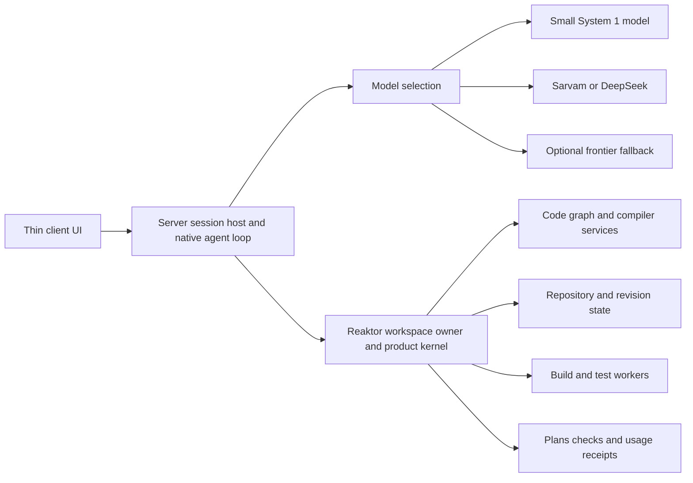
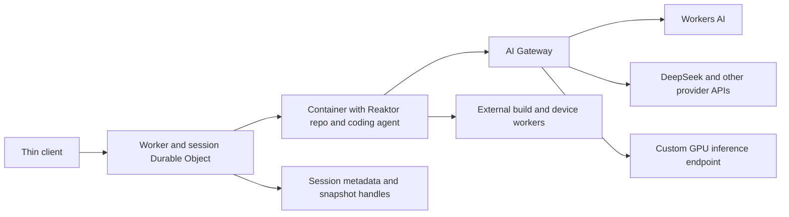

# Reaktor server deployment and coding agent evaluation

28 October 2026

Reaktor can support a server that owns the repository, code intelligence, edits and checks while a thin client displays the session and sends user input. Its strongest opportunity is to replace repeated model reasoning about repository structure and mechanical changes with precise graph queries and compiler-backed operations. Whether this makes Sarvam, DeepSeek or a custom model competitive with the complete Codex and Claude Code systems remains an empirical question.

Start with native Codex and Claude Code running beside the server repository, each with and without Reaktor. Then add a fixed open model and finally a small-model routing policy. This separates improvements from Reaktor, deployment placement, model choice and orchestration. The existing evidence supports investigating this design; it does not establish a general full-stack advantage.

## Server architecture

The client should carry user messages, streamed activity, diffs, approvals and session controls. The agent loop, shell, filesystem, Reaktor calls and repository remain on the server. A remote MCP endpoint alone does not make a client thin if its agent still executes shell commands and reads files on the client machine.

There are three latency loops: client interaction across the WAN, model inference, and agent tool execution. Keep the frequent tool loop local to the repository owner. The GPU service can run on another nearby machine; putting everything on one physical server is unnecessary. Give compiler/index services and builds enough CPU and memory without allowing concurrent builds to starve the agent host.

Use one workspace owner per canonical repository root, preserving included-build scope. A standalone Reaktor checkout and the BestBuds owner that includes Reaktor do not see identical consumers. Each session must bind to the intended source revision and workspace; a global graph does not imply one shared mutable checkout for every task.

Use one component to own the agent loop and model routing. If Sarvam Code owns the loop and its routing, Reaktor should supply grounded tools. If a Reaktor runtime owns the loop, it should select model endpoints itself. Stacking independent planning and routing loops would add repeated context and uncertain ownership of retries, edits and completion.

## Cloudflare Containers and AI Gateway

Cloudflare is a practical managed-hosting candidate for the first pilot. Use Containers for the repository, Reaktor JVM and agent process; use AI Gateway for model requests. The gateway supplies model access, routing and request accounting. The coding harness still owns the tool loop and completion decision. Cloudflare documents running native Codex, Claude Code and other coding agents in its sandboxes with model requests through AI Gateway. [Coding agents on Cloudflare](https://developers.cloudflare.com/sandbox/coding-agents/), [AI Gateway](https://developers.cloudflare.com/ai-gateway/).

For the first version, keep the existing agent loop inside the Container so repository tools stay local. A Worker and Durable Object handle client connections, session routing and progress. An Agents SDK agent can serve this outer session role, but should not introduce another reasoning loop around Reaktor's existing loop. Cloudflare also supports the alternative of an agent in a Durable Object with a Container for tools; compare that arrangement later if moving orchestration provides a concrete benefit. [Agents and sandboxes](https://developers.cloudflare.com/agents/tools/sandbox/).

Reaktor already has a Cloudflare request path: `CloudflareAi.complete` calls `/accounts/{account}/ai/v1/chat/completions`, adds the gateway identity and metadata, and captures the gateway log ID. `GatewayRuntime` uses it, but currently exposes only read/search/list tools. The missing capability is a full coding loop connected to existing kernel operations, rather than basic Cloudflare connectivity. [Cloudflare completion adapter](/Users/ovd/dev/reaktor/reaktor-tooling/src/jvmMain/kotlin/dev/shibasis/reaktor/tooling/cloud/CloudflareAi.kt:314).

DeepSeek has a documented gateway integration. Sarvam or a private System 1 model can use a custom provider if an appropriate HTTPS inference API is available. This proxies an inference service; it does not provision the GPU host or make a provider's weights available. Use Workers AI where the selected model is supported, or a separate GPU endpoint for custom inference. [DeepSeek integration](https://developers.cloudflare.com/ai-gateway/usage/providers/deepseek/), [custom providers](https://developers.cloudflare.com/ai-gateway/configuration/custom-providers/).

Keep task-aware routing in Reaktor: its graph and check outcomes can determine when to escalate. Gateway dynamic routes can implement request policies using supplied metadata, provider selection and limits. A successful HTTP response is not evidence of a successful code change. [Dynamic routes](https://developers.cloudflare.com/ai-gateway/features/dynamic-routing/).

Four deployment constraints determine whether this is also the fastest host:

- **Capacity:** documented default instance ceilings are 4 vCPU, 12 GiB RAM and 20 GB disk; Cloudflare accepts requests for increases. Measure peak memory and disk for the repository, compiler services, dependencies and build caches together. Move large builds to existing workers if needed. [Container limits](https://developers.cloudflare.com/containers/platform/limits/).
- **Persistence:** disk is ephemeral. Save durable patches and receipts separately and use snapshots to accelerate workspace restoration. Snapshots require the `durable_object` scheduling policy, are tied to the image version, and preserve filesystem state rather than live JVM/compiler memory. Warm-up after restoration remains part of latency. [Snapshots](https://developers.cloudflare.com/containers/guides/snapshots/).
- **Filesystem performance:** keep active source and compiler/build caches on local Container disk. Use object storage for durable outputs and backups; Cloudflare explicitly cautions that FUSE storage does not provide native SSD-like performance. [Filesystem behavior](https://developers.cloudflare.com/containers/faq/).
- **Process and transport:** run the product kernel service as a foreground JVM under the Container entrypoint rather than installing a systemd user service. Keep native-agent MCP traffic on loopback. Provide a scoped session bridge on the Container port for the Worker, preserving the owner's authentication and authority checks. [Kernel service entrypoint](/Users/ovd/dev/bestbuds/modules/kernel/src/main/kotlin/ai/bestbuds/reaktor/kernel/KernelAgentService.kt:28).

For benchmarking, use identical Container resources and gateway settings for the with/without-Reaktor arms. Disable gateway response caching so repeated tasks do not replay cached model responses; record provider prompt caching separately. Gateway logs supplement Reaktor receipts but do not capture acceptance, local tool work or all child-agent activity. API-backed native CLI runs through the gateway should also be distinguished from subscription-product cost and allowance comparisons. [Bypass gateway response caching](https://developers.cloudflare.com/ai-gateway/features/caching/).

The initial Cloudflare gate is one task that survives the complete path: thin client, authenticated session, Container checkout, foreground kernel, model request, graph query, edit, check and returned diff. Then test stop/restore and measure warm versus restored completion. No Cloudflare resources were deployed during this investigation.

## What the current implementation provides

| Area | Current capability | Consequence for deployment |
|---|---|---|
| Workspace service | A shared owner, workspace binding, loopback HTTP transport and bearer token | Reuse this owner; do not expose the loopback API as an unauthenticated public service. |
| Linux supervision | A systemd user service configuration with restart policy, working directory and private umask | Linux deployment has implementation support. A real Linux deployment still needs end-to-end qualification. |
| Remote access | An SSH workspace adapter invokes the remote MCP launcher | Suitable for an initial functional connection. It starts a new SSH process for every exchange, so measure its overhead. |
| Native agents | Batch and interactive runtimes for Codex and Claude Code, among others | Preserve the native agent loop for the first comparisons. Interactive and batch capabilities are not identical. |
| Code work | Atlas queries, compiler-backed change plans, apply and affected checks | This is the main mechanism for reducing model work; measure the complete change-and-verification path. |
| Accounting | Session and task graph scores, token/cache fields, wall time and failure counters | Useful measurement substrate, with child-session accounting work still required. |
| Benchmarking | Versioned scenarios, configurations, owner identity and task graph scoring | Extend the existing harness rather than introducing a second general evaluation system. |

The product CLI, MCP integration and kernel live in BestBuds, while Reaktor supplies the framework substrate. Deploy the complete product kernel distribution for the code-agent service. The Spring server under `bestbuds/targets/reaktorServer` is a product server target; its existence does not establish a deployable coding-agent fleet.

Implementation anchors:

- [Workspace connection and owner](/Users/ovd/dev/reaktor/reaktor-conductor/src/jvmMain/kotlin/dev/shibasis/reaktor/conductor/workspace/AgentWorkspaceConnection.kt:211), [SSH adapter](/Users/ovd/dev/reaktor/reaktor-conductor/src/jvmMain/kotlin/dev/shibasis/reaktor/conductor/workspace/AgentRemoteWorkspace.kt:12), [Linux supervisor](/Users/ovd/dev/reaktor/reaktor-conductor/src/jvmMain/kotlin/dev/shibasis/reaktor/conductor/workspace/PlatformAgentService.kt:53).
- [Runtime registration](/Users/ovd/dev/reaktor/reaktor-conductor/src/jvmMain/kotlin/dev/shibasis/reaktor/conductor/appserver/AgentRuntimes.kt:23), [runtime request and event contract](/Users/ovd/dev/reaktor/reaktor-conductor/src/commonMain/kotlin/dev/shibasis/reaktor/conductor/AgentRuntime.kt:9).
- [Product owner connection](/Users/ovd/dev/bestbuds/modules/kernel/src/main/kotlin/ai/bestbuds/reaktor/kernel/KernelAgentMcpHost.kt:59), [product service command](/Users/ovd/dev/bestbuds/modules/kernel/src/main/kotlin/ai/bestbuds/reaktor/kernel/KernelAgentService.kt:9).

The current remote adapter is a request bridge, not a complete qualification of streamed UI, reconnect, approval delivery and cancellation. Prove one useful remote session first: connect, inspect the intended revision, make an authorized change, run its checks, display the result, disconnect and resume. Preserve the existing authority and source-freshness checks along this path.

## Sarvam and DeepSeek integration

Sarvam describes Sarvam Code as an early-beta coding harness built on Codex, with model routing and deployment options that include VPC and on-premises installations. Its published extension supports remote HTTP MCP servers. These are useful integration leads, but they do not establish a supported remote agent-host protocol, self-hosted checkpoint availability or an arbitrary DeepSeek backend for Sarvam Code. Verify those capabilities against the actual product build and deployment agreement. [Sarvam announcement](https://www.sarvam.ai/epoch/summary), [Sarvam Code extension](https://marketplace.visualstudio.com/items?itemName=sarvam.sarvam-code).

For the proposed “Sarvam plus Reaktor on the server, Sarvam Code on the client” arrangement, the decisive question is where the Sarvam agent process, shell and filesystem execute. A remote development environment or a supported remote agent host could provide that separation. A locally running extension that only calls remote Reaktor tools would still split the tool loop across machines.

Codex exposes an App Server protocol for custom clients. Its documented WebSocket transport is experimental and requires particular care with authentication and exposure; start with a server-local process transport and an authenticated session channel where practical. Claude Code supports a programmatic CLI and Agent SDK that retain its agent loop and tools. These are stronger starting points for faithful comparisons than replacing either product with a simple model API call. [Codex App Server](https://learn.chatgpt.com/docs/app-server), [Claude Code programmatic use](https://code.claude.com/docs/en/headless).

Reaktor's current `GatewayRuntime` is not a complete general-purpose open-model coding harness. It connects through the Cloudflare integration and offers read, search and list tools; its instructions prohibit edits and commands. It also emits reasoning information without preserving that field in the subsequent assistant-message history. Changing its model name is insufficient to produce a Sarvam or DeepSeek editing agent. [Gateway implementation](/Users/ovd/dev/reaktor/reaktor-conductor/src/jvmMain/kotlin/dev/shibasis/reaktor/conductor/gateway/GatewayRuntime.kt:39).

Extend the existing `AgentRuntime` boundary for a custom provider or runner. It needs correct tool-call continuation, streamed events, cancellation, session continuation, usage reporting and access to existing kernel operations under the session's authority. DeepSeek's current thinking-mode documentation specifically requires replaying `reasoning_content` in tool conversations. Test the exact endpoint protocol; an OpenAI-shaped API does not guarantee interchangeable reasoning/tool behavior. [DeepSeek thinking mode](https://api-docs.deepseek.com/guides/thinking_mode/).

Use an API-hosted model for the first functional comparison if that shortens the path to a working agent. Move to self-hosted inference after the loop works. Hardware sizing depends on the selected checkpoint, weight format, context length, KV-cache demand, concurrency and latency target; no particular GPU configuration is justified yet.

## Where a small model and graph can help

Treat “System 1 plus graph” as a small, fast policy model using Reaktor's authoritative repository graph. This differs from token-level speculative decoding, where a draft model proposes tokens for another model to verify.

| Work | Preferred executor | Escalation condition |
|---|---|---|
| Symbol resolution, references, ownership and impact | Compiler and graph operations | Unsupported language, incomplete indexing or ambiguous request |
| Known mechanical transformation | Existing typed change recipe, then apply and checks | Recipe cannot establish the intended transformation |
| Translate intent into a bounded query; choose relevant context | Small model with typed operation schemas | Invalid query, missing evidence or low confidence |
| Local repair with a clear failing test | Small or medium coding model with graph context | Failed repair budget or cross-module uncertainty |
| New architecture, ambiguous behavior or broad full-stack feature | Stronger model with graph context | Human clarification when requirements are genuinely missing |
| Acceptance | Hidden behavioral checks and review criteria | Passing compilation alone is insufficient |

Do not make a learned model reproduce compiler authority. Use it to choose operations and assemble relevant evidence. Keep source revision, symbol identity, edit scope and check receipts explicit. The graph can reduce uncertainty about the existing system; it cannot by itself determine whether a newly requested product behavior is correct.

Begin without custom training: fixed model, typed tools and bounded context. If traces show repeatable policy errors, train on intent, graph revision, selected operation, evidence and outcome. Split training and evaluation by repository or time, and exclude held-out tasks and answers. Include unsuccessful and escalated attempts so the policy learns when to stop.

For a sequential small-to-large cascade, expected cost is approximately:

`small attempt + probability of escalation × large attempt + repair + graph/tool overhead`.

Time also includes queueing and the failed small attempt before escalation. A direct strong-model call can win when escalation is frequent. Compare the hybrid against the best fixed model with Reaktor, in addition to comparing it against native frontier agents.

## Performance priorities

1. **Remove model round trips.** Batch independent lookups, return the evidence needed for the next decision, and use compiler-backed plans directly for supported transformations. A smaller answer that hides the edited statement can increase total work.
2. **Keep context useful and stable.** Reuse bounded evidence with revision provenance. Put stable instructions and tool definitions before changing task evidence where the harness permits it. Reaktor's context compiler does not automatically control the inner context policy of a native agent.
3. **Keep hot services resident.** Measure owner startup, compiler warm-up and incremental invalidation separately from warm operation. Keep suitable small and large model pools resident when hardware allows; repeated weight loading can erase routing gains.
4. **Tune inference after task success.** Prefix caching saves repeated prefill, not generation time. Speculative decoding is workload dependent; vLLM particularly describes benefits for suitable low-to-medium-QPS, memory-bound workloads. Measure accepted tasks per GPU-hour and tail latency under the intended traffic. [vLLM prefix caching](https://docs.vllm.ai/en/latest/features/automatic_prefix_caching/), [vLLM speculative decoding](https://docs.vllm.ai/en/latest/features/speculative_decoding/).

Measure graph evidence caches, provider prompt caches, GPU KV caches and build caches separately. They have different validity rules and costs. Keep source caches revision-aware and model caches tied to the actual model, tokenizer and isolation boundary.

## Existing performance evidence

Historical Atlas experiments contain both gains and regressions. The figures below are reported in the repository's experiment notes, rather than newly reproduced measurements. Input totals include repeated context; they are not equivalent to uncached input or monetary cost.

| Experiment | With Atlas versus control | Interpretation |
|---|---|---|
| Five code questions, eight passes, 18 October | 516,100 versus 635,700 average input tokens per five-question pass; 18.9% lower. 9 versus 13.8 tool rounds. | Encouraging lookup result. The notes identify an unexplained change in MCP/request overhead, so the whole gain cannot be attributed to the tool design. |
| Three edits, eight passes, same addendum | 492,000 versus 443,600 input tokens per three-task pass; reported paired increase 12.2%. 12.4 versus 15.9 rounds. All 48 diffs correct. | Fewer rounds did not guarantee fewer tokens. Evidence windows hid relevant statements; busy-owner timeouts increased work. |
| Codex top-level rename, one pass | 215,157 versus 1,485,196 input tokens; 45 versus 299 seconds | Demonstrates a working compiler-plan path, but a stale Gradle daemon and unequal cache conditions substantially affected the control. |
| Claude extension rename, one pass per arm | About 5.01M versus 7.01M input tokens over the complete runs; 368 versus 528 seconds | Promising, but the executed check sets and cache conditions differed. This is not a controlled full-stack estimate. |

The earlier Claude top-level rename also illustrates why reporting must cover the whole task: its advantage before the first test result reversed over the complete run, which used about 10.53M versus 6.69M input tokens. Daemon trouble and continued verification affected the outcome. The Claude rename gates used fresh subagents rather than a signed-in headless CLI, another reason to rerun a native-harness comparison.

Sources: [eight-pass lookup and edit experiment](/Users/ovd/dev/reaktor/plans/atlas-hld.md:1285), [rename gates and caveats](/Users/ovd/dev/reaktor/plans/atlas-hld.md:1359), [historical token accounting investigation](/Users/ovd/dev/reaktor/plans/token-roi.md:1).

The current `bench.catalog` snapshot contains three scenarios and 36 proposals, all with status `Proposed`. They are not completed benchmark runs. A result can carry definition-comparability metadata while still being partial and open. The scenarios cover parser review and small parser changes, not representative full-stack product work.

`AgentBenchmarks.propose` currently restricts seats to Codex and Claude Code with explicit models. It has no general model-provider comparison or explicit no-Reaktor treatment. Extend its scenario/configuration manifests and use an external observer for native runs, retaining the existing revision and acceptance machinery. [Benchmark implementation](/Users/ovd/dev/reaktor/reaktor-conductor/src/jvmMain/kotlin/dev/shibasis/reaktor/conductor/workspace/AgentBenchmarks.kt:54).

## Comparison design

### Separate the experiments

| Stage | Arms | Question answered |
|---|---|---|
| Native agents | Codex native; Codex plus Reaktor; Claude Code native; Claude Code plus Reaktor | Does Reaktor improve each complete native system? |
| Reaktor ablation | Atlas only; Atlas plus change/apply/check | Which capability produces the gain or regression? |
| Sarvam | Native Sarvam Code; the same harness plus Reaktor | Does Reaktor help the actual Sarvam product? |
| Open model | One fixed DeepSeek checkpoint and runner, with and without Reaktor | Does the graph/tool layer help that model independently of routing? |
| Hybrid | Best fixed model plus Reaktor; small/large policy plus Reaktor | Does model routing improve quality, cost or latency? |
| Placement | Selected identical configurations on local and remote hosts | What does server placement change? |

Run the first four arms on the same server class. Cross deployment placement separately so a server-versus-laptop hardware difference is not credited to Reaktor.

“Native” means the real Codex or Claude Code harness, including its normal context management, shell, editing, compaction and permitted subagents. Keep ordinary repository knowledge, skills, permissions, models and verification expectations equivalent. Remove only Reaktor-specific configuration, guidance, commands and access from the control. In particular, repository AGENTS files currently instruct agents to use Reaktor; sanitize those sections in the benchmark fixtures. Do not compare a fully configured Reaktor arm against a deliberately stripped native arm. Claude's `--bare` changes several facilities beyond MCP, so it is not a suitable one-sided ablation.

The observer can score completed native transcripts afterwards without making Reaktor available during the control run. Reconcile child sessions and model requests by identity. Current work-score code explicitly notes that native child usage is not separately attributed; parent-only totals can materially undercount a full native system. [Work score](/Users/ovd/dev/reaktor/reaktor-conductor/src/commonMain/kotlin/dev/shibasis/reaktor/conductor/worklog/WorkScore.kt:16), [usage fields](/Users/ovd/dev/reaktor/reaktor-conductor/src/commonMain/kotlin/dev/shibasis/reaktor/conductor/UsageSummary.kt:9).

### Use representative tasks and independent acceptance

Build a held-out suite covering cross-module changes, backend/API/client contract changes, database migrations, runtime bugs, UI behavior and review. Include realistic ambiguous failures and tasks where a compiler recipe should excel. A suggested 12-task pilot is four full-stack changes, four bug fixes and four semantic/refactoring tasks. Report each category separately so an easy rename does not conceal weak product implementation.

Every arm starts from the same task revision and receives the same requirements, budget and final acceptance criteria. Keep hidden behavioral tests outside the agent-visible repository. For review, adjudicate false positives as well as planted-defect recall; matching a file and line is insufficient. For UI work, check the resulting behavior. Use the worker for physical mobile checks and Docker-based evaluation, following the development-machine routing rules; do not start emulators or simulators.

SWE-bench provides an additional reproducible issue-resolution benchmark, but cannot substitute for this workspace's cross-language, mobile and full-stack tasks. [SWE-bench evaluation harness](https://www.swebench.com/SWE-bench/).

### Pin the run and control cache effects

Record task/source hashes including included builds and uncommitted content; kernel binary digest; graph/index/build-model revisions; agent versions; resolved model/checkpoint, quantization and tokenizer; context and output limits; effective reasoning settings; instructions and tool schemas; permissions; hardware; resource limits; network placement; check set; and timeout/cost budget. Provider labels such as “medium” are not necessarily equivalent across systems.

Use paired tasks, randomize or interleave arm order, and reset source edits between runs. Separate cold startup/indexing, typical warm operation and incremental changes. Equalize build-cache conditions or report cold and warm strata independently. For provider caches that cannot be reset, record observed cached usage and interleave arms. Keep the required final acceptance checks identical even when agents choose different intermediate checks.

After single-session correctness, test representative concurrent session counts, for example 1, 4 and 8, and controlled WAN latency. Record queue time and resource saturation. Repeated runs share caches today, so repeat number alone does not establish independence.

### Score complete accepted work

| Dimension | Required measurements |
|---|---|
| Quality | Accepted-task rate, hidden-test outcomes, regressions, review precision/recall, human interventions |
| User latency | Time to accepted completion; median and p95; first useful response separately |
| Work | Model requests, sequential rounds, tool time, failed calls, retries, repairs and escalation rate |
| Tokens | Fresh input, cache reads, cache writes, output and reasoning where exposed; unknown fields retained |
| Serving | Queue, prefill and decode time; GPU memory/utilization; throughput under concurrency |
| Cost | Total campaign cost including failures, retries, fallback models, builds and indexing; cost per accepted task |

Publish both fixed-quality and fixed-budget comparisons. A cheaper system with materially lower success is not an equivalent replacement. Include failed tasks in campaign cost, and report success alongside timeouts rather than computing latency only over easy successes. Bootstrap paired differences by task and show confidence intervals; repeats within one task are not independent task samples.

For commercial agents, distinguish actual API charges, subscription allowance consumption and any API-equivalent estimate. For self-hosting, include allocated GPU idle time, CPU/RAM, storage, model loading, builds and amortized training costs. Report cold setup cost separately from steady operation. Do not infer monetary savings from total input-token reduction alone.

Start with a 16-run functional smoke test: four tasks, four native arms, one run each. A 12-task, four-arm, three-repeat pilot is 144 runs. Use its variance and failure modes to size a larger held-out comparison; adding more distinct tasks is more informative than repeatedly solving the same few tasks. These are proposed run counts, not results or an authorized benchmark launch.

## Delivery sequence and decision gates

1. **Qualify the remote native path.** Package the full kernel and one native harness on Linux, bind the intended workspace, and complete one edit/check/session round trip from a thin client. Keep the graph headless; it should not acquire Compose or workbench dependencies.
2. **Make the comparison trustworthy.** Add explicit treatment manifests, native-run observation, complete child accounting and representative acceptance tests to the existing benchmark path. Pin the owner binary and source snapshot before running it.
3. **Run Codex and Claude Code with and without Reaktor.** Identify which task classes benefit. Investigate added rounds, incomplete evidence and graph/check latency before adding model complexity.
4. **Prove Sarvam interoperability and a fixed open-model agent.** Verify actual remote execution and protocol behavior. Get repository-to-edit-to-check functionality working before training or inference tuning.
5. **Add System 1 routing only when traces justify it.** Compare against the fixed-model Reaktor arm. Keep escalation if it improves the measured quality/cost/latency frontier; remove it where failed small attempts dominate.
6. **Tune and size serving from measured traffic.** Choose batching, cache policy, speculative decoding and hardware using actual context distributions and concurrent accepted-task throughput.

The first competitive claim should be narrow: a named model/harness and pinned Reaktor build, on specified task categories and hardware, at a measured acceptance rate, completion time and total cost. A broad claim of outperforming full-stack Codex or Claude requires those same results across representative product work.

## Snapshot and qualification limits

The inspected Reaktor checkout was at `423e607f10b29aae104e39879be962e0e9bb5131`; BestBuds was at `777a85b5` with substantial uncommitted work in both repositories. The running owner was built on 27 October and lagged the inspected source. Its Kotlin indexing was complete for the reported file set, TypeScript indexing was nearly complete, and no production telemetry was retained. Index coverage is not proof of complete semantic coverage across every language or runtime path.

Source implementation, the running owner's catalog and historical results therefore refer to different snapshots. Pin a fresh, consistent distribution before qualification. This investigation produced no new model benchmark, server deployment or GPU measurement. Manna session logging was unavailable because the connector's advertised tool-set version differed from `manna_version`; no stale mutation tools were used.
